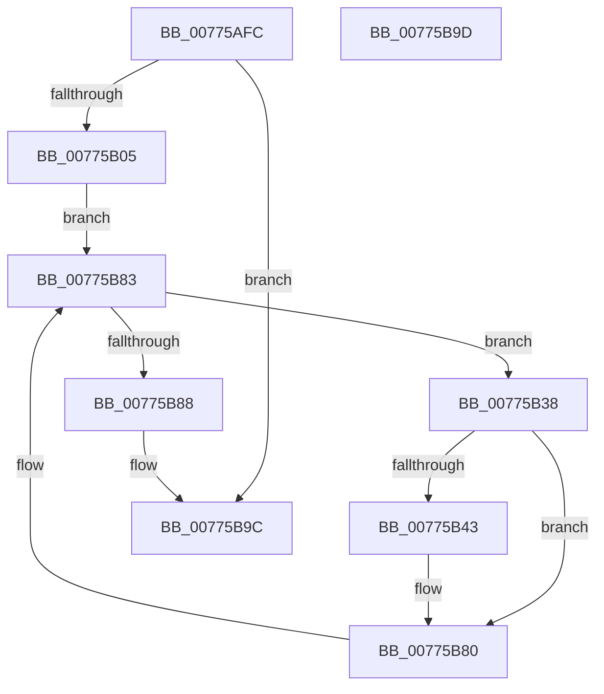

# TtmiDevicesRundown

- RVA: `0x00775AFC`–`0x00775B9E` (길이 `162` bytes)
- VA: `0x0000000140775AFC`
- 실행 섹션: `PAGE`
- PDB 이름 있음: `예`; PDB Function 태그: `아니요`
- unwind 정보 RVA: `0x000CDB60`
- 디코드: `46`개 명령, `162/162` bytes 표시
- 미해석 바이트: `0` (있으면 어셈블리에 `.byte`로 보존)

> 이 문서는 커널 이미지의 기계어와 PDB 기호를 분석해 생성했습니다. 4번과 5번은 함수 원형과 자료형을 바이너리 사용 방식에서 추정한 C 해석이며 원본 소스 복구 결과는 아닙니다.

## 1. Dependencies

- 직접 호출 지점: **1**; 고유 호출 대상: **1**
- 직접 호출자로 확인된 함수: **1**
- RIP 상대 이미지 참조: **0**

### Outgoing calls
- `0x00775B7B` → [TtmiLogDeviceRundown](TtmiLogDeviceRundown_function_00779D00.md) (function, `0x00779D00`)

### Direct callers
- [TtmiSessionsRundown](TtmiSessionsRundown_function_007771BC.md) at `0x0077724E`

### Static image references
- 디코드된 RIP-relative 메모리 참조가 없습니다.

## 2. Other-region calls and transfers

- 다른 실행 섹션으로 향하는 call: **0**
- 별도 외부 분기/꼬리 이동을 확인하지 못했습니다.

## 3. Assembly (complete function range)

```asm
00775AFC  48 85 C9                        test rcx, rcx
00775AFF  0F 84 97 00 00 00               je 0x140775b9c
00775B05  48 89 5C 24 08                  mov qword ptr [rsp + 8], rbx
00775B0A  48 89 74 24 10                  mov qword ptr [rsp + 0x10], rsi
00775B0F  48 89 7C 24 18                  mov qword ptr [rsp + 0x18], rdi
00775B14  55                              push rbp
00775B15  48 8B EC                        mov rbp, rsp
00775B18  48 83 EC 50                     sub rsp, 0x50
00775B1C  8B 31                           mov esi, dword ptr [rcx]
00775B1E  48 8D 79 60                     lea rdi, [rcx + 0x60]
00775B22  48 8B 1F                        mov rbx, qword ptr [rdi]
00775B25  0F 57 C0                        xorps xmm0, xmm0
00775B28  33 C0                           xor eax, eax
00775B2A  0F 11 45 D0                     movups xmmword ptr [rbp - 0x30], xmm0
00775B2E  48 89 45 F0                     mov qword ptr [rbp - 0x10], rax
00775B32  0F 11 45 E0                     movups xmmword ptr [rbp - 0x20], xmm0
00775B36  EB 4B                           jmp 0x140775b83
00775B38  8B 8B 58 02 00 00               mov ecx, dword ptr [rbx + 0x258]
00775B3E  F6 C1 08                        test cl, 8
00775B41  75 3D                           jne 0x140775b80
00775B43  8B 83 54 02 00 00               mov eax, dword ptr [rbx + 0x254]
00775B49  89 45 D4                        mov dword ptr [rbp - 0x2c], eax
00775B4C  8B 43 10                        mov eax, dword ptr [rbx + 0x10]
00775B4F  89 45 D8                        mov dword ptr [rbp - 0x28], eax
00775B52  48 8B 43 18                     mov rax, qword ptr [rbx + 0x18]
00775B56  48 89 45 E8                     mov qword ptr [rbp - 0x18], rax
00775B5A  8B 43 20                        mov eax, dword ptr [rbx + 0x20]
00775B5D  89 45 DC                        mov dword ptr [rbp - 0x24], eax
00775B60  8B 43 48                        mov eax, dword ptr [rbx + 0x48]
00775B63  89 45 E0                        mov dword ptr [rbp - 0x20], eax
00775B66  48 8B 83 60 02 00 00            mov rax, qword ptr [rbx + 0x260]
00775B6D  89 4D E4                        mov dword ptr [rbp - 0x1c], ecx
00775B70  48 8D 4D D0                     lea rcx, [rbp - 0x30]
00775B74  48 89 45 F0                     mov qword ptr [rbp - 0x10], rax
00775B78  89 75 D0                        mov dword ptr [rbp - 0x30], esi
00775B7B  E8 80 41 00 00                  call 0x140779d00
00775B80  48 8B 1B                        mov rbx, qword ptr [rbx]
00775B83  48 3B DF                        cmp rbx, rdi
00775B86  75 B0                           jne 0x140775b38
00775B88  48 8B 5C 24 60                  mov rbx, qword ptr [rsp + 0x60]
00775B8D  48 8B 74 24 68                  mov rsi, qword ptr [rsp + 0x68]
00775B92  48 8B 7C 24 70                  mov rdi, qword ptr [rsp + 0x70]
00775B97  48 83 C4 50                     add rsp, 0x50
00775B9B  5D                              pop rbp
00775B9C  C3                              ret
00775B9D  CC                              int3
```

## 4. C-style interpretation (structured pseudocode)

```c
__int64 __fastcall TtmiDevicesRundown(__int64 a1)
{
    __int64 result;
    __int64 v_rsp;
    unsigned __int64 v_stack_m18;
    unsigned __int64 v_stack_m20;
    unsigned int v_stack_m24;
    unsigned __int64 v_stack_m28;
    unsigned int v_stack_m2C;
    unsigned int v_stack_m30;
    unsigned int v_stack_m34;
    unsigned __int64 v_stack_m38;
    unsigned __int64 v_stack_p10;
    unsigned __int64 v_stack_p18;
    unsigned __int64 v_stack_p8;

    if (a1 == 0) goto loc_00775B9C;
    v_stack_p8 = v_rbx;
    v_stack_p10 = v_rsi;
    v_stack_p18 = v_rdi;
    v_rsp = (v_rsp) - (80);
    result = 0;
    v_stack_m38 = v_xmm0;
    v_stack_m18 = 0;
    v_stack_m28 = v_xmm0;
    goto loc_00775B83;
loc_00775B38:
    if ((((unsigned __int8)((unsigned int)(*(unsigned int *)(*(unsigned __int64 *)(a1 + 96) + 600)))) & (8)) == 0) {
        result = *(unsigned int *)(*(unsigned __int64 *)(a1 + 96) + 596);
        v_stack_m34 = (unsigned int)(result);
        result = *(unsigned int *)(*(unsigned __int64 *)(a1 + 96) + 16);
        v_stack_m30 = (unsigned int)(result);
        result = *(unsigned __int64 *)(*(unsigned __int64 *)(a1 + 96) + 24);
        v_stack_m20 = result;
        result = *(unsigned int *)(*(unsigned __int64 *)(a1 + 96) + 32);
        v_stack_m2C = (unsigned int)(result);
        result = *(unsigned int *)(*(unsigned __int64 *)(a1 + 96) + 72);
        v_stack_m28 = (unsigned int)(result);
        result = *(unsigned __int64 *)(*(unsigned __int64 *)(a1 + 96) + 608);
        v_stack_m24 = (unsigned int)((unsigned int)(*(unsigned int *)(*(unsigned __int64 *)(a1 + 96) + 600)));
        a1 = v_stack_m38;
        v_stack_m18 = result;
        v_stack_m38 = (unsigned int)((unsigned int)(*(unsigned int *)(a1)));
        result = TtmiLogDeviceRundown(a1, a2, a3, a4);
    }
loc_00775B83:
    if ((*(unsigned __int64 *)(*(unsigned __int64 *)(a1 + 96))) != (a1 + 96)) goto loc_00775B38;
    v_rsp = (v_rsp) + (80);
loc_00775B9C:
    return result;
}
```

## 5. (Beta) C Style

```c
int64_t TtmiDevicesRundown(int64_t Arg1)
{
    int64_t result;
    int64_t local_rsp;
    uint64_t v_stack_m18;
    uint64_t v_stack_m20;
    uint32_t v_stack_m24;
    uint64_t v_stack_m28;
    uint32_t v_stack_m2C;
    uint32_t v_stack_m30;
    uint32_t v_stack_m34;
    uint64_t v_stack_m38;
    uint64_t v_stack_p10;
    uint64_t v_stack_p18;
    uint64_t v_stack_p8;

    if (Arg1 == 0) goto loc_00775B9C;
    v_stack_p8 = local_rbx;
    v_stack_p10 = local_rsi;
    v_stack_p18 = local_rdi;
    local_rsp = (local_rsp) - (80);
    result = 0;
    v_stack_m38 = v_xmm0;
    v_stack_m18 = 0;
    v_stack_m28 = v_xmm0;
    goto loc_00775B83;
loc_00775B38:
    if ((((uint8_t)((uint32_t)(*(uint32_t *)(*(uint64_t *)(Arg1 + 0x60) + 0x258)))) & (8)) == 0) {
        result = *(uint32_t *)(*(uint64_t *)(Arg1 + 0x60) + 0x254);
        v_stack_m34 = (uint32_t)(result);
        result = *(uint32_t *)(*(uint64_t *)(Arg1 + 0x60) + 0x10);
        v_stack_m30 = (uint32_t)(result);
        result = *(uint64_t *)(*(uint64_t *)(Arg1 + 0x60) + 0x18);
        v_stack_m20 = result;
        result = *(uint32_t *)(*(uint64_t *)(Arg1 + 0x60) + 0x20);
        v_stack_m2C = (uint32_t)(result);
        result = *(uint32_t *)(*(uint64_t *)(Arg1 + 0x60) + 0x48);
        v_stack_m28 = (uint32_t)(result);
        result = *(uint64_t *)(*(uint64_t *)(Arg1 + 0x60) + 0x260);
        v_stack_m24 = (uint32_t)((uint32_t)(*(uint32_t *)(*(uint64_t *)(Arg1 + 0x60) + 0x258)));
        Arg1 = v_stack_m38;
        v_stack_m18 = result;
        v_stack_m38 = (uint32_t)((uint32_t)(*(uint32_t *)(Arg1)));
        result = TtmiLogDeviceRundown(Arg1, a2, a3, a4);
    }
loc_00775B83:
    if ((*(uint64_t *)(*(uint64_t *)(Arg1 + 0x60))) != (Arg1 + 96)) goto loc_00775B38;
    local_rsp = (local_rsp) + (80);
loc_00775B9C:
    return result;
}
```

## 6. Execution-region graph

[열기: 2D/3D 그래프와 함수 탐색 컨트롤 패널](../../../control-panel.html?section=page&rva=0x00775AFC&view=graph)

- 2D 그래프는 위에서 아래로 흐르고, 3D 그래프는 빈 공간을 드래그해 회전합니다. Shift+드래그는 이동, 휠은 확대·축소, 함수 노드 선택은 대상 보고서 이동입니다.

### Static fallback


