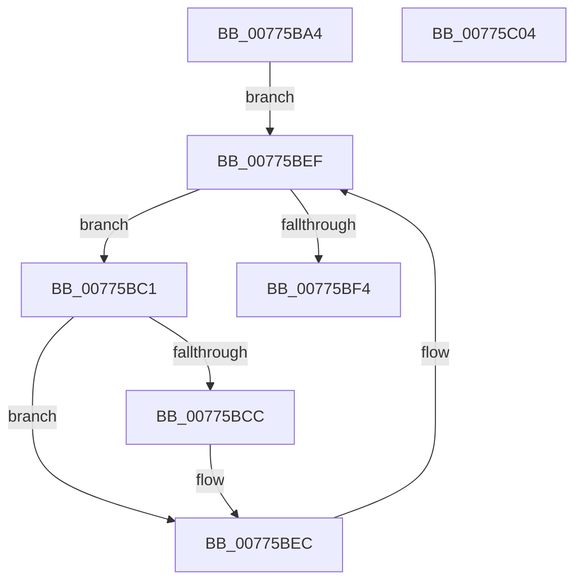

# TtmiEvacuateDevices

- RVA: `0x00775BA4`–`0x00775C05` (길이 `97` bytes)
- VA: `0x0000000140775BA4`
- 실행 섹션: `PAGE`
- PDB 이름 있음: `예`; PDB Function 태그: `아니요`
- unwind 정보 RVA: `0x00060BC4`
- 디코드: `28`개 명령, `97/97` bytes 표시
- 미해석 바이트: `0` (있으면 어셈블리에 `.byte`로 보존)

> 이 문서는 커널 이미지의 기계어와 PDB 기호를 분석해 생성했습니다. 4번과 5번은 함수 원형과 자료형을 바이너리 사용 방식에서 추정한 C 해석이며 원본 소스 복구 결과는 아닙니다.

## 1. Dependencies

- 직접 호출 지점: **1**; 고유 호출 대상: **1**
- 직접 호출자로 확인된 함수: **2**
- RIP 상대 이미지 참조: **0**

### Outgoing calls
- `0x00775BD7` → [TtmiLogDeviceFromTerminalRemoved](TtmiLogDeviceFromTerminalRemoved_function_00779A60.md) (function, `0x00779A60`)

### Direct callers
- [TtmpDispatchEvacuateDevices](TtmpDispatchEvacuateDevices_function_00778948.md) at `0x0077899D`
- [TtmiSessionTerminalListWorker](TtmiSessionTerminalListWorker_function_0077CE14.md) at `0x0077CED6`

### Static image references
- 디코드된 RIP-relative 메모리 참조가 없습니다.

## 2. Other-region calls and transfers

- 다른 실행 섹션으로 향하는 call: **0**
- 별도 외부 분기/꼬리 이동을 확인하지 못했습니다.

## 3. Assembly (complete function range)

```asm
00775BA4  48 89 5C 24 08                  mov qword ptr [rsp + 8], rbx
00775BA9  48 89 74 24 10                  mov qword ptr [rsp + 0x10], rsi
00775BAE  57                              push rdi
00775BAF  48 83 EC 20                     sub rsp, 0x20
00775BB3  48 8D 79 60                     lea rdi, [rcx + 0x60]
00775BB7  48 8B F2                        mov rsi, rdx
00775BBA  48 8B 1F                        mov rbx, qword ptr [rdi]
00775BBD  32 C0                           xor al, al
00775BBF  EB 2E                           jmp 0x140775bef
00775BC1  8B 4E 1C                        mov ecx, dword ptr [rsi + 0x1c]
00775BC4  39 8B 54 02 00 00               cmp dword ptr [rbx + 0x254], ecx
00775BCA  75 20                           jne 0x140775bec
00775BCC  44 8B 4B 20                     mov r9d, dword ptr [rbx + 0x20]
00775BD0  4C 8B 43 18                     mov r8, qword ptr [rbx + 0x18]
00775BD4  8B 53 10                        mov edx, dword ptr [rbx + 0x10]
00775BD7  E8 84 3E 00 00                  call 0x140779a60
00775BDC  83 8B 54 02 00 00 FF            or dword ptr [rbx + 0x254], 0xffffffff
00775BE3  B0 01                           mov al, 1
00775BE5  83 8B 58 02 00 00 10            or dword ptr [rbx + 0x258], 0x10
00775BEC  48 8B 1B                        mov rbx, qword ptr [rbx]
00775BEF  48 3B DF                        cmp rbx, rdi
00775BF2  75 CD                           jne 0x140775bc1
00775BF4  48 8B 5C 24 30                  mov rbx, qword ptr [rsp + 0x30]
00775BF9  48 8B 74 24 38                  mov rsi, qword ptr [rsp + 0x38]
00775BFE  48 83 C4 20                     add rsp, 0x20
00775C02  5F                              pop rdi
00775C03  C3                              ret
00775C04  CC                              int3
```

## 4. C-style interpretation (structured pseudocode)

```c
__int64 __fastcall TtmiEvacuateDevices(__int64 a1, __int64 a2)
{
    __int64 result;
    __int64 v_rsp;
    unsigned __int64 v_stack_p10;
    unsigned __int64 v_stack_p8;

    v_stack_p8 = v_rbx;
    v_stack_p10 = v_rsi;
    v_rsp = (v_rsp) - (32);
    result = 0;
    goto loc_00775BEF;
loc_00775BC1:
    if ((*(unsigned int *)(*(unsigned __int64 *)(a1 + 96) + 596)) == ((unsigned int)((unsigned int)(*(unsigned int *)(a2 + 28))))) {
        a4 = *(unsigned int *)(*(unsigned __int64 *)(a1 + 96) + 32);
        a3 = *(unsigned __int64 *)(*(unsigned __int64 *)(a1 + 96) + 24);
        a2 = *(unsigned int *)(*(unsigned __int64 *)(a1 + 96) + 16);
        result = TtmiLogDeviceFromTerminalRemoved((unsigned int)(*(unsigned int *)(a2 + 28)), a2, a3, a4);
        result = 1;
    }
loc_00775BEF:
    if ((*(unsigned __int64 *)(*(unsigned __int64 *)(a1 + 96))) != (a1 + 96)) goto loc_00775BC1;
    v_rsp = (v_rsp) + (32);
    return result;
}
```

## 5. (Beta) C Style

```c
int64_t TtmiEvacuateDevices(void *Arg1, void *Arg2)
{
    uint8_t *arg1 = (uint8_t *)Arg1;
    uint8_t *arg2 = (uint8_t *)Arg2;

    int64_t result;
    int64_t local_rsp;
    uint64_t v_stack_p10;
    uint64_t v_stack_p8;

    v_stack_p8 = local_rbx;
    v_stack_p10 = local_rsi;
    local_rsp = (local_rsp) - (32);
    result = 0;
    goto loc_00775BEF;
loc_00775BC1:
    if ((*(uint32_t *)(*(uint64_t *)(arg1 + 0x60) + 0x254)) == ((uint32_t)((uint32_t)(*(uint32_t *)(arg2 + 0x1C))))) {
        a4 = *(uint32_t *)(*(uint64_t *)(arg1 + 0x60) + 0x20);
        a3 = *(uint64_t *)(*(uint64_t *)(arg1 + 0x60) + 0x18);
        Arg2 = *(uint32_t *)(*(uint64_t *)(arg1 + 0x60) + 0x10);
        result = TtmiLogDeviceFromTerminalRemoved((uint32_t)(*(uint32_t *)(arg2 + 0x1C)), Arg2, a3, a4);
        result = 1;
    }
loc_00775BEF:
    if ((*(uint64_t *)(*(uint64_t *)(arg1 + 0x60))) != (Arg1 + 96)) goto loc_00775BC1;
    local_rsp = (local_rsp) + (32);
    return result;
}
```

### 관측된 메모리 오프셋

구조체 형식이 확인되지 않은 접근은 인자 기준의 오프셋으로만 기록했습니다.

| 기준 인자 | 오프셋 표현 | 폭 (bit) | 접근 |
|---|---:|---:|---|
| `Arg1` | `+ 0x0` | `64` | `R` |
| `Arg1` | `+ 0x60` | `64` | `R` |
| `Arg2` | `+ 0x1C` | `32` | `R` |

## 6. Execution-region graph

[열기: 2D/3D 그래프와 함수 탐색 컨트롤 패널](../../../control-panel.html?section=page&rva=0x00775BA4&view=graph)

- 2D 그래프는 위에서 아래로 흐르고, 3D 그래프는 빈 공간을 드래그해 회전합니다. Shift+드래그는 이동, 휠은 확대·축소, 함수 노드 선택은 대상 보고서 이동입니다.

### Static fallback


