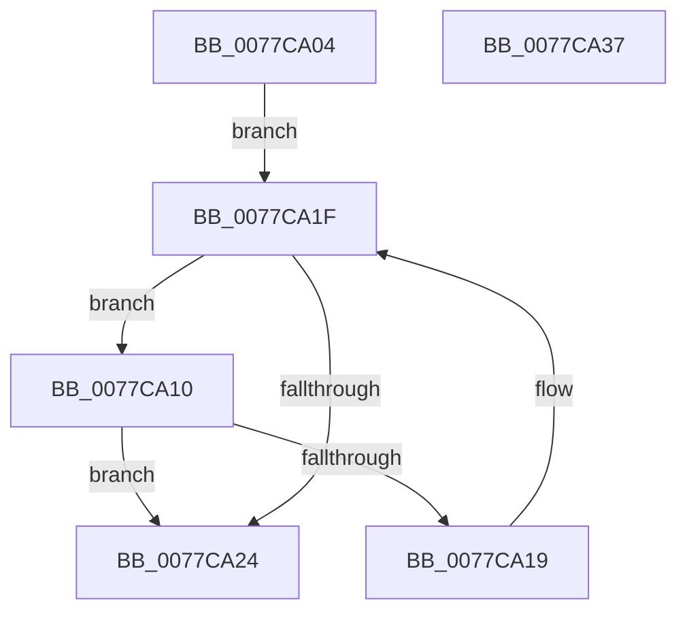

# TtmiGetTerminalById

- RVA: `0x0077CA04`–`0x0077CA38` (길이 `52` bytes)
- VA: `0x000000014077CA04`
- 실행 섹션: `PAGE`
- PDB 이름 있음: `예`; PDB Function 태그: `아니요`
- unwind 정보 RVA: `0x000DB714`
- 디코드: `19`개 명령, `52/52` bytes 표시
- 미해석 바이트: `0` (있으면 어셈블리에 `.byte`로 보존)

> 이 문서는 커널 이미지의 기계어와 PDB 기호를 분석해 생성했습니다. 4번과 5번은 함수 원형과 자료형을 바이너리 사용 방식에서 추정한 C 해석이며 원본 소스 복구 결과는 아닙니다.

## 1. Dependencies

- 직접 호출 지점: **0**; 고유 호출 대상: **0**
- 직접 호출자로 확인된 함수: **4**
- RIP 상대 이미지 참조: **0**

### Outgoing calls
- 직접 디코드된 call 명령이 없습니다.

### Direct callers
- [TtmNotifyDeviceInput](TtmNotifyDeviceInput_function_007758B0.md) at `0x007759E7`
- [TtmpPushTerminalState](TtmpPushTerminalState_function_007768F0.md) at `0x00776927`
- [TtmiSetDisplayPowerRequest](TtmiSetDisplayPowerRequest_function_0077727C.md) at `0x007772EF`
- [TtmiSetDisplayPowerRequest](TtmiSetDisplayPowerRequest_function_0077727C.md) at `0x007773F7`
- [TtmpSetDisplayRequestEnded](TtmpSetDisplayRequestEnded_function_00778124.md) at `0x00778196`

### Static image references
- 디코드된 RIP-relative 메모리 참조가 없습니다.

## 2. Other-region calls and transfers

- 다른 실행 섹션으로 향하는 call: **0**
- 별도 외부 분기/꼬리 이동을 확인하지 못했습니다.

## 3. Assembly (complete function range)

```asm
0077CA04  45 33 C9                        xor r9d, r9d
0077CA07  48 83 C2 28                     add rdx, 0x28
0077CA0B  48 8B 02                        mov rax, qword ptr [rdx]
0077CA0E  EB 0F                           jmp 0x14077ca1f
0077CA10  4C 8B C8                        mov r9, rax
0077CA13  44 39 40 1C                     cmp dword ptr [rax + 0x1c], r8d
0077CA17  74 0B                           je 0x14077ca24
0077CA19  48 8B 00                        mov rax, qword ptr [rax]
0077CA1C  45 33 C9                        xor r9d, r9d
0077CA1F  48 3B C2                        cmp rax, rdx
0077CA22  75 EC                           jne 0x14077ca10
0077CA24  49 8B C1                        mov rax, r9
0077CA27  4C 89 09                        mov qword ptr [rcx], r9
0077CA2A  48 F7 D8                        neg rax
0077CA2D  1B C0                           sbb eax, eax
0077CA2F  F7 D0                           not eax
0077CA31  25 25 02 00 C0                  and eax, 0xc0000225
0077CA36  C3                              ret
0077CA37  CC                              int3
```

## 4. C-style interpretation (structured pseudocode)

```c
__int64 __fastcall TtmiGetTerminalById(__int64 a1, __int64 a2, int a3, int a4)
{
    __int64 result;

    a4 = 0;
    a2 = (a2) + (40);
    goto loc_0077CA1F;
loc_0077CA10:
    if ((*(unsigned int *)(*(unsigned __int64 *)(a2) + 28)) == a3) goto loc_0077CA24;
    a4 = 0;
loc_0077CA1F:
    if ((*(unsigned __int64 *)(*(unsigned __int64 *)(a2))) != a2) goto loc_0077CA10;
loc_0077CA24:
    *(unsigned __int64 *)(a1) = 0;
    result = -(0);
    result = (unsigned int)(~(result));
    result = (unsigned int)((result) & (0xC0000225ULL));
    return result;
}
```

## 5. (Beta) C Style

```c
int64_t TtmiGetTerminalById(void *Arg1, void *Arg2, int32_t Arg3, int32_t Arg4)
{
    uint8_t *arg1 = (uint8_t *)Arg1;
    uint8_t *arg2 = (uint8_t *)Arg2;

    int64_t result;

    Arg4 = 0;
    Arg2 = (Arg2) + (40);
    goto loc_0077CA1F;
loc_0077CA10:
    if ((*(uint32_t *)(*(uint64_t *)(arg2) + 0x1C)) == Arg3) goto loc_0077CA24;
    Arg4 = 0;
loc_0077CA1F:
    if ((*(uint64_t *)(*(uint64_t *)(arg2))) != Arg2) goto loc_0077CA10;
loc_0077CA24:
    *(uint64_t *)(arg1) = 0;
    result = -(0);
    result = (uint32_t)(~(result));
    result = (uint32_t)((result) & (0xC0000225ULL));
    return result;
}
```

### 관측된 메모리 오프셋

구조체 형식이 확인되지 않은 접근은 인자 기준의 오프셋으로만 기록했습니다.

| 기준 인자 | 오프셋 표현 | 폭 (bit) | 접근 |
|---|---:|---:|---|
| `Arg1` | `+ 0x0` | `64` | `W` |
| `Arg2` | `+ 0x0` | `64` | `R` |

## 6. Execution-region graph

[열기: 2D/3D 그래프와 함수 탐색 컨트롤 패널](../../../control-panel.html?section=page&rva=0x0077CA04&view=graph)

- 2D 그래프는 위에서 아래로 흐르고, 3D 그래프는 빈 공간을 드래그해 회전합니다. Shift+드래그는 이동, 휠은 확대·축소, 함수 노드 선택은 대상 보고서 이동입니다.

### Static fallback


