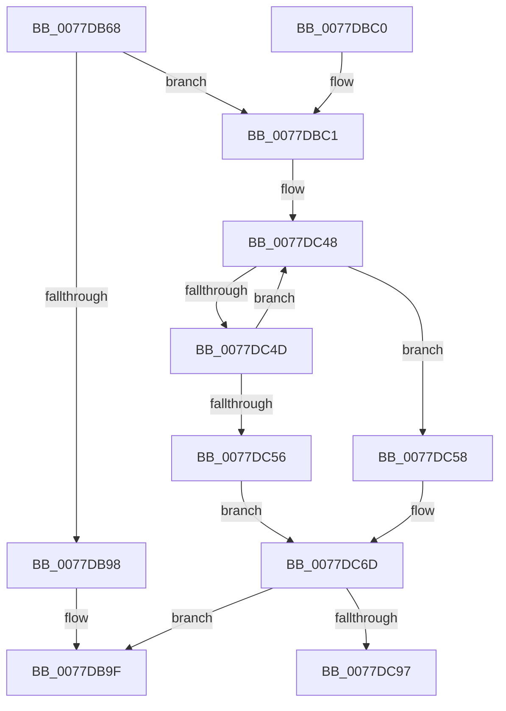

# TtmiInitQueues

- RVA: `0x0077DB68`–`0x0077DCB0` (길이 `328` bytes)
- VA: `0x000000014077DB68`
- 실행 섹션: `PAGE`
- PDB 이름 있음: `예`; PDB Function 태그: `아니요`
- unwind 정보 RVA: `0x000CDEC0`
- 디코드: `80`개 명령, `328/328` bytes 표시
- 미해석 바이트: `0` (있으면 어셈블리에 `.byte`로 보존)

> 이 문서는 커널 이미지의 기계어와 PDB 기호를 분석해 생성했습니다. 4번과 5번은 함수 원형과 자료형을 바이너리 사용 방식에서 추정한 C 해석이며 원본 소스 복구 결과는 아닙니다.

## 1. Dependencies

- 직접 호출 지점: **5**; 고유 호출 대상: **5**
- 직접 호출자로 확인된 함수: **1**
- RIP 상대 이미지 참조: **8**

### Outgoing calls
- `0x0077DB8D` → [TtmIsEnabled](../91/TtmIsEnabled_function_009143D8.md) (function, `0x009143D8`)
- `0x0077DBA6` → [_security_check_cookie](../../text/6A/_security_check_cookie_function_006AC640.md) (function, `0x006AC640`)
- `0x0077DBCF` → [memset](../../text/6C/memset_function_006C6C40.md) (function, `0x006C6C40`)
- `0x0077DC8A` → [ObCreateObjectTypeEx](../AB/ObCreateObjectTypeEx_function_00AB46D0.md) (function, `0x00AB46D0`)
- `0x0077DCAA` → [KeBugCheckEx](../../text/4F/KeBugCheckEx_function_004FD660.md) (function, `0x004FD660`)

### Direct callers
- [TtmInit](TtmInit_function_00776D80.md) at `0x00776D84`

### Static image references
- `0x0077DB7F` → RVA `0x00E0A740` (`.data`; read)
- `0x0077DB98` → RVA `0x00FD9E98` (`PAGEDATA`; write)
- `0x0077DBD7` → RVA `0x00B046D0` (` ?? ::NNGAKEGL::`string'`; read)
- `0x0077DBDE` → RVA `0x0002B5E8` (`.rdata`; read)
- `0x0077DC06` → RVA `0x0077E070` (`TtmpOpenQueueHandle`; read)
- `0x0077DC18` → RVA `0x0077DF80` (`TtmpCloseQueueHandle`; read)
- `0x0077DC23` → RVA `0x0077DFC0` (`TtmpDeleteQueue`; read)
- `0x0077DC6D` → RVA `0x00FD9E98` (`PAGEDATA`; read)

## 2. Other-region calls and transfers

- 다른 실행 섹션으로 향하는 call: **3**
  - `0x0077DBA6` → [_security_check_cookie](../../text/6A/_security_check_cookie_function_006AC640.md) (`PAGE` → `.text`)
  - `0x0077DBCF` → [memset](../../text/6C/memset_function_006C6C40.md) (`PAGE` → `.text`)
  - `0x0077DCAA` → [KeBugCheckEx](../../text/4F/KeBugCheckEx_function_004FD660.md) (`PAGE` → `.text`)
- 별도 외부 분기/꼬리 이동을 확인하지 못했습니다.

## 3. Assembly (complete function range)

```asm
0077DB68  48 89 5C 24 08                  mov qword ptr [rsp + 8], rbx
0077DB6D  48 89 7C 24 10                  mov qword ptr [rsp + 0x10], rdi
0077DB72  55                              push rbp
0077DB73  48 8D 6C 24 A9                  lea rbp, [rsp - 0x57]
0077DB78  48 81 EC D0 00 00 00            sub rsp, 0xd0
0077DB7F  48 8B 05 BA CB 68 00            mov rax, qword ptr [rip + 0x68cbba]
0077DB86  48 33 C4                        xor rax, rsp
0077DB89  48 89 45 47                     mov qword ptr [rbp + 0x47], rax
0077DB8D  E8 46 68 19 00                  call 0x1409143d8
0077DB92  33 FF                           xor edi, edi
0077DB94  84 C0                           test al, al
0077DB96  75 29                           jne 0x14077dbc1
0077DB98  48 89 3D F9 C2 85 00            mov qword ptr [rip + 0x85c2f9], rdi
0077DB9F  48 8B 4D 47                     mov rcx, qword ptr [rbp + 0x47]
0077DBA3  48 33 CC                        xor rcx, rsp
0077DBA6  E8 95 EA F2 FF                  call 0x1406ac640
0077DBAB  4C 8D 9C 24 D0 00 00 00         lea r11, [rsp + 0xd0]
0077DBB3  49 8B 5B 10                     mov rbx, qword ptr [r11 + 0x10]
0077DBB7  49 8B 7B 18                     mov rdi, qword ptr [r11 + 0x18]
0077DBBB  49 8B E3                        mov rsp, r11
0077DBBE  5D                              pop rbp
0077DBBF  C3                              ret
0077DBC0  CC                              int3
0077DBC1  BB 78 00 00 00                  mov ebx, 0x78
0077DBC6  48 8D 4D C7                     lea rcx, [rbp - 0x39]
0077DBCA  44 8B C3                        mov r8d, ebx
0077DBCD  33 D2                           xor edx, edx
0077DBCF  E8 6C 90 F4 FF                  call 0x1406c6c40
0077DBD4  8A 45 C9                        mov al, byte ptr [rbp - 0x37]
0077DBD7  4C 8D 05 F2 6A 38 00            lea r8, [rip + 0x386af2]
0077DBDE  0F 10 05 03 DA 8A FF            movups xmm0, xmmword ptr [rip - 0x7525fd]
0077DBE5  24 F3                           and al, 0xf3
0077DBE7  66 89 5D C7                     mov word ptr [rbp - 0x39], bx
0077DBEB  BB 02 00 00 00                  mov ebx, 2
0077DBF0  C7 45 CF 90 01 00 00            mov dword ptr [rbp - 0x31], 0x190
0077DBF7  0A C3                           or al, bl
0077DBF9  C7 45 E3 03 00 1F 00            mov dword ptr [rbp - 0x1d], 0x1f0003
0077DC00  88 45 C9                        mov byte ptr [rbp - 0x37], al
0077DC03  49 8B C8                        mov rcx, r8
0077DC06  48 8D 05 63 04 00 00            lea rax, [rip + 0x463]
0077DC0D  C7 45 EB 00 02 00 00            mov dword ptr [rbp - 0x15], 0x200
0077DC14  48 89 45 FF                     mov qword ptr [rbp - 1], rax
0077DC18  48 8D 05 61 03 00 00            lea rax, [rip + 0x361]
0077DC1F  48 89 45 07                     mov qword ptr [rbp + 7], rax
0077DC23  48 8D 05 96 03 00 00            lea rax, [rip + 0x396]
0077DC2A  48 89 45 0F                     mov qword ptr [rbp + 0xf], rax
0077DC2E  B8 FF 7F 00 00                  mov eax, 0x7fff
0077DC33  F3 0F 7F 45 D3                  movdqu xmmword ptr [rbp - 0x2d], xmm0
0077DC38  C7 45 F3 B0 00 00 00            mov dword ptr [rbp - 0xd], 0xb0
0077DC3F  8B D0                           mov edx, eax
0077DC41  0F 57 C0                        xorps xmm0, xmm0
0077DC44  0F 11 45 B7                     movups xmmword ptr [rbp - 0x49], xmm0
0077DC48  66 39 39                        cmp word ptr [rcx], di
0077DC4B  74 0B                           je 0x14077dc58
0077DC4D  48 03 CB                        add rcx, rbx
0077DC50  48 83 EA 01                     sub rdx, 1
0077DC54  75 F2                           jne 0x14077dc48
0077DC56  EB 15                           jmp 0x14077dc6d
0077DC58  48 2B C2                        sub rax, rdx
0077DC5B  4C 89 45 BF                     mov qword ptr [rbp - 0x41], r8
0077DC5F  66 03 C0                        add ax, ax
0077DC62  66 89 45 B7                     mov word ptr [rbp - 0x49], ax
0077DC66  66 03 C3                        add ax, bx
0077DC69  66 89 45 B9                     mov word ptr [rbp - 0x47], ax
0077DC6D  48 8D 05 24 C2 85 00            lea rax, [rip + 0x85c224]
0077DC74  41 B9 80 00 00 00               mov r9d, 0x80
0077DC7A  45 33 C0                        xor r8d, r8d
0077DC7D  48 89 44 24 20                  mov qword ptr [rsp + 0x20], rax
0077DC82  48 8D 55 C7                     lea rdx, [rbp - 0x39]
0077DC86  48 8D 4D B7                     lea rcx, [rbp - 0x49]
0077DC8A  E8 41 6A 33 00                  call 0x140ab46d0
0077DC8F  85 C0                           test eax, eax
0077DC91  0F 89 08 FF FF FF               jns 0x14077db9f
0077DC97  4C 63 C0                        movsxd r8, eax
0077DC9A  45 33 C9                        xor r9d, r9d
0077DC9D  48 8B D3                        mov rdx, rbx
0077DCA0  48 89 7C 24 20                  mov qword ptr [rsp + 0x20], rdi
0077DCA5  B9 9B 01 00 00                  mov ecx, 0x19b
0077DCAA  E8 B1 F9 D7 FF                  call 0x1404fd660
0077DCAF  CC                              int3
```

## 4. C-style interpretation (structured pseudocode)

```c
__int64 __fastcall TtmiInitQueues(__int64 a1, int a2)
{
    __int64 result;
    __int64 v_rdi;
    __int64 v_rsp;
    unsigned __int64 v_stack_m18;
    unsigned __int64 v_stack_m50;
    unsigned __int64 v_stack_m58;
    unsigned __int64 v_stack_m5F;
    unsigned __int64 v_stack_m60;
    unsigned int v_stack_m6C;
    unsigned int v_stack_m74;
    unsigned int v_stack_m7C;
    unsigned __int64 v_stack_m8;
    unsigned __int64 v_stack_m8C;
    unsigned int v_stack_m90;
    unsigned __int8 v_stack_m96;
    unsigned __int64 v_stack_m98;
    unsigned __int64 v_stack_mA0;
    unsigned __int16 v_stack_mA6;
    unsigned __int64 v_stack_mA8;
    unsigned __int64 v_stack_mB0;
    unsigned __int64 v_stack_p10;
    unsigned __int64 v_stack_p8;

    v_stack_p8 = v_rbx;
    v_stack_p10 = v_rdi;
    v_rsp = (v_rsp) - (208);
    result = (*(unsigned __int64 *)(v_rip + 6867898)) ^ (v_rsp);
    v_stack_m18 = result;
    result = TtmIsEnabled(a1, a2, a3, a4);
    v_rdi = 0;
    if ((unsigned __int8)(result) != 0) goto loc_0077DBC1;
    *(unsigned __int64 *)(v_rip + 8766201) = 0;
loc_0077DB9F:
    a1 = (v_stack_m18) ^ (v_rsp);
    result = _security_check_cookie(a1, a2, a3, a4);
    return result;
loc_0077DBC1:
    a2 = 0;
    result = memset(v_stack_m98, a2, 120, a4);
    result = (unsigned __int8)((v_stack_m96) & (243));
    v_stack_m98 = 120;
    v_stack_m90 = 400;
    result = (unsigned __int8)((result) | (2));
    v_stack_m7C = 0x1F0003ULL;
    v_stack_m96 = (unsigned __int8)(result);
    v_stack_m74 = 512;
    v_stack_m60 = v_rip + 1123;
    v_stack_m58 = v_rip + 865;
    v_stack_m50 = v_rip + 918;
    v_stack_m8C = v_xmm0;
    v_stack_m6C = 176;
    v_stack_mA8 = v_xmm0;
loc_0077DC48:
    if ((*(unsigned __int16 *)(v_rip + 3697394)) == ((unsigned __int16)(*(unsigned __int64 *)(v_stack_m8 + 24)))) goto loc_0077DC58;
    a1 = (v_rip + 3697394) + (2);
    a2 = ((unsigned int)((unsigned int)((unsigned int)(0x7FFFULL)))) - (1);
    if (condition_is_not_equal) goto loc_0077DC48;
    goto loc_0077DC6D;
loc_0077DC58:
    result = ((unsigned int)(0x7FFFULL)) - (a2);
    v_stack_mA0 = v_rip + 3697394;
    result = (unsigned __int16)((result) + ((unsigned __int16)(result)));
    v_stack_mA8 = (unsigned __int16)(result);
    result = (unsigned __int16)((result) + (2));
    v_stack_mA6 = (unsigned __int16)(result);
loc_0077DC6D:
    a3 = 0;
    v_stack_mB0 = v_rip + 8765988;
    result = ObCreateObjectTypeEx(v_stack_mA8, v_stack_m98, a3, 128);
    if (!sign_flag) goto loc_0077DB9F;
    a4 = 0;
    v_stack_mB0 = *(unsigned __int64 *)(v_stack_m8 + 24);
    result = KeBugCheckEx(411, 2, (int)((unsigned int)(result)), a4);
    return result;
}
```

## 5. (Beta) C Style

```c
int64_t TtmiInitQueues(int64_t Arg1, int32_t Arg2)
{
    int64_t result;
    int64_t local_rdi;
    int64_t local_rsp;
    uint64_t v_stack_m18;
    uint64_t v_stack_m50;
    uint64_t v_stack_m58;
    uint64_t v_stack_m5F;
    uint64_t v_stack_m60;
    uint32_t v_stack_m6C;
    uint32_t v_stack_m74;
    uint32_t v_stack_m7C;
    uint64_t v_stack_m8;
    uint64_t v_stack_m8C;
    uint32_t v_stack_m90;
    uint8_t v_stack_m96;
    uint64_t v_stack_m98;
    uint64_t v_stack_mA0;
    uint16_t v_stack_mA6;
    uint64_t v_stack_mA8;
    uint64_t v_stack_mB0;
    uint64_t v_stack_p10;
    uint64_t v_stack_p8;

    v_stack_p8 = local_rbx;
    v_stack_p10 = local_rdi;
    local_rsp = (local_rsp) - (208);
    result = (*(uint64_t *)(v_rip + 0x68CBBA)) ^ (local_rsp);
    v_stack_m18 = result;
    result = TtmIsEnabled(Arg1, Arg2, a3, a4);
    local_rdi = 0;
    if ((uint8_t)(result) != 0) goto loc_0077DBC1;
    *(uint64_t *)(v_rip + 0x85C2F9) = 0;
loc_0077DB9F:
    Arg1 = (v_stack_m18) ^ (local_rsp);
    result = _security_check_cookie(Arg1, Arg2, a3, a4);
    return result;
loc_0077DBC1:
    Arg2 = 0;
    result = memset(v_stack_m98, Arg2, 120, a4);
    result = (uint8_t)((v_stack_m96) & (243));
    v_stack_m98 = 120;
    v_stack_m90 = 400;
    result = (uint8_t)((result) | (2));
    v_stack_m7C = 0x1F0003ULL;
    v_stack_m96 = (uint8_t)(result);
    v_stack_m74 = 512;
    v_stack_m60 = v_rip + 1123;
    v_stack_m58 = v_rip + 865;
    v_stack_m50 = v_rip + 918;
    v_stack_m8C = v_xmm0;
    v_stack_m6C = 176;
    v_stack_mA8 = v_xmm0;
loc_0077DC48:
    if ((*(uint16_t *)(v_rip + 0x386AF2)) == ((uint16_t)(*(uint64_t *)(v_stack_m8 + 0x18)))) goto loc_0077DC58;
    Arg1 = (v_rip + 3697394) + (2);
    Arg2 = ((uint32_t)((uint32_t)((uint32_t)(0x7FFFULL)))) - (1);
    if (condition_is_not_equal) goto loc_0077DC48;
    goto loc_0077DC6D;
loc_0077DC58:
    result = ((uint32_t)(0x7FFFULL)) - (Arg2);
    v_stack_mA0 = v_rip + 3697394;
    result = (uint16_t)((result) + ((uint16_t)(result)));
    v_stack_mA8 = (uint16_t)(result);
    result = (uint16_t)((result) + (2));
    v_stack_mA6 = (uint16_t)(result);
loc_0077DC6D:
    a3 = 0;
    v_stack_mB0 = v_rip + 8765988;
    result = ObCreateObjectTypeEx(v_stack_mA8, v_stack_m98, a3, 128);
    if (!sign_flag) goto loc_0077DB9F;
    a4 = 0;
    v_stack_mB0 = *(uint64_t *)(v_stack_m8 + 0x18);
    result = KeBugCheckEx(411, 2, (int32_t)((uint32_t)(result)), a4);
    return result;
}
```

## 6. Execution-region graph

[열기: 2D/3D 그래프와 함수 탐색 컨트롤 패널](../../../control-panel.html?section=page&rva=0x0077DB68&view=graph)

- 2D 그래프는 위에서 아래로 흐르고, 3D 그래프는 빈 공간을 드래그해 회전합니다. Shift+드래그는 이동, 휠은 확대·축소, 함수 노드 선택은 대상 보고서 이동입니다.

### Static fallback


