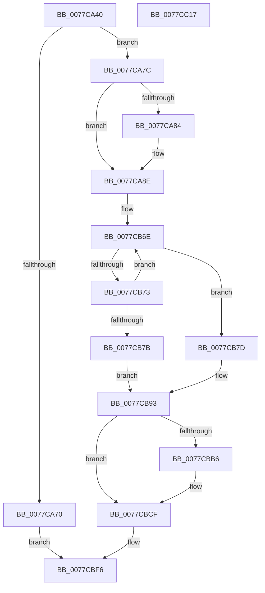

# TtmiInitTerminals

- RVA: `0x0077CA40`–`0x0077CC18` (길이 `472` bytes)
- VA: `0x000000014077CA40`
- 실행 섹션: `PAGE`
- PDB 이름 있음: `예`; PDB Function 태그: `아니요`
- unwind 정보 RVA: `0x000CDE88`
- 디코드: `106`개 명령, `472/472` bytes 표시
- 미해석 바이트: `0` (있으면 어셈블리에 `.byte`로 보존)

> 이 문서는 커널 이미지의 기계어와 PDB 기호를 분석해 생성했습니다. 4번과 5번은 함수 원형과 자료형을 바이너리 사용 방식에서 추정한 C 해석이며 원본 소스 복구 결과는 아닙니다.

## 1. Dependencies

- 직접 호출 지점: **9**; 고유 호출 대상: **9**
- 직접 호출자로 확인된 함수: **1**
- RIP 상대 이미지 참조: **21**

### Outgoing calls
- `0x0077CA65` → [TtmIsEnabled](../91/TtmIsEnabled_function_009143D8.md) (function, `0x009143D8`)
- `0x0077CAA0` → [ExInitializeResourceLite](../../text/41/ExInitializeResourceLite_function_0041F9A0.md) (function, `0x0041F9A0`)
- `0x0077CAAC` → [KeInitializeTimer](../../text/45/KeInitializeTimer_function_0045B590.md) (function, `0x0045B590`)
- `0x0077CAC2` → [KeInitializeDpc](../../text/45/KeInitializeDpc_function_0045BBD0.md) (function, `0x0045BBD0`)
- `0x0077CAF1` → [memset](../../text/6C/memset_function_006C6C40.md) (function, `0x006C6C40`)
- `0x0077CBAD` → [ObCreateObjectTypeEx](../AB/ObCreateObjectTypeEx_function_00AB46D0.md) (function, `0x00AB46D0`)
- `0x0077CBC9` → [KeBugCheckEx](../../text/4F/KeBugCheckEx_function_004FD660.md) (function, `0x004FD660`)
- `0x0077CBF1` → [ExSubscribeWnfStateChange](../9D/ExSubscribeWnfStateChange_function_009D4BC0.md) (function, `0x009D4BC0`)
- `0x0077CBFD` → [_security_check_cookie](../../text/6A/_security_check_cookie_function_006AC640.md) (function, `0x006AC640`)

### Direct callers
- [TtmInit](TtmInit_function_00776D80.md) at `0x00776D9D`

### Static image references
- `0x0077CA57` → RVA `0x00E0A740` (`.data`; read)
- `0x0077CA70` → RVA `0x00FD9D08` (`PAGEDATA`; write)
- `0x0077CA7C` → RVA `0x00FD9BBC` (`PAGEDATA`; read)
- `0x0077CA84` → RVA `0x00FD9BBC` (`PAGEDATA`; write)
- `0x0077CA8E` → RVA `0x00F067E0` (`.data`; read)
- `0x0077CA95` → RVA `0x00F068E0` (`.data`; write)
- `0x0077CAA5` → RVA `0x00F068A0` (`.data`; read)
- `0x0077CAB4` → RVA `0x005E2140` (`TtmpTerminalInactivityTimerDpcRoutine`; read)
- `0x0077CABB` → RVA `0x00F06860` (`.data`; read)
- `0x0077CAC7` → RVA `0x0077D690` (`TtmpTerminalInactivityWorkerRoutine`; read)
- `0x0077CACE` → RVA `0x00F06918` (`.data`; write)
- `0x0077CADA` → RVA `0x00F06910` (`.data`; write)
- `0x0077CAE4` → RVA `0x00F06900` (`.data`; write)
- `0x0077CAF9` → RVA `0x00B04690` (` ?? ::NNGAKEGL::`string'`; read)
- `0x0077CB00` → RVA `0x0002B5D8` (`.rdata`; read)
- `0x0077CB1E` → RVA `0x0077D490` (`TtmpOpenTerminalHandle`; read)
- `0x0077CB33` → RVA `0x0077D390` (`TtmpCloseTerminalHandle`; read)
- `0x0077CB49` → RVA `0x0077D420` (`TtmpDeleteTerminal`; read)
- `0x0077CB93` → RVA `0x00FD9D08` (`PAGEDATA`; read)
- `0x0077CBCF` → RVA `0x0077D990` (`TtmpWnfInactivityTimeoutCallback`; read)
- `0x0077CBE6` → RVA `0x00020900` (`.rdata`; read)

## 2. Other-region calls and transfers

- 다른 실행 섹션으로 향하는 call: **6**
  - `0x0077CAA0` → [ExInitializeResourceLite](../../text/41/ExInitializeResourceLite_function_0041F9A0.md) (`PAGE` → `.text`)
  - `0x0077CAAC` → [KeInitializeTimer](../../text/45/KeInitializeTimer_function_0045B590.md) (`PAGE` → `.text`)
  - `0x0077CAC2` → [KeInitializeDpc](../../text/45/KeInitializeDpc_function_0045BBD0.md) (`PAGE` → `.text`)
  - `0x0077CAF1` → [memset](../../text/6C/memset_function_006C6C40.md) (`PAGE` → `.text`)
  - `0x0077CBC9` → [KeBugCheckEx](../../text/4F/KeBugCheckEx_function_004FD660.md) (`PAGE` → `.text`)
  - `0x0077CBFD` → [_security_check_cookie](../../text/6A/_security_check_cookie_function_006AC640.md) (`PAGE` → `.text`)
- 별도 외부 분기/꼬리 이동을 확인하지 못했습니다.

## 3. Assembly (complete function range)

```asm
0077CA40  48 89 5C 24 08                  mov qword ptr [rsp + 8], rbx
0077CA45  48 89 7C 24 10                  mov qword ptr [rsp + 0x10], rdi
0077CA4A  55                              push rbp
0077CA4B  48 8D 6C 24 A9                  lea rbp, [rsp - 0x57]
0077CA50  48 81 EC D0 00 00 00            sub rsp, 0xd0
0077CA57  48 8B 05 E2 DC 68 00            mov rax, qword ptr [rip + 0x68dce2]
0077CA5E  48 33 C4                        xor rax, rsp
0077CA61  48 89 45 47                     mov qword ptr [rbp + 0x47], rax
0077CA65  E8 6E 79 19 00                  call 0x1409143d8
0077CA6A  33 FF                           xor edi, edi
0077CA6C  84 C0                           test al, al
0077CA6E  75 0C                           jne 0x14077ca7c
0077CA70  48 89 3D 91 D2 85 00            mov qword ptr [rip + 0x85d291], rdi
0077CA77  E9 7A 01 00 00                  jmp 0x14077cbf6
0077CA7C  39 3D 3A D1 85 00               cmp dword ptr [rip + 0x85d13a], edi
0077CA82  75 0A                           jne 0x14077ca8e
0077CA84  C7 05 2E D1 85 00 B8 0B 00 00   mov dword ptr [rip + 0x85d12e], 0xbb8
0077CA8E  48 8D 0D 4B 9D 78 00            lea rcx, [rip + 0x789d4b]
0077CA95  48 C7 05 40 9E 78 00 00 5D 1E EE  mov qword ptr [rip + 0x789e40], 0xffffffffee1e5d00
0077CAA0  E8 FB 2E CA FF                  call 0x14041f9a0
0077CAA5  48 8D 0D F4 9D 78 00            lea rcx, [rip + 0x789df4]
0077CAAC  E8 DF EA CD FF                  call 0x14045b590
0077CAB1  45 33 C0                        xor r8d, r8d
0077CAB4  48 8D 15 85 56 E6 FF            lea rdx, [rip - 0x19a97b]
0077CABB  48 8D 0D 9E 9D 78 00            lea rcx, [rip + 0x789d9e]
0077CAC2  E8 09 F1 CD FF                  call 0x14045bbd0
0077CAC7  48 8D 05 C2 0B 00 00            lea rax, [rip + 0xbc2]
0077CACE  48 89 3D 43 9E 78 00            mov qword ptr [rip + 0x789e43], rdi
0077CAD5  BB 78 00 00 00                  mov ebx, 0x78
0077CADA  48 89 05 2F 9E 78 00            mov qword ptr [rip + 0x789e2f], rax
0077CAE1  44 8B C3                        mov r8d, ebx
0077CAE4  48 89 3D 15 9E 78 00            mov qword ptr [rip + 0x789e15], rdi
0077CAEB  33 D2                           xor edx, edx
0077CAED  48 8D 4D C7                     lea rcx, [rbp - 0x39]
0077CAF1  E8 4A A1 F4 FF                  call 0x1406c6c40
0077CAF6  8A 45 C9                        mov al, byte ptr [rbp - 0x37]
0077CAF9  4C 8D 0D 90 7B 38 00            lea r9, [rip + 0x387b90]
0077CB00  0F 10 05 D1 EA 8A FF            movups xmm0, xmmword ptr [rip - 0x75152f]
0077CB07  24 F7                           and al, 0xf7
0077CB09  66 89 5D C7                     mov word ptr [rbp - 0x39], bx
0077CB0D  0C 06                           or al, 6
0077CB0F  C7 45 CF 90 01 00 00            mov dword ptr [rbp - 0x31], 0x190
0077CB16  88 45 C9                        mov byte ptr [rbp - 0x37], al
0077CB19  BB 01 00 00 00                  mov ebx, 1
0077CB1E  48 8D 05 6B 09 00 00            lea rax, [rip + 0x96b]
0077CB25  C7 45 E3 03 00 1F 00            mov dword ptr [rbp - 0x1d], 0x1f0003
0077CB2C  48 89 45 FF                     mov qword ptr [rbp - 1], rax
0077CB30  49 8B C9                        mov rcx, r9
0077CB33  48 8D 05 56 08 00 00            lea rax, [rip + 0x856]
0077CB3A  C7 45 EB 00 02 00 00            mov dword ptr [rbp - 0x15], 0x200
0077CB41  48 89 45 07                     mov qword ptr [rbp + 7], rax
0077CB45  44 8D 43 01                     lea r8d, [rbx + 1]
0077CB49  48 8D 05 D0 08 00 00            lea rax, [rip + 0x8d0]
0077CB50  C7 45 F3 20 01 00 00            mov dword ptr [rbp - 0xd], 0x120
0077CB57  48 89 45 0F                     mov qword ptr [rbp + 0xf], rax
0077CB5B  B8 FF 7F 00 00                  mov eax, 0x7fff
0077CB60  F3 0F 7F 45 D3                  movdqu xmmword ptr [rbp - 0x2d], xmm0
0077CB65  8B D0                           mov edx, eax
0077CB67  0F 57 C0                        xorps xmm0, xmm0
0077CB6A  0F 11 45 B7                     movups xmmword ptr [rbp - 0x49], xmm0
0077CB6E  66 39 39                        cmp word ptr [rcx], di
0077CB71  74 0A                           je 0x14077cb7d
0077CB73  49 03 C8                        add rcx, r8
0077CB76  48 2B D3                        sub rdx, rbx
0077CB79  75 F3                           jne 0x14077cb6e
0077CB7B  EB 16                           jmp 0x14077cb93
0077CB7D  48 2B C2                        sub rax, rdx
0077CB80  4C 89 4D BF                     mov qword ptr [rbp - 0x41], r9
0077CB84  66 03 C0                        add ax, ax
0077CB87  66 89 45 B7                     mov word ptr [rbp - 0x49], ax
0077CB8B  66 41 03 C0                     add ax, r8w
0077CB8F  66 89 45 B9                     mov word ptr [rbp - 0x47], ax
0077CB93  48 8D 05 6E D1 85 00            lea rax, [rip + 0x85d16e]
0077CB9A  45 33 C9                        xor r9d, r9d
0077CB9D  45 33 C0                        xor r8d, r8d
0077CBA0  48 89 44 24 20                  mov qword ptr [rsp + 0x20], rax
0077CBA5  48 8D 55 C7                     lea rdx, [rbp - 0x39]
0077CBA9  48 8D 4D B7                     lea rcx, [rbp - 0x49]
0077CBAD  E8 1E 7B 33 00                  call 0x140ab46d0
0077CBB2  85 C0                           test eax, eax
0077CBB4  79 19                           jns 0x14077cbcf
0077CBB6  4C 63 C0                        movsxd r8, eax
0077CBB9  45 33 C9                        xor r9d, r9d
0077CBBC  48 8B D3                        mov rdx, rbx
0077CBBF  48 89 7C 24 20                  mov qword ptr [rsp + 0x20], rdi
0077CBC4  B9 9B 01 00 00                  mov ecx, 0x19b
0077CBC9  E8 92 0A D8 FF                  call 0x1404fd660
0077CBCE  CC                              int3
0077CBCF  48 8D 05 BA 0D 00 00            lea rax, [rip + 0xdba]
0077CBD6  48 89 7C 24 28                  mov qword ptr [rsp + 0x28], rdi
0077CBDB  45 33 C9                        xor r9d, r9d
0077CBDE  48 89 44 24 20                  mov qword ptr [rsp + 0x20], rax
0077CBE3  44 8B C3                        mov r8d, ebx
0077CBE6  48 8D 15 13 3D 8A FF            lea rdx, [rip - 0x75c2ed]
0077CBED  48 8D 4D B7                     lea rcx, [rbp - 0x49]
0077CBF1  E8 CA 7F 25 00                  call 0x1409d4bc0
0077CBF6  48 8B 4D 47                     mov rcx, qword ptr [rbp + 0x47]
0077CBFA  48 33 CC                        xor rcx, rsp
0077CBFD  E8 3E FA F2 FF                  call 0x1406ac640
0077CC02  4C 8D 9C 24 D0 00 00 00         lea r11, [rsp + 0xd0]
0077CC0A  49 8B 5B 10                     mov rbx, qword ptr [r11 + 0x10]
0077CC0E  49 8B 7B 18                     mov rdi, qword ptr [r11 + 0x18]
0077CC12  49 8B E3                        mov rsp, r11
0077CC15  5D                              pop rbp
0077CC16  C3                              ret
0077CC17  CC                              int3
```

## 4. C-style interpretation (structured pseudocode)

```c
__int64 __fastcall TtmiInitTerminals(__int64 a1, __int64 a2, int a3)
{
    __int64 result;
    __int64 v_rdi;
    __int64 v_rsp;
    unsigned __int64 v_stack_m18;
    unsigned __int64 v_stack_m50;
    unsigned __int64 v_stack_m58;
    unsigned __int64 v_stack_m5F;
    unsigned __int64 v_stack_m60;
    unsigned int v_stack_m6C;
    unsigned int v_stack_m74;
    unsigned int v_stack_m7C;
    unsigned __int64 v_stack_m8;
    unsigned __int64 v_stack_m8C;
    unsigned int v_stack_m90;
    unsigned __int8 v_stack_m96;
    unsigned __int64 v_stack_m98;
    unsigned __int64 v_stack_mA0;
    unsigned __int16 v_stack_mA6;
    unsigned __int64 v_stack_mA8;
    unsigned __int64 v_stack_mB0;
    unsigned __int64 v_stack_mB8;
    unsigned __int64 v_stack_p10;
    unsigned __int64 v_stack_p8;

    v_stack_p8 = v_rbx;
    v_stack_p10 = v_rdi;
    v_rsp = (v_rsp) - (208);
    result = (*(unsigned __int64 *)(v_rip + 6872290)) ^ (v_rsp);
    v_stack_m18 = result;
    result = TtmIsEnabled(a1, a2, a3, a4);
    v_rdi = 0;
    if ((unsigned __int8)(result) != 0) goto loc_0077CA7C;
    *(unsigned __int64 *)(v_rip + 8770193) = 0;
    goto loc_0077CBF6;
loc_0077CA7C:
    if ((*(unsigned int *)(v_rip + 8769850)) == 0) {
        *(unsigned int *)(v_rip + 8769838) = 0xBB8ULL;
    }
    *(unsigned __int64 *)(v_rip + 7904832) = 0xFFFFFFFFEE1E5D00ULL;
    result = ExInitializeResourceLite(v_rip + 7904587, a2, a3, a4);
    result = KeInitializeTimer(v_rip + 7904756, a2, a3, a4);
    a3 = 0;
    result = KeInitializeDpc(v_rip + 7904670, v_rip - 1681787, a3, a4);
    *(unsigned __int64 *)(v_rip + 7904835) = 0;
    *(unsigned __int64 *)(v_rip + 7904815) = v_rip + 3010;
    *(unsigned __int64 *)(v_rip + 7904789) = 0;
    a2 = 0;
    result = memset(v_stack_m98, a2, 120, a4);
    result = (unsigned __int8)((v_stack_m96) & (247));
    v_stack_m98 = 120;
    result = (unsigned __int8)((result) | (6));
    v_stack_m90 = 400;
    v_stack_m96 = (unsigned __int8)(result);
    v_stack_m7C = 0x1F0003ULL;
    v_stack_m60 = v_rip + 2411;
    v_stack_m74 = 512;
    v_stack_m58 = v_rip + 2134;
    v_stack_m6C = 288;
    v_stack_m50 = v_rip + 2256;
    v_stack_m8C = v_xmm0;
    v_stack_mA8 = v_xmm0;
loc_0077CB6E:
    if ((*(unsigned __int16 *)(v_rip + 3701648)) == 0) goto loc_0077CB7D;
    a1 = (v_rip + 3701648) + (1 + 1);
    a2 = ((unsigned int)((unsigned int)((unsigned int)(0x7FFFULL)))) - (1);
    if (condition_is_not_equal) goto loc_0077CB6E;
    goto loc_0077CB93;
loc_0077CB7D:
    result = ((unsigned int)(0x7FFFULL)) - (a2);
    v_stack_mA0 = v_rip + 3701648;
    result = (unsigned __int16)((result) + ((unsigned __int16)(result)));
    v_stack_mA8 = (unsigned __int16)(result);
    result = (unsigned __int16)((result) + ((unsigned __int16)(1 + 1)));
    v_stack_mA6 = (unsigned __int16)(result);
loc_0077CB93:
    a4 = 0;
    a3 = 0;
    v_stack_mB8 = v_rip + 8769902;
    result = ObCreateObjectTypeEx(v_stack_mA8, v_stack_m98, a3, a4);
    if (sign_flag) {
        a3 = (int)((unsigned int)(result));
        a4 = 0;
        a2 = 1;
        v_stack_mB8 = 0;
        a1 = 411;
        result = KeBugCheckEx(a1, a2, a3, a4);
    }
    v_stack_mB0 = 0;
    a4 = 0;
    v_stack_mB8 = v_rip + 3514;
    result = ExSubscribeWnfStateChange(v_stack_mA8, v_rip - 7717613, 1, a4);
loc_0077CBF6:
    a1 = (v_stack_m18) ^ (v_rsp);
    result = _security_check_cookie(a1, v_rip - 7717613, 1, a4);
    return result;
}
```

## 5. (Beta) C Style

```c
int64_t TtmiInitTerminals(int64_t Arg1, int64_t Arg2, int32_t Arg3)
{
    int64_t result;
    int64_t local_rdi;
    int64_t local_rsp;
    uint64_t v_stack_m18;
    uint64_t v_stack_m50;
    uint64_t v_stack_m58;
    uint64_t v_stack_m5F;
    uint64_t v_stack_m60;
    uint32_t v_stack_m6C;
    uint32_t v_stack_m74;
    uint32_t v_stack_m7C;
    uint64_t v_stack_m8;
    uint64_t v_stack_m8C;
    uint32_t v_stack_m90;
    uint8_t v_stack_m96;
    uint64_t v_stack_m98;
    uint64_t v_stack_mA0;
    uint16_t v_stack_mA6;
    uint64_t v_stack_mA8;
    uint64_t v_stack_mB0;
    uint64_t v_stack_mB8;
    uint64_t v_stack_p10;
    uint64_t v_stack_p8;

    v_stack_p8 = local_rbx;
    v_stack_p10 = local_rdi;
    local_rsp = (local_rsp) - (208);
    result = (*(uint64_t *)(v_rip + 0x68DCE2)) ^ (local_rsp);
    v_stack_m18 = result;
    result = TtmIsEnabled(Arg1, Arg2, Arg3, a4);
    local_rdi = 0;
    if ((uint8_t)(result) != 0) goto loc_0077CA7C;
    *(uint64_t *)(v_rip + 0x85D291) = 0;
    goto loc_0077CBF6;
loc_0077CA7C:
    if ((*(uint32_t *)(v_rip + 0x85D13A)) == 0) {
        *(uint32_t *)(v_rip + 0x85D12E) = 0xBB8ULL;
    }
    *(uint64_t *)(v_rip + 0x789E40) = 0xFFFFFFFFEE1E5D00ULL;
    result = ExInitializeResourceLite(v_rip + 7904587, Arg2, Arg3, a4);
    result = KeInitializeTimer(v_rip + 7904756, Arg2, Arg3, a4);
    Arg3 = 0;
    result = KeInitializeDpc(v_rip + 7904670, v_rip - 1681787, Arg3, a4);
    *(uint64_t *)(v_rip + 0x789E43) = 0;
    *(uint64_t *)(v_rip + 0x789E2F) = v_rip + 3010;
    *(uint64_t *)(v_rip + 0x789E15) = 0;
    Arg2 = 0;
    result = memset(v_stack_m98, Arg2, 120, a4);
    result = (uint8_t)((v_stack_m96) & (247));
    v_stack_m98 = 120;
    result = (uint8_t)((result) | (6));
    v_stack_m90 = 400;
    v_stack_m96 = (uint8_t)(result);
    v_stack_m7C = 0x1F0003ULL;
    v_stack_m60 = v_rip + 2411;
    v_stack_m74 = 512;
    v_stack_m58 = v_rip + 2134;
    v_stack_m6C = 288;
    v_stack_m50 = v_rip + 2256;
    v_stack_m8C = v_xmm0;
    v_stack_mA8 = v_xmm0;
loc_0077CB6E:
    if ((*(uint16_t *)(v_rip + 0x387B90)) == 0) goto loc_0077CB7D;
    Arg1 = (v_rip + 3701648) + (1 + 1);
    Arg2 = ((uint32_t)((uint32_t)((uint32_t)(0x7FFFULL)))) - (1);
    if (condition_is_not_equal) goto loc_0077CB6E;
    goto loc_0077CB93;
loc_0077CB7D:
    result = ((uint32_t)(0x7FFFULL)) - (Arg2);
    v_stack_mA0 = v_rip + 3701648;
    result = (uint16_t)((result) + ((uint16_t)(result)));
    v_stack_mA8 = (uint16_t)(result);
    result = (uint16_t)((result) + ((uint16_t)(1 + 1)));
    v_stack_mA6 = (uint16_t)(result);
loc_0077CB93:
    a4 = 0;
    Arg3 = 0;
    v_stack_mB8 = v_rip + 8769902;
    result = ObCreateObjectTypeEx(v_stack_mA8, v_stack_m98, Arg3, a4);
    if (sign_flag) {
        Arg3 = (int32_t)((uint32_t)(result));
        a4 = 0;
        Arg2 = 1;
        v_stack_mB8 = 0;
        Arg1 = 411;
        result = KeBugCheckEx(Arg1, Arg2, Arg3, a4);
    }
    v_stack_mB0 = 0;
    a4 = 0;
    v_stack_mB8 = v_rip + 3514;
    result = ExSubscribeWnfStateChange(v_stack_mA8, v_rip - 7717613, 1, a4);
loc_0077CBF6:
    Arg1 = (v_stack_m18) ^ (local_rsp);
    result = _security_check_cookie(Arg1, v_rip - 7717613, 1, a4);
    return result;
}
```

## 6. Execution-region graph

[열기: 2D/3D 그래프와 함수 탐색 컨트롤 패널](../../../control-panel.html?section=page&rva=0x0077CA40&view=graph)

- 2D 그래프는 위에서 아래로 흐르고, 3D 그래프는 빈 공간을 드래그해 회전합니다. Shift+드래그는 이동, 휠은 확대·축소, 함수 노드 선택은 대상 보고서 이동입니다.

### Static fallback


