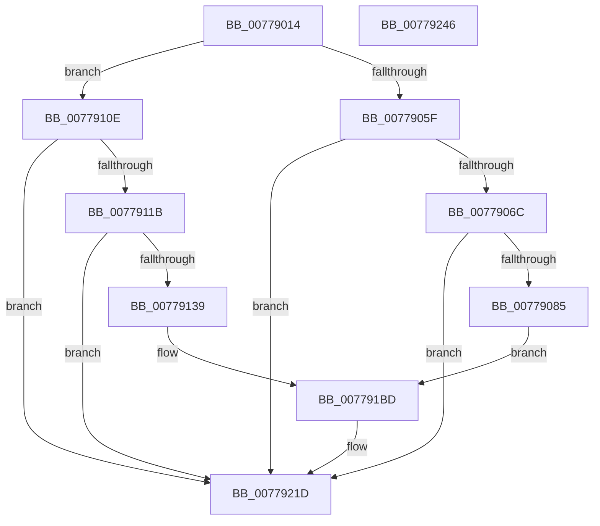

# TtmiLogCalloutStop

- RVA: `0x00779014`–`0x00779247` (길이 `563` bytes)
- VA: `0x0000000140779014`
- 실행 섹션: `PAGE`
- PDB 이름 있음: `예`; PDB Function 태그: `아니요`
- unwind 정보 RVA: `0x000CDE10`
- 디코드: `116`개 명령, `563/563` bytes 표시
- 미해석 바이트: `0` (있으면 어셈블리에 `.byte`로 보존)

> 이 문서는 커널 이미지의 기계어와 PDB 기호를 분석해 생성했습니다. 4번과 5번은 함수 원형과 자료형을 바이너리 사용 방식에서 추정한 C 해석이며 원본 소스 복구 결과는 아닙니다.

## 1. Dependencies

- 직접 호출 지점: **6**; 고유 호출 대상: **4**
- 직접 호출자로 확인된 함수: **1**
- RIP 상대 이미지 참조: **5**

### Outgoing calls
- `0x00779078` → [tlgKeywordOn](../../text/42/tlgKeywordOn_function_0042EAA0.md) (function, `0x0042EAA0`)
- `0x00779095` → [PsGetProcessSessionIdEx](../../text/22/PsGetProcessSessionIdEx_function_0022F8F0.md) (function, `0x0022F8F0`)
- `0x0077912C` → [tlgKeywordOn](../../text/42/tlgKeywordOn_function_0042EAA0.md) (function, `0x0042EAA0`)
- `0x00779149` → [PsGetProcessSessionIdEx](../../text/22/PsGetProcessSessionIdEx_function_0022F8F0.md) (function, `0x0022F8F0`)
- `0x00779218` → [tlgWriteTransfer_EtwWriteTransfer](../../text/42/tlgWriteTransfer_EtwWriteTransfer_function_004260E0.md) (function, `0x004260E0`)
- `0x00779224` → [_security_check_cookie](../../text/6A/_security_check_cookie_function_006AC640.md) (function, `0x006AC640`)

### Direct callers
- [TtmpStopCallout](TtmpStopCallout_function_00776C24.md) at `0x00776CC1`

### Static image references
- `0x00779037` → RVA `0x00E0A740` (`.data`; read)
- `0x0077905F` → RVA `0x00FD88C8` (`PAGEDATA`; read)
- `0x0077909E` → RVA `0x00051C16` (`.rdata`; read)
- `0x0077910E` → RVA `0x00FD8890` (`PAGEDATA`; read)
- `0x00779152` → RVA `0x000527F1` (`.rdata`; read)

## 2. Other-region calls and transfers

- 다른 실행 섹션으로 향하는 call: **6**
  - `0x00779078` → [tlgKeywordOn](../../text/42/tlgKeywordOn_function_0042EAA0.md) (`PAGE` → `.text`)
  - `0x00779095` → [PsGetProcessSessionIdEx](../../text/22/PsGetProcessSessionIdEx_function_0022F8F0.md) (`PAGE` → `.text`)
  - `0x0077912C` → [tlgKeywordOn](../../text/42/tlgKeywordOn_function_0042EAA0.md) (`PAGE` → `.text`)
  - `0x00779149` → [PsGetProcessSessionIdEx](../../text/22/PsGetProcessSessionIdEx_function_0022F8F0.md) (`PAGE` → `.text`)
  - `0x00779218` → [tlgWriteTransfer_EtwWriteTransfer](../../text/42/tlgWriteTransfer_EtwWriteTransfer_function_004260E0.md) (`PAGE` → `.text`)
  - `0x00779224` → [_security_check_cookie](../../text/6A/_security_check_cookie_function_006AC640.md) (`PAGE` → `.text`)
- 별도 외부 분기/꼬리 이동을 확인하지 못했습니다.

## 3. Assembly (complete function range)

```asm
00779014  48 8B C4                        mov rax, rsp
00779017  48 89 58 08                     mov qword ptr [rax + 8], rbx
0077901B  48 89 70 10                     mov qword ptr [rax + 0x10], rsi
0077901F  48 89 78 18                     mov qword ptr [rax + 0x18], rdi
00779023  44 89 48 20                     mov dword ptr [rax + 0x20], r9d
00779027  55                              push rbp
00779028  41 56                           push r14
0077902A  41 57                           push r15
0077902C  48 8D 68 B1                     lea rbp, [rax - 0x4f]
00779030  48 81 EC 00 01 00 00            sub rsp, 0x100
00779037  48 8B 05 02 17 69 00            mov rax, qword ptr [rip + 0x691702]
0077903E  48 33 C4                        xor rax, rsp
00779041  48 89 45 27                     mov qword ptr [rbp + 0x27], rax
00779045  48 8B 7D 7F                     mov rdi, qword ptr [rbp + 0x7f]
00779049  49 8B F0                        mov rsi, r8
0077904C  44 8B F2                        mov r14d, edx
0077904F  44 8B F9                        mov r15d, ecx
00779052  48 81 FF 00 2D 31 01            cmp rdi, 0x1312d00
00779059  0F 87 AF 00 00 00               ja 0x14077910e
0077905F  83 3D 62 F8 85 00 05            cmp dword ptr [rip + 0x85f862], 5
00779066  0F 86 B1 01 00 00               jbe 0x14077921d
0077906C  BA 01 00 00 00                  mov edx, 1
00779071  48 8D 0D 50 F8 85 00            lea rcx, [rip + 0x85f850]
00779078  E8 23 5A CB FF                  call 0x14042eaa0
0077907D  84 C0                           test al, al
0077907F  0F 84 98 01 00 00               je 0x14077921d
00779085  65 48 8B 0C 25 88 01 00 00      mov rcx, qword ptr gs:[0x188]
0077908E  48 8B 89 B8 00 00 00            mov rcx, qword ptr [rcx + 0xb8]
00779095  E8 56 68 AB FF                  call 0x14022f8f0
0077909A  89 44 24 30                     mov dword ptr [rsp + 0x30], eax
0077909E  48 8D 15 71 8B 8D FF            lea rdx, [rip - 0x72748f]
007790A5  48 8D 44 24 30                  lea rax, [rsp + 0x30]
007790AA  44 89 7C 24 34                  mov dword ptr [rsp + 0x34], r15d
007790AF  48 89 45 A7                     mov qword ptr [rbp - 0x59], rax
007790B3  48 8D 0D 0E F8 85 00            lea rcx, [rip + 0x85f80e]
007790BA  48 8D 44 24 34                  lea rax, [rsp + 0x34]
007790BF  44 89 74 24 38                  mov dword ptr [rsp + 0x38], r14d
007790C4  48 89 45 B7                     mov qword ptr [rbp - 0x49], rax
007790C8  48 8D 44 24 38                  lea rax, [rsp + 0x38]
007790CD  48 89 45 C7                     mov qword ptr [rbp - 0x39], rax
007790D1  48 8D 44 24 40                  lea rax, [rsp + 0x40]
007790D6  48 89 45 D7                     mov qword ptr [rbp - 0x29], rax
007790DA  48 8D 45 FF                     lea rax, [rbp - 1]
007790DE  48 89 45 E7                     mov qword ptr [rbp - 0x19], rax
007790E2  48 8D 45 6F                     lea rax, [rbp + 0x6f]
007790E6  48 89 45 F7                     mov qword ptr [rbp - 9], rax
007790EA  8B 45 77                        mov eax, dword ptr [rbp + 0x77]
007790ED  89 44 24 3C                     mov dword ptr [rsp + 0x3c], eax
007790F1  48 8D 44 24 3C                  lea rax, [rsp + 0x3c]
007790F6  48 89 45 07                     mov qword ptr [rbp + 7], rax
007790FA  48 8D 44 24 48                  lea rax, [rsp + 0x48]
007790FF  48 89 74 24 40                  mov qword ptr [rsp + 0x40], rsi
00779104  48 89 7C 24 48                  mov qword ptr [rsp + 0x48], rdi
00779109  E9 AF 00 00 00                  jmp 0x1407791bd
0077910E  83 3D 7B F7 85 00 05            cmp dword ptr [rip + 0x85f77b], 5
00779115  0F 86 02 01 00 00               jbe 0x14077921d
0077911B  48 BA 01 00 00 00 00 40 00 00   movabs rdx, 0x400000000001
00779125  48 8D 0D 64 F7 85 00            lea rcx, [rip + 0x85f764]
0077912C  E8 6F 59 CB FF                  call 0x14042eaa0
00779131  84 C0                           test al, al
00779133  0F 84 E4 00 00 00               je 0x14077921d
00779139  65 48 8B 0C 25 88 01 00 00      mov rcx, qword ptr gs:[0x188]
00779142  48 8B 89 B8 00 00 00            mov rcx, qword ptr [rcx + 0xb8]
00779149  E8 A2 67 AB FF                  call 0x14022f8f0
0077914E  89 44 24 3C                     mov dword ptr [rsp + 0x3c], eax
00779152  48 8D 15 98 96 8D FF            lea rdx, [rip - 0x726968]
00779159  48 8D 44 24 3C                  lea rax, [rsp + 0x3c]
0077915E  44 89 7C 24 38                  mov dword ptr [rsp + 0x38], r15d
00779163  48 89 45 A7                     mov qword ptr [rbp - 0x59], rax
00779167  48 8D 0D 22 F7 85 00            lea rcx, [rip + 0x85f722]
0077916E  48 8D 44 24 38                  lea rax, [rsp + 0x38]
00779173  44 89 74 24 34                  mov dword ptr [rsp + 0x34], r14d
00779178  48 89 45 B7                     mov qword ptr [rbp - 0x49], rax
0077917C  48 8D 44 24 34                  lea rax, [rsp + 0x34]
00779181  48 89 45 C7                     mov qword ptr [rbp - 0x39], rax
00779185  48 8D 44 24 48                  lea rax, [rsp + 0x48]
0077918A  48 89 45 D7                     mov qword ptr [rbp - 0x29], rax
0077918E  48 8D 45 FF                     lea rax, [rbp - 1]
00779192  48 89 45 E7                     mov qword ptr [rbp - 0x19], rax
00779196  48 8D 45 6F                     lea rax, [rbp + 0x6f]
0077919A  48 89 45 F7                     mov qword ptr [rbp - 9], rax
0077919E  8B 45 77                        mov eax, dword ptr [rbp + 0x77]
007791A1  89 44 24 30                     mov dword ptr [rsp + 0x30], eax
007791A5  48 8D 44 24 30                  lea rax, [rsp + 0x30]
007791AA  48 89 45 07                     mov qword ptr [rbp + 7], rax
007791AE  48 8D 44 24 40                  lea rax, [rsp + 0x40]
007791B3  48 89 74 24 48                  mov qword ptr [rsp + 0x48], rsi
007791B8  48 89 7C 24 40                  mov qword ptr [rsp + 0x40], rdi
007791BD  48 89 45 17                     mov qword ptr [rbp + 0x17], rax
007791C1  45 33 C9                        xor r9d, r9d
007791C4  48 8D 45 87                     lea rax, [rbp - 0x79]
007791C8  48 C7 45 BF 04 00 00 00         mov qword ptr [rbp - 0x41], 4
007791D0  48 89 44 24 28                  mov qword ptr [rsp + 0x28], rax
007791D5  45 33 C0                        xor r8d, r8d
007791D8  C7 44 24 20 0A 00 00 00         mov dword ptr [rsp + 0x20], 0xa
007791E0  48 C7 45 AF 04 00 00 00         mov qword ptr [rbp - 0x51], 4
007791E8  48 C7 45 CF 04 00 00 00         mov qword ptr [rbp - 0x31], 4
007791F0  48 C7 45 DF 08 00 00 00         mov qword ptr [rbp - 0x21], 8
007791F8  48 C7 45 EF 02 00 00 00         mov qword ptr [rbp - 0x11], 2
00779200  48 C7 45 FF 04 00 00 00         mov qword ptr [rbp - 1], 4
00779208  48 C7 45 0F 04 00 00 00         mov qword ptr [rbp + 0xf], 4
00779210  48 C7 45 1F 08 00 00 00         mov qword ptr [rbp + 0x1f], 8
00779218  E8 C3 CE CA FF                  call 0x1404260e0
0077921D  48 8B 4D 27                     mov rcx, qword ptr [rbp + 0x27]
00779221  48 33 CC                        xor rcx, rsp
00779224  E8 17 34 F3 FF                  call 0x1406ac640
00779229  4C 8D 9C 24 00 01 00 00         lea r11, [rsp + 0x100]
00779231  49 8B 5B 20                     mov rbx, qword ptr [r11 + 0x20]
00779235  49 8B 73 28                     mov rsi, qword ptr [r11 + 0x28]
00779239  49 8B 7B 30                     mov rdi, qword ptr [r11 + 0x30]
0077923D  49 8B E3                        mov rsp, r11
00779240  41 5F                           pop r15
00779242  41 5E                           pop r14
00779244  5D                              pop rbp
00779245  C3                              ret
00779246  CC                              int3
```

## 4. C-style interpretation (structured pseudocode)

```c
__int64 __fastcall TtmiLogCalloutStop(int a1, int a2, __int64 a3, int a4)
{
    __int64 result;
    __int64 v_rsp;
    unsigned __int64 v_stack_m18;
    unsigned __int64 v_stack_mD0;
    unsigned __int64 v_stack_mD8;
    unsigned int v_stack_mDC;
    unsigned int v_stack_mE0;
    unsigned int v_stack_mE4;
    unsigned int v_stack_mE8;
    unsigned __int64 v_stack_mF0;
    unsigned int v_stack_mF8;

    *(unsigned __int64 *)(v_rsp + 8) = v_rbx;
    *(unsigned __int64 *)(v_rsp + 16) = v_rsi;
    *(unsigned __int64 *)(v_rsp + 24) = v_rdi;
    *(unsigned int *)(v_rsp + 32) = a4;
    v_rsp = (v_rsp) - (256);
    result = (*(unsigned __int64 *)(v_rip + 6887170)) ^ (v_rsp);
    *(unsigned __int64 *)(v_rsp - 79 + 39) = result;
    if ((*(unsigned __int64 *)(v_rsp - 79 + 127)) > 0x1312D00ULL) goto loc_0077910E;
    if ((*(unsigned int *)(v_rip + 8779874)) <= 5) goto loc_0077921D;
    result = tlgKeywordOn(v_rip + 8779856, 1, a3, a4);
    if ((unsigned __int8)(result) == 0) goto loc_0077921D;
    result = PsGetProcessSessionIdEx(*(unsigned __int64 *)(*(unsigned __int64 *)(gs_base + (0 + 392)) + 184), 1, a3, a4);
    v_stack_mE8 = (unsigned int)(result);
    v_stack_mE4 = (unsigned int)((unsigned int)(a1));
    *(unsigned __int64 *)(v_rsp - 79 - 89) = v_stack_mE8;
    v_stack_mE0 = (unsigned int)((unsigned int)(a2));
    *(unsigned __int64 *)(v_rsp - 79 - 73) = v_stack_mE4;
    *(unsigned __int64 *)(v_rsp - 79 - 57) = v_stack_mE0;
    *(unsigned __int64 *)(v_rsp - 79 - 41) = v_stack_mD8;
    *(unsigned __int64 *)(v_rsp - 79 - 25) = v_rsp - 79 - 1;
    *(unsigned __int64 *)(v_rsp - 79 - 9) = v_rsp - 79 + 111;
    v_stack_mDC = (unsigned int)((unsigned int)(*(unsigned int *)(v_rsp - 79 + 119)));
    *(unsigned __int64 *)(v_rsp - 79 + 7) = v_stack_mDC;
    v_stack_mD8 = a3;
    v_stack_mD0 = *(unsigned __int64 *)(v_rsp - 79 + 127);
    goto loc_007791BD;
loc_0077910E:
    if ((*(unsigned int *)(v_rip + 8779643)) <= 5) goto loc_0077921D;
    result = tlgKeywordOn(v_rip + 8779620, v_rip - 7500943, a3, a4);
    if ((unsigned __int8)(result) == 0) goto loc_0077921D;
    result = PsGetProcessSessionIdEx(*(unsigned __int64 *)(*(unsigned __int64 *)(gs_base + (0 + 392)) + 184), v_rip - 7500943, a3, a4);
    v_stack_mDC = (unsigned int)(result);
    v_stack_mE0 = (unsigned int)((unsigned int)(a1));
    *(unsigned __int64 *)(v_rsp - 79 - 89) = v_stack_mDC;
    v_stack_mE4 = (unsigned int)((unsigned int)(a2));
    *(unsigned __int64 *)(v_rsp - 79 - 73) = v_stack_mE0;
    *(unsigned __int64 *)(v_rsp - 79 - 57) = v_stack_mE4;
    *(unsigned __int64 *)(v_rsp - 79 - 41) = v_stack_mD0;
    *(unsigned __int64 *)(v_rsp - 79 - 25) = v_rsp - 79 - 1;
    *(unsigned __int64 *)(v_rsp - 79 - 9) = v_rsp - 79 + 111;
    v_stack_mE8 = (unsigned int)((unsigned int)(*(unsigned int *)(v_rsp - 79 + 119)));
    *(unsigned __int64 *)(v_rsp - 79 + 7) = v_stack_mE8;
    v_stack_mD0 = a3;
    v_stack_mD8 = *(unsigned __int64 *)(v_rsp - 79 + 127);
loc_007791BD:
    *(unsigned __int64 *)(v_rsp - 79 + 23) = v_stack_mD8;
    a4 = 0;
    *(unsigned __int64 *)(v_rsp - 79 - 65) = 4;
    v_stack_mF0 = v_rsp - 79 - 121;
    a3 = 0;
    v_stack_mF8 = 10;
    *(unsigned __int64 *)(v_rsp - 79 - 81) = 4;
    *(unsigned __int64 *)(v_rsp - 79 - 49) = 4;
    *(unsigned __int64 *)(v_rsp - 79 - 33) = 8;
    *(unsigned __int64 *)(v_rsp - 79 - 17) = 2;
    *(unsigned __int64 *)(v_rsp - 79 - 1) = 4;
    *(unsigned __int64 *)(v_rsp - 79 + 15) = 4;
    *(unsigned __int64 *)(v_rsp - 79 + 31) = 8;
    result = tlgWriteTransfer_EtwWriteTransfer(v_rip + 8779554, v_rip - 7498088, a3, a4);
loc_0077921D:
    a1 = (*(unsigned __int64 *)(v_rsp - 79 + 39)) ^ (v_rsp);
    result = _security_check_cookie(a1, v_rip - 7498088, a3, a4);
    return result;
}
```

## 5. (Beta) C Style

```c
int64_t TtmiLogCalloutStop(int32_t Arg1, int32_t Arg2, int64_t Arg3, int32_t Arg4)
{
    int64_t result;
    int64_t local_rsp;
    uint64_t v_stack_m18;
    uint64_t v_stack_mD0;
    uint64_t v_stack_mD8;
    uint32_t v_stack_mDC;
    uint32_t v_stack_mE0;
    uint32_t v_stack_mE4;
    uint32_t v_stack_mE8;
    uint64_t v_stack_mF0;
    uint32_t v_stack_mF8;

    *(uint64_t *)(local_rsp + 0x8) = local_rbx;
    *(uint64_t *)(local_rsp + 0x10) = local_rsi;
    *(uint64_t *)(local_rsp + 0x18) = local_rdi;
    *(uint32_t *)(local_rsp + 0x20) = Arg4;
    local_rsp = (local_rsp) - (256);
    result = (*(uint64_t *)(v_rip + 0x691702)) ^ (local_rsp);
    *(uint64_t *)(local_rsp - 0x4F + 0x27) = result;
    if ((*(uint64_t *)(local_rsp - 0x4F + 0x7F)) > 0x1312D00ULL) goto loc_0077910E;
    if ((*(uint32_t *)(v_rip + 0x85F862)) <= 5) goto loc_0077921D;
    result = tlgKeywordOn(v_rip + 8779856, 1, Arg3, Arg4);
    if ((uint8_t)(result) == 0) goto loc_0077921D;
    result = PsGetProcessSessionIdEx(*(uint64_t *)(*(uint64_t *)(gs_base + (0 + 0x188)) + 0xB8), 1, Arg3, Arg4);
    v_stack_mE8 = (uint32_t)(result);
    v_stack_mE4 = (uint32_t)((uint32_t)(Arg1));
    *(uint64_t *)(local_rsp - 0x4F - 0x59) = v_stack_mE8;
    v_stack_mE0 = (uint32_t)((uint32_t)(Arg2));
    *(uint64_t *)(local_rsp - 0x4F - 0x49) = v_stack_mE4;
    *(uint64_t *)(local_rsp - 0x4F - 0x39) = v_stack_mE0;
    *(uint64_t *)(local_rsp - 0x4F - 0x29) = v_stack_mD8;
    *(uint64_t *)(local_rsp - 0x4F - 0x19) = local_rsp - 79 - 1;
    *(uint64_t *)(local_rsp - 0x4F - 0x9) = local_rsp - 79 + 111;
    v_stack_mDC = (uint32_t)((uint32_t)(*(uint32_t *)(local_rsp - 0x4F + 0x77)));
    *(uint64_t *)(local_rsp - 0x4F + 0x7) = v_stack_mDC;
    v_stack_mD8 = Arg3;
    v_stack_mD0 = *(uint64_t *)(local_rsp - 0x4F + 0x7F);
    goto loc_007791BD;
loc_0077910E:
    if ((*(uint32_t *)(v_rip + 0x85F77B)) <= 5) goto loc_0077921D;
    result = tlgKeywordOn(v_rip + 8779620, v_rip - 7500943, Arg3, Arg4);
    if ((uint8_t)(result) == 0) goto loc_0077921D;
    result = PsGetProcessSessionIdEx(*(uint64_t *)(*(uint64_t *)(gs_base + (0 + 0x188)) + 0xB8), v_rip - 7500943, Arg3, Arg4);
    v_stack_mDC = (uint32_t)(result);
    v_stack_mE0 = (uint32_t)((uint32_t)(Arg1));
    *(uint64_t *)(local_rsp - 0x4F - 0x59) = v_stack_mDC;
    v_stack_mE4 = (uint32_t)((uint32_t)(Arg2));
    *(uint64_t *)(local_rsp - 0x4F - 0x49) = v_stack_mE0;
    *(uint64_t *)(local_rsp - 0x4F - 0x39) = v_stack_mE4;
    *(uint64_t *)(local_rsp - 0x4F - 0x29) = v_stack_mD0;
    *(uint64_t *)(local_rsp - 0x4F - 0x19) = local_rsp - 79 - 1;
    *(uint64_t *)(local_rsp - 0x4F - 0x9) = local_rsp - 79 + 111;
    v_stack_mE8 = (uint32_t)((uint32_t)(*(uint32_t *)(local_rsp - 0x4F + 0x77)));
    *(uint64_t *)(local_rsp - 0x4F + 0x7) = v_stack_mE8;
    v_stack_mD0 = Arg3;
    v_stack_mD8 = *(uint64_t *)(local_rsp - 0x4F + 0x7F);
loc_007791BD:
    *(uint64_t *)(local_rsp - 0x4F + 0x17) = v_stack_mD8;
    Arg4 = 0;
    *(uint64_t *)(local_rsp - 0x4F - 0x41) = 4;
    v_stack_mF0 = local_rsp - 79 - 121;
    Arg3 = 0;
    v_stack_mF8 = 10;
    *(uint64_t *)(local_rsp - 0x4F - 0x51) = 4;
    *(uint64_t *)(local_rsp - 0x4F - 0x31) = 4;
    *(uint64_t *)(local_rsp - 0x4F - 0x21) = 8;
    *(uint64_t *)(local_rsp - 0x4F - 0x11) = 2;
    *(uint64_t *)(local_rsp - 0x4F - 0x1) = 4;
    *(uint64_t *)(local_rsp - 0x4F + 0xF) = 4;
    *(uint64_t *)(local_rsp - 0x4F + 0x1F) = 8;
    result = tlgWriteTransfer_EtwWriteTransfer(v_rip + 8779554, v_rip - 7498088, Arg3, Arg4);
loc_0077921D:
    Arg1 = (*(uint64_t *)(local_rsp - 0x4F + 0x27)) ^ (local_rsp);
    result = _security_check_cookie(Arg1, v_rip - 7498088, Arg3, Arg4);
    return result;
}
```

## 6. Execution-region graph

[열기: 2D/3D 그래프와 함수 탐색 컨트롤 패널](../../../control-panel.html?section=page&rva=0x00779014&view=graph)

- 2D 그래프는 위에서 아래로 흐르고, 3D 그래프는 빈 공간을 드래그해 회전합니다. Shift+드래그는 이동, 휠은 확대·축소, 함수 노드 선택은 대상 보고서 이동입니다.

### Static fallback


