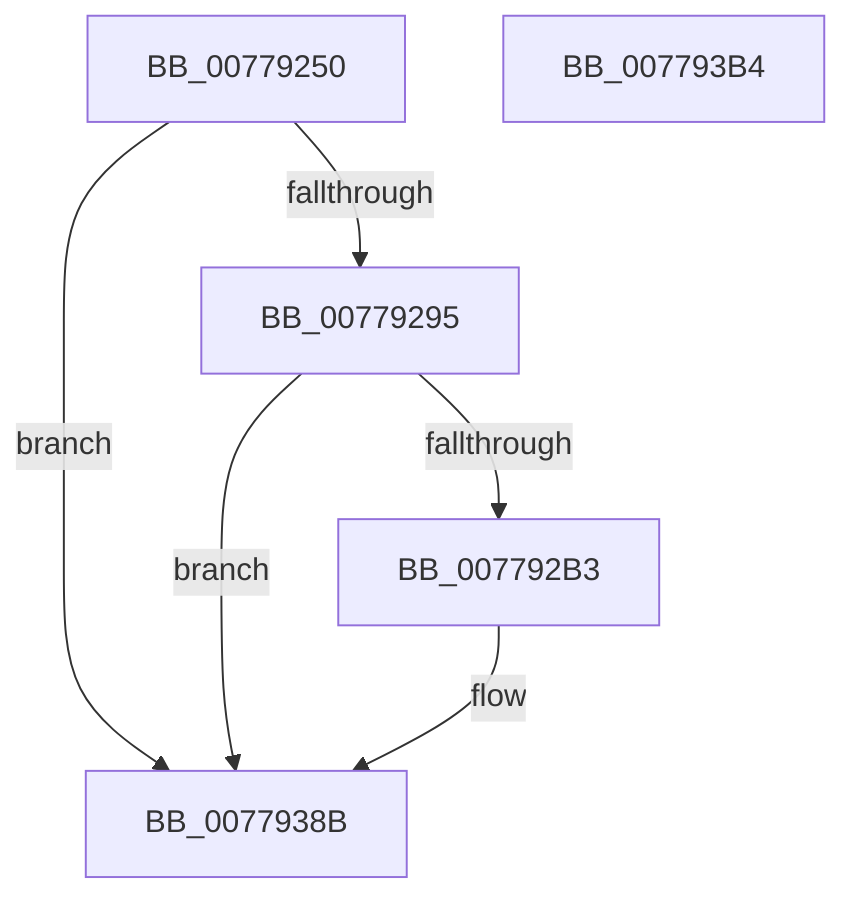

# TtmiLogCalloutWatchdogCrashSkipped

- RVA: `0x00779250`–`0x007793B5` (길이 `357` bytes)
- VA: `0x0000000140779250`
- 실행 섹션: `PAGE`
- PDB 이름 있음: `예`; PDB Function 태그: `아니요`
- unwind 정보 RVA: `0x000CD0D4`
- 디코드: `84`개 명령, `357/357` bytes 표시
- 미해석 바이트: `0` (있으면 어셈블리에 `.byte`로 보존)

> 이 문서는 커널 이미지의 기계어와 PDB 기호를 분석해 생성했습니다. 4번과 5번은 함수 원형과 자료형을 바이너리 사용 방식에서 추정한 C 해석이며 원본 소스 복구 결과는 아닙니다.

## 1. Dependencies

- 직접 호출 지점: **4**; 고유 호출 대상: **4**
- 직접 호출자로 확인된 함수: **1**
- RIP 상대 이미지 참조: **3**

### Outgoing calls
- `0x007792A6` → [tlgKeywordOn](../../text/42/tlgKeywordOn_function_0042EAA0.md) (function, `0x0042EAA0`)
- `0x007792C3` → [PsGetProcessSessionIdEx](../../text/22/PsGetProcessSessionIdEx_function_0022F8F0.md) (function, `0x0022F8F0`)
- `0x00779386` → [tlgWriteTransfer_EtwWriteTransfer](../../text/42/tlgWriteTransfer_EtwWriteTransfer_function_004260E0.md) (function, `0x004260E0`)
- `0x00779392` → [_security_check_cookie](../../text/6A/_security_check_cookie_function_006AC640.md) (function, `0x006AC640`)

### Direct callers
- [TtmpCalloutWatchdogCallback](TtmpCalloutWatchdogCallback_function_00776280.md) at `0x0077632E`

### Static image references
- `0x0077926F` → RVA `0x00E0A740` (`.data`; read)
- `0x0077927D` → RVA `0x00FD8890` (`PAGEDATA`; read)
- `0x00779361` → RVA `0x00051352` (`.rdata`; read)

## 2. Other-region calls and transfers

- 다른 실행 섹션으로 향하는 call: **4**
  - `0x007792A6` → [tlgKeywordOn](../../text/42/tlgKeywordOn_function_0042EAA0.md) (`PAGE` → `.text`)
  - `0x007792C3` → [PsGetProcessSessionIdEx](../../text/22/PsGetProcessSessionIdEx_function_0022F8F0.md) (`PAGE` → `.text`)
  - `0x00779386` → [tlgWriteTransfer_EtwWriteTransfer](../../text/42/tlgWriteTransfer_EtwWriteTransfer_function_004260E0.md) (`PAGE` → `.text`)
  - `0x00779392` → [_security_check_cookie](../../text/6A/_security_check_cookie_function_006AC640.md) (`PAGE` → `.text`)
- 별도 외부 분기/꼬리 이동을 확인하지 못했습니다.

## 3. Assembly (complete function range)

```asm
00779250  48 8B C4                        mov rax, rsp
00779253  48 89 58 08                     mov qword ptr [rax + 8], rbx
00779257  48 89 70 10                     mov qword ptr [rax + 0x10], rsi
0077925B  48 89 78 18                     mov qword ptr [rax + 0x18], rdi
0077925F  4C 89 70 20                     mov qword ptr [rax + 0x20], r14
00779263  55                              push rbp
00779264  48 8D 68 B1                     lea rbp, [rax - 0x4f]
00779268  48 81 EC 00 01 00 00            sub rsp, 0x100
0077926F  48 8B 05 CA 14 69 00            mov rax, qword ptr [rip + 0x6914ca]
00779276  48 33 C4                        xor rax, rsp
00779279  48 89 45 37                     mov qword ptr [rbp + 0x37], rax
0077927D  83 3D 0C F6 85 00 05            cmp dword ptr [rip + 0x85f60c], 5
00779284  49 8B D9                        mov rbx, r9
00779287  49 8B F8                        mov rdi, r8
0077928A  8B F2                           mov esi, edx
0077928C  44 8B F1                        mov r14d, ecx
0077928F  0F 86 F6 00 00 00               jbe 0x14077938b
00779295  48 BA 01 00 00 00 00 40 00 00   movabs rdx, 0x400000000001
0077929F  48 8D 0D EA F5 85 00            lea rcx, [rip + 0x85f5ea]
007792A6  E8 F5 57 CB FF                  call 0x14042eaa0
007792AB  84 C0                           test al, al
007792AD  0F 84 D8 00 00 00               je 0x14077938b
007792B3  65 48 8B 0C 25 88 01 00 00      mov rcx, qword ptr gs:[0x188]
007792BC  48 8B 89 B8 00 00 00            mov rcx, qword ptr [rcx + 0xb8]
007792C3  E8 28 66 AB FF                  call 0x14022f8f0
007792C8  83 65 D3 00                     and dword ptr [rbp - 0x2d], 0
007792CC  B9 04 00 00 00                  mov ecx, 4
007792D1  83 65 E3 00                     and dword ptr [rbp - 0x1d], 0
007792D5  45 33 C9                        xor r9d, r9d
007792D8  83 65 F3 00                     and dword ptr [rbp - 0xd], 0
007792DC  45 33 C0                        xor r8d, r8d
007792DF  83 65 03 00                     and dword ptr [rbp + 3], 0
007792E3  83 65 13 00                     and dword ptr [rbp + 0x13], 0
007792E7  8D 51 04                        lea edx, [rcx + 4]
007792EA  83 65 23 00                     and dword ptr [rbp + 0x23], 0
007792EE  83 65 33 00                     and dword ptr [rbp + 0x33], 0
007792F2  89 44 24 30                     mov dword ptr [rsp + 0x30], eax
007792F6  48 8D 44 24 30                  lea rax, [rsp + 0x30]
007792FB  48 89 45 C7                     mov qword ptr [rbp - 0x39], rax
007792FF  48 8D 44 24 34                  lea rax, [rsp + 0x34]
00779304  48 89 45 D7                     mov qword ptr [rbp - 0x29], rax
00779308  48 8D 44 24 38                  lea rax, [rsp + 0x38]
0077930D  48 89 45 E7                     mov qword ptr [rbp - 0x19], rax
00779311  48 8D 45 87                     lea rax, [rbp - 0x79]
00779315  48 89 45 F7                     mov qword ptr [rbp - 9], rax
00779319  48 8D 45 8F                     lea rax, [rbp - 0x71]
0077931D  48 89 45 07                     mov qword ptr [rbp + 7], rax
00779321  48 8B 45 77                     mov rax, qword ptr [rbp + 0x77]
00779325  48 89 45 97                     mov qword ptr [rbp - 0x69], rax
00779329  48 8D 45 97                     lea rax, [rbp - 0x69]
0077932D  48 89 45 17                     mov qword ptr [rbp + 0x17], rax
00779331  48 8B 45 7F                     mov rax, qword ptr [rbp + 0x7f]
00779335  48 89 45 9F                     mov qword ptr [rbp - 0x61], rax
00779339  48 8D 45 9F                     lea rax, [rbp - 0x61]
0077933D  48 89 45 27                     mov qword ptr [rbp + 0x27], rax
00779341  48 8D 45 A7                     lea rax, [rbp - 0x59]
00779345  89 4D CF                        mov dword ptr [rbp - 0x31], ecx
00779348  89 4D DF                        mov dword ptr [rbp - 0x21], ecx
0077934B  89 4D EF                        mov dword ptr [rbp - 0x11], ecx
0077934E  48 8D 0D 3B F5 85 00            lea rcx, [rip + 0x85f53b]
00779355  89 55 FF                        mov dword ptr [rbp - 1], edx
00779358  89 55 0F                        mov dword ptr [rbp + 0xf], edx
0077935B  89 55 1F                        mov dword ptr [rbp + 0x1f], edx
0077935E  89 55 2F                        mov dword ptr [rbp + 0x2f], edx
00779361  48 8D 15 EA 7F 8D FF            lea rdx, [rip - 0x728016]
00779368  48 89 44 24 28                  mov qword ptr [rsp + 0x28], rax
0077936D  C7 44 24 20 09 00 00 00         mov dword ptr [rsp + 0x20], 9
00779375  44 89 74 24 34                  mov dword ptr [rsp + 0x34], r14d
0077937A  89 74 24 38                     mov dword ptr [rsp + 0x38], esi
0077937E  48 89 7D 87                     mov qword ptr [rbp - 0x79], rdi
00779382  48 89 5D 8F                     mov qword ptr [rbp - 0x71], rbx
00779386  E8 55 CD CA FF                  call 0x1404260e0
0077938B  48 8B 4D 37                     mov rcx, qword ptr [rbp + 0x37]
0077938F  48 33 CC                        xor rcx, rsp
00779392  E8 A9 32 F3 FF                  call 0x1406ac640
00779397  4C 8D 9C 24 00 01 00 00         lea r11, [rsp + 0x100]
0077939F  49 8B 5B 10                     mov rbx, qword ptr [r11 + 0x10]
007793A3  49 8B 73 18                     mov rsi, qword ptr [r11 + 0x18]
007793A7  49 8B 7B 20                     mov rdi, qword ptr [r11 + 0x20]
007793AB  4D 8B 73 28                     mov r14, qword ptr [r11 + 0x28]
007793AF  49 8B E3                        mov rsp, r11
007793B2  5D                              pop rbp
007793B3  C3                              ret
007793B4  CC                              int3
```

## 4. C-style interpretation (structured pseudocode)

```c
__int64 __fastcall TtmiLogCalloutWatchdogCrashSkipped(int a1, int a2, __int64 a3, __int64 a4)
{
    __int64 result;
    __int64 v_rsp;
    unsigned __int64 v_stack_m8;
    unsigned __int64 v_stack_mD0;
    unsigned __int64 v_stack_mD4;
    unsigned int v_stack_mD8;
    unsigned __int64 v_stack_mE0;
    unsigned int v_stack_mE8;

    *(unsigned __int64 *)(v_rsp + 8) = v_rbx;
    *(unsigned __int64 *)(v_rsp + 16) = v_rsi;
    *(unsigned __int64 *)(v_rsp + 24) = v_rdi;
    *(unsigned __int64 *)(v_rsp + 32) = v_r14;
    v_rsp = (v_rsp) - (256);
    result = (*(unsigned __int64 *)(v_rip + 6886602)) ^ (v_rsp);
    *(unsigned __int64 *)(v_rsp - 79 + 55) = result;
    if ((*(unsigned int *)(v_rip + 8779276)) <= 5) goto loc_0077938B;
    result = tlgKeywordOn(v_rip + 8779242, a2, a3, a4);
    if ((unsigned __int8)(result) != 0) {
        a1 = *(unsigned __int64 *)(gs_base + (0 + 392));
        a1 = *(unsigned __int64 *)(a1 + 184);
        result = PsGetProcessSessionIdEx(a1, a2, a3, a4);
        a1 = 4;
        a4 = 0;
        a3 = 0;
        a2 = a1 + 4;
        v_stack_mD8 = (unsigned int)(result);
        result = v_stack_mD8;
        *(unsigned __int64 *)(v_rsp - 79 - 57) = result;
        result = v_stack_mD4;
        *(unsigned __int64 *)(v_rsp - 79 - 41) = result;
        result = v_stack_mD0;
        *(unsigned __int64 *)(v_rsp - 79 - 25) = result;
        result = v_rsp - 79 - 121;
        *(unsigned __int64 *)(v_rsp - 79 - 9) = result;
        result = v_rsp - 79 - 113;
        *(unsigned __int64 *)(v_rsp - 79 + 7) = result;
        result = *(unsigned __int64 *)(v_rsp - 79 + 119);
        *(unsigned __int64 *)(v_rsp - 79 - 105) = result;
        result = v_rsp - 79 - 105;
        *(unsigned __int64 *)(v_rsp - 79 + 23) = result;
        result = *(unsigned __int64 *)(v_rsp - 79 + 127);
        *(unsigned __int64 *)(v_rsp - 79 - 97) = result;
        result = v_rsp - 79 - 97;
        *(unsigned __int64 *)(v_rsp - 79 + 39) = result;
        result = v_rsp - 79 - 89;
        *(unsigned int *)(v_rsp - 79 - 49) = a1;
        *(unsigned int *)(v_rsp - 79 - 33) = a1;
        *(unsigned int *)(v_rsp - 79 - 17) = a1;
        a1 = v_rip + 8779067;
        *(unsigned int *)(v_rsp - 79 - 1) = a2;
        *(unsigned int *)(v_rsp - 79 + 15) = a2;
        *(unsigned int *)(v_rsp - 79 + 31) = a2;
        *(unsigned int *)(v_rsp - 79 + 47) = a2;
        a2 = v_rip - 7503894;
        v_stack_mE0 = result;
        v_stack_mE8 = 9;
        v_stack_mD4 = (unsigned int)((unsigned int)(a1));
        v_stack_mD0 = (unsigned int)((unsigned int)(a2));
        *(unsigned __int64 *)(v_rsp - 79 - 121) = 0;
        *(unsigned __int64 *)(v_rsp - 79 - 113) = 0;
        result = tlgWriteTransfer_EtwWriteTransfer(a1, a2, a3, a4);
    }
    a1 = (*(unsigned __int64 *)(v_rsp - 79 + 55)) ^ (v_rsp);
    result = _security_check_cookie(a1, a2, a3, a4);
    return result;
}
```

## 5. (Beta) C Style

```c
int64_t TtmiLogCalloutWatchdogCrashSkipped(int32_t Arg1, int32_t Arg2, int64_t Arg3, int64_t Arg4)
{
    int64_t result;
    int64_t local_rsp;
    uint64_t v_stack_m8;
    uint64_t v_stack_mD0;
    uint64_t v_stack_mD4;
    uint32_t v_stack_mD8;
    uint64_t v_stack_mE0;
    uint32_t v_stack_mE8;

    *(uint64_t *)(local_rsp + 0x8) = local_rbx;
    *(uint64_t *)(local_rsp + 0x10) = local_rsi;
    *(uint64_t *)(local_rsp + 0x18) = local_rdi;
    *(uint64_t *)(local_rsp + 0x20) = local_r14;
    local_rsp = (local_rsp) - (256);
    result = (*(uint64_t *)(v_rip + 0x6914CA)) ^ (local_rsp);
    *(uint64_t *)(local_rsp - 0x4F + 0x37) = result;
    if ((*(uint32_t *)(v_rip + 0x85F60C)) <= 5) goto loc_0077938B;
    result = tlgKeywordOn(v_rip + 8779242, Arg2, Arg3, Arg4);
    if ((uint8_t)(result) != 0) {
        Arg1 = *(uint64_t *)(gs_base + (0 + 0x188));
        Arg1 = *(uint64_t *)(Arg1 + 0xB8);
        result = PsGetProcessSessionIdEx(Arg1, Arg2, Arg3, Arg4);
        Arg1 = 4;
        Arg4 = 0;
        Arg3 = 0;
        Arg2 = Arg1 + 4;
        v_stack_mD8 = (uint32_t)(result);
        result = v_stack_mD8;
        *(uint64_t *)(local_rsp - 0x4F - 0x39) = result;
        result = v_stack_mD4;
        *(uint64_t *)(local_rsp - 0x4F - 0x29) = result;
        result = v_stack_mD0;
        *(uint64_t *)(local_rsp - 0x4F - 0x19) = result;
        result = local_rsp - 79 - 121;
        *(uint64_t *)(local_rsp - 0x4F - 0x9) = result;
        result = local_rsp - 79 - 113;
        *(uint64_t *)(local_rsp - 0x4F + 0x7) = result;
        result = *(uint64_t *)(local_rsp - 0x4F + 0x77);
        *(uint64_t *)(local_rsp - 0x4F - 0x69) = result;
        result = local_rsp - 79 - 105;
        *(uint64_t *)(local_rsp - 0x4F + 0x17) = result;
        result = *(uint64_t *)(local_rsp - 0x4F + 0x7F);
        *(uint64_t *)(local_rsp - 0x4F - 0x61) = result;
        result = local_rsp - 79 - 97;
        *(uint64_t *)(local_rsp - 0x4F + 0x27) = result;
        result = local_rsp - 79 - 89;
        *(uint32_t *)(local_rsp - 0x4F - 0x31) = Arg1;
        *(uint32_t *)(local_rsp - 0x4F - 0x21) = Arg1;
        *(uint32_t *)(local_rsp - 0x4F - 0x11) = Arg1;
        Arg1 = v_rip + 8779067;
        *(uint32_t *)(local_rsp - 0x4F - 0x1) = Arg2;
        *(uint32_t *)(local_rsp - 0x4F + 0xF) = Arg2;
        *(uint32_t *)(local_rsp - 0x4F + 0x1F) = Arg2;
        *(uint32_t *)(local_rsp - 0x4F + 0x2F) = Arg2;
        Arg2 = v_rip - 7503894;
        v_stack_mE0 = result;
        v_stack_mE8 = 9;
        v_stack_mD4 = (uint32_t)((uint32_t)(Arg1));
        v_stack_mD0 = (uint32_t)((uint32_t)(Arg2));
        *(uint64_t *)(local_rsp - 0x4F - 0x79) = 0;
        *(uint64_t *)(local_rsp - 0x4F - 0x71) = 0;
        result = tlgWriteTransfer_EtwWriteTransfer(Arg1, Arg2, Arg3, Arg4);
    }
    Arg1 = (*(uint64_t *)(local_rsp - 0x4F + 0x37)) ^ (local_rsp);
    result = _security_check_cookie(Arg1, Arg2, Arg3, Arg4);
    return result;
}
```

## 6. Execution-region graph

[열기: 2D/3D 그래프와 함수 탐색 컨트롤 패널](../../../control-panel.html?section=page&rva=0x00779250&view=graph)

- 2D 그래프는 위에서 아래로 흐르고, 3D 그래프는 빈 공간을 드래그해 회전합니다. Shift+드래그는 이동, 휠은 확대·축소, 함수 노드 선택은 대상 보고서 이동입니다.

### Static fallback


