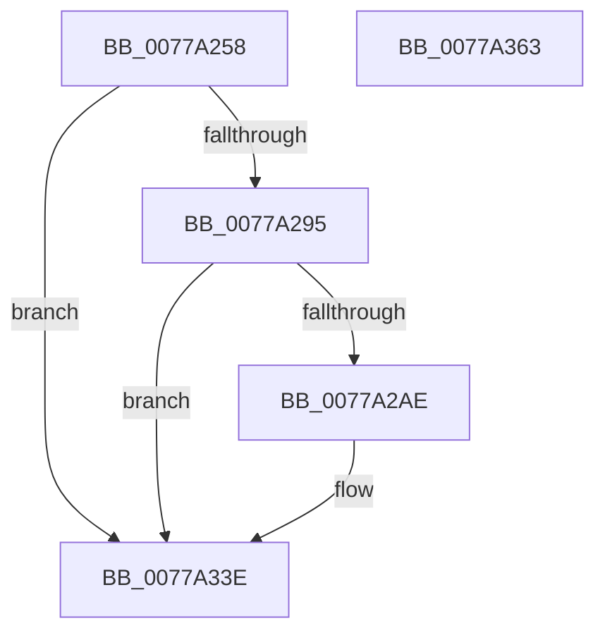

# TtmiLogExitProximity

- RVA: `0x0077A258`–`0x0077A364` (길이 `268` bytes)
- VA: `0x000000014077A258`
- 실행 섹션: `PAGE`
- PDB 이름 있음: `예`; PDB Function 태그: `아니요`
- unwind 정보 RVA: `0x000CDD08`
- 디코드: `63`개 명령, `268/268` bytes 표시
- 미해석 바이트: `0` (있으면 어셈블리에 `.byte`로 보존)

> 이 문서는 커널 이미지의 기계어와 PDB 기호를 분석해 생성했습니다. 4번과 5번은 함수 원형과 자료형을 바이너리 사용 방식에서 추정한 C 해석이며 원본 소스 복구 결과는 아닙니다.

## 1. Dependencies

- 직접 호출 지점: **4**; 고유 호출 대상: **4**
- 직접 호출자로 확인된 함수: **1**
- RIP 상대 이미지 참조: **3**

### Outgoing calls
- `0x0077A2A1` → [tlgKeywordOn](../../text/42/tlgKeywordOn_function_0042EAA0.md) (function, `0x0042EAA0`)
- `0x0077A2BE` → [PsGetProcessSessionIdEx](../../text/22/PsGetProcessSessionIdEx_function_0022F8F0.md) (function, `0x0022F8F0`)
- `0x0077A339` → [tlgWriteTransfer_EtwWriteTransfer](../../text/42/tlgWriteTransfer_EtwWriteTransfer_function_004260E0.md) (function, `0x004260E0`)
- `0x0077A345` → [_security_check_cookie](../../text/6A/_security_check_cookie_function_006AC640.md) (function, `0x006AC640`)

### Direct callers
- [TtmpExitProximity](TtmpExitProximity_function_0077D438.md) at `0x0077D464`

### Static image references
- `0x0077A273` → RVA `0x00E0A740` (`.data`; read)
- `0x0077A281` → RVA `0x00FD88C8` (`PAGEDATA`; read)
- `0x0077A315` → RVA `0x00052235` (`.rdata`; read)

## 2. Other-region calls and transfers

- 다른 실행 섹션으로 향하는 call: **4**
  - `0x0077A2A1` → [tlgKeywordOn](../../text/42/tlgKeywordOn_function_0042EAA0.md) (`PAGE` → `.text`)
  - `0x0077A2BE` → [PsGetProcessSessionIdEx](../../text/22/PsGetProcessSessionIdEx_function_0022F8F0.md) (`PAGE` → `.text`)
  - `0x0077A339` → [tlgWriteTransfer_EtwWriteTransfer](../../text/42/tlgWriteTransfer_EtwWriteTransfer_function_004260E0.md) (`PAGE` → `.text`)
  - `0x0077A345` → [_security_check_cookie](../../text/6A/_security_check_cookie_function_006AC640.md) (`PAGE` → `.text`)
- 별도 외부 분기/꼬리 이동을 확인하지 못했습니다.

## 3. Assembly (complete function range)

```asm
0077A258  48 8B C4                        mov rax, rsp
0077A25B  48 89 58 08                     mov qword ptr [rax + 8], rbx
0077A25F  48 89 70 10                     mov qword ptr [rax + 0x10], rsi
0077A263  48 89 78 18                     mov qword ptr [rax + 0x18], rdi
0077A267  55                              push rbp
0077A268  48 8D 68 A1                     lea rbp, [rax - 0x5f]
0077A26C  48 81 EC B0 00 00 00            sub rsp, 0xb0
0077A273  48 8B 05 C6 04 69 00            mov rax, qword ptr [rip + 0x6904c6]
0077A27A  48 33 C4                        xor rax, rsp
0077A27D  48 89 45 47                     mov qword ptr [rbp + 0x47], rax
0077A281  83 3D 40 E6 85 00 05            cmp dword ptr [rip + 0x85e640], 5
0077A288  41 8A D8                        mov bl, r8b
0077A28B  8B FA                           mov edi, edx
0077A28D  8B F1                           mov esi, ecx
0077A28F  0F 86 A9 00 00 00               jbe 0x14077a33e
0077A295  BA 01 00 00 00                  mov edx, 1
0077A29A  48 8D 0D 27 E6 85 00            lea rcx, [rip + 0x85e627]
0077A2A1  E8 FA 47 CB FF                  call 0x14042eaa0
0077A2A6  84 C0                           test al, al
0077A2A8  0F 84 90 00 00 00               je 0x14077a33e
0077A2AE  65 48 8B 0C 25 88 01 00 00      mov rcx, qword ptr gs:[0x188]
0077A2B7  48 8B 89 B8 00 00 00            mov rcx, qword ptr [rcx + 0xb8]
0077A2BE  E8 2D 56 AB FF                  call 0x14022f8f0
0077A2C3  83 65 13 00                     and dword ptr [rbp + 0x13], 0
0077A2C7  48 8D 0D FA E5 85 00            lea rcx, [rip + 0x85e5fa]
0077A2CE  83 65 23 00                     and dword ptr [rbp + 0x23], 0
0077A2D2  BA 04 00 00 00                  mov edx, 4
0077A2D7  83 65 33 00                     and dword ptr [rbp + 0x33], 0
0077A2DB  45 33 C9                        xor r9d, r9d
0077A2DE  83 65 43 00                     and dword ptr [rbp + 0x43], 0
0077A2E2  45 33 C0                        xor r8d, r8d
0077A2E5  89 45 DB                        mov dword ptr [rbp - 0x25], eax
0077A2E8  48 8D 45 DB                     lea rax, [rbp - 0x25]
0077A2EC  48 89 45 07                     mov qword ptr [rbp + 7], rax
0077A2F0  48 8D 45 DF                     lea rax, [rbp - 0x21]
0077A2F4  48 89 45 17                     mov qword ptr [rbp + 0x17], rax
0077A2F8  48 8D 45 E3                     lea rax, [rbp - 0x1d]
0077A2FC  48 89 45 27                     mov qword ptr [rbp + 0x27], rax
0077A300  48 8D 45 D7                     lea rax, [rbp - 0x29]
0077A304  48 89 45 37                     mov qword ptr [rbp + 0x37], rax
0077A308  48 8D 45 E7                     lea rax, [rbp - 0x19]
0077A30C  89 55 0F                        mov dword ptr [rbp + 0xf], edx
0077A30F  89 55 1F                        mov dword ptr [rbp + 0x1f], edx
0077A312  89 55 2F                        mov dword ptr [rbp + 0x2f], edx
0077A315  48 8D 15 19 7F 8D FF            lea rdx, [rip - 0x7280e7]
0077A31C  48 89 44 24 28                  mov qword ptr [rsp + 0x28], rax
0077A321  C7 44 24 20 06 00 00 00         mov dword ptr [rsp + 0x20], 6
0077A329  89 75 DF                        mov dword ptr [rbp - 0x21], esi
0077A32C  89 7D E3                        mov dword ptr [rbp - 0x1d], edi
0077A32F  88 5D D7                        mov byte ptr [rbp - 0x29], bl
0077A332  C7 45 3F 01 00 00 00            mov dword ptr [rbp + 0x3f], 1
0077A339  E8 A2 BD CA FF                  call 0x1404260e0
0077A33E  48 8B 4D 47                     mov rcx, qword ptr [rbp + 0x47]
0077A342  48 33 CC                        xor rcx, rsp
0077A345  E8 F6 22 F3 FF                  call 0x1406ac640
0077A34A  4C 8D 9C 24 B0 00 00 00         lea r11, [rsp + 0xb0]
0077A352  49 8B 5B 10                     mov rbx, qword ptr [r11 + 0x10]
0077A356  49 8B 73 18                     mov rsi, qword ptr [r11 + 0x18]
0077A35A  49 8B 7B 20                     mov rdi, qword ptr [r11 + 0x20]
0077A35E  49 8B E3                        mov rsp, r11
0077A361  5D                              pop rbp
0077A362  C3                              ret
0077A363  CC                              int3
```

## 4. C-style interpretation (structured pseudocode)

```c
__int64 __fastcall TtmiLogExitProximity(int a1, int a2, int a3, int a4)
{
    __int64 result;
    __int64 v_rsp;
    unsigned __int64 v_stack_m8;
    unsigned __int64 v_stack_m90;
    unsigned int v_stack_m98;

    *(unsigned __int64 *)(v_rsp + 8) = v_rbx;
    *(unsigned __int64 *)(v_rsp + 16) = v_rsi;
    *(unsigned __int64 *)(v_rsp + 24) = v_rdi;
    v_rsp = (v_rsp) - (176);
    result = (*(unsigned __int64 *)(v_rip + 6882502)) ^ (v_rsp);
    *(unsigned __int64 *)(v_rsp - 95 + 71) = result;
    if ((*(unsigned int *)(v_rip + 8775232)) <= 5) goto loc_0077A33E;
    result = tlgKeywordOn(v_rip + 8775207, 1, a3, a4);
    if ((unsigned __int8)(result) != 0) {
        a1 = *(unsigned __int64 *)(gs_base + (0 + 392));
        a1 = *(unsigned __int64 *)(a1 + 184);
        result = PsGetProcessSessionIdEx(a1, 1, a3, a4);
        a1 = v_rip + 8775162;
        a2 = 4;
        a4 = 0;
        a3 = 0;
        *(unsigned int *)(v_rsp - 95 - 37) = (unsigned int)(result);
        result = v_rsp - 95 - 37;
        *(unsigned __int64 *)(v_rsp - 95 + 7) = result;
        result = v_rsp - 95 - 33;
        *(unsigned __int64 *)(v_rsp - 95 + 23) = result;
        result = v_rsp - 95 - 29;
        *(unsigned __int64 *)(v_rsp - 95 + 39) = result;
        result = v_rsp - 95 - 41;
        *(unsigned __int64 *)(v_rsp - 95 + 55) = result;
        result = v_rsp - 95 - 25;
        *(unsigned int *)(v_rsp - 95 + 15) = a2;
        *(unsigned int *)(v_rsp - 95 + 31) = a2;
        *(unsigned int *)(v_rsp - 95 + 47) = a2;
        a2 = v_rip - 7504103;
        v_stack_m90 = result;
        v_stack_m98 = 6;
        *(unsigned int *)(v_rsp - 95 - 33) = (unsigned int)((unsigned int)(a1));
        *(unsigned int *)(v_rsp - 95 - 29) = (unsigned int)((unsigned int)(a2));
        *(unsigned __int8 *)(v_rsp - 95 - 41) = (unsigned __int8)((unsigned __int8)(a3));
        *(unsigned int *)(v_rsp - 95 + 63) = 1;
        result = tlgWriteTransfer_EtwWriteTransfer(a1, a2, a3, a4);
    }
    a1 = (*(unsigned __int64 *)(v_rsp - 95 + 71)) ^ (v_rsp);
    result = _security_check_cookie(a1, a2, a3, a4);
    return result;
}
```

## 5. (Beta) C Style

```c
int64_t TtmiLogExitProximity(int32_t Arg1, int32_t Arg2, int32_t Arg3, int32_t Arg4)
{
    int64_t result;
    int64_t local_rsp;
    uint64_t v_stack_m8;
    uint64_t v_stack_m90;
    uint32_t v_stack_m98;

    *(uint64_t *)(local_rsp + 0x8) = local_rbx;
    *(uint64_t *)(local_rsp + 0x10) = local_rsi;
    *(uint64_t *)(local_rsp + 0x18) = local_rdi;
    local_rsp = (local_rsp) - (176);
    result = (*(uint64_t *)(v_rip + 0x6904C6)) ^ (local_rsp);
    *(uint64_t *)(local_rsp - 0x5F + 0x47) = result;
    if ((*(uint32_t *)(v_rip + 0x85E640)) <= 5) goto loc_0077A33E;
    result = tlgKeywordOn(v_rip + 8775207, 1, Arg3, Arg4);
    if ((uint8_t)(result) != 0) {
        Arg1 = *(uint64_t *)(gs_base + (0 + 0x188));
        Arg1 = *(uint64_t *)(Arg1 + 0xB8);
        result = PsGetProcessSessionIdEx(Arg1, 1, Arg3, Arg4);
        Arg1 = v_rip + 8775162;
        Arg2 = 4;
        Arg4 = 0;
        Arg3 = 0;
        *(uint32_t *)(local_rsp - 0x5F - 0x25) = (uint32_t)(result);
        result = local_rsp - 95 - 37;
        *(uint64_t *)(local_rsp - 0x5F + 0x7) = result;
        result = local_rsp - 95 - 33;
        *(uint64_t *)(local_rsp - 0x5F + 0x17) = result;
        result = local_rsp - 95 - 29;
        *(uint64_t *)(local_rsp - 0x5F + 0x27) = result;
        result = local_rsp - 95 - 41;
        *(uint64_t *)(local_rsp - 0x5F + 0x37) = result;
        result = local_rsp - 95 - 25;
        *(uint32_t *)(local_rsp - 0x5F + 0xF) = Arg2;
        *(uint32_t *)(local_rsp - 0x5F + 0x1F) = Arg2;
        *(uint32_t *)(local_rsp - 0x5F + 0x2F) = Arg2;
        Arg2 = v_rip - 7504103;
        v_stack_m90 = result;
        v_stack_m98 = 6;
        *(uint32_t *)(local_rsp - 0x5F - 0x21) = (uint32_t)((uint32_t)(Arg1));
        *(uint32_t *)(local_rsp - 0x5F - 0x1D) = (uint32_t)((uint32_t)(Arg2));
        *(uint8_t *)(local_rsp - 0x5F - 0x29) = (uint8_t)((uint8_t)(Arg3));
        *(uint32_t *)(local_rsp - 0x5F + 0x3F) = 1;
        result = tlgWriteTransfer_EtwWriteTransfer(Arg1, Arg2, Arg3, Arg4);
    }
    Arg1 = (*(uint64_t *)(local_rsp - 0x5F + 0x47)) ^ (local_rsp);
    result = _security_check_cookie(Arg1, Arg2, Arg3, Arg4);
    return result;
}
```

## 6. Execution-region graph

[열기: 2D/3D 그래프와 함수 탐색 컨트롤 패널](../../../control-panel.html?section=page&rva=0x0077A258&view=graph)

- 2D 그래프는 위에서 아래로 흐르고, 3D 그래프는 빈 공간을 드래그해 회전합니다. Shift+드래그는 이동, 휠은 확대·축소, 함수 노드 선택은 대상 보고서 이동입니다.

### Static fallback


