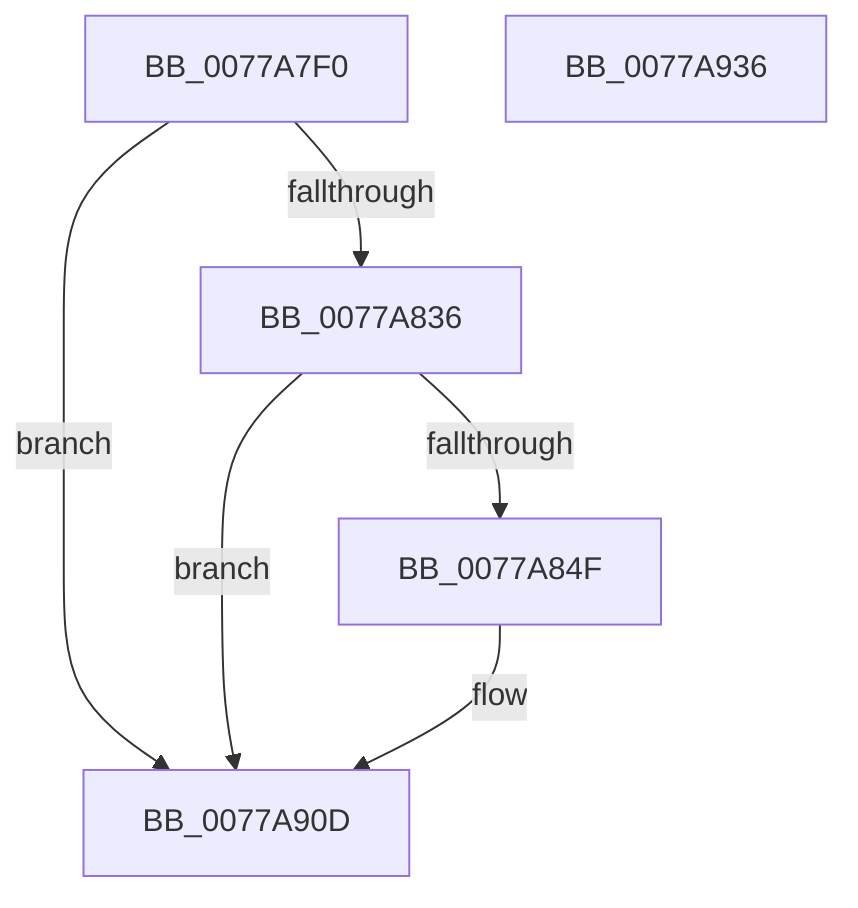

# TtmiLogProximityPowerPress

- RVA: `0x0077A7F0`–`0x0077A937` (길이 `327` bytes)
- VA: `0x000000014077A7F0`
- 실행 섹션: `PAGE`
- PDB 이름 있음: `예`; PDB Function 태그: `아니요`
- unwind 정보 RVA: `0x000CDD4C`
- 디코드: `78`개 명령, `327/327` bytes 표시
- 미해석 바이트: `0` (있으면 어셈블리에 `.byte`로 보존)

> 이 문서는 커널 이미지의 기계어와 PDB 기호를 분석해 생성했습니다. 4번과 5번은 함수 원형과 자료형을 바이너리 사용 방식에서 추정한 C 해석이며 원본 소스 복구 결과는 아닙니다.

## 1. Dependencies

- 직접 호출 지점: **4**; 고유 호출 대상: **4**
- 직접 호출자로 확인된 함수: **1**
- RIP 상대 이미지 참조: **3**

### Outgoing calls
- `0x0077A842` → [tlgKeywordOn](../../text/42/tlgKeywordOn_function_0042EAA0.md) (function, `0x0042EAA0`)
- `0x0077A85F` → [PsGetProcessSessionIdEx](../../text/22/PsGetProcessSessionIdEx_function_0022F8F0.md) (function, `0x0022F8F0`)
- `0x0077A908` → [tlgWriteTransfer_EtwWriteTransfer](../../text/42/tlgWriteTransfer_EtwWriteTransfer_function_004260E0.md) (function, `0x004260E0`)
- `0x0077A914` → [_security_check_cookie](../../text/6A/_security_check_cookie_function_006AC640.md) (function, `0x006AC640`)

### Direct callers
- [TtmpShouldEscapeProximity](TtmpShouldEscapeProximity_function_0077D5F4.md) at `0x0077D665`

### Static image references
- `0x0077A80F` → RVA `0x00E0A740` (`.data`; read)
- `0x0077A81D` → RVA `0x00FD88C8` (`PAGEDATA`; read)
- `0x0077A8DD` → RVA `0x0005141B` (`.rdata`; read)

## 2. Other-region calls and transfers

- 다른 실행 섹션으로 향하는 call: **4**
  - `0x0077A842` → [tlgKeywordOn](../../text/42/tlgKeywordOn_function_0042EAA0.md) (`PAGE` → `.text`)
  - `0x0077A85F` → [PsGetProcessSessionIdEx](../../text/22/PsGetProcessSessionIdEx_function_0022F8F0.md) (`PAGE` → `.text`)
  - `0x0077A908` → [tlgWriteTransfer_EtwWriteTransfer](../../text/42/tlgWriteTransfer_EtwWriteTransfer_function_004260E0.md) (`PAGE` → `.text`)
  - `0x0077A914` → [_security_check_cookie](../../text/6A/_security_check_cookie_function_006AC640.md) (`PAGE` → `.text`)
- 별도 외부 분기/꼬리 이동을 확인하지 못했습니다.

## 3. Assembly (complete function range)

```asm
0077A7F0  48 8B C4                        mov rax, rsp
0077A7F3  48 89 58 08                     mov qword ptr [rax + 8], rbx
0077A7F7  48 89 70 10                     mov qword ptr [rax + 0x10], rsi
0077A7FB  48 89 78 18                     mov qword ptr [rax + 0x18], rdi
0077A7FF  4C 89 70 20                     mov qword ptr [rax + 0x20], r14
0077A803  55                              push rbp
0077A804  48 8D 68 A9                     lea rbp, [rax - 0x57]
0077A808  48 81 EC E0 00 00 00            sub rsp, 0xe0
0077A80F  48 8B 05 2A FF 68 00            mov rax, qword ptr [rip + 0x68ff2a]
0077A816  48 33 C4                        xor rax, rsp
0077A819  48 89 45 3F                     mov qword ptr [rbp + 0x3f], rax
0077A81D  83 3D A4 E0 85 00 05            cmp dword ptr [rip + 0x85e0a4], 5
0077A824  41 8B D9                        mov ebx, r9d
0077A827  41 8B F8                        mov edi, r8d
0077A82A  48 8B F2                        mov rsi, rdx
0077A82D  44 8A F1                        mov r14b, cl
0077A830  0F 86 D7 00 00 00               jbe 0x14077a90d
0077A836  BA 01 00 00 00                  mov edx, 1
0077A83B  48 8D 0D 86 E0 85 00            lea rcx, [rip + 0x85e086]
0077A842  E8 59 42 CB FF                  call 0x14042eaa0
0077A847  84 C0                           test al, al
0077A849  0F 84 BE 00 00 00               je 0x14077a90d
0077A84F  65 48 8B 0C 25 88 01 00 00      mov rcx, qword ptr gs:[0x188]
0077A858  48 8B 89 B8 00 00 00            mov rcx, qword ptr [rcx + 0xb8]
0077A85F  E8 8C 50 AB FF                  call 0x14022f8f0
0077A864  83 65 EB 00                     and dword ptr [rbp - 0x15], 0
0077A868  48 8D 0D 59 E0 85 00            lea rcx, [rip + 0x85e059]
0077A86F  83 65 FB 00                     and dword ptr [rbp - 5], 0
0077A873  41 B8 04 00 00 00               mov r8d, 4
0077A879  83 65 0B 00                     and dword ptr [rbp + 0xb], 0
0077A87D  45 33 C9                        xor r9d, r9d
0077A880  83 65 1B 00                     and dword ptr [rbp + 0x1b], 0
0077A884  83 65 2B 00                     and dword ptr [rbp + 0x2b], 0
0077A888  83 65 3B 00                     and dword ptr [rbp + 0x3b], 0
0077A88C  41 8D 50 04                     lea edx, [r8 + 4]
0077A890  89 45 A3                        mov dword ptr [rbp - 0x5d], eax
0077A893  48 8D 45 A3                     lea rax, [rbp - 0x5d]
0077A897  48 89 45 DF                     mov qword ptr [rbp - 0x21], rax
0077A89B  48 8D 45 9F                     lea rax, [rbp - 0x61]
0077A89F  48 89 45 EF                     mov qword ptr [rbp - 0x11], rax
0077A8A3  48 8D 45 B7                     lea rax, [rbp - 0x49]
0077A8A7  48 89 45 FF                     mov qword ptr [rbp - 1], rax
0077A8AB  48 8D 45 A7                     lea rax, [rbp - 0x59]
0077A8AF  48 89 45 0F                     mov qword ptr [rbp + 0xf], rax
0077A8B3  48 8D 45 AB                     lea rax, [rbp - 0x55]
0077A8B7  48 89 45 1F                     mov qword ptr [rbp + 0x1f], rax
0077A8BB  8B 45 7F                        mov eax, dword ptr [rbp + 0x7f]
0077A8BE  89 45 AF                        mov dword ptr [rbp - 0x51], eax
0077A8C1  48 8D 45 AF                     lea rax, [rbp - 0x51]
0077A8C5  48 89 45 2F                     mov qword ptr [rbp + 0x2f], rax
0077A8C9  48 8D 45 BF                     lea rax, [rbp - 0x41]
0077A8CD  48 89 44 24 28                  mov qword ptr [rsp + 0x28], rax
0077A8D2  89 54 24 20                     mov dword ptr [rsp + 0x20], edx
0077A8D6  44 89 45 E7                     mov dword ptr [rbp - 0x19], r8d
0077A8DA  89 55 07                        mov dword ptr [rbp + 7], edx
0077A8DD  48 8D 15 37 6B 8D FF            lea rdx, [rip - 0x7294c9]
0077A8E4  44 89 45 17                     mov dword ptr [rbp + 0x17], r8d
0077A8E8  44 89 45 27                     mov dword ptr [rbp + 0x27], r8d
0077A8EC  44 89 45 37                     mov dword ptr [rbp + 0x37], r8d
0077A8F0  45 33 C0                        xor r8d, r8d
0077A8F3  44 88 75 9F                     mov byte ptr [rbp - 0x61], r14b
0077A8F7  C7 45 F7 01 00 00 00            mov dword ptr [rbp - 9], 1
0077A8FE  48 89 75 B7                     mov qword ptr [rbp - 0x49], rsi
0077A902  89 7D A7                        mov dword ptr [rbp - 0x59], edi
0077A905  89 5D AB                        mov dword ptr [rbp - 0x55], ebx
0077A908  E8 D3 B7 CA FF                  call 0x1404260e0
0077A90D  48 8B 4D 3F                     mov rcx, qword ptr [rbp + 0x3f]
0077A911  48 33 CC                        xor rcx, rsp
0077A914  E8 27 1D F3 FF                  call 0x1406ac640
0077A919  4C 8D 9C 24 E0 00 00 00         lea r11, [rsp + 0xe0]
0077A921  49 8B 5B 10                     mov rbx, qword ptr [r11 + 0x10]
0077A925  49 8B 73 18                     mov rsi, qword ptr [r11 + 0x18]
0077A929  49 8B 7B 20                     mov rdi, qword ptr [r11 + 0x20]
0077A92D  4D 8B 73 28                     mov r14, qword ptr [r11 + 0x28]
0077A931  49 8B E3                        mov rsp, r11
0077A934  5D                              pop rbp
0077A935  C3                              ret
0077A936  CC                              int3
```

## 4. C-style interpretation (structured pseudocode)

```c
__int64 __fastcall TtmiLogProximityPowerPress(unsigned __int8 a1, __int64 a2, int a3, int a4)
{
    __int64 result;
    __int64 v_rsp;
    unsigned __int64 v_stack_m8;
    unsigned __int64 v_stack_mC0;
    unsigned int v_stack_mC8;

    *(unsigned __int64 *)(v_rsp + 8) = v_rbx;
    *(unsigned __int64 *)(v_rsp + 16) = v_rsi;
    *(unsigned __int64 *)(v_rsp + 24) = v_rdi;
    *(unsigned __int64 *)(v_rsp + 32) = v_r14;
    v_rsp = (v_rsp) - (224);
    result = (*(unsigned __int64 *)(v_rip + 6881066)) ^ (v_rsp);
    *(unsigned __int64 *)(v_rsp - 87 + 63) = result;
    if ((*(unsigned int *)(v_rip + 8773796)) <= 5) goto loc_0077A90D;
    result = tlgKeywordOn(v_rip + 8773766, 1, a3, a4);
    if ((unsigned __int8)(result) != 0) {
        a1 = *(unsigned __int64 *)(gs_base + (0 + 392));
        a1 = *(unsigned __int64 *)(a1 + 184);
        result = PsGetProcessSessionIdEx(a1, 1, a3, a4);
        a1 = v_rip + 8773721;
        a3 = 4;
        a4 = 0;
        a2 = a3 + 4;
        *(unsigned int *)(v_rsp - 87 - 93) = (unsigned int)(result);
        result = v_rsp - 87 - 93;
        *(unsigned __int64 *)(v_rsp - 87 - 33) = result;
        result = v_rsp - 87 - 97;
        *(unsigned __int64 *)(v_rsp - 87 - 17) = result;
        result = v_rsp - 87 - 73;
        *(unsigned __int64 *)(v_rsp - 87 - 1) = result;
        result = v_rsp - 87 - 89;
        *(unsigned __int64 *)(v_rsp - 87 + 15) = result;
        result = v_rsp - 87 - 85;
        *(unsigned __int64 *)(v_rsp - 87 + 31) = result;
        result = *(unsigned int *)(v_rsp - 87 + 127);
        *(unsigned int *)(v_rsp - 87 - 81) = (unsigned int)(result);
        result = v_rsp - 87 - 81;
        *(unsigned __int64 *)(v_rsp - 87 + 47) = result;
        result = v_rsp - 87 - 65;
        v_stack_mC0 = result;
        v_stack_mC8 = (unsigned int)(a2);
        *(unsigned int *)(v_rsp - 87 - 25) = a3;
        *(unsigned int *)(v_rsp - 87 + 7) = (unsigned int)(a2);
        a2 = v_rip - 7509193;
        *(unsigned int *)(v_rsp - 87 + 23) = a3;
        *(unsigned int *)(v_rsp - 87 + 39) = a3;
        *(unsigned int *)(v_rsp - 87 + 55) = a3;
        a3 = 0;
        *(unsigned __int8 *)(v_rsp - 87 - 97) = a1;
        *(unsigned int *)(v_rsp - 87 - 9) = 1;
        *(unsigned __int64 *)(v_rsp - 87 - 73) = a2;
        *(unsigned int *)(v_rsp - 87 - 89) = (unsigned int)((unsigned int)(a3));
        *(unsigned int *)(v_rsp - 87 - 85) = (unsigned int)((unsigned int)(a4));
        result = tlgWriteTransfer_EtwWriteTransfer(a1, a2, a3, a4);
    }
    a1 = (*(unsigned __int64 *)(v_rsp - 87 + 63)) ^ (v_rsp);
    result = _security_check_cookie(a1, a2, a3, a4);
    return result;
}
```

## 5. (Beta) C Style

```c
int64_t TtmiLogProximityPowerPress(uint8_t Arg1, int64_t Arg2, int32_t Arg3, int32_t Arg4)
{
    int64_t result;
    int64_t local_rsp;
    uint64_t v_stack_m8;
    uint64_t v_stack_mC0;
    uint32_t v_stack_mC8;

    *(uint64_t *)(local_rsp + 0x8) = local_rbx;
    *(uint64_t *)(local_rsp + 0x10) = local_rsi;
    *(uint64_t *)(local_rsp + 0x18) = local_rdi;
    *(uint64_t *)(local_rsp + 0x20) = local_r14;
    local_rsp = (local_rsp) - (224);
    result = (*(uint64_t *)(v_rip + 0x68FF2A)) ^ (local_rsp);
    *(uint64_t *)(local_rsp - 0x57 + 0x3F) = result;
    if ((*(uint32_t *)(v_rip + 0x85E0A4)) <= 5) goto loc_0077A90D;
    result = tlgKeywordOn(v_rip + 8773766, 1, Arg3, Arg4);
    if ((uint8_t)(result) != 0) {
        Arg1 = *(uint64_t *)(gs_base + (0 + 0x188));
        Arg1 = *(uint64_t *)(Arg1 + 0xB8);
        result = PsGetProcessSessionIdEx(Arg1, 1, Arg3, Arg4);
        Arg1 = v_rip + 8773721;
        Arg3 = 4;
        Arg4 = 0;
        Arg2 = Arg3 + 4;
        *(uint32_t *)(local_rsp - 0x57 - 0x5D) = (uint32_t)(result);
        result = local_rsp - 87 - 93;
        *(uint64_t *)(local_rsp - 0x57 - 0x21) = result;
        result = local_rsp - 87 - 97;
        *(uint64_t *)(local_rsp - 0x57 - 0x11) = result;
        result = local_rsp - 87 - 73;
        *(uint64_t *)(local_rsp - 0x57 - 0x1) = result;
        result = local_rsp - 87 - 89;
        *(uint64_t *)(local_rsp - 0x57 + 0xF) = result;
        result = local_rsp - 87 - 85;
        *(uint64_t *)(local_rsp - 0x57 + 0x1F) = result;
        result = *(uint32_t *)(local_rsp - 0x57 + 0x7F);
        *(uint32_t *)(local_rsp - 0x57 - 0x51) = (uint32_t)(result);
        result = local_rsp - 87 - 81;
        *(uint64_t *)(local_rsp - 0x57 + 0x2F) = result;
        result = local_rsp - 87 - 65;
        v_stack_mC0 = result;
        v_stack_mC8 = (uint32_t)(Arg2);
        *(uint32_t *)(local_rsp - 0x57 - 0x19) = Arg3;
        *(uint32_t *)(local_rsp - 0x57 + 0x7) = (uint32_t)(Arg2);
        Arg2 = v_rip - 7509193;
        *(uint32_t *)(local_rsp - 0x57 + 0x17) = Arg3;
        *(uint32_t *)(local_rsp - 0x57 + 0x27) = Arg3;
        *(uint32_t *)(local_rsp - 0x57 + 0x37) = Arg3;
        Arg3 = 0;
        *(uint8_t *)(local_rsp - 0x57 - 0x61) = Arg1;
        *(uint32_t *)(local_rsp - 0x57 - 0x9) = 1;
        *(uint64_t *)(local_rsp - 0x57 - 0x49) = Arg2;
        *(uint32_t *)(local_rsp - 0x57 - 0x59) = (uint32_t)((uint32_t)(Arg3));
        *(uint32_t *)(local_rsp - 0x57 - 0x55) = (uint32_t)((uint32_t)(Arg4));
        result = tlgWriteTransfer_EtwWriteTransfer(Arg1, Arg2, Arg3, Arg4);
    }
    Arg1 = (*(uint64_t *)(local_rsp - 0x57 + 0x3F)) ^ (local_rsp);
    result = _security_check_cookie(Arg1, Arg2, Arg3, Arg4);
    return result;
}
```

## 6. Execution-region graph

[열기: 2D/3D 그래프와 함수 탐색 컨트롤 패널](../../../control-panel.html?section=page&rva=0x0077A7F0&view=graph)

- 2D 그래프는 위에서 아래로 흐르고, 3D 그래프는 빈 공간을 드래그해 회전합니다. Shift+드래그는 이동, 휠은 확대·축소, 함수 노드 선택은 대상 보고서 이동입니다.

### Static fallback


