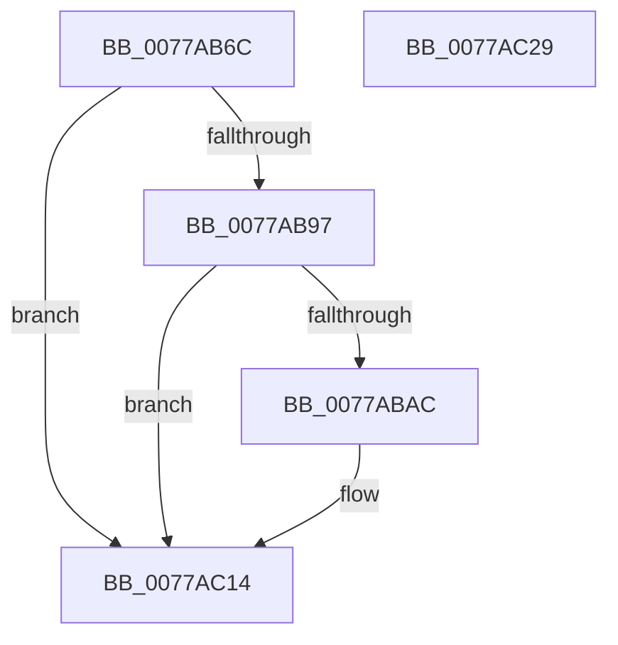

# TtmiLogQueueEnqueueEvent

- RVA: `0x0077AB6C`–`0x0077AC2A` (길이 `190` bytes)
- VA: `0x000000014077AB6C`
- 실행 섹션: `PAGE`
- PDB 이름 있음: `예`; PDB Function 태그: `아니요`
- unwind 정보 RVA: `0x00079278`
- 디코드: `43`개 명령, `190/190` bytes 표시
- 미해석 바이트: `0` (있으면 어셈블리에 `.byte`로 보존)

> 이 문서는 커널 이미지의 기계어와 PDB 기호를 분석해 생성했습니다. 4번과 5번은 함수 원형과 자료형을 바이너리 사용 방식에서 추정한 C 해석이며 원본 소스 복구 결과는 아닙니다.

## 1. Dependencies

- 직접 호출 지점: **3**; 고유 호출 대상: **3**
- 직접 호출자로 확인된 함수: **1**
- RIP 상대 이미지 참조: **3**

### Outgoing calls
- `0x0077ABA3` → [tlgKeywordOn](../../text/42/tlgKeywordOn_function_0042EAA0.md) (function, `0x0042EAA0`)
- `0x0077AC0F` → [tlgWriteTransfer_EtwWriteTransfer](../../text/42/tlgWriteTransfer_EtwWriteTransfer_function_004260E0.md) (function, `0x004260E0`)
- `0x0077AC1B` → [_security_check_cookie](../../text/6A/_security_check_cookie_function_006AC640.md) (function, `0x006AC640`)

### Direct callers
- [TtmiWriteEventToSingleQueue](TtmiWriteEventToSingleQueue_function_0077DE04.md) at `0x0077DEE5`

### Static image references
- `0x0077AB7A` → RVA `0x00E0A740` (`.data`; read)
- `0x0077AB88` → RVA `0x00FD88C8` (`PAGEDATA`; read)
- `0x0077ABB8` → RVA `0x00051726` (`.rdata`; read)

## 2. Other-region calls and transfers

- 다른 실행 섹션으로 향하는 call: **3**
  - `0x0077ABA3` → [tlgKeywordOn](../../text/42/tlgKeywordOn_function_0042EAA0.md) (`PAGE` → `.text`)
  - `0x0077AC0F` → [tlgWriteTransfer_EtwWriteTransfer](../../text/42/tlgWriteTransfer_EtwWriteTransfer_function_004260E0.md) (`PAGE` → `.text`)
  - `0x0077AC1B` → [_security_check_cookie](../../text/6A/_security_check_cookie_function_006AC640.md) (`PAGE` → `.text`)
- 별도 외부 분기/꼬리 이동을 확인하지 못했습니다.

## 3. Assembly (complete function range)

```asm
0077AB6C  40 55                           push rbp
0077AB6E  48 8D 6C 24 A9                  lea rbp, [rsp - 0x57]
0077AB73  48 81 EC B0 00 00 00            sub rsp, 0xb0
0077AB7A  48 8B 05 BF FB 68 00            mov rax, qword ptr [rip + 0x68fbbf]
0077AB81  48 33 C4                        xor rax, rsp
0077AB84  48 89 45 47                     mov qword ptr [rbp + 0x47], rax
0077AB88  83 3D 39 DD 85 00 05            cmp dword ptr [rip + 0x85dd39], 5
0077AB8F  4C 8B C2                        mov r8, rdx
0077AB92  4C 8B C9                        mov r9, rcx
0077AB95  76 7D                           jbe 0x14077ac14
0077AB97  BA 01 00 00 00                  mov edx, 1
0077AB9C  48 8D 0D 25 DD 85 00            lea rcx, [rip + 0x85dd25]
0077ABA3  E8 F8 3E CB FF                  call 0x14042eaa0
0077ABA8  84 C0                           test al, al
0077ABAA  74 68                           je 0x14077ac14
0077ABAC  48 8D 45 DF                     lea rax, [rbp - 0x21]
0077ABB0  4C 89 4D DF                     mov qword ptr [rbp - 0x21], r9
0077ABB4  48 89 45 17                     mov qword ptr [rbp + 0x17], rax
0077ABB8  48 8D 15 67 6B 8D FF            lea rdx, [rip - 0x729499]
0077ABBF  48 8D 45 E7                     lea rax, [rbp - 0x19]
0077ABC3  4C 89 45 E7                     mov qword ptr [rbp - 0x19], r8
0077ABC7  48 89 45 27                     mov qword ptr [rbp + 0x27], rax
0077ABCB  48 8D 0D F6 DC 85 00            lea rcx, [rip + 0x85dcf6]
0077ABD2  41 8B 00                        mov eax, dword ptr [r8]
0077ABD5  45 33 C9                        xor r9d, r9d
0077ABD8  89 45 D7                        mov dword ptr [rbp - 0x29], eax
0077ABDB  45 33 C0                        xor r8d, r8d
0077ABDE  48 8D 45 D7                     lea rax, [rbp - 0x29]
0077ABE2  48 C7 45 1F 08 00 00 00         mov qword ptr [rbp + 0x1f], 8
0077ABEA  48 89 45 37                     mov qword ptr [rbp + 0x37], rax
0077ABEE  48 8D 45 F7                     lea rax, [rbp - 9]
0077ABF2  48 89 44 24 28                  mov qword ptr [rsp + 0x28], rax
0077ABF7  C7 44 24 20 05 00 00 00         mov dword ptr [rsp + 0x20], 5
0077ABFF  48 C7 45 2F 08 00 00 00         mov qword ptr [rbp + 0x2f], 8
0077AC07  48 C7 45 3F 04 00 00 00         mov qword ptr [rbp + 0x3f], 4
0077AC0F  E8 CC B4 CA FF                  call 0x1404260e0
0077AC14  48 8B 4D 47                     mov rcx, qword ptr [rbp + 0x47]
0077AC18  48 33 CC                        xor rcx, rsp
0077AC1B  E8 20 1A F3 FF                  call 0x1406ac640
0077AC20  48 81 C4 B0 00 00 00            add rsp, 0xb0
0077AC27  5D                              pop rbp
0077AC28  C3                              ret
0077AC29  CC                              int3
```

## 4. C-style interpretation (structured pseudocode)

```c
__int64 __fastcall TtmiLogQueueEnqueueEvent(__int64 a1, __int64 a2)
{
    __int64 result;
    __int64 v_rsp;
    unsigned __int64 v_stack_m18;
    unsigned __int64 v_stack_m20;
    unsigned __int64 v_stack_m28;
    unsigned __int64 v_stack_m30;
    unsigned __int64 v_stack_m38;
    unsigned __int64 v_stack_m40;
    unsigned __int64 v_stack_m48;
    unsigned __int64 v_stack_m5F;
    unsigned __int64 v_stack_m68;
    unsigned __int64 v_stack_m78;
    unsigned __int64 v_stack_m80;
    unsigned int v_stack_m88;
    unsigned __int64 v_stack_m90;
    unsigned int v_stack_m98;

    v_rsp = (v_rsp) - (176);
    result = (*(unsigned __int64 *)(v_rip + 6880191)) ^ (v_rsp);
    v_stack_m18 = result;
    if ((*(unsigned int *)(v_rip + 8772921)) <= 5) goto loc_0077AC14;
    result = tlgKeywordOn(v_rip + 8772901, 1, a2, a1);
    if ((unsigned __int8)(result) != 0) {
        result = v_stack_m80;
        v_stack_m80 = a1;
        v_stack_m48 = result;
        a2 = v_rip - 7509145;
        result = v_stack_m78;
        v_stack_m78 = a2;
        v_stack_m38 = result;
        a1 = v_rip + 8772854;
        result = *(unsigned int *)(a2);
        a4 = 0;
        v_stack_m88 = (unsigned int)(result);
        a3 = 0;
        result = v_stack_m88;
        v_stack_m40 = 8;
        v_stack_m28 = result;
        result = v_stack_m68;
        v_stack_m90 = result;
        v_stack_m98 = 5;
        v_stack_m30 = 8;
        v_stack_m20 = 4;
        result = tlgWriteTransfer_EtwWriteTransfer(a1, a2, a3, a4);
    }
    a1 = (v_stack_m18) ^ (v_rsp);
    result = _security_check_cookie(a1, a2, a3, a4);
    v_rsp = (v_rsp) + (176);
    return result;
}
```

## 5. (Beta) C Style

```c
int64_t TtmiLogQueueEnqueueEvent(int64_t Arg1, int64_t Arg2)
{
    int64_t result;
    int64_t local_rsp;
    uint64_t v_stack_m18;
    uint64_t v_stack_m20;
    uint64_t v_stack_m28;
    uint64_t v_stack_m30;
    uint64_t v_stack_m38;
    uint64_t v_stack_m40;
    uint64_t v_stack_m48;
    uint64_t v_stack_m5F;
    uint64_t v_stack_m68;
    uint64_t v_stack_m78;
    uint64_t v_stack_m80;
    uint32_t v_stack_m88;
    uint64_t v_stack_m90;
    uint32_t v_stack_m98;

    local_rsp = (local_rsp) - (176);
    result = (*(uint64_t *)(v_rip + 0x68FBBF)) ^ (local_rsp);
    v_stack_m18 = result;
    if ((*(uint32_t *)(v_rip + 0x85DD39)) <= 5) goto loc_0077AC14;
    result = tlgKeywordOn(v_rip + 8772901, 1, Arg2, Arg1);
    if ((uint8_t)(result) != 0) {
        result = v_stack_m80;
        v_stack_m80 = Arg1;
        v_stack_m48 = result;
        Arg2 = v_rip - 7509145;
        result = v_stack_m78;
        v_stack_m78 = Arg2;
        v_stack_m38 = result;
        Arg1 = v_rip + 8772854;
        result = *(uint32_t *)(Arg2);
        a4 = 0;
        v_stack_m88 = (uint32_t)(result);
        a3 = 0;
        result = v_stack_m88;
        v_stack_m40 = 8;
        v_stack_m28 = result;
        result = v_stack_m68;
        v_stack_m90 = result;
        v_stack_m98 = 5;
        v_stack_m30 = 8;
        v_stack_m20 = 4;
        result = tlgWriteTransfer_EtwWriteTransfer(Arg1, Arg2, a3, a4);
    }
    Arg1 = (v_stack_m18) ^ (local_rsp);
    result = _security_check_cookie(Arg1, Arg2, a3, a4);
    local_rsp = (local_rsp) + (176);
    return result;
}
```

## 6. Execution-region graph

[열기: 2D/3D 그래프와 함수 탐색 컨트롤 패널](../../../control-panel.html?section=page&rva=0x0077AB6C&view=graph)

- 2D 그래프는 위에서 아래로 흐르고, 3D 그래프는 빈 공간을 드래그해 회전합니다. Shift+드래그는 이동, 휠은 확대·축소, 함수 노드 선택은 대상 보고서 이동입니다.

### Static fallback


