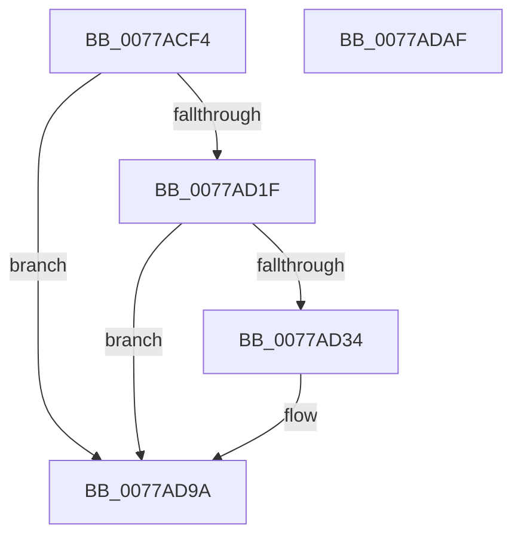

# TtmiLogQueueHandleOpened

- RVA: `0x0077ACF4`–`0x0077ADB0` (길이 `188` bytes)
- VA: `0x000000014077ACF4`
- 실행 섹션: `PAGE`
- PDB 이름 있음: `예`; PDB Function 태그: `아니요`
- unwind 정보 RVA: `0x00079278`
- 디코드: `42`개 명령, `188/188` bytes 표시
- 미해석 바이트: `0` (있으면 어셈블리에 `.byte`로 보존)

> 이 문서는 커널 이미지의 기계어와 PDB 기호를 분석해 생성했습니다. 4번과 5번은 함수 원형과 자료형을 바이너리 사용 방식에서 추정한 C 해석이며 원본 소스 복구 결과는 아닙니다.

## 1. Dependencies

- 직접 호출 지점: **3**; 고유 호출 대상: **3**
- 직접 호출자로 확인된 함수: **1**
- RIP 상대 이미지 참조: **3**

### Outgoing calls
- `0x0077AD2B` → [tlgKeywordOn](../../text/42/tlgKeywordOn_function_0042EAA0.md) (function, `0x0042EAA0`)
- `0x0077AD95` → [tlgWriteTransfer_EtwWriteTransfer](../../text/42/tlgWriteTransfer_EtwWriteTransfer_function_004260E0.md) (function, `0x004260E0`)
- `0x0077ADA1` → [_security_check_cookie](../../text/6A/_security_check_cookie_function_006AC640.md) (function, `0x006AC640`)

### Direct callers
- [TtmpOpenQueueHandle](TtmpOpenQueueHandle_function_0077E070.md) at `0x0077E0A5`

### Static image references
- `0x0077AD02` → RVA `0x00E0A740` (`.data`; read)
- `0x0077AD10` → RVA `0x00FD88C8` (`PAGEDATA`; read)
- `0x0077AD40` → RVA `0x0005254C` (`.rdata`; read)

## 2. Other-region calls and transfers

- 다른 실행 섹션으로 향하는 call: **3**
  - `0x0077AD2B` → [tlgKeywordOn](../../text/42/tlgKeywordOn_function_0042EAA0.md) (`PAGE` → `.text`)
  - `0x0077AD95` → [tlgWriteTransfer_EtwWriteTransfer](../../text/42/tlgWriteTransfer_EtwWriteTransfer_function_004260E0.md) (`PAGE` → `.text`)
  - `0x0077ADA1` → [_security_check_cookie](../../text/6A/_security_check_cookie_function_006AC640.md) (`PAGE` → `.text`)
- 별도 외부 분기/꼬리 이동을 확인하지 못했습니다.

## 3. Assembly (complete function range)

```asm
0077ACF4  40 55                           push rbp
0077ACF6  48 8D 6C 24 A9                  lea rbp, [rsp - 0x57]
0077ACFB  48 81 EC B0 00 00 00            sub rsp, 0xb0
0077AD02  48 8B 05 37 FA 68 00            mov rax, qword ptr [rip + 0x68fa37]
0077AD09  48 33 C4                        xor rax, rsp
0077AD0C  48 89 45 47                     mov qword ptr [rbp + 0x47], rax
0077AD10  83 3D B1 DB 85 00 05            cmp dword ptr [rip + 0x85dbb1], 5
0077AD17  4C 8B CA                        mov r9, rdx
0077AD1A  4C 8B D1                        mov r10, rcx
0077AD1D  76 7B                           jbe 0x14077ad9a
0077AD1F  BA 01 00 00 00                  mov edx, 1
0077AD24  48 8D 0D 9D DB 85 00            lea rcx, [rip + 0x85db9d]
0077AD2B  E8 70 3D CB FF                  call 0x14042eaa0
0077AD30  84 C0                           test al, al
0077AD32  74 66                           je 0x14077ad9a
0077AD34  48 8D 45 DF                     lea rax, [rbp - 0x21]
0077AD38  4C 89 4D E7                     mov qword ptr [rbp - 0x19], r9
0077AD3C  48 89 45 17                     mov qword ptr [rbp + 0x17], rax
0077AD40  48 8D 15 05 78 8D FF            lea rdx, [rip - 0x7287fb]
0077AD47  48 8D 45 E7                     lea rax, [rbp - 0x19]
0077AD4B  44 89 45 D7                     mov dword ptr [rbp - 0x29], r8d
0077AD4F  48 89 45 27                     mov qword ptr [rbp + 0x27], rax
0077AD53  48 8D 0D 6E DB 85 00            lea rcx, [rip + 0x85db6e]
0077AD5A  48 8D 45 D7                     lea rax, [rbp - 0x29]
0077AD5E  4C 89 55 DF                     mov qword ptr [rbp - 0x21], r10
0077AD62  48 89 45 37                     mov qword ptr [rbp + 0x37], rax
0077AD66  45 33 C9                        xor r9d, r9d
0077AD69  48 8D 45 F7                     lea rax, [rbp - 9]
0077AD6D  48 C7 45 1F 08 00 00 00         mov qword ptr [rbp + 0x1f], 8
0077AD75  48 89 44 24 28                  mov qword ptr [rsp + 0x28], rax
0077AD7A  45 33 C0                        xor r8d, r8d
0077AD7D  C7 44 24 20 05 00 00 00         mov dword ptr [rsp + 0x20], 5
0077AD85  48 C7 45 2F 08 00 00 00         mov qword ptr [rbp + 0x2f], 8
0077AD8D  48 C7 45 3F 04 00 00 00         mov qword ptr [rbp + 0x3f], 4
0077AD95  E8 46 B3 CA FF                  call 0x1404260e0
0077AD9A  48 8B 4D 47                     mov rcx, qword ptr [rbp + 0x47]
0077AD9E  48 33 CC                        xor rcx, rsp
0077ADA1  E8 9A 18 F3 FF                  call 0x1406ac640
0077ADA6  48 81 C4 B0 00 00 00            add rsp, 0xb0
0077ADAD  5D                              pop rbp
0077ADAE  C3                              ret
0077ADAF  CC                              int3
```

## 4. C-style interpretation (structured pseudocode)

```c
__int64 __fastcall TtmiLogQueueHandleOpened(__int64 a1, __int64 a2, int a3)
{
    __int64 result;
    __int64 v_rsp;
    unsigned __int64 v_stack_m18;
    unsigned __int64 v_stack_m20;
    unsigned __int64 v_stack_m28;
    unsigned __int64 v_stack_m30;
    unsigned __int64 v_stack_m38;
    unsigned __int64 v_stack_m40;
    unsigned __int64 v_stack_m48;
    unsigned __int64 v_stack_m5F;
    unsigned __int64 v_stack_m68;
    unsigned __int64 v_stack_m78;
    unsigned __int64 v_stack_m80;
    unsigned int v_stack_m88;
    unsigned __int64 v_stack_m90;
    unsigned int v_stack_m98;

    v_rsp = (v_rsp) - (176);
    result = (*(unsigned __int64 *)(v_rip + 6879799)) ^ (v_rsp);
    v_stack_m18 = result;
    if ((*(unsigned int *)(v_rip + 8772529)) <= 5) goto loc_0077AD9A;
    result = tlgKeywordOn(v_rip + 8772509, 1, a3, a2);
    if ((unsigned __int8)(result) != 0) {
        result = v_stack_m80;
        v_stack_m78 = a2;
        v_stack_m48 = result;
        a2 = v_rip - 7505915;
        result = v_stack_m78;
        v_stack_m88 = a3;
        v_stack_m38 = result;
        a1 = v_rip + 8772462;
        result = v_stack_m88;
        v_stack_m80 = a1;
        v_stack_m28 = result;
        a4 = 0;
        result = v_stack_m68;
        v_stack_m40 = 8;
        v_stack_m90 = result;
        a3 = 0;
        v_stack_m98 = 5;
        v_stack_m30 = 8;
        v_stack_m20 = 4;
        result = tlgWriteTransfer_EtwWriteTransfer(a1, a2, a3, a4);
    }
    a1 = (v_stack_m18) ^ (v_rsp);
    result = _security_check_cookie(a1, a2, a3, a4);
    v_rsp = (v_rsp) + (176);
    return result;
}
```

## 5. (Beta) C Style

```c
int64_t TtmiLogQueueHandleOpened(int64_t Arg1, int64_t Arg2, int32_t Arg3)
{
    int64_t result;
    int64_t local_rsp;
    uint64_t v_stack_m18;
    uint64_t v_stack_m20;
    uint64_t v_stack_m28;
    uint64_t v_stack_m30;
    uint64_t v_stack_m38;
    uint64_t v_stack_m40;
    uint64_t v_stack_m48;
    uint64_t v_stack_m5F;
    uint64_t v_stack_m68;
    uint64_t v_stack_m78;
    uint64_t v_stack_m80;
    uint32_t v_stack_m88;
    uint64_t v_stack_m90;
    uint32_t v_stack_m98;

    local_rsp = (local_rsp) - (176);
    result = (*(uint64_t *)(v_rip + 0x68FA37)) ^ (local_rsp);
    v_stack_m18 = result;
    if ((*(uint32_t *)(v_rip + 0x85DBB1)) <= 5) goto loc_0077AD9A;
    result = tlgKeywordOn(v_rip + 8772509, 1, Arg3, Arg2);
    if ((uint8_t)(result) != 0) {
        result = v_stack_m80;
        v_stack_m78 = Arg2;
        v_stack_m48 = result;
        Arg2 = v_rip - 7505915;
        result = v_stack_m78;
        v_stack_m88 = Arg3;
        v_stack_m38 = result;
        Arg1 = v_rip + 8772462;
        result = v_stack_m88;
        v_stack_m80 = Arg1;
        v_stack_m28 = result;
        a4 = 0;
        result = v_stack_m68;
        v_stack_m40 = 8;
        v_stack_m90 = result;
        Arg3 = 0;
        v_stack_m98 = 5;
        v_stack_m30 = 8;
        v_stack_m20 = 4;
        result = tlgWriteTransfer_EtwWriteTransfer(Arg1, Arg2, Arg3, a4);
    }
    Arg1 = (v_stack_m18) ^ (local_rsp);
    result = _security_check_cookie(Arg1, Arg2, Arg3, a4);
    local_rsp = (local_rsp) + (176);
    return result;
}
```

## 6. Execution-region graph

[열기: 2D/3D 그래프와 함수 탐색 컨트롤 패널](../../../control-panel.html?section=page&rva=0x0077ACF4&view=graph)

- 2D 그래프는 위에서 아래로 흐르고, 3D 그래프는 빈 공간을 드래그해 회전합니다. Shift+드래그는 이동, 휠은 확대·축소, 함수 노드 선택은 대상 보고서 이동입니다.

### Static fallback


