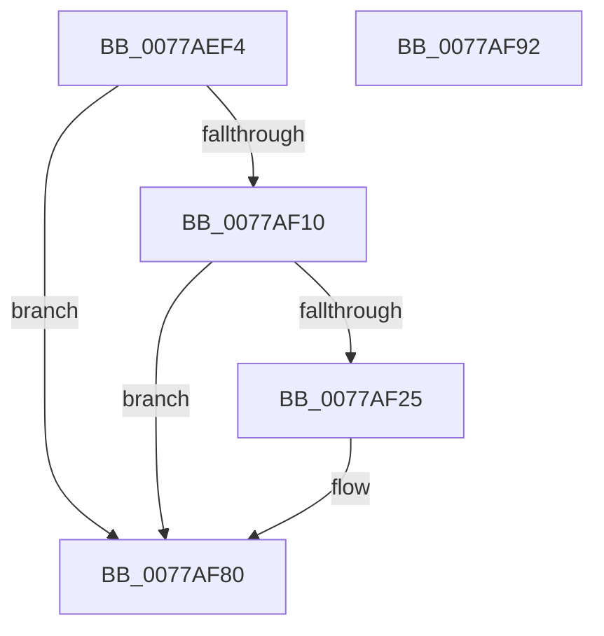

# TtmiLogSessionDeactivate

- RVA: `0x0077AEF4`–`0x0077AF93` (길이 `159` bytes)
- VA: `0x000000014077AEF4`
- 실행 섹션: `PAGE`
- PDB 이름 있음: `예`; PDB Function 태그: `아니요`
- unwind 정보 RVA: `0x000986E4`
- 디코드: `33`개 명령, `159/159` bytes 표시
- 미해석 바이트: `0` (있으면 어셈블리에 `.byte`로 보존)

> 이 문서는 커널 이미지의 기계어와 PDB 기호를 분석해 생성했습니다. 4번과 5번은 함수 원형과 자료형을 바이너리 사용 방식에서 추정한 C 해석이며 원본 소스 복구 결과는 아닙니다.

## 1. Dependencies

- 직접 호출 지점: **4**; 고유 호출 대상: **4**
- 직접 호출자로 확인된 함수: **1**
- RIP 상대 이미지 참조: **3**

### Outgoing calls
- `0x0077AF1C` → [tlgKeywordOn](../../text/42/tlgKeywordOn_function_0042EAA0.md) (function, `0x0042EAA0`)
- `0x0077AF35` → [PsGetProcessSessionIdEx](../../text/22/PsGetProcessSessionIdEx_function_0022F8F0.md) (function, `0x0022F8F0`)
- `0x0077AF7B` → [tlgWriteTransfer_EtwWriteTransfer](../../text/42/tlgWriteTransfer_EtwWriteTransfer_function_004260E0.md) (function, `0x004260E0`)
- `0x0077AF88` → [_security_check_cookie](../../text/6A/_security_check_cookie_function_006AC640.md) (function, `0x006AC640`)

### Direct callers
- [TtmpSessionWorker](TtmpSessionWorker_function_00777F60.md) at `0x00778071`

### Static image references
- `0x0077AEF8` → RVA `0x00E0A740` (`.data`; read)
- `0x0077AF07` → RVA `0x00FD88C8` (`PAGEDATA`; read)
- `0x0077AF3F` → RVA `0x00051E79` (`.rdata`; read)

## 2. Other-region calls and transfers

- 다른 실행 섹션으로 향하는 call: **4**
  - `0x0077AF1C` → [tlgKeywordOn](../../text/42/tlgKeywordOn_function_0042EAA0.md) (`PAGE` → `.text`)
  - `0x0077AF35` → [PsGetProcessSessionIdEx](../../text/22/PsGetProcessSessionIdEx_function_0022F8F0.md) (`PAGE` → `.text`)
  - `0x0077AF7B` → [tlgWriteTransfer_EtwWriteTransfer](../../text/42/tlgWriteTransfer_EtwWriteTransfer_function_004260E0.md) (`PAGE` → `.text`)
  - `0x0077AF88` → [_security_check_cookie](../../text/6A/_security_check_cookie_function_006AC640.md) (`PAGE` → `.text`)
- 별도 외부 분기/꼬리 이동을 확인하지 못했습니다.

## 3. Assembly (complete function range)

```asm
0077AEF4  48 83 EC 78                     sub rsp, 0x78
0077AEF8  48 8B 05 41 F8 68 00            mov rax, qword ptr [rip + 0x68f841]
0077AEFF  48 33 C4                        xor rax, rsp
0077AF02  48 89 44 24 68                  mov qword ptr [rsp + 0x68], rax
0077AF07  83 3D BA D9 85 00 05            cmp dword ptr [rip + 0x85d9ba], 5
0077AF0E  76 70                           jbe 0x14077af80
0077AF10  BA 01 00 00 00                  mov edx, 1
0077AF15  48 8D 0D AC D9 85 00            lea rcx, [rip + 0x85d9ac]
0077AF1C  E8 7F 3B CB FF                  call 0x14042eaa0
0077AF21  84 C0                           test al, al
0077AF23  74 5B                           je 0x14077af80
0077AF25  65 48 8B 0C 25 88 01 00 00      mov rcx, qword ptr gs:[0x188]
0077AF2E  48 8B 89 B8 00 00 00            mov rcx, qword ptr [rcx + 0xb8]
0077AF35  E8 B6 49 AB FF                  call 0x14022f8f0
0077AF3A  83 64 24 64 00                  and dword ptr [rsp + 0x64], 0
0077AF3F  48 8D 15 33 6F 8D FF            lea rdx, [rip - 0x7290cd]
0077AF46  89 44 24 30                     mov dword ptr [rsp + 0x30], eax
0077AF4A  48 8D 0D 77 D9 85 00            lea rcx, [rip + 0x85d977]
0077AF51  48 8D 44 24 30                  lea rax, [rsp + 0x30]
0077AF56  C7 44 24 60 04 00 00 00         mov dword ptr [rsp + 0x60], 4
0077AF5E  48 89 44 24 58                  mov qword ptr [rsp + 0x58], rax
0077AF63  45 33 C9                        xor r9d, r9d
0077AF66  48 8D 44 24 38                  lea rax, [rsp + 0x38]
0077AF6B  45 33 C0                        xor r8d, r8d
0077AF6E  48 89 44 24 28                  mov qword ptr [rsp + 0x28], rax
0077AF73  C7 44 24 20 03 00 00 00         mov dword ptr [rsp + 0x20], 3
0077AF7B  E8 60 B1 CA FF                  call 0x1404260e0
0077AF80  48 8B 4C 24 68                  mov rcx, qword ptr [rsp + 0x68]
0077AF85  48 33 CC                        xor rcx, rsp
0077AF88  E8 B3 16 F3 FF                  call 0x1406ac640
0077AF8D  48 83 C4 78                     add rsp, 0x78
0077AF91  C3                              ret
0077AF92  CC                              int3
```

## 4. C-style interpretation (structured pseudocode)

```c
__int64 __fastcall TtmiLogSessionDeactivate(__int64 a1, __int64 a2, int a3, int a4)
{
    __int64 result;
    __int64 v_rsp;
    unsigned __int64 v_stack_m10;
    unsigned int v_stack_m14;
    unsigned int v_stack_m18;
    unsigned __int64 v_stack_m20;
    unsigned __int64 v_stack_m40;
    unsigned int v_stack_m48;
    unsigned __int64 v_stack_m50;
    unsigned int v_stack_m58;

    v_rsp = (v_rsp) - (120);
    result = (*(unsigned __int64 *)(v_rip + 6879297)) ^ (v_rsp);
    v_stack_m10 = result;
    if ((*(unsigned int *)(v_rip + 8772026)) <= 5) goto loc_0077AF80;
    result = tlgKeywordOn(v_rip + 8772012, 1, a3, a4);
    if ((unsigned __int8)(result) != 0) {
        a1 = *(unsigned __int64 *)(gs_base + (0 + 392));
        a1 = *(unsigned __int64 *)(a1 + 184);
        result = PsGetProcessSessionIdEx(a1, 1, a3, a4);
        a2 = v_rip - 7508173;
        v_stack_m48 = (unsigned int)(result);
        a1 = v_rip + 8771959;
        result = v_stack_m48;
        v_stack_m18 = 4;
        v_stack_m20 = result;
        a4 = 0;
        result = v_stack_m40;
        a3 = 0;
        v_stack_m50 = result;
        v_stack_m58 = 3;
        result = tlgWriteTransfer_EtwWriteTransfer(a1, a2, a3, a4);
    }
    a1 = (v_stack_m10) ^ (v_rsp);
    result = _security_check_cookie(a1, a2, a3, a4);
    v_rsp = (v_rsp) + (120);
    return result;
}
```

## 5. (Beta) C Style

```c
int64_t TtmiLogSessionDeactivate(int64_t Arg1, int64_t Arg2, int32_t Arg3, int32_t Arg4)
{
    int64_t result;
    int64_t local_rsp;
    uint64_t v_stack_m10;
    uint32_t v_stack_m14;
    uint32_t v_stack_m18;
    uint64_t v_stack_m20;
    uint64_t v_stack_m40;
    uint32_t v_stack_m48;
    uint64_t v_stack_m50;
    uint32_t v_stack_m58;

    local_rsp = (local_rsp) - (120);
    result = (*(uint64_t *)(v_rip + 0x68F841)) ^ (local_rsp);
    v_stack_m10 = result;
    if ((*(uint32_t *)(v_rip + 0x85D9BA)) <= 5) goto loc_0077AF80;
    result = tlgKeywordOn(v_rip + 8772012, 1, Arg3, Arg4);
    if ((uint8_t)(result) != 0) {
        Arg1 = *(uint64_t *)(gs_base + (0 + 0x188));
        Arg1 = *(uint64_t *)(Arg1 + 0xB8);
        result = PsGetProcessSessionIdEx(Arg1, 1, Arg3, Arg4);
        Arg2 = v_rip - 7508173;
        v_stack_m48 = (uint32_t)(result);
        Arg1 = v_rip + 8771959;
        result = v_stack_m48;
        v_stack_m18 = 4;
        v_stack_m20 = result;
        Arg4 = 0;
        result = v_stack_m40;
        Arg3 = 0;
        v_stack_m50 = result;
        v_stack_m58 = 3;
        result = tlgWriteTransfer_EtwWriteTransfer(Arg1, Arg2, Arg3, Arg4);
    }
    Arg1 = (v_stack_m10) ^ (local_rsp);
    result = _security_check_cookie(Arg1, Arg2, Arg3, Arg4);
    local_rsp = (local_rsp) + (120);
    return result;
}
```

## 6. Execution-region graph

[열기: 2D/3D 그래프와 함수 탐색 컨트롤 패널](../../../control-panel.html?section=page&rva=0x0077AEF4&view=graph)

- 2D 그래프는 위에서 아래로 흐르고, 3D 그래프는 빈 공간을 드래그해 회전합니다. Shift+드래그는 이동, 휠은 확대·축소, 함수 노드 선택은 대상 보고서 이동입니다.

### Static fallback


