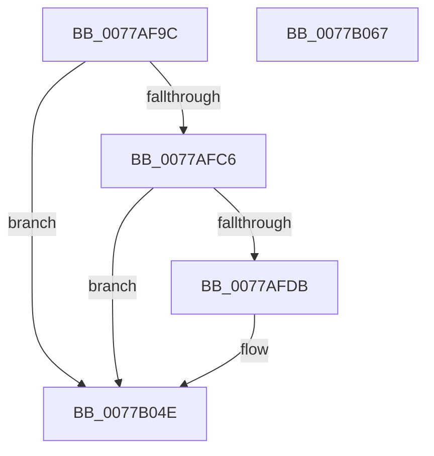

# TtmiLogSessionDeviceAssignmentPolicySet

- RVA: `0x0077AF9C`–`0x0077B068` (길이 `204` bytes)
- VA: `0x000000014077AF9C`
- 실행 섹션: `PAGE`
- PDB 이름 있음: `예`; PDB Function 태그: `아니요`
- unwind 정보 RVA: `0x000986F8`
- 디코드: `42`개 명령, `204/204` bytes 표시
- 미해석 바이트: `0` (있으면 어셈블리에 `.byte`로 보존)

> 이 문서는 커널 이미지의 기계어와 PDB 기호를 분석해 생성했습니다. 4번과 5번은 함수 원형과 자료형을 바이너리 사용 방식에서 추정한 C 해석이며 원본 소스 복구 결과는 아닙니다.

## 1. Dependencies

- 직접 호출 지점: **4**; 고유 호출 대상: **4**
- 직접 호출자로 확인된 함수: **2**
- RIP 상대 이미지 참조: **3**

### Outgoing calls
- `0x0077AFD2` → [tlgKeywordOn](../../text/42/tlgKeywordOn_function_0042EAA0.md) (function, `0x0042EAA0`)
- `0x0077AFEB` → [PsGetProcessSessionIdEx](../../text/22/PsGetProcessSessionIdEx_function_0022F8F0.md) (function, `0x0022F8F0`)
- `0x0077B049` → [tlgWriteTransfer_EtwWriteTransfer](../../text/42/tlgWriteTransfer_EtwWriteTransfer_function_004260E0.md) (function, `0x004260E0`)
- `0x0077B059` → [_security_check_cookie](../../text/6A/_security_check_cookie_function_006AC640.md) (function, `0x006AC640`)

### Direct callers
- [TtmpDispatchSetDefaultDeviceAssignment](TtmpDispatchSetDefaultDeviceAssignment_function_00778B54.md) at `0x00778BC8`
- [TtmInitCurrentSession](../98/TtmInitCurrentSession_function_0098AA18.md) at `0x0098AB1F`

### Static image references
- `0x0077AFA5` → RVA `0x00E0A740` (`.data`; read)
- `0x0077AFB7` → RVA `0x00FD88C8` (`PAGEDATA`; read)
- `0x0077B03A` → RVA `0x00052676` (`.rdata`; read)

## 2. Other-region calls and transfers

- 다른 실행 섹션으로 향하는 call: **4**
  - `0x0077AFD2` → [tlgKeywordOn](../../text/42/tlgKeywordOn_function_0042EAA0.md) (`PAGE` → `.text`)
  - `0x0077AFEB` → [PsGetProcessSessionIdEx](../../text/22/PsGetProcessSessionIdEx_function_0022F8F0.md) (`PAGE` → `.text`)
  - `0x0077B049` → [tlgWriteTransfer_EtwWriteTransfer](../../text/42/tlgWriteTransfer_EtwWriteTransfer_function_004260E0.md) (`PAGE` → `.text`)
  - `0x0077B059` → [_security_check_cookie](../../text/6A/_security_check_cookie_function_006AC640.md) (`PAGE` → `.text`)
- 별도 외부 분기/꼬리 이동을 확인하지 못했습니다.

## 3. Assembly (complete function range)

```asm
0077AF9C  40 53                           push rbx
0077AF9E  48 81 EC 90 00 00 00            sub rsp, 0x90
0077AFA5  48 8B 05 94 F7 68 00            mov rax, qword ptr [rip + 0x68f794]
0077AFAC  48 33 C4                        xor rax, rsp
0077AFAF  48 89 84 24 80 00 00 00         mov qword ptr [rsp + 0x80], rax
0077AFB7  83 3D 0A D9 85 00 05            cmp dword ptr [rip + 0x85d90a], 5
0077AFBE  8A D9                           mov bl, cl
0077AFC0  0F 86 88 00 00 00               jbe 0x14077b04e
0077AFC6  BA 01 00 00 00                  mov edx, 1
0077AFCB  48 8D 0D F6 D8 85 00            lea rcx, [rip + 0x85d8f6]
0077AFD2  E8 C9 3A CB FF                  call 0x14042eaa0
0077AFD7  84 C0                           test al, al
0077AFD9  74 73                           je 0x14077b04e
0077AFDB  65 48 8B 0C 25 88 01 00 00      mov rcx, qword ptr gs:[0x188]
0077AFE4  48 8B 89 B8 00 00 00            mov rcx, qword ptr [rcx + 0xb8]
0077AFEB  E8 00 49 AB FF                  call 0x14022f8f0
0077AFF0  83 64 24 6C 00                  and dword ptr [rsp + 0x6c], 0
0077AFF5  48 8D 0D CC D8 85 00            lea rcx, [rip + 0x85d8cc]
0077AFFC  83 64 24 7C 00                  and dword ptr [rsp + 0x7c], 0
0077B001  BA 04 00 00 00                  mov edx, 4
0077B006  89 44 24 34                     mov dword ptr [rsp + 0x34], eax
0077B00A  45 33 C9                        xor r9d, r9d
0077B00D  48 8D 44 24 34                  lea rax, [rsp + 0x34]
0077B012  89 54 24 68                     mov dword ptr [rsp + 0x68], edx
0077B016  48 89 44 24 60                  mov qword ptr [rsp + 0x60], rax
0077B01B  45 33 C0                        xor r8d, r8d
0077B01E  48 8D 44 24 30                  lea rax, [rsp + 0x30]
0077B023  88 5C 24 30                     mov byte ptr [rsp + 0x30], bl
0077B027  48 89 44 24 70                  mov qword ptr [rsp + 0x70], rax
0077B02C  48 8D 44 24 40                  lea rax, [rsp + 0x40]
0077B031  48 89 44 24 28                  mov qword ptr [rsp + 0x28], rax
0077B036  89 54 24 20                     mov dword ptr [rsp + 0x20], edx
0077B03A  48 8D 15 35 76 8D FF            lea rdx, [rip - 0x7289cb]
0077B041  C7 44 24 78 01 00 00 00         mov dword ptr [rsp + 0x78], 1
0077B049  E8 92 B0 CA FF                  call 0x1404260e0
0077B04E  48 8B 8C 24 80 00 00 00         mov rcx, qword ptr [rsp + 0x80]
0077B056  48 33 CC                        xor rcx, rsp
0077B059  E8 E2 15 F3 FF                  call 0x1406ac640
0077B05E  48 81 C4 90 00 00 00            add rsp, 0x90
0077B065  5B                              pop rbx
0077B066  C3                              ret
0077B067  CC                              int3
```

## 4. C-style interpretation (structured pseudocode)

```c
__int64 __fastcall TtmiLogSessionDeviceAssignmentPolicySet(unsigned __int8 a1, __int64 a2, int a3, int a4)
{
    __int64 result;
    __int64 v_rsp;
    unsigned __int64 v_stack_m18;
    unsigned int v_stack_m1C;
    unsigned int v_stack_m20;
    unsigned __int64 v_stack_m28;
    unsigned int v_stack_m2C;
    unsigned int v_stack_m30;
    unsigned __int64 v_stack_m38;
    unsigned __int64 v_stack_m58;
    unsigned int v_stack_m64;
    unsigned __int64 v_stack_m68;
    unsigned __int64 v_stack_m70;
    unsigned int v_stack_m78;

    v_rsp = (v_rsp) - (144);
    result = (*(unsigned __int64 *)(v_rip + 6879124)) ^ (v_rsp);
    v_stack_m18 = result;
    if ((*(unsigned int *)(v_rip + 8771850)) <= 5) goto loc_0077B04E;
    result = tlgKeywordOn(v_rip + 8771830, 1, a3, a4);
    if ((unsigned __int8)(result) != 0) {
        a1 = *(unsigned __int64 *)(gs_base + (0 + 392));
        a1 = *(unsigned __int64 *)(a1 + 184);
        result = PsGetProcessSessionIdEx(a1, 1, a3, a4);
        a1 = v_rip + 8771788;
        a2 = 4;
        v_stack_m64 = (unsigned int)(result);
        a4 = 0;
        result = v_stack_m64;
        v_stack_m30 = (unsigned int)(a2);
        v_stack_m38 = result;
        a3 = 0;
        result = v_stack_m68;
        v_stack_m68 = a1;
        v_stack_m28 = result;
        result = v_stack_m58;
        v_stack_m70 = result;
        v_stack_m78 = (unsigned int)(a2);
        a2 = v_rip - 7506379;
        v_stack_m20 = 1;
        result = tlgWriteTransfer_EtwWriteTransfer(a1, a2, a3, a4);
    }
    a1 = (v_stack_m18) ^ (v_rsp);
    result = _security_check_cookie(a1, a2, a3, a4);
    v_rsp = (v_rsp) + (144);
    return result;
}
```

## 5. (Beta) C Style

```c
int64_t TtmiLogSessionDeviceAssignmentPolicySet(uint8_t Arg1, int64_t Arg2, int32_t Arg3, int32_t Arg4)
{
    int64_t result;
    int64_t local_rsp;
    uint64_t v_stack_m18;
    uint32_t v_stack_m1C;
    uint32_t v_stack_m20;
    uint64_t v_stack_m28;
    uint32_t v_stack_m2C;
    uint32_t v_stack_m30;
    uint64_t v_stack_m38;
    uint64_t v_stack_m58;
    uint32_t v_stack_m64;
    uint64_t v_stack_m68;
    uint64_t v_stack_m70;
    uint32_t v_stack_m78;

    local_rsp = (local_rsp) - (144);
    result = (*(uint64_t *)(v_rip + 0x68F794)) ^ (local_rsp);
    v_stack_m18 = result;
    if ((*(uint32_t *)(v_rip + 0x85D90A)) <= 5) goto loc_0077B04E;
    result = tlgKeywordOn(v_rip + 8771830, 1, Arg3, Arg4);
    if ((uint8_t)(result) != 0) {
        Arg1 = *(uint64_t *)(gs_base + (0 + 0x188));
        Arg1 = *(uint64_t *)(Arg1 + 0xB8);
        result = PsGetProcessSessionIdEx(Arg1, 1, Arg3, Arg4);
        Arg1 = v_rip + 8771788;
        Arg2 = 4;
        v_stack_m64 = (uint32_t)(result);
        Arg4 = 0;
        result = v_stack_m64;
        v_stack_m30 = (uint32_t)(Arg2);
        v_stack_m38 = result;
        Arg3 = 0;
        result = v_stack_m68;
        v_stack_m68 = Arg1;
        v_stack_m28 = result;
        result = v_stack_m58;
        v_stack_m70 = result;
        v_stack_m78 = (uint32_t)(Arg2);
        Arg2 = v_rip - 7506379;
        v_stack_m20 = 1;
        result = tlgWriteTransfer_EtwWriteTransfer(Arg1, Arg2, Arg3, Arg4);
    }
    Arg1 = (v_stack_m18) ^ (local_rsp);
    result = _security_check_cookie(Arg1, Arg2, Arg3, Arg4);
    local_rsp = (local_rsp) + (144);
    return result;
}
```

## 6. Execution-region graph

[열기: 2D/3D 그래프와 함수 탐색 컨트롤 패널](../../../control-panel.html?section=page&rva=0x0077AF9C&view=graph)

- 2D 그래프는 위에서 아래로 흐르고, 3D 그래프는 빈 공간을 드래그해 회전합니다. Shift+드래그는 이동, 휠은 확대·축소, 함수 노드 선택은 대상 보고서 이동입니다.

### Static fallback


