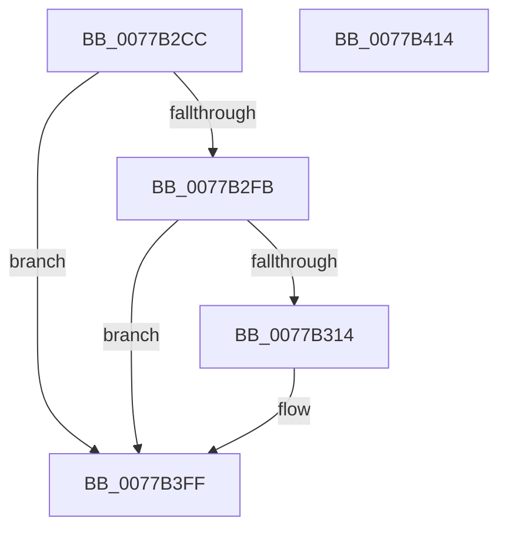

# TtmiLogSessionPowerRequestAcknowledged

- RVA: `0x0077B2CC`–`0x0077B415` (길이 `329` bytes)
- VA: `0x000000014077B2CC`
- 실행 섹션: `PAGE`
- PDB 이름 있음: `예`; PDB Function 태그: `아니요`
- unwind 정보 RVA: `0x00073684`
- 디코드: `75`개 명령, `329/329` bytes 표시
- 미해석 바이트: `0` (있으면 어셈블리에 `.byte`로 보존)

> 이 문서는 커널 이미지의 기계어와 PDB 기호를 분석해 생성했습니다. 4번과 5번은 함수 원형과 자료형을 바이너리 사용 방식에서 추정한 C 해석이며 원본 소스 복구 결과는 아닙니다.

## 1. Dependencies

- 직접 호출 지점: **3**; 고유 호출 대상: **3**
- 직접 호출자로 확인된 함수: **1**
- RIP 상대 이미지 참조: **3**

### Outgoing calls
- `0x0077B307` → [tlgKeywordOn](../../text/42/tlgKeywordOn_function_0042EAA0.md) (function, `0x0042EAA0`)
- `0x0077B3FA` → [tlgWriteTransfer_EtwWriteTransfer](../../text/42/tlgWriteTransfer_EtwWriteTransfer_function_004260E0.md) (function, `0x004260E0`)
- `0x0077B406` → [_security_check_cookie](../../text/6A/_security_check_cookie_function_006AC640.md) (function, `0x006AC640`)

### Direct callers
- [TtmNotifySessionPowerRequestPresent](TtmNotifySessionPowerRequestPresent_function_00776F88.md) at `0x00776FE9`

### Static image references
- `0x0077B2DA` → RVA `0x00E0A740` (`.data`; read)
- `0x0077B2E8` → RVA `0x00FD88C8` (`PAGEDATA`; read)
- `0x0077B3CE` → RVA `0x00052288` (`.rdata`; read)

## 2. Other-region calls and transfers

- 다른 실행 섹션으로 향하는 call: **3**
  - `0x0077B307` → [tlgKeywordOn](../../text/42/tlgKeywordOn_function_0042EAA0.md) (`PAGE` → `.text`)
  - `0x0077B3FA` → [tlgWriteTransfer_EtwWriteTransfer](../../text/42/tlgWriteTransfer_EtwWriteTransfer_function_004260E0.md) (`PAGE` → `.text`)
  - `0x0077B406` → [_security_check_cookie](../../text/6A/_security_check_cookie_function_006AC640.md) (`PAGE` → `.text`)
- 별도 외부 분기/꼬리 이동을 확인하지 못했습니다.

## 3. Assembly (complete function range)

```asm
0077B2CC  40 55                           push rbp
0077B2CE  48 8D 6C 24 F0                  lea rbp, [rsp - 0x10]
0077B2D3  48 81 EC 10 01 00 00            sub rsp, 0x110
0077B2DA  48 8B 05 5F F4 68 00            mov rax, qword ptr [rip + 0x68f45f]
0077B2E1  48 33 C4                        xor rax, rsp
0077B2E4  48 89 45 00                     mov qword ptr [rbp], rax
0077B2E8  83 3D D9 D5 85 00 05            cmp dword ptr [rip + 0x85d5d9], 5
0077B2EF  44 8B D2                        mov r10d, edx
0077B2F2  44 8B D9                        mov r11d, ecx
0077B2F5  0F 86 04 01 00 00               jbe 0x14077b3ff
0077B2FB  BA 01 00 00 00                  mov edx, 1
0077B300  48 8D 0D C1 D5 85 00            lea rcx, [rip + 0x85d5c1]
0077B307  E8 94 37 CB FF                  call 0x14042eaa0
0077B30C  84 C0                           test al, al
0077B30E  0F 84 EB 00 00 00               je 0x14077b3ff
0077B314  83 65 8C 00                     and dword ptr [rbp - 0x74], 0
0077B318  48 8D 44 24 34                  lea rax, [rsp + 0x34]
0077B31D  83 65 9C 00                     and dword ptr [rbp - 0x64], 0
0077B321  BA 04 00 00 00                  mov edx, 4
0077B326  83 65 AC 00                     and dword ptr [rbp - 0x54], 0
0077B32A  83 65 BC 00                     and dword ptr [rbp - 0x44], 0
0077B32E  83 65 CC 00                     and dword ptr [rbp - 0x34], 0
0077B332  83 64 24 40 00                  and dword ptr [rsp + 0x40], 0
0077B337  8D 4A 04                        lea ecx, [rdx + 4]
0077B33A  83 65 DC 00                     and dword ptr [rbp - 0x24], 0
0077B33E  83 65 EC 00                     and dword ptr [rbp - 0x14], 0
0077B342  83 65 FC 00                     and dword ptr [rbp - 4], 0
0077B346  48 89 45 80                     mov qword ptr [rbp - 0x80], rax
0077B34A  48 8D 44 24 38                  lea rax, [rsp + 0x38]
0077B34F  48 89 45 90                     mov qword ptr [rbp - 0x70], rax
0077B353  48 8D 44 24 3C                  lea rax, [rsp + 0x3c]
0077B358  48 89 45 A0                     mov qword ptr [rbp - 0x60], rax
0077B35C  48 8D 44 24 48                  lea rax, [rsp + 0x48]
0077B361  48 89 45 B0                     mov qword ptr [rbp - 0x50], rax
0077B365  48 8B 45 40                     mov rax, qword ptr [rbp + 0x40]
0077B369  48 89 44 24 50                  mov qword ptr [rsp + 0x50], rax
0077B36E  48 8D 44 24 50                  lea rax, [rsp + 0x50]
0077B373  48 89 45 C0                     mov qword ptr [rbp - 0x40], rax
0077B377  48 8D 44 24 40                  lea rax, [rsp + 0x40]
0077B37C  48 89 45 D0                     mov qword ptr [rbp - 0x30], rax
0077B380  8A 45 50                        mov al, byte ptr [rbp + 0x50]
0077B383  88 44 24 30                     mov byte ptr [rsp + 0x30], al
0077B387  48 8D 44 24 30                  lea rax, [rsp + 0x30]
0077B38C  48 89 45 E0                     mov qword ptr [rbp - 0x20], rax
0077B390  8A 45 58                        mov al, byte ptr [rbp + 0x58]
0077B393  88 44 24 31                     mov byte ptr [rsp + 0x31], al
0077B397  48 8D 44 24 31                  lea rax, [rsp + 0x31]
0077B39C  48 89 45 F0                     mov qword ptr [rbp - 0x10], rax
0077B3A0  48 8D 44 24 60                  lea rax, [rsp + 0x60]
0077B3A5  89 55 88                        mov dword ptr [rbp - 0x78], edx
0077B3A8  89 55 98                        mov dword ptr [rbp - 0x68], edx
0077B3AB  44 89 44 24 3C                  mov dword ptr [rsp + 0x3c], r8d
0077B3B0  45 33 C0                        xor r8d, r8d
0077B3B3  89 55 A8                        mov dword ptr [rbp - 0x58], edx
0077B3B6  4C 89 4C 24 48                  mov qword ptr [rsp + 0x48], r9
0077B3BB  45 33 C9                        xor r9d, r9d
0077B3BE  89 4D B8                        mov dword ptr [rbp - 0x48], ecx
0077B3C1  89 4D C8                        mov dword ptr [rbp - 0x38], ecx
0077B3C4  48 8D 0D FD D4 85 00            lea rcx, [rip + 0x85d4fd]
0077B3CB  89 55 D8                        mov dword ptr [rbp - 0x28], edx
0077B3CE  48 8D 15 B3 6E 8D FF            lea rdx, [rip - 0x72914d]
0077B3D5  48 89 44 24 28                  mov qword ptr [rsp + 0x28], rax
0077B3DA  C7 44 24 20 0A 00 00 00         mov dword ptr [rsp + 0x20], 0xa
0077B3E2  44 89 5C 24 34                  mov dword ptr [rsp + 0x34], r11d
0077B3E7  44 89 54 24 38                  mov dword ptr [rsp + 0x38], r10d
0077B3EC  C7 45 E8 01 00 00 00            mov dword ptr [rbp - 0x18], 1
0077B3F3  C7 45 F8 01 00 00 00            mov dword ptr [rbp - 8], 1
0077B3FA  E8 E1 AC CA FF                  call 0x1404260e0
0077B3FF  48 8B 4D 00                     mov rcx, qword ptr [rbp]
0077B403  48 33 CC                        xor rcx, rsp
0077B406  E8 35 12 F3 FF                  call 0x1406ac640
0077B40B  48 81 C4 10 01 00 00            add rsp, 0x110
0077B412  5D                              pop rbp
0077B413  C3                              ret
0077B414  CC                              int3
```

## 4. C-style interpretation (structured pseudocode)

```c
__int64 __fastcall TtmiLogSessionPowerRequestAcknowledged(int a1, int a2, int a3, __int64 a4, __int64 a5, __int64 a6, unsigned __int8 a7, unsigned __int8 a8)
{
    __int64 result;
    __int64 v_rsp;
    unsigned __int64 v_stack_m18;
    unsigned int v_stack_m1C;
    unsigned int v_stack_m20;
    unsigned __int64 v_stack_m28;
    unsigned int v_stack_m2C;
    unsigned int v_stack_m30;
    unsigned __int64 v_stack_m38;
    unsigned int v_stack_m3C;
    unsigned int v_stack_m40;
    unsigned __int64 v_stack_m48;
    unsigned int v_stack_m4C;
    unsigned int v_stack_m50;
    unsigned __int64 v_stack_m58;
    unsigned int v_stack_m5C;
    unsigned int v_stack_m60;
    unsigned __int64 v_stack_m68;
    unsigned int v_stack_m6C;
    unsigned int v_stack_m70;
    unsigned __int64 v_stack_m78;
    unsigned int v_stack_m7C;
    unsigned int v_stack_m80;
    unsigned __int64 v_stack_m88;
    unsigned int v_stack_m8C;
    unsigned int v_stack_m90;
    unsigned __int64 v_stack_m98;
    unsigned __int64 v_stack_mB8;
    unsigned __int64 v_stack_mC8;
    unsigned __int64 v_stack_mD0;
    unsigned int v_stack_mD8;
    unsigned __int64 v_stack_mDC;
    unsigned __int64 v_stack_mE0;
    unsigned __int64 v_stack_mE4;
    unsigned __int8 v_stack_mE7;
    unsigned __int8 v_stack_mE8;
    unsigned __int64 v_stack_mF0;
    unsigned int v_stack_mF8;

    v_rsp = (v_rsp) - (272);
    result = (*(unsigned __int64 *)(v_rip + 6878303)) ^ (v_rsp);
    v_stack_m18 = result;
    if ((*(unsigned int *)(v_rip + 8771033)) <= 5) goto loc_0077B3FF;
    result = tlgKeywordOn(v_rip + 8771009, 1, a3, a4);
    if ((unsigned __int8)(result) != 0) {
        result = v_stack_mE4;
        a2 = 4;
        a1 = a2 + 4;
        v_stack_m98 = result;
        result = v_stack_mE0;
        v_stack_m88 = result;
        result = v_stack_mDC;
        v_stack_m78 = result;
        result = v_stack_mD0;
        v_stack_m68 = result;
        result = a5;
        v_stack_mC8 = result;
        result = v_stack_mC8;
        v_stack_m58 = result;
        result = v_stack_mD8;
        v_stack_m48 = result;
        result = a7;
        v_stack_mE8 = (unsigned __int8)(result);
        result = v_stack_mE8;
        v_stack_m38 = result;
        result = a8;
        v_stack_mE7 = (unsigned __int8)(result);
        result = v_stack_mE7;
        v_stack_m28 = result;
        result = v_stack_mB8;
        v_stack_m90 = a2;
        v_stack_m80 = a2;
        v_stack_mDC = a3;
        a3 = 0;
        v_stack_m70 = a2;
        v_stack_mD0 = a4;
        a4 = 0;
        v_stack_m60 = a1;
        v_stack_m50 = a1;
        a1 = v_rip + 8770813;
        v_stack_m40 = a2;
        a2 = v_rip - 7508301;
        v_stack_mF0 = result;
        v_stack_mF8 = 10;
        v_stack_mE4 = (unsigned int)((unsigned int)(a1));
        v_stack_mE0 = (unsigned int)((unsigned int)(a2));
        v_stack_m30 = 1;
        v_stack_m20 = 1;
        result = tlgWriteTransfer_EtwWriteTransfer(a1, a2, a3, a4);
    }
    a1 = (v_stack_m18) ^ (v_rsp);
    result = _security_check_cookie(a1, a2, a3, a4);
    v_rsp = (v_rsp) + (272);
    return result;
}
```

## 5. (Beta) C Style

```c
int64_t TtmiLogSessionPowerRequestAcknowledged(int32_t Arg1, int32_t Arg2, int32_t Arg3, int64_t Arg4, int64_t Arg5, uint64_t Arg6, uint8_t Arg7, uint8_t Arg8)
{
    int64_t result;
    int64_t local_rsp;
    uint64_t v_stack_m18;
    uint32_t v_stack_m1C;
    uint32_t v_stack_m20;
    uint64_t v_stack_m28;
    uint32_t v_stack_m2C;
    uint32_t v_stack_m30;
    uint64_t v_stack_m38;
    uint32_t v_stack_m3C;
    uint32_t v_stack_m40;
    uint64_t v_stack_m48;
    uint32_t v_stack_m4C;
    uint32_t v_stack_m50;
    uint64_t v_stack_m58;
    uint32_t v_stack_m5C;
    uint32_t v_stack_m60;
    uint64_t v_stack_m68;
    uint32_t v_stack_m6C;
    uint32_t v_stack_m70;
    uint64_t v_stack_m78;
    uint32_t v_stack_m7C;
    uint32_t v_stack_m80;
    uint64_t v_stack_m88;
    uint32_t v_stack_m8C;
    uint32_t v_stack_m90;
    uint64_t v_stack_m98;
    uint64_t v_stack_mB8;
    uint64_t v_stack_mC8;
    uint64_t v_stack_mD0;
    uint32_t v_stack_mD8;
    uint64_t v_stack_mDC;
    uint64_t v_stack_mE0;
    uint64_t v_stack_mE4;
    uint8_t v_stack_mE7;
    uint8_t v_stack_mE8;
    uint64_t v_stack_mF0;
    uint32_t v_stack_mF8;

    local_rsp = (local_rsp) - (272);
    result = (*(uint64_t *)(v_rip + 0x68F45F)) ^ (local_rsp);
    v_stack_m18 = result;
    if ((*(uint32_t *)(v_rip + 0x85D5D9)) <= 5) goto loc_0077B3FF;
    result = tlgKeywordOn(v_rip + 8771009, 1, Arg3, Arg4);
    if ((uint8_t)(result) != 0) {
        result = v_stack_mE4;
        Arg2 = 4;
        Arg1 = Arg2 + 4;
        v_stack_m98 = result;
        result = v_stack_mE0;
        v_stack_m88 = result;
        result = v_stack_mDC;
        v_stack_m78 = result;
        result = v_stack_mD0;
        v_stack_m68 = result;
        result = Arg5;
        v_stack_mC8 = result;
        result = v_stack_mC8;
        v_stack_m58 = result;
        result = v_stack_mD8;
        v_stack_m48 = result;
        result = Arg7;
        v_stack_mE8 = (uint8_t)(result);
        result = v_stack_mE8;
        v_stack_m38 = result;
        result = Arg8;
        v_stack_mE7 = (uint8_t)(result);
        result = v_stack_mE7;
        v_stack_m28 = result;
        result = v_stack_mB8;
        v_stack_m90 = Arg2;
        v_stack_m80 = Arg2;
        v_stack_mDC = Arg3;
        Arg3 = 0;
        v_stack_m70 = Arg2;
        v_stack_mD0 = Arg4;
        Arg4 = 0;
        v_stack_m60 = Arg1;
        v_stack_m50 = Arg1;
        Arg1 = v_rip + 8770813;
        v_stack_m40 = Arg2;
        Arg2 = v_rip - 7508301;
        v_stack_mF0 = result;
        v_stack_mF8 = 10;
        v_stack_mE4 = (uint32_t)((uint32_t)(Arg1));
        v_stack_mE0 = (uint32_t)((uint32_t)(Arg2));
        v_stack_m30 = 1;
        v_stack_m20 = 1;
        result = tlgWriteTransfer_EtwWriteTransfer(Arg1, Arg2, Arg3, Arg4);
    }
    Arg1 = (v_stack_m18) ^ (local_rsp);
    result = _security_check_cookie(Arg1, Arg2, Arg3, Arg4);
    local_rsp = (local_rsp) + (272);
    return result;
}
```

## 6. Execution-region graph

[열기: 2D/3D 그래프와 함수 탐색 컨트롤 패널](../../../control-panel.html?section=page&rva=0x0077B2CC&view=graph)

- 2D 그래프는 위에서 아래로 흐르고, 3D 그래프는 빈 공간을 드래그해 회전합니다. Shift+드래그는 이동, 휠은 확대·축소, 함수 노드 선택은 대상 보고서 이동입니다.

### Static fallback


