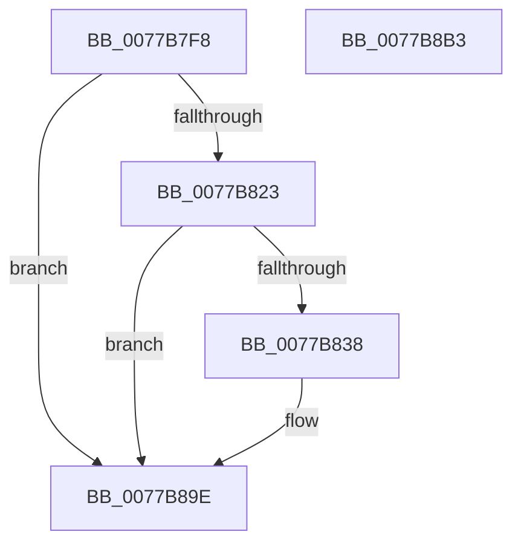

# TtmiLogSessionWorkerPass

- RVA: `0x0077B7F8`–`0x0077B8B4` (길이 `188` bytes)
- VA: `0x000000014077B7F8`
- 실행 섹션: `PAGE`
- PDB 이름 있음: `예`; PDB Function 태그: `아니요`
- unwind 정보 RVA: `0x0009EA9C`
- 디코드: `42`개 명령, `188/188` bytes 표시
- 미해석 바이트: `0` (있으면 어셈블리에 `.byte`로 보존)

> 이 문서는 커널 이미지의 기계어와 PDB 기호를 분석해 생성했습니다. 4번과 5번은 함수 원형과 자료형을 바이너리 사용 방식에서 추정한 C 해석이며 원본 소스 복구 결과는 아닙니다.

## 1. Dependencies

- 직접 호출 지점: **3**; 고유 호출 대상: **3**
- 직접 호출자로 확인된 함수: **1**
- RIP 상대 이미지 참조: **3**

### Outgoing calls
- `0x0077B82F` → [tlgKeywordOn](../../text/42/tlgKeywordOn_function_0042EAA0.md) (function, `0x0042EAA0`)
- `0x0077B899` → [tlgWriteTransfer_EtwWriteTransfer](../../text/42/tlgWriteTransfer_EtwWriteTransfer_function_004260E0.md) (function, `0x004260E0`)
- `0x0077B8A5` → [_security_check_cookie](../../text/6A/_security_check_cookie_function_006AC640.md) (function, `0x006AC640`)

### Direct callers
- [TtmpSessionWorker](TtmpSessionWorker_function_00777F60.md) at `0x00777FC8`

### Static image references
- `0x0077B806` → RVA `0x00E0A740` (`.data`; read)
- `0x0077B814` → RVA `0x00FD88C8` (`PAGEDATA`; read)
- `0x0077B844` → RVA `0x00051D89` (`.rdata`; read)

## 2. Other-region calls and transfers

- 다른 실행 섹션으로 향하는 call: **3**
  - `0x0077B82F` → [tlgKeywordOn](../../text/42/tlgKeywordOn_function_0042EAA0.md) (`PAGE` → `.text`)
  - `0x0077B899` → [tlgWriteTransfer_EtwWriteTransfer](../../text/42/tlgWriteTransfer_EtwWriteTransfer_function_004260E0.md) (`PAGE` → `.text`)
  - `0x0077B8A5` → [_security_check_cookie](../../text/6A/_security_check_cookie_function_006AC640.md) (`PAGE` → `.text`)
- 별도 외부 분기/꼬리 이동을 확인하지 못했습니다.

## 3. Assembly (complete function range)

```asm
0077B7F8  40 55                           push rbp
0077B7FA  48 8D 6C 24 A9                  lea rbp, [rsp - 0x57]
0077B7FF  48 81 EC A0 00 00 00            sub rsp, 0xa0
0077B806  48 8B 05 33 EF 68 00            mov rax, qword ptr [rip + 0x68ef33]
0077B80D  48 33 C4                        xor rax, rsp
0077B810  48 89 45 47                     mov qword ptr [rbp + 0x47], rax
0077B814  83 3D AD D0 85 00 05            cmp dword ptr [rip + 0x85d0ad], 5
0077B81B  44 8B CA                        mov r9d, edx
0077B81E  44 8B D1                        mov r10d, ecx
0077B821  76 7B                           jbe 0x14077b89e
0077B823  BA 01 00 00 00                  mov edx, 1
0077B828  48 8D 0D 99 D0 85 00            lea rcx, [rip + 0x85d099]
0077B82F  E8 6C 32 CB FF                  call 0x14042eaa0
0077B834  84 C0                           test al, al
0077B836  74 66                           je 0x14077b89e
0077B838  48 8D 45 E7                     lea rax, [rbp - 0x19]
0077B83C  44 89 4D EB                     mov dword ptr [rbp - 0x15], r9d
0077B840  48 89 45 17                     mov qword ptr [rbp + 0x17], rax
0077B844  48 8D 15 3E 65 8D FF            lea rdx, [rip - 0x729ac2]
0077B84B  48 8D 45 EB                     lea rax, [rbp - 0x15]
0077B84F  44 89 45 EF                     mov dword ptr [rbp - 0x11], r8d
0077B853  48 89 45 27                     mov qword ptr [rbp + 0x27], rax
0077B857  48 8D 0D 6A D0 85 00            lea rcx, [rip + 0x85d06a]
0077B85E  48 8D 45 EF                     lea rax, [rbp - 0x11]
0077B862  44 89 55 E7                     mov dword ptr [rbp - 0x19], r10d
0077B866  48 89 45 37                     mov qword ptr [rbp + 0x37], rax
0077B86A  45 33 C9                        xor r9d, r9d
0077B86D  48 8D 45 F7                     lea rax, [rbp - 9]
0077B871  48 C7 45 1F 04 00 00 00         mov qword ptr [rbp + 0x1f], 4
0077B879  48 89 44 24 28                  mov qword ptr [rsp + 0x28], rax
0077B87E  45 33 C0                        xor r8d, r8d
0077B881  C7 44 24 20 05 00 00 00         mov dword ptr [rsp + 0x20], 5
0077B889  48 C7 45 2F 04 00 00 00         mov qword ptr [rbp + 0x2f], 4
0077B891  48 C7 45 3F 04 00 00 00         mov qword ptr [rbp + 0x3f], 4
0077B899  E8 42 A8 CA FF                  call 0x1404260e0
0077B89E  48 8B 4D 47                     mov rcx, qword ptr [rbp + 0x47]
0077B8A2  48 33 CC                        xor rcx, rsp
0077B8A5  E8 96 0D F3 FF                  call 0x1406ac640
0077B8AA  48 81 C4 A0 00 00 00            add rsp, 0xa0
0077B8B1  5D                              pop rbp
0077B8B2  C3                              ret
0077B8B3  CC                              int3
```

## 4. C-style interpretation (structured pseudocode)

```c
__int64 __fastcall TtmiLogSessionWorkerPass(int a1, int a2, int a3)
{
    __int64 result;
    __int64 v_rsp;
    unsigned __int64 v_stack_m18;
    unsigned __int64 v_stack_m20;
    unsigned __int64 v_stack_m28;
    unsigned __int64 v_stack_m30;
    unsigned __int64 v_stack_m38;
    unsigned __int64 v_stack_m40;
    unsigned __int64 v_stack_m48;
    unsigned __int64 v_stack_m5F;
    unsigned __int64 v_stack_m68;
    unsigned int v_stack_m70;
    unsigned int v_stack_m74;
    unsigned __int64 v_stack_m78;
    unsigned __int64 v_stack_m80;
    unsigned int v_stack_m88;

    v_rsp = (v_rsp) - (160);
    result = (*(unsigned __int64 *)(v_rip + 6876979)) ^ (v_rsp);
    v_stack_m18 = result;
    if ((*(unsigned int *)(v_rip + 8769709)) <= 5) goto loc_0077B89E;
    result = tlgKeywordOn(v_rip + 8769689, 1, a3, (unsigned int)(a2));
    if ((unsigned __int8)(result) != 0) {
        result = v_stack_m78;
        v_stack_m74 = (unsigned int)((unsigned int)(a2));
        v_stack_m48 = result;
        a2 = v_rip - 7510722;
        result = v_stack_m74;
        v_stack_m70 = a3;
        v_stack_m38 = result;
        a1 = v_rip + 8769642;
        result = v_stack_m70;
        v_stack_m78 = (unsigned int)((unsigned int)(a1));
        v_stack_m28 = result;
        a4 = 0;
        result = v_stack_m68;
        v_stack_m40 = 4;
        v_stack_m80 = result;
        a3 = 0;
        v_stack_m88 = 5;
        v_stack_m30 = 4;
        v_stack_m20 = 4;
        result = tlgWriteTransfer_EtwWriteTransfer(a1, a2, a3, a4);
    }
    a1 = (v_stack_m18) ^ (v_rsp);
    result = _security_check_cookie(a1, a2, a3, a4);
    v_rsp = (v_rsp) + (160);
    return result;
}
```

## 5. (Beta) C Style

```c
int64_t TtmiLogSessionWorkerPass(int32_t Arg1, int32_t Arg2, int32_t Arg3)
{
    int64_t result;
    int64_t local_rsp;
    uint64_t v_stack_m18;
    uint64_t v_stack_m20;
    uint64_t v_stack_m28;
    uint64_t v_stack_m30;
    uint64_t v_stack_m38;
    uint64_t v_stack_m40;
    uint64_t v_stack_m48;
    uint64_t v_stack_m5F;
    uint64_t v_stack_m68;
    uint32_t v_stack_m70;
    uint32_t v_stack_m74;
    uint64_t v_stack_m78;
    uint64_t v_stack_m80;
    uint32_t v_stack_m88;

    local_rsp = (local_rsp) - (160);
    result = (*(uint64_t *)(v_rip + 0x68EF33)) ^ (local_rsp);
    v_stack_m18 = result;
    if ((*(uint32_t *)(v_rip + 0x85D0AD)) <= 5) goto loc_0077B89E;
    result = tlgKeywordOn(v_rip + 8769689, 1, Arg3, (uint32_t)(Arg2));
    if ((uint8_t)(result) != 0) {
        result = v_stack_m78;
        v_stack_m74 = (uint32_t)((uint32_t)(Arg2));
        v_stack_m48 = result;
        Arg2 = v_rip - 7510722;
        result = v_stack_m74;
        v_stack_m70 = Arg3;
        v_stack_m38 = result;
        Arg1 = v_rip + 8769642;
        result = v_stack_m70;
        v_stack_m78 = (uint32_t)((uint32_t)(Arg1));
        v_stack_m28 = result;
        a4 = 0;
        result = v_stack_m68;
        v_stack_m40 = 4;
        v_stack_m80 = result;
        Arg3 = 0;
        v_stack_m88 = 5;
        v_stack_m30 = 4;
        v_stack_m20 = 4;
        result = tlgWriteTransfer_EtwWriteTransfer(Arg1, Arg2, Arg3, a4);
    }
    Arg1 = (v_stack_m18) ^ (local_rsp);
    result = _security_check_cookie(Arg1, Arg2, Arg3, a4);
    local_rsp = (local_rsp) + (160);
    return result;
}
```

## 6. Execution-region graph

[열기: 2D/3D 그래프와 함수 탐색 컨트롤 패널](../../../control-panel.html?section=page&rva=0x0077B7F8&view=graph)

- 2D 그래프는 위에서 아래로 흐르고, 3D 그래프는 빈 공간을 드래그해 회전합니다. Shift+드래그는 이동, 휠은 확대·축소, 함수 노드 선택은 대상 보고서 이동입니다.

### Static fallback


