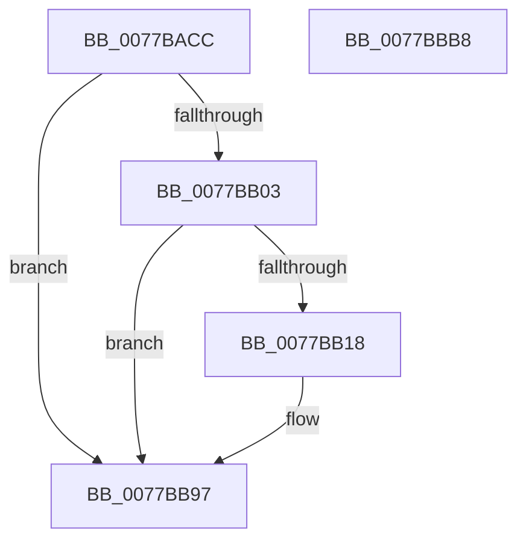

# TtmiLogTerminalCreated

- RVA: `0x0077BACC`–`0x0077BBB9` (길이 `237` bytes)
- VA: `0x000000014077BACC`
- 실행 섹션: `PAGE`
- PDB 이름 있음: `예`; PDB Function 태그: `아니요`
- unwind 정보 RVA: `0x00078F20`
- 디코드: `54`개 명령, `237/237` bytes 표시
- 미해석 바이트: `0` (있으면 어셈블리에 `.byte`로 보존)

> 이 문서는 커널 이미지의 기계어와 PDB 기호를 분석해 생성했습니다. 4번과 5번은 함수 원형과 자료형을 바이너리 사용 방식에서 추정한 C 해석이며 원본 소스 복구 결과는 아닙니다.

## 1. Dependencies

- 직접 호출 지점: **4**; 고유 호출 대상: **4**
- 직접 호출자로 확인된 함수: **1**
- RIP 상대 이미지 참조: **3**

### Outgoing calls
- `0x0077BB0F` → [tlgKeywordOn](../../text/42/tlgKeywordOn_function_0042EAA0.md) (function, `0x0042EAA0`)
- `0x0077BB28` → [PsGetProcessSessionIdEx](../../text/22/PsGetProcessSessionIdEx_function_0022F8F0.md) (function, `0x0022F8F0`)
- `0x0077BB92` → [tlgWriteTransfer_EtwWriteTransfer](../../text/42/tlgWriteTransfer_EtwWriteTransfer_function_004260E0.md) (function, `0x004260E0`)
- `0x0077BB9E` → [_security_check_cookie](../../text/6A/_security_check_cookie_function_006AC640.md) (function, `0x006AC640`)

### Direct callers
- [TtmiCreateTerminal](TtmiCreateTerminal_function_0077C748.md) at `0x0077C966`

### Static image references
- `0x0077BAE3` → RVA `0x00E0A740` (`.data`; read)
- `0x0077BAF1` → RVA `0x00FD88C8` (`PAGEDATA`; read)
- `0x0077BB70` → RVA `0x00051E34` (`.rdata`; read)

## 2. Other-region calls and transfers

- 다른 실행 섹션으로 향하는 call: **4**
  - `0x0077BB0F` → [tlgKeywordOn](../../text/42/tlgKeywordOn_function_0042EAA0.md) (`PAGE` → `.text`)
  - `0x0077BB28` → [PsGetProcessSessionIdEx](../../text/22/PsGetProcessSessionIdEx_function_0022F8F0.md) (`PAGE` → `.text`)
  - `0x0077BB92` → [tlgWriteTransfer_EtwWriteTransfer](../../text/42/tlgWriteTransfer_EtwWriteTransfer_function_004260E0.md) (`PAGE` → `.text`)
  - `0x0077BB9E` → [_security_check_cookie](../../text/6A/_security_check_cookie_function_006AC640.md) (`PAGE` → `.text`)
- 별도 외부 분기/꼬리 이동을 확인하지 못했습니다.

## 3. Assembly (complete function range)

```asm
0077BACC  48 89 5C 24 08                  mov qword ptr [rsp + 8], rbx
0077BAD1  48 89 7C 24 10                  mov qword ptr [rsp + 0x10], rdi
0077BAD6  55                              push rbp
0077BAD7  48 8D 6C 24 A9                  lea rbp, [rsp - 0x57]
0077BADC  48 81 EC A0 00 00 00            sub rsp, 0xa0
0077BAE3  48 8B 05 56 EC 68 00            mov rax, qword ptr [rip + 0x68ec56]
0077BAEA  48 33 C4                        xor rax, rsp
0077BAED  48 89 45 47                     mov qword ptr [rbp + 0x47], rax
0077BAF1  83 3D D0 CD 85 00 05            cmp dword ptr [rip + 0x85cdd0], 5
0077BAF8  8B DA                           mov ebx, edx
0077BAFA  48 8B F9                        mov rdi, rcx
0077BAFD  0F 86 94 00 00 00               jbe 0x14077bb97
0077BB03  BA 01 00 00 00                  mov edx, 1
0077BB08  48 8D 0D B9 CD 85 00            lea rcx, [rip + 0x85cdb9]
0077BB0F  E8 8C 2F CB FF                  call 0x14042eaa0
0077BB14  84 C0                           test al, al
0077BB16  74 7F                           je 0x14077bb97
0077BB18  65 48 8B 0C 25 88 01 00 00      mov rcx, qword ptr gs:[0x188]
0077BB21  48 8B 89 B8 00 00 00            mov rcx, qword ptr [rcx + 0xb8]
0077BB28  E8 C3 3D AB FF                  call 0x14022f8f0
0077BB2D  83 65 23 00                     and dword ptr [rbp + 0x23], 0
0077BB31  48 8D 0D 90 CD 85 00            lea rcx, [rip + 0x85cd90]
0077BB38  83 65 33 00                     and dword ptr [rbp + 0x33], 0
0077BB3C  BA 04 00 00 00                  mov edx, 4
0077BB41  83 65 43 00                     and dword ptr [rbp + 0x43], 0
0077BB45  45 33 C9                        xor r9d, r9d
0077BB48  89 45 E7                        mov dword ptr [rbp - 0x19], eax
0077BB4B  45 33 C0                        xor r8d, r8d
0077BB4E  48 8D 45 E7                     lea rax, [rbp - 0x19]
0077BB52  89 55 1F                        mov dword ptr [rbp + 0x1f], edx
0077BB55  48 89 45 17                     mov qword ptr [rbp + 0x17], rax
0077BB59  48 8D 45 EB                     lea rax, [rbp - 0x15]
0077BB5D  48 89 45 27                     mov qword ptr [rbp + 0x27], rax
0077BB61  48 8D 45 EF                     lea rax, [rbp - 0x11]
0077BB65  48 89 45 37                     mov qword ptr [rbp + 0x37], rax
0077BB69  48 8D 45 F7                     lea rax, [rbp - 9]
0077BB6D  89 55 2F                        mov dword ptr [rbp + 0x2f], edx
0077BB70  48 8D 15 BD 62 8D FF            lea rdx, [rip - 0x729d43]
0077BB77  48 89 44 24 28                  mov qword ptr [rsp + 0x28], rax
0077BB7C  C7 44 24 20 05 00 00 00         mov dword ptr [rsp + 0x20], 5
0077BB84  89 5D EB                        mov dword ptr [rbp - 0x15], ebx
0077BB87  48 89 7D EF                     mov qword ptr [rbp - 0x11], rdi
0077BB8B  C7 45 3F 08 00 00 00            mov dword ptr [rbp + 0x3f], 8
0077BB92  E8 49 A5 CA FF                  call 0x1404260e0
0077BB97  48 8B 4D 47                     mov rcx, qword ptr [rbp + 0x47]
0077BB9B  48 33 CC                        xor rcx, rsp
0077BB9E  E8 9D 0A F3 FF                  call 0x1406ac640
0077BBA3  4C 8D 9C 24 A0 00 00 00         lea r11, [rsp + 0xa0]
0077BBAB  49 8B 5B 10                     mov rbx, qword ptr [r11 + 0x10]
0077BBAF  49 8B 7B 18                     mov rdi, qword ptr [r11 + 0x18]
0077BBB3  49 8B E3                        mov rsp, r11
0077BBB6  5D                              pop rbp
0077BBB7  C3                              ret
0077BBB8  CC                              int3
```

## 4. C-style interpretation (structured pseudocode)

```c
__int64 __fastcall TtmiLogTerminalCreated(__int64 a1, int a2, int a3, int a4)
{
    __int64 result;
    __int64 v_rsp;
    unsigned __int64 v_stack_m18;
    unsigned int v_stack_m1C;
    unsigned int v_stack_m20;
    unsigned __int64 v_stack_m28;
    unsigned int v_stack_m2C;
    unsigned int v_stack_m30;
    unsigned __int64 v_stack_m38;
    unsigned int v_stack_m3C;
    unsigned int v_stack_m40;
    unsigned __int64 v_stack_m48;
    unsigned __int64 v_stack_m5F;
    unsigned __int64 v_stack_m68;
    unsigned __int64 v_stack_m70;
    unsigned __int64 v_stack_m74;
    unsigned int v_stack_m78;
    unsigned __int64 v_stack_m8;
    unsigned __int64 v_stack_m80;
    unsigned int v_stack_m88;
    unsigned __int64 v_stack_p10;
    unsigned __int64 v_stack_p8;

    v_stack_p8 = v_rbx;
    v_stack_p10 = v_rdi;
    v_rsp = (v_rsp) - (160);
    result = (*(unsigned __int64 *)(v_rip + 6876246)) ^ (v_rsp);
    v_stack_m18 = result;
    if ((*(unsigned int *)(v_rip + 8768976)) <= 5) goto loc_0077BB97;
    result = tlgKeywordOn(v_rip + 8768953, 1, a3, a4);
    if ((unsigned __int8)(result) != 0) {
        a1 = *(unsigned __int64 *)(gs_base + (0 + 392));
        a1 = *(unsigned __int64 *)(a1 + 184);
        result = PsGetProcessSessionIdEx(a1, 1, a3, a4);
        a1 = v_rip + 8768912;
        a2 = 4;
        a4 = 0;
        v_stack_m78 = (unsigned int)(result);
        a3 = 0;
        result = v_stack_m78;
        v_stack_m40 = a2;
        v_stack_m48 = result;
        result = v_stack_m74;
        v_stack_m38 = result;
        result = v_stack_m70;
        v_stack_m28 = result;
        result = v_stack_m68;
        v_stack_m30 = a2;
        a2 = v_rip - 7511363;
        v_stack_m80 = result;
        v_stack_m88 = 5;
        v_stack_m74 = (unsigned int)((unsigned int)(a2));
        v_stack_m70 = a1;
        v_stack_m20 = 8;
        result = tlgWriteTransfer_EtwWriteTransfer(a1, a2, a3, a4);
    }
    a1 = (v_stack_m18) ^ (v_rsp);
    result = _security_check_cookie(a1, a2, a3, a4);
    return result;
}
```

## 5. (Beta) C Style

```c
int64_t TtmiLogTerminalCreated(int64_t Arg1, int32_t Arg2, int32_t Arg3, int32_t Arg4)
{
    int64_t result;
    int64_t local_rsp;
    uint64_t v_stack_m18;
    uint32_t v_stack_m1C;
    uint32_t v_stack_m20;
    uint64_t v_stack_m28;
    uint32_t v_stack_m2C;
    uint32_t v_stack_m30;
    uint64_t v_stack_m38;
    uint32_t v_stack_m3C;
    uint32_t v_stack_m40;
    uint64_t v_stack_m48;
    uint64_t v_stack_m5F;
    uint64_t v_stack_m68;
    uint64_t v_stack_m70;
    uint64_t v_stack_m74;
    uint32_t v_stack_m78;
    uint64_t v_stack_m8;
    uint64_t v_stack_m80;
    uint32_t v_stack_m88;
    uint64_t v_stack_p10;
    uint64_t v_stack_p8;

    v_stack_p8 = local_rbx;
    v_stack_p10 = local_rdi;
    local_rsp = (local_rsp) - (160);
    result = (*(uint64_t *)(v_rip + 0x68EC56)) ^ (local_rsp);
    v_stack_m18 = result;
    if ((*(uint32_t *)(v_rip + 0x85CDD0)) <= 5) goto loc_0077BB97;
    result = tlgKeywordOn(v_rip + 8768953, 1, Arg3, Arg4);
    if ((uint8_t)(result) != 0) {
        Arg1 = *(uint64_t *)(gs_base + (0 + 0x188));
        Arg1 = *(uint64_t *)(Arg1 + 0xB8);
        result = PsGetProcessSessionIdEx(Arg1, 1, Arg3, Arg4);
        Arg1 = v_rip + 8768912;
        Arg2 = 4;
        Arg4 = 0;
        v_stack_m78 = (uint32_t)(result);
        Arg3 = 0;
        result = v_stack_m78;
        v_stack_m40 = Arg2;
        v_stack_m48 = result;
        result = v_stack_m74;
        v_stack_m38 = result;
        result = v_stack_m70;
        v_stack_m28 = result;
        result = v_stack_m68;
        v_stack_m30 = Arg2;
        Arg2 = v_rip - 7511363;
        v_stack_m80 = result;
        v_stack_m88 = 5;
        v_stack_m74 = (uint32_t)((uint32_t)(Arg2));
        v_stack_m70 = Arg1;
        v_stack_m20 = 8;
        result = tlgWriteTransfer_EtwWriteTransfer(Arg1, Arg2, Arg3, Arg4);
    }
    Arg1 = (v_stack_m18) ^ (local_rsp);
    result = _security_check_cookie(Arg1, Arg2, Arg3, Arg4);
    return result;
}
```

## 6. Execution-region graph

[열기: 2D/3D 그래프와 함수 탐색 컨트롤 패널](../../../control-panel.html?section=page&rva=0x0077BACC&view=graph)

- 2D 그래프는 위에서 아래로 흐르고, 3D 그래프는 빈 공간을 드래그해 회전합니다. Shift+드래그는 이동, 휠은 확대·축소, 함수 노드 선택은 대상 보고서 이동입니다.

### Static fallback


