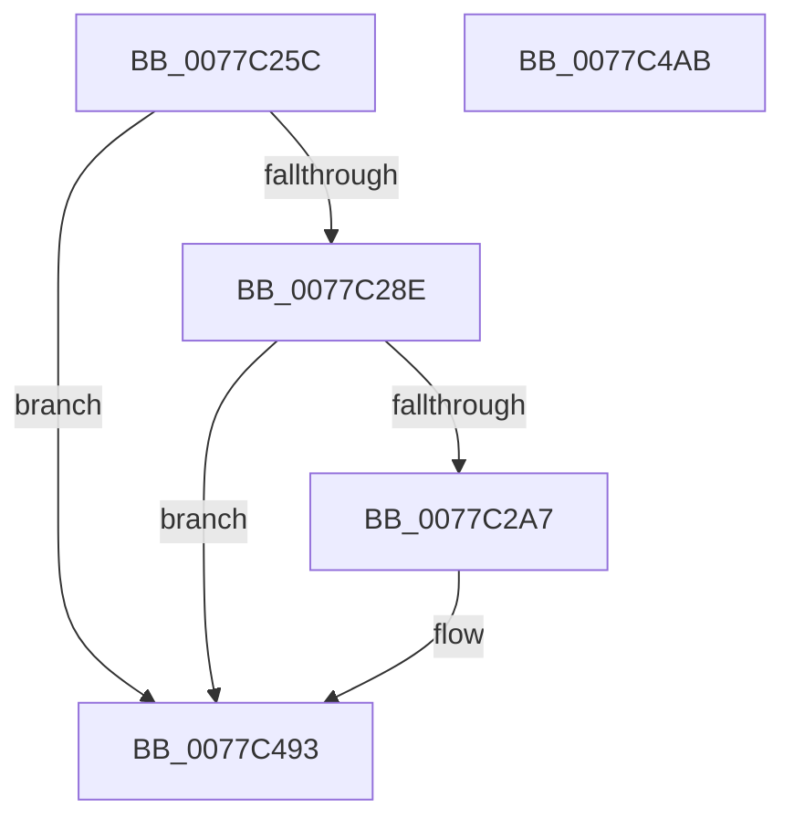

# TtmiLogTerminalRundown

- RVA: `0x0077C25C`–`0x0077C4AC` (길이 `592` bytes)
- VA: `0x000000014077C25C`
- 실행 섹션: `PAGE`
- PDB 이름 있음: `예`; PDB Function 태그: `아니요`
- unwind 정보 RVA: `0x000CDCF0`
- 디코드: `114`개 명령, `592/592` bytes 표시
- 미해석 바이트: `0` (있으면 어셈블리에 `.byte`로 보존)

> 이 문서는 커널 이미지의 기계어와 PDB 기호를 분석해 생성했습니다. 4번과 5번은 함수 원형과 자료형을 바이너리 사용 방식에서 추정한 C 해석이며 원본 소스 복구 결과는 아닙니다.

## 1. Dependencies

- 직접 호출 지점: **3**; 고유 호출 대상: **3**
- 직접 호출자로 확인된 함수: **1**
- RIP 상대 이미지 참조: **3**

### Outgoing calls
- `0x0077C29A` → [tlgKeywordOn](../../text/42/tlgKeywordOn_function_0042EAA0.md) (function, `0x0042EAA0`)
- `0x0077C48E` → [tlgWriteTransfer_EtwWriteTransfer](../../text/42/tlgWriteTransfer_EtwWriteTransfer_function_004260E0.md) (function, `0x004260E0`)
- `0x0077C49D` → [_security_check_cookie](../../text/6A/_security_check_cookie_function_006AC640.md) (function, `0x006AC640`)

### Direct callers
- [TtmiTerminalsRundown](TtmiTerminalsRundown_function_0077D280.md) at `0x0077D351`

### Static image references
- `0x0077C26D` → RVA `0x00E0A740` (`.data`; read)
- `0x0077C27E` → RVA `0x00FD88C8` (`PAGEDATA`; read)
- `0x0077C452` → RVA `0x000517B0` (`.rdata`; read)

## 2. Other-region calls and transfers

- 다른 실행 섹션으로 향하는 call: **3**
  - `0x0077C29A` → [tlgKeywordOn](../../text/42/tlgKeywordOn_function_0042EAA0.md) (`PAGE` → `.text`)
  - `0x0077C48E` → [tlgWriteTransfer_EtwWriteTransfer](../../text/42/tlgWriteTransfer_EtwWriteTransfer_function_004260E0.md) (`PAGE` → `.text`)
  - `0x0077C49D` → [_security_check_cookie](../../text/6A/_security_check_cookie_function_006AC640.md) (`PAGE` → `.text`)
- 별도 외부 분기/꼬리 이동을 확인하지 못했습니다.

## 3. Assembly (complete function range)

```asm
0077C25C  40 55                           push rbp
0077C25E  48 8D AC 24 30 FF FF FF         lea rbp, [rsp - 0xd0]
0077C266  48 81 EC D0 01 00 00            sub rsp, 0x1d0
0077C26D  48 8B 05 CC E4 68 00            mov rax, qword ptr [rip + 0x68e4cc]
0077C274  48 33 C4                        xor rax, rsp
0077C277  48 89 85 C0 00 00 00            mov qword ptr [rbp + 0xc0], rax
0077C27E  83 3D 43 C6 85 00 05            cmp dword ptr [rip + 0x85c643], 5
0077C285  4C 8B C1                        mov r8, rcx
0077C288  0F 86 05 02 00 00               jbe 0x14077c493
0077C28E  BA 01 00 00 00                  mov edx, 1
0077C293  48 8D 0D 2E C6 85 00            lea rcx, [rip + 0x85c62e]
0077C29A  E8 01 28 CB FF                  call 0x14042eaa0
0077C29F  84 C0                           test al, al
0077C2A1  0F 84 EC 01 00 00               je 0x14077c493
0077C2A7  41 8B 00                        mov eax, dword ptr [r8]
0077C2AA  89 44 24 30                     mov dword ptr [rsp + 0x30], eax
0077C2AE  48 8D 44 24 30                  lea rax, [rsp + 0x30]
0077C2B3  48 89 45 B0                     mov qword ptr [rbp - 0x50], rax
0077C2B7  41 8B 40 04                     mov eax, dword ptr [r8 + 4]
0077C2BB  89 44 24 34                     mov dword ptr [rsp + 0x34], eax
0077C2BF  48 8D 44 24 34                  lea rax, [rsp + 0x34]
0077C2C4  48 89 45 C0                     mov qword ptr [rbp - 0x40], rax
0077C2C8  41 8B 40 08                     mov eax, dword ptr [r8 + 8]
0077C2CC  89 44 24 38                     mov dword ptr [rsp + 0x38], eax
0077C2D0  48 8D 44 24 38                  lea rax, [rsp + 0x38]
0077C2D5  48 89 45 D0                     mov qword ptr [rbp - 0x30], rax
0077C2D9  41 8B 40 0C                     mov eax, dword ptr [r8 + 0xc]
0077C2DD  89 44 24 3C                     mov dword ptr [rsp + 0x3c], eax
0077C2E1  48 8D 44 24 3C                  lea rax, [rsp + 0x3c]
0077C2E6  48 89 45 E0                     mov qword ptr [rbp - 0x20], rax
0077C2EA  41 8B 40 10                     mov eax, dword ptr [r8 + 0x10]
0077C2EE  89 44 24 40                     mov dword ptr [rsp + 0x40], eax
0077C2F2  48 8D 44 24 40                  lea rax, [rsp + 0x40]
0077C2F7  48 89 45 F0                     mov qword ptr [rbp - 0x10], rax
0077C2FB  41 8B 40 14                     mov eax, dword ptr [r8 + 0x14]
0077C2FF  89 44 24 44                     mov dword ptr [rsp + 0x44], eax
0077C303  48 8D 44 24 44                  lea rax, [rsp + 0x44]
0077C308  48 89 45 00                     mov qword ptr [rbp], rax
0077C30C  41 8B 40 18                     mov eax, dword ptr [r8 + 0x18]
0077C310  89 44 24 48                     mov dword ptr [rsp + 0x48], eax
0077C314  48 8D 44 24 48                  lea rax, [rsp + 0x48]
0077C319  48 89 45 10                     mov qword ptr [rbp + 0x10], rax
0077C31D  41 8B 40 1C                     mov eax, dword ptr [r8 + 0x1c]
0077C321  89 44 24 4C                     mov dword ptr [rsp + 0x4c], eax
0077C325  48 8D 44 24 4C                  lea rax, [rsp + 0x4c]
0077C32A  48 89 45 20                     mov qword ptr [rbp + 0x20], rax
0077C32E  49 8B 40 20                     mov rax, qword ptr [r8 + 0x20]
0077C332  48 89 44 24 68                  mov qword ptr [rsp + 0x68], rax
0077C337  48 8D 44 24 68                  lea rax, [rsp + 0x68]
0077C33C  48 89 45 30                     mov qword ptr [rbp + 0x30], rax
0077C340  49 8B 40 28                     mov rax, qword ptr [r8 + 0x28]
0077C344  48 89 44 24 70                  mov qword ptr [rsp + 0x70], rax
0077C349  48 8D 44 24 70                  lea rax, [rsp + 0x70]
0077C34E  48 89 45 40                     mov qword ptr [rbp + 0x40], rax
0077C352  49 8B 40 30                     mov rax, qword ptr [r8 + 0x30]
0077C356  48 89 44 24 78                  mov qword ptr [rsp + 0x78], rax
0077C35B  48 8D 44 24 78                  lea rax, [rsp + 0x78]
0077C360  48 89 45 50                     mov qword ptr [rbp + 0x50], rax
0077C364  49 8B 40 38                     mov rax, qword ptr [r8 + 0x38]
0077C368  48 89 45 80                     mov qword ptr [rbp - 0x80], rax
0077C36C  48 8D 45 80                     lea rax, [rbp - 0x80]
0077C370  48 89 45 60                     mov qword ptr [rbp + 0x60], rax
0077C374  41 8B 40 40                     mov eax, dword ptr [r8 + 0x40]
0077C378  89 44 24 50                     mov dword ptr [rsp + 0x50], eax
0077C37C  48 8D 44 24 50                  lea rax, [rsp + 0x50]
0077C381  48 89 45 70                     mov qword ptr [rbp + 0x70], rax
0077C385  41 8B 40 44                     mov eax, dword ptr [r8 + 0x44]
0077C389  89 44 24 54                     mov dword ptr [rsp + 0x54], eax
0077C38D  48 8D 44 24 54                  lea rax, [rsp + 0x54]
0077C392  48 89 85 80 00 00 00            mov qword ptr [rbp + 0x80], rax
0077C399  41 8B 40 48                     mov eax, dword ptr [r8 + 0x48]
0077C39D  89 44 24 58                     mov dword ptr [rsp + 0x58], eax
0077C3A1  48 8D 44 24 58                  lea rax, [rsp + 0x58]
0077C3A6  48 89 85 90 00 00 00            mov qword ptr [rbp + 0x90], rax
0077C3AD  41 8B 40 4C                     mov eax, dword ptr [r8 + 0x4c]
0077C3B1  89 44 24 5C                     mov dword ptr [rsp + 0x5c], eax
0077C3B5  48 8D 44 24 5C                  lea rax, [rsp + 0x5c]
0077C3BA  48 89 85 A0 00 00 00            mov qword ptr [rbp + 0xa0], rax
0077C3C1  41 8B 40 50                     mov eax, dword ptr [r8 + 0x50]
0077C3C5  48 C7 45 B8 04 00 00 00         mov qword ptr [rbp - 0x48], 4
0077C3CD  48 C7 45 C8 04 00 00 00         mov qword ptr [rbp - 0x38], 4
0077C3D5  48 C7 45 D8 04 00 00 00         mov qword ptr [rbp - 0x28], 4
0077C3DD  48 C7 45 E8 04 00 00 00         mov qword ptr [rbp - 0x18], 4
0077C3E5  48 C7 45 F8 04 00 00 00         mov qword ptr [rbp - 8], 4
0077C3ED  48 C7 45 08 04 00 00 00         mov qword ptr [rbp + 8], 4
0077C3F5  48 C7 45 18 04 00 00 00         mov qword ptr [rbp + 0x18], 4
0077C3FD  48 C7 45 28 04 00 00 00         mov qword ptr [rbp + 0x28], 4
0077C405  48 C7 45 38 08 00 00 00         mov qword ptr [rbp + 0x38], 8
0077C40D  48 C7 45 48 08 00 00 00         mov qword ptr [rbp + 0x48], 8
0077C415  48 C7 45 58 08 00 00 00         mov qword ptr [rbp + 0x58], 8
0077C41D  48 C7 45 68 08 00 00 00         mov qword ptr [rbp + 0x68], 8
0077C425  48 C7 45 78 04 00 00 00         mov qword ptr [rbp + 0x78], 4
0077C42D  48 C7 85 88 00 00 00 04 00 00 00  mov qword ptr [rbp + 0x88], 4
0077C438  48 C7 85 98 00 00 00 04 00 00 00  mov qword ptr [rbp + 0x98], 4
0077C443  48 C7 85 A8 00 00 00 04 00 00 00  mov qword ptr [rbp + 0xa8], 4
0077C44E  89 44 24 60                     mov dword ptr [rsp + 0x60], eax
0077C452  48 8D 15 57 53 8D FF            lea rdx, [rip - 0x72aca9]
0077C459  48 8D 44 24 60                  lea rax, [rsp + 0x60]
0077C45E  48 C7 85 B8 00 00 00 04 00 00 00  mov qword ptr [rbp + 0xb8], 4
0077C469  48 89 85 B0 00 00 00            mov qword ptr [rbp + 0xb0], rax
0077C470  48 8D 0D 51 C4 85 00            lea rcx, [rip + 0x85c451]
0077C477  48 8D 45 90                     lea rax, [rbp - 0x70]
0077C47B  45 33 C9                        xor r9d, r9d
0077C47E  48 89 44 24 28                  mov qword ptr [rsp + 0x28], rax
0077C483  45 33 C0                        xor r8d, r8d
0077C486  C7 44 24 20 13 00 00 00         mov dword ptr [rsp + 0x20], 0x13
0077C48E  E8 4D 9C CA FF                  call 0x1404260e0
0077C493  48 8B 8D C0 00 00 00            mov rcx, qword ptr [rbp + 0xc0]
0077C49A  48 33 CC                        xor rcx, rsp
0077C49D  E8 9E 01 F3 FF                  call 0x1406ac640
0077C4A2  48 81 C4 D0 01 00 00            add rsp, 0x1d0
0077C4A9  5D                              pop rbp
0077C4AA  C3                              ret
0077C4AB  CC                              int3
```

## 4. C-style interpretation (structured pseudocode)

```c
__int64 __fastcall TtmiLogTerminalRundown(__int64 a1, __int64 a2, __int64 a3, int a4)
{
    __int64 result;
    __int64 v_rsp;
    unsigned __int64 v_stack_m100;
    unsigned __int64 v_stack_m108;
    unsigned __int64 v_stack_m110;
    unsigned __int64 v_stack_m118;
    unsigned __int64 v_stack_m120;
    unsigned __int64 v_stack_m128;
    unsigned __int64 v_stack_m148;
    unsigned __int64 v_stack_m158;
    unsigned __int64 v_stack_m160;
    unsigned __int64 v_stack_m168;
    unsigned __int64 v_stack_m170;
    unsigned int v_stack_m178;
    unsigned int v_stack_m17C;
    unsigned __int64 v_stack_m18;
    unsigned int v_stack_m180;
    unsigned int v_stack_m184;
    unsigned int v_stack_m188;
    unsigned int v_stack_m18C;
    unsigned int v_stack_m190;
    unsigned int v_stack_m194;
    unsigned int v_stack_m198;
    unsigned int v_stack_m19C;
    unsigned int v_stack_m1A0;
    unsigned int v_stack_m1A4;
    unsigned int v_stack_m1A8;
    unsigned __int64 v_stack_m1B0;
    unsigned int v_stack_m1B8;
    unsigned __int64 v_stack_m20;
    unsigned __int64 v_stack_m28;
    unsigned __int64 v_stack_m30;
    unsigned __int64 v_stack_m38;
    unsigned __int64 v_stack_m40;
    unsigned __int64 v_stack_m48;
    unsigned __int64 v_stack_m50;
    unsigned __int64 v_stack_m58;
    unsigned __int64 v_stack_m60;
    unsigned __int64 v_stack_m68;
    unsigned __int64 v_stack_m70;
    unsigned __int64 v_stack_m78;
    unsigned __int64 v_stack_m80;
    unsigned __int64 v_stack_m88;
    unsigned __int64 v_stack_m90;
    unsigned __int64 v_stack_m98;
    unsigned __int64 v_stack_mA0;
    unsigned __int64 v_stack_mA8;
    unsigned __int64 v_stack_mB0;
    unsigned __int64 v_stack_mB8;
    unsigned __int64 v_stack_mC0;
    unsigned __int64 v_stack_mC8;
    unsigned __int64 v_stack_mD0;
    unsigned __int64 v_stack_mD8;
    unsigned __int64 v_stack_mE0;
    unsigned __int64 v_stack_mE8;
    unsigned __int64 v_stack_mF0;
    unsigned __int64 v_stack_mF8;

    v_rsp = (v_rsp) - (464);
    result = (*(unsigned __int64 *)(v_rip + 6874316)) ^ (v_rsp);
    v_stack_m18 = result;
    if ((*(unsigned int *)(v_rip + 8767043)) <= 5) goto loc_0077C493;
    result = tlgKeywordOn(v_rip + 8767022, 1, a1, a4);
    if ((unsigned __int8)(result) != 0) {
        result = *(unsigned int *)(a1);
        v_stack_m1A8 = (unsigned int)(result);
        result = v_stack_m1A8;
        v_stack_m128 = result;
        result = *(unsigned int *)(a1 + 4);
        v_stack_m1A4 = (unsigned int)(result);
        result = v_stack_m1A4;
        v_stack_m118 = result;
        result = *(unsigned int *)(a1 + 8);
        v_stack_m1A0 = (unsigned int)(result);
        result = v_stack_m1A0;
        v_stack_m108 = result;
        result = *(unsigned int *)(a1 + 12);
        v_stack_m19C = (unsigned int)(result);
        result = v_stack_m19C;
        v_stack_mF8 = result;
        result = *(unsigned int *)(a1 + 16);
        v_stack_m198 = (unsigned int)(result);
        result = v_stack_m198;
        v_stack_mE8 = result;
        result = *(unsigned int *)(a1 + 20);
        v_stack_m194 = (unsigned int)(result);
        result = v_stack_m194;
        v_stack_mD8 = result;
        result = *(unsigned int *)(a1 + 24);
        v_stack_m190 = (unsigned int)(result);
        result = v_stack_m190;
        v_stack_mC8 = result;
        result = *(unsigned int *)(a1 + 28);
        v_stack_m18C = (unsigned int)(result);
        result = v_stack_m18C;
        v_stack_mB8 = result;
        result = *(unsigned __int64 *)(a1 + 32);
        v_stack_m170 = result;
        result = v_stack_m170;
        v_stack_mA8 = result;
        result = *(unsigned __int64 *)(a1 + 40);
        v_stack_m168 = result;
        result = v_stack_m168;
        v_stack_m98 = result;
        result = *(unsigned __int64 *)(a1 + 48);
        v_stack_m160 = result;
        result = v_stack_m160;
        v_stack_m88 = result;
        result = *(unsigned __int64 *)(a1 + 56);
        v_stack_m158 = result;
        result = v_stack_m158;
        v_stack_m78 = result;
        result = *(unsigned int *)(a1 + 64);
        v_stack_m188 = (unsigned int)(result);
        result = v_stack_m188;
        v_stack_m68 = result;
        result = *(unsigned int *)(a1 + 68);
        v_stack_m184 = (unsigned int)(result);
        result = v_stack_m184;
        v_stack_m58 = result;
        result = *(unsigned int *)(a1 + 72);
        v_stack_m180 = (unsigned int)(result);
        result = v_stack_m180;
        v_stack_m48 = result;
        result = *(unsigned int *)(a1 + 76);
        v_stack_m17C = (unsigned int)(result);
        result = v_stack_m17C;
        v_stack_m38 = result;
        result = *(unsigned int *)(a1 + 80);
        v_stack_m120 = 4;
        v_stack_m110 = 4;
        v_stack_m100 = 4;
        v_stack_mF0 = 4;
        v_stack_mE0 = 4;
        v_stack_mD0 = 4;
        v_stack_mC0 = 4;
        v_stack_mB0 = 4;
        v_stack_mA0 = 8;
        v_stack_m90 = 8;
        v_stack_m80 = 8;
        v_stack_m70 = 8;
        v_stack_m60 = 4;
        v_stack_m50 = 4;
        v_stack_m40 = 4;
        v_stack_m30 = 4;
        v_stack_m178 = (unsigned int)(result);
        a2 = v_rip - 7515305;
        result = v_stack_m178;
        v_stack_m20 = 4;
        v_stack_m28 = result;
        a1 = v_rip + 8766545;
        result = v_stack_m148;
        a4 = 0;
        v_stack_m1B0 = result;
        a3 = 0;
        v_stack_m1B8 = 19;
        result = tlgWriteTransfer_EtwWriteTransfer(a1, a2, a3, a4);
    }
    a1 = (v_stack_m18) ^ (v_rsp);
    result = _security_check_cookie(a1, a2, a3, a4);
    v_rsp = (v_rsp) + (464);
    return result;
}
```

## 5. (Beta) C Style

```c
int64_t TtmiLogTerminalRundown(int64_t Arg1, int64_t Arg2, int64_t Arg3, int32_t Arg4)
{
    int64_t result;
    int64_t local_rsp;
    uint64_t v_stack_m100;
    uint64_t v_stack_m108;
    uint64_t v_stack_m110;
    uint64_t v_stack_m118;
    uint64_t v_stack_m120;
    uint64_t v_stack_m128;
    uint64_t v_stack_m148;
    uint64_t v_stack_m158;
    uint64_t v_stack_m160;
    uint64_t v_stack_m168;
    uint64_t v_stack_m170;
    uint32_t v_stack_m178;
    uint32_t v_stack_m17C;
    uint64_t v_stack_m18;
    uint32_t v_stack_m180;
    uint32_t v_stack_m184;
    uint32_t v_stack_m188;
    uint32_t v_stack_m18C;
    uint32_t v_stack_m190;
    uint32_t v_stack_m194;
    uint32_t v_stack_m198;
    uint32_t v_stack_m19C;
    uint32_t v_stack_m1A0;
    uint32_t v_stack_m1A4;
    uint32_t v_stack_m1A8;
    uint64_t v_stack_m1B0;
    uint32_t v_stack_m1B8;
    uint64_t v_stack_m20;
    uint64_t v_stack_m28;
    uint64_t v_stack_m30;
    uint64_t v_stack_m38;
    uint64_t v_stack_m40;
    uint64_t v_stack_m48;
    uint64_t v_stack_m50;
    uint64_t v_stack_m58;
    uint64_t v_stack_m60;
    uint64_t v_stack_m68;
    uint64_t v_stack_m70;
    uint64_t v_stack_m78;
    uint64_t v_stack_m80;
    uint64_t v_stack_m88;
    uint64_t v_stack_m90;
    uint64_t v_stack_m98;
    uint64_t v_stack_mA0;
    uint64_t v_stack_mA8;
    uint64_t v_stack_mB0;
    uint64_t v_stack_mB8;
    uint64_t v_stack_mC0;
    uint64_t v_stack_mC8;
    uint64_t v_stack_mD0;
    uint64_t v_stack_mD8;
    uint64_t v_stack_mE0;
    uint64_t v_stack_mE8;
    uint64_t v_stack_mF0;
    uint64_t v_stack_mF8;

    local_rsp = (local_rsp) - (464);
    result = (*(uint64_t *)(v_rip + 0x68E4CC)) ^ (local_rsp);
    v_stack_m18 = result;
    if ((*(uint32_t *)(v_rip + 0x85C643)) <= 5) goto loc_0077C493;
    result = tlgKeywordOn(v_rip + 8767022, 1, Arg1, Arg4);
    if ((uint8_t)(result) != 0) {
        result = *(uint32_t *)(Arg1);
        v_stack_m1A8 = (uint32_t)(result);
        result = v_stack_m1A8;
        v_stack_m128 = result;
        result = *(uint32_t *)(Arg1 + 0x4);
        v_stack_m1A4 = (uint32_t)(result);
        result = v_stack_m1A4;
        v_stack_m118 = result;
        result = *(uint32_t *)(Arg1 + 0x8);
        v_stack_m1A0 = (uint32_t)(result);
        result = v_stack_m1A0;
        v_stack_m108 = result;
        result = *(uint32_t *)(Arg1 + 0xC);
        v_stack_m19C = (uint32_t)(result);
        result = v_stack_m19C;
        v_stack_mF8 = result;
        result = *(uint32_t *)(Arg1 + 0x10);
        v_stack_m198 = (uint32_t)(result);
        result = v_stack_m198;
        v_stack_mE8 = result;
        result = *(uint32_t *)(Arg1 + 0x14);
        v_stack_m194 = (uint32_t)(result);
        result = v_stack_m194;
        v_stack_mD8 = result;
        result = *(uint32_t *)(Arg1 + 0x18);
        v_stack_m190 = (uint32_t)(result);
        result = v_stack_m190;
        v_stack_mC8 = result;
        result = *(uint32_t *)(Arg1 + 0x1C);
        v_stack_m18C = (uint32_t)(result);
        result = v_stack_m18C;
        v_stack_mB8 = result;
        result = *(uint64_t *)(Arg1 + 0x20);
        v_stack_m170 = result;
        result = v_stack_m170;
        v_stack_mA8 = result;
        result = *(uint64_t *)(Arg1 + 0x28);
        v_stack_m168 = result;
        result = v_stack_m168;
        v_stack_m98 = result;
        result = *(uint64_t *)(Arg1 + 0x30);
        v_stack_m160 = result;
        result = v_stack_m160;
        v_stack_m88 = result;
        result = *(uint64_t *)(Arg1 + 0x38);
        v_stack_m158 = result;
        result = v_stack_m158;
        v_stack_m78 = result;
        result = *(uint32_t *)(Arg1 + 0x40);
        v_stack_m188 = (uint32_t)(result);
        result = v_stack_m188;
        v_stack_m68 = result;
        result = *(uint32_t *)(Arg1 + 0x44);
        v_stack_m184 = (uint32_t)(result);
        result = v_stack_m184;
        v_stack_m58 = result;
        result = *(uint32_t *)(Arg1 + 0x48);
        v_stack_m180 = (uint32_t)(result);
        result = v_stack_m180;
        v_stack_m48 = result;
        result = *(uint32_t *)(Arg1 + 0x4C);
        v_stack_m17C = (uint32_t)(result);
        result = v_stack_m17C;
        v_stack_m38 = result;
        result = *(uint32_t *)(Arg1 + 0x50);
        v_stack_m120 = 4;
        v_stack_m110 = 4;
        v_stack_m100 = 4;
        v_stack_mF0 = 4;
        v_stack_mE0 = 4;
        v_stack_mD0 = 4;
        v_stack_mC0 = 4;
        v_stack_mB0 = 4;
        v_stack_mA0 = 8;
        v_stack_m90 = 8;
        v_stack_m80 = 8;
        v_stack_m70 = 8;
        v_stack_m60 = 4;
        v_stack_m50 = 4;
        v_stack_m40 = 4;
        v_stack_m30 = 4;
        v_stack_m178 = (uint32_t)(result);
        Arg2 = v_rip - 7515305;
        result = v_stack_m178;
        v_stack_m20 = 4;
        v_stack_m28 = result;
        Arg1 = v_rip + 8766545;
        result = v_stack_m148;
        Arg4 = 0;
        v_stack_m1B0 = result;
        Arg3 = 0;
        v_stack_m1B8 = 19;
        result = tlgWriteTransfer_EtwWriteTransfer(Arg1, Arg2, Arg3, Arg4);
    }
    Arg1 = (v_stack_m18) ^ (local_rsp);
    result = _security_check_cookie(Arg1, Arg2, Arg3, Arg4);
    local_rsp = (local_rsp) + (464);
    return result;
}
```

## 6. Execution-region graph

[열기: 2D/3D 그래프와 함수 탐색 컨트롤 패널](../../../control-panel.html?section=page&rva=0x0077C25C&view=graph)

- 2D 그래프는 위에서 아래로 흐르고, 3D 그래프는 빈 공간을 드래그해 회전합니다. Shift+드래그는 이동, 휠은 확대·축소, 함수 노드 선택은 대상 보고서 이동입니다.

### Static fallback


