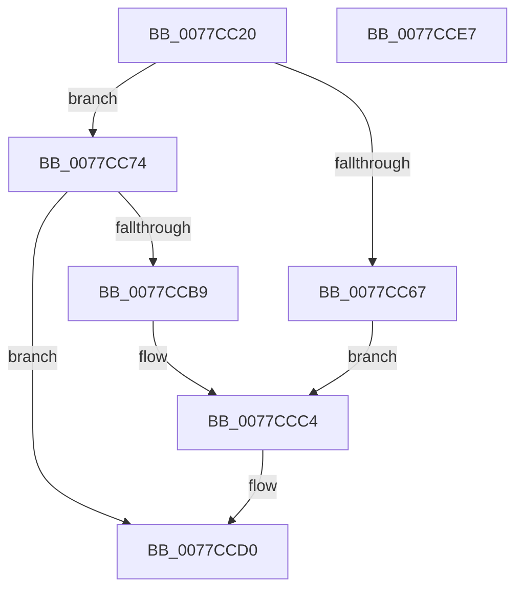

# TtmiOpenDefaultTerminal

- RVA: `0x0077CC20`–`0x0077CCE8` (길이 `200` bytes)
- VA: `0x000000014077CC20`
- 실행 섹션: `PAGE`
- PDB 이름 있음: `예`; PDB Function 태그: `아니요`
- unwind 정보 RVA: `0x000C7B58`
- 디코드: `55`개 명령, `200/200` bytes 표시
- 미해석 바이트: `0` (있으면 어셈블리에 `.byte`로 보존)

> 이 문서는 커널 이미지의 기계어와 PDB 기호를 분석해 생성했습니다. 4번과 5번은 함수 원형과 자료형을 바이너리 사용 방식에서 추정한 C 해석이며 원본 소스 복구 결과는 아닙니다.

## 1. Dependencies

- 직접 호출 지점: **4**; 고유 호출 대상: **4**
- 직접 호출자로 확인된 함수: **1**
- RIP 상대 이미지 참조: **2**

### Outgoing calls
- `0x0077CC5C` → [ObReferenceObjectByHandle](../86/ObReferenceObjectByHandle_function_00868DB0.md) (function, `0x00868DB0`)
- `0x0077CCA4` → [ObOpenObjectByPointer](../8B/ObOpenObjectByPointer_function_008B7420.md) (function, `0x008B7420`)
- `0x0077CCB0` → [ObfDereferenceObject](../../text/2F/ObfDereferenceObject_function_002F9350.md) (function, `0x002F9350`)
- `0x0077CCCB` → [TtmiLogError](../98/TtmiLogError_function_0098B39C.md) (function, `0x0098B39C`)

### Direct callers
- [TtmpDispatchOpenTerminal](TtmpDispatchOpenTerminal_function_00778AB8.md) at `0x00778B1E`

### Static image references
- `0x0077CC4C` → RVA `0x00FD9D08` (`PAGEDATA`; read)
- `0x0077CCC4` → RVA `0x00B04650` (` ?? ::NNGAKEGL::`string'`; read)

## 2. Other-region calls and transfers

- 다른 실행 섹션으로 향하는 call: **1**
  - `0x0077CCB0` → [ObfDereferenceObject](../../text/2F/ObfDereferenceObject_function_002F9350.md) (`PAGE` → `.text`)
- 별도 외부 분기/꼬리 이동을 확인하지 못했습니다.

## 3. Assembly (complete function range)

```asm
0077CC20  4C 8B DC                        mov r11, rsp
0077CC23  49 89 5B 10                     mov qword ptr [r11 + 0x10], rbx
0077CC27  49 89 6B 18                     mov qword ptr [r11 + 0x18], rbp
0077CC2B  49 89 73 20                     mov qword ptr [r11 + 0x20], rsi
0077CC2F  57                              push rdi
0077CC30  48 83 EC 40                     sub rsp, 0x40
0077CC34  49 83 63 E0 00                  and qword ptr [r11 - 0x20], 0
0077CC39  49 8D 43 08                     lea rax, [r11 + 8]
0077CC3D  48 8B 49 18                     mov rcx, qword ptr [rcx + 0x18]
0077CC41  49 8B E9                        mov rbp, r9
0077CC44  49 83 63 08 00                  and qword ptr [r11 + 8], 0
0077CC49  41 8A F8                        mov dil, r8b
0077CC4C  4C 8B 05 B5 D0 85 00            mov r8, qword ptr [rip + 0x85d0b5]
0077CC53  45 33 C9                        xor r9d, r9d
0077CC56  49 89 43 D8                     mov qword ptr [r11 - 0x28], rax
0077CC5A  8B F2                           mov esi, edx
0077CC5C  E8 4F C1 0E 00                  call 0x140868db0
0077CC61  8B D8                           mov ebx, eax
0077CC63  85 C0                           test eax, eax
0077CC65  79 0D                           jns 0x14077cc74
0077CC67  44 8B C8                        mov r9d, eax
0077CC6A  44 8B C0                        mov r8d, eax
0077CC6D  BA 9F 03 00 00                  mov edx, 0x39f
0077CC72  EB 50                           jmp 0x14077ccc4
0077CC74  48 8B 4C 24 50                  mov rcx, qword ptr [rsp + 0x50]
0077CC79  40 8A C7                        mov al, dil
0077CC7C  F6 D8                           neg al
0077CC7E  48 89 6C 24 30                  mov qword ptr [rsp + 0x30], rbp
0077CC83  48 8B 05 7E D0 85 00            mov rax, qword ptr [rip + 0x85d07e]
0077CC8A  44 8B CE                        mov r9d, esi
0077CC8D  1B D2                           sbb edx, edx
0077CC8F  40 88 7C 24 28                  mov byte ptr [rsp + 0x28], dil
0077CC94  F7 D2                           not edx
0077CC96  48 89 44 24 20                  mov qword ptr [rsp + 0x20], rax
0077CC9B  81 E2 00 02 00 00               and edx, 0x200
0077CCA1  45 33 C0                        xor r8d, r8d
0077CCA4  E8 77 A7 13 00                  call 0x1408b7420
0077CCA9  48 8B 4C 24 50                  mov rcx, qword ptr [rsp + 0x50]
0077CCAE  8B D8                           mov ebx, eax
0077CCB0  E8 9B C6 B7 FF                  call 0x1402f9350
0077CCB5  85 DB                           test ebx, ebx
0077CCB7  79 17                           jns 0x14077ccd0
0077CCB9  44 8B CB                        mov r9d, ebx
0077CCBC  44 8B C3                        mov r8d, ebx
0077CCBF  BA B8 03 00 00                  mov edx, 0x3b8
0077CCC4  48 8D 0D 85 79 38 00            lea rcx, [rip + 0x387985]
0077CCCB  E8 CC E6 20 00                  call 0x14098b39c
0077CCD0  48 8B 6C 24 60                  mov rbp, qword ptr [rsp + 0x60]
0077CCD5  8B C3                           mov eax, ebx
0077CCD7  48 8B 5C 24 58                  mov rbx, qword ptr [rsp + 0x58]
0077CCDC  48 8B 74 24 68                  mov rsi, qword ptr [rsp + 0x68]
0077CCE1  48 83 C4 40                     add rsp, 0x40
0077CCE5  5F                              pop rdi
0077CCE6  C3                              ret
0077CCE7  CC                              int3
```

## 4. C-style interpretation (structured pseudocode)

```c
__int64 __fastcall TtmiOpenDefaultTerminal(__int64 a1, int a2, unsigned __int8 a3, __int64 a4)
{
    __int64 result;
    __int64 v_rsp;
    unsigned __int64 v_stack_m18;
    unsigned __int8 v_stack_m20;
    unsigned __int64 v_stack_m28;
    unsigned __int64 v_stack_p10;
    unsigned __int64 v_stack_p18;
    unsigned __int64 v_stack_p20;
    unsigned __int64 v_stack_p8;

    *(unsigned __int64 *)(v_rsp + 16) = v_rbx;
    *(unsigned __int64 *)(v_rsp + 24) = v_rbp;
    *(unsigned __int64 *)(v_rsp + 32) = v_rsi;
    v_rsp = (v_rsp) - (64);
    a4 = 0;
    *(unsigned __int64 *)(v_rsp - 40) = v_rsp + 8;
    result = ObReferenceObjectByHandle(*(unsigned __int64 *)(a1 + 24), a2, *(unsigned __int64 *)(v_rip + 8769717), a4);
    if (!sign_flag) goto loc_0077CC74;
    goto loc_0077CCC4;
loc_0077CC74:
    result = (unsigned __int8)(-(a3));
    v_stack_m18 = 0;
    v_stack_m20 = a3;
    a2 = (unsigned int)(~(927));
    v_stack_m28 = *(unsigned __int64 *)(v_rip + 8769662);
    a2 = (unsigned int)((a2) & (512));
    a3 = 0;
    result = ObOpenObjectByPointer(v_stack_p8, a2, a3, (unsigned int)((unsigned int)((unsigned int)(a2))));
    result = ObfDereferenceObject(v_stack_p8, a2, a3, (unsigned int)((unsigned int)((unsigned int)(a2))));
    if (!sign_flag) goto loc_0077CCD0;
loc_0077CCC4:
    result = TtmiLogError(v_rip + 3701125, 952, (unsigned int)((unsigned int)((unsigned int)((unsigned int)(result)))), (unsigned int)((unsigned int)((unsigned int)((unsigned int)(result)))));
loc_0077CCD0:
    v_rsp = (v_rsp) + (64);
    return (unsigned int)((unsigned int)((unsigned int)((unsigned int)(result))));
}
```

## 5. (Beta) C Style

```c
int64_t TtmiOpenDefaultTerminal(void *Arg1, int32_t Arg2, uint8_t Arg3, int64_t Arg4)
{
    uint8_t *arg1 = (uint8_t *)Arg1;

    int64_t result;
    int64_t local_rsp;
    uint64_t v_stack_m18;
    uint8_t v_stack_m20;
    uint64_t v_stack_m28;
    uint64_t v_stack_p10;
    uint64_t v_stack_p18;
    uint64_t v_stack_p20;
    uint64_t v_stack_p8;

    *(uint64_t *)(local_rsp + 0x10) = local_rbx;
    *(uint64_t *)(local_rsp + 0x18) = local_rbp;
    *(uint64_t *)(local_rsp + 0x20) = local_rsi;
    local_rsp = (local_rsp) - (64);
    Arg4 = 0;
    *(uint64_t *)(local_rsp - 0x28) = local_rsp + 8;
    result = ObReferenceObjectByHandle(*(uint64_t *)(arg1 + 0x18), Arg2, *(uint64_t *)(v_rip + 0x85D0B5), Arg4);
    if (!sign_flag) goto loc_0077CC74;
    goto loc_0077CCC4;
loc_0077CC74:
    result = (uint8_t)(-(Arg3));
    v_stack_m18 = 0;
    v_stack_m20 = Arg3;
    Arg2 = (uint32_t)(~(927));
    v_stack_m28 = *(uint64_t *)(v_rip + 0x85D07E);
    Arg2 = (uint32_t)((Arg2) & (512));
    Arg3 = 0;
    result = ObOpenObjectByPointer(v_stack_p8, Arg2, Arg3, (uint32_t)((uint32_t)((uint32_t)(Arg2))));
    result = ObfDereferenceObject(v_stack_p8, Arg2, Arg3, (uint32_t)((uint32_t)((uint32_t)(Arg2))));
    if (!sign_flag) goto loc_0077CCD0;
loc_0077CCC4:
    result = TtmiLogError(v_rip + 3701125, 952, (uint32_t)((uint32_t)((uint32_t)((uint32_t)(result)))), (uint32_t)((uint32_t)((uint32_t)((uint32_t)(result)))));
loc_0077CCD0:
    local_rsp = (local_rsp) + (64);
    return (uint32_t)((uint32_t)((uint32_t)((uint32_t)(result))));
}
```

### 관측된 메모리 오프셋

구조체 형식이 확인되지 않은 접근은 인자 기준의 오프셋으로만 기록했습니다.

| 기준 인자 | 오프셋 표현 | 폭 (bit) | 접근 |
|---|---:|---:|---|
| `Arg1` | `+ 0x18` | `64` | `R` |

## 6. Execution-region graph

[열기: 2D/3D 그래프와 함수 탐색 컨트롤 패널](../../../control-panel.html?section=page&rva=0x0077CC20&view=graph)

- 2D 그래프는 위에서 아래로 흐르고, 3D 그래프는 빈 공간을 드래그해 회전합니다. Shift+드래그는 이동, 휠은 확대·축소, 함수 노드 선택은 대상 보고서 이동입니다.

### Static fallback


