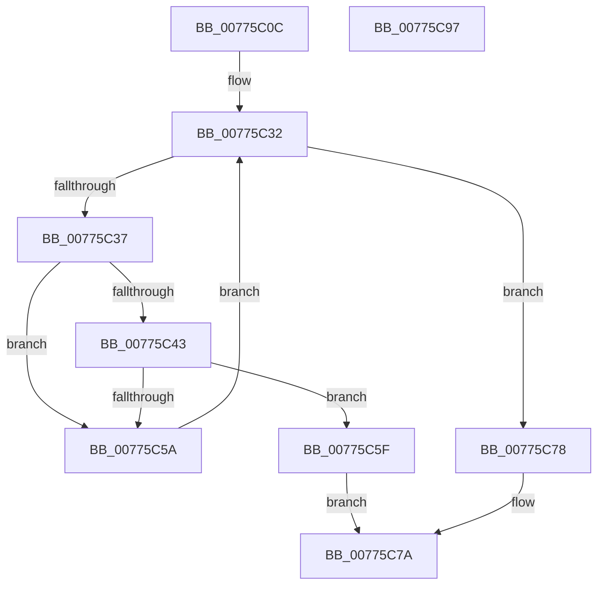

# TtmiPublishDeviceEnumerationEvents

- RVA: `0x00775C0C`–`0x00775C98` (길이 `140` bytes)
- VA: `0x0000000140775C0C`
- 실행 섹션: `PAGE`
- PDB 이름 있음: `예`; PDB Function 태그: `아니요`
- unwind 정보 RVA: `0x0005E6B4`
- 디코드: `43`개 명령, `140/140` bytes 표시
- 미해석 바이트: `0` (있으면 어셈블리에 `.byte`로 보존)

> 이 문서는 커널 이미지의 기계어와 PDB 기호를 분석해 생성했습니다. 4번과 5번은 함수 원형과 자료형을 바이너리 사용 방식에서 추정한 C 해석이며 원본 소스 복구 결과는 아닙니다.

## 1. Dependencies

- 직접 호출 지점: **2**; 고유 호출 대상: **2**
- 직접 호출자로 확인된 함수: **1**
- RIP 상대 이미지 참조: **1**

### Outgoing calls
- `0x00775C4F` → [TtmpPublishDeviceEvent](TtmpPublishDeviceEvent_function_00776718.md) (function, `0x00776718`)
- `0x00775C71` → [TtmiLogError](../98/TtmiLogError_function_0098B39C.md) (function, `0x0098B39C`)

### Direct callers
- [TtmiWriteEnumerationEventsToQueue](TtmiWriteEnumerationEventsToQueue_function_00777510.md) at `0x00777528`

### Static image references
- `0x00775C62` → RVA `0x00B04000` (` ?? ::NNGAKEGL::`string'`; read)

## 2. Other-region calls and transfers

- 다른 실행 섹션으로 향하는 call: **0**
- 별도 외부 분기/꼬리 이동을 확인하지 못했습니다.

## 3. Assembly (complete function range)

```asm
00775C0C  48 8B C4                        mov rax, rsp
00775C0F  48 89 58 08                     mov qword ptr [rax + 8], rbx
00775C13  48 89 68 10                     mov qword ptr [rax + 0x10], rbp
00775C17  48 89 70 18                     mov qword ptr [rax + 0x18], rsi
00775C1B  48 89 78 20                     mov qword ptr [rax + 0x20], rdi
00775C1F  41 56                           push r14
00775C21  48 83 EC 20                     sub rsp, 0x20
00775C25  48 8D 71 60                     lea rsi, [rcx + 0x60]
00775C29  4C 8B F2                        mov r14, rdx
00775C2C  48 8B 3E                        mov rdi, qword ptr [rsi]
00775C2F  48 8B E9                        mov rbp, rcx
00775C32  48 3B FE                        cmp rdi, rsi
00775C35  74 41                           je 0x140775c78
00775C37  8B 87 58 02 00 00               mov eax, dword ptr [rdi + 0x258]
00775C3D  24 0A                           and al, 0xa
00775C3F  3C 02                           cmp al, 2
00775C41  75 17                           jne 0x140775c5a
00775C43  45 33 C9                        xor r9d, r9d
00775C46  4C 8B C7                        mov r8, rdi
00775C49  49 8B D6                        mov rdx, r14
00775C4C  48 8B CD                        mov rcx, rbp
00775C4F  E8 C4 0A 00 00                  call 0x140776718
00775C54  8B D8                           mov ebx, eax
00775C56  85 C0                           test eax, eax
00775C58  78 05                           js 0x140775c5f
00775C5A  48 8B 3F                        mov rdi, qword ptr [rdi]
00775C5D  EB D3                           jmp 0x140775c32
00775C5F  44 8B C8                        mov r9d, eax
00775C62  48 8D 0D 97 E3 38 00            lea rcx, [rip + 0x38e397]
00775C69  44 8B C0                        mov r8d, eax
00775C6C  BA 1E 04 00 00                  mov edx, 0x41e
00775C71  E8 26 57 21 00                  call 0x14098b39c
00775C76  EB 02                           jmp 0x140775c7a
00775C78  33 DB                           xor ebx, ebx
00775C7A  48 8B 6C 24 38                  mov rbp, qword ptr [rsp + 0x38]
00775C7F  8B C3                           mov eax, ebx
00775C81  48 8B 5C 24 30                  mov rbx, qword ptr [rsp + 0x30]
00775C86  48 8B 74 24 40                  mov rsi, qword ptr [rsp + 0x40]
00775C8B  48 8B 7C 24 48                  mov rdi, qword ptr [rsp + 0x48]
00775C90  48 83 C4 20                     add rsp, 0x20
00775C94  41 5E                           pop r14
00775C96  C3                              ret
00775C97  CC                              int3
```

## 4. C-style interpretation (structured pseudocode)

```c
__int64 __fastcall TtmiPublishDeviceEnumerationEvents(__int64 a1, __int64 a2, __int64 a3, int a4)
{
    __int64 result;
    __int64 v_rbx;
    __int64 v_rsp;
    unsigned __int64 v_stack_p10;
    unsigned __int64 v_stack_p18;
    unsigned __int64 v_stack_p20;
    unsigned __int64 v_stack_p8;

    *(unsigned __int64 *)(v_rsp + 8) = v_rbx;
    *(unsigned __int64 *)(v_rsp + 16) = v_rbp;
    *(unsigned __int64 *)(v_rsp + 24) = v_rsi;
    *(unsigned __int64 *)(v_rsp + 32) = v_rdi;
    v_rsp = (v_rsp) - (32);
loc_00775C32:
    if ((*(unsigned __int64 *)(a1 + 96)) == (a1 + 96)) goto loc_00775C78;
    result = (unsigned __int8)(((unsigned int)(*(unsigned int *)(*(unsigned __int64 *)(a1 + 96) + 600))) & (10));
    if (((unsigned __int8)(result)) != 2) goto loc_00775C5A;
    a4 = 0;
    result = TtmpPublishDeviceEvent(a1, a2, *(unsigned __int64 *)(a1 + 96), a4);
    if (sign_flag) goto loc_00775C5F;
loc_00775C5A:
    goto loc_00775C32;
loc_00775C5F:
    result = TtmiLogError(v_rip + 3728279, (unsigned int)(0x41EULL), (unsigned int)((unsigned int)(result)), (unsigned int)((unsigned int)(result)));
    goto loc_00775C7A;
loc_00775C78:
    v_rbx = 0;
loc_00775C7A:
    v_rsp = (v_rsp) + (32);
    return 0;
}
```

## 5. (Beta) C Style

```c
int64_t TtmiPublishDeviceEnumerationEvents(void *Arg1, int64_t Arg2, int64_t Arg3, int32_t Arg4)
{
    uint8_t *arg1 = (uint8_t *)Arg1;

    int64_t result;
    int64_t local_rbx;
    int64_t local_rsp;
    uint64_t v_stack_p10;
    uint64_t v_stack_p18;
    uint64_t v_stack_p20;
    uint64_t v_stack_p8;

    *(uint64_t *)(local_rsp + 0x8) = local_rbx;
    *(uint64_t *)(local_rsp + 0x10) = local_rbp;
    *(uint64_t *)(local_rsp + 0x18) = local_rsi;
    *(uint64_t *)(local_rsp + 0x20) = local_rdi;
    local_rsp = (local_rsp) - (32);
loc_00775C32:
    if ((*(uint64_t *)(arg1 + 0x60)) == (Arg1 + 96)) goto loc_00775C78;
    result = (uint8_t)(((uint32_t)(*(uint32_t *)(*(uint64_t *)(arg1 + 0x60) + 0x258))) & (10));
    if (((uint8_t)(result)) != 2) goto loc_00775C5A;
    Arg4 = 0;
    result = TtmpPublishDeviceEvent(Arg1, Arg2, *(uint64_t *)(arg1 + 0x60), Arg4);
    if (sign_flag) goto loc_00775C5F;
loc_00775C5A:
    goto loc_00775C32;
loc_00775C5F:
    result = TtmiLogError(v_rip + 3728279, (uint32_t)(0x41EULL), (uint32_t)((uint32_t)(result)), (uint32_t)((uint32_t)(result)));
    goto loc_00775C7A;
loc_00775C78:
    local_rbx = 0;
loc_00775C7A:
    local_rsp = (local_rsp) + (32);
    return 0;
}
```

### 관측된 메모리 오프셋

구조체 형식이 확인되지 않은 접근은 인자 기준의 오프셋으로만 기록했습니다.

| 기준 인자 | 오프셋 표현 | 폭 (bit) | 접근 |
|---|---:|---:|---|
| `Arg1` | `+ 0x0` | `64` | `R` |
| `Arg1` | `+ 0x60` | `64` | `R` |

## 6. Execution-region graph

[열기: 2D/3D 그래프와 함수 탐색 컨트롤 패널](../../../control-panel.html?section=page&rva=0x00775C0C&view=graph)

- 2D 그래프는 위에서 아래로 흐르고, 3D 그래프는 빈 공간을 드래그해 회전합니다. Shift+드래그는 이동, 휠은 확대·축소, 함수 노드 선택은 대상 보고서 이동입니다.

### Static fallback


