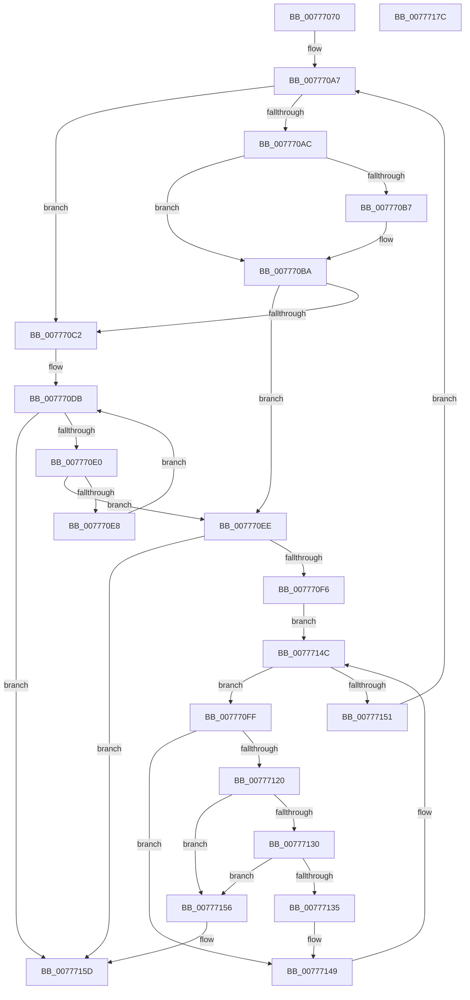

# TtmiPurgeSessionPowerRequestEntries

- RVA: `0x00777070`–`0x0077717D` (길이 `269` bytes)
- VA: `0x0000000140777070`
- 실행 섹션: `PAGE`
- PDB 이름 있음: `예`; PDB Function 태그: `아니요`
- unwind 정보 RVA: `0x0008A350`
- 디코드: `81`개 명령, `269/269` bytes 표시
- 미해석 바이트: `0` (있으면 어셈블리에 `.byte`로 보존)

> 이 문서는 커널 이미지의 기계어와 PDB 기호를 분석해 생성했습니다. 4번과 5번은 함수 원형과 자료형을 바이너리 사용 방식에서 추정한 C 해석이며 원본 소스 복구 결과는 아닙니다.

## 1. Dependencies

- 직접 호출 지점: **1**; 고유 호출 대상: **1**
- 직접 호출자로 확인된 함수: **1**
- RIP 상대 이미지 참조: **0**

### Outgoing calls
- `0x00777144` → [ExFreePoolWithTag](../../poolcode/B8/ExFreePoolWithTag_function_00B82870.md) (function, `0x00B82870`)

### Direct callers
- [TtmiSessionTerminalListWorker](TtmiSessionTerminalListWorker_function_0077CE14.md) at `0x0077D04C`

### Static image references
- 디코드된 RIP-relative 메모리 참조가 없습니다.

## 2. Other-region calls and transfers

- 다른 실행 섹션으로 향하는 call: **1**
  - `0x00777144` → [ExFreePoolWithTag](../../poolcode/B8/ExFreePoolWithTag_function_00B82870.md) (`PAGE` → `POOLCODE`)
- 별도 외부 분기/꼬리 이동을 확인하지 못했습니다.

## 3. Assembly (complete function range)

```asm
00777070  48 8B C4                        mov rax, rsp
00777073  48 89 58 08                     mov qword ptr [rax + 8], rbx
00777077  48 89 68 10                     mov qword ptr [rax + 0x10], rbp
0077707B  48 89 70 18                     mov qword ptr [rax + 0x18], rsi
0077707F  48 89 78 20                     mov qword ptr [rax + 0x20], rdi
00777083  41 55                           push r13
00777085  41 56                           push r14
00777087  41 57                           push r15
00777089  48 83 EC 20                     sub rsp, 0x20
0077708D  48 8B B9 18 01 00 00            mov rdi, qword ptr [rcx + 0x118]
00777094  48 8B E9                        mov rbp, rcx
00777097  48 8B DF                        mov rbx, rdi
0077709A  45 33 FF                        xor r15d, r15d
0077709D  49 BD 02 00 00 00 00 00 00 80   movabs r13, 0x8000000000000002
007770A7  48 85 DB                        test rbx, rbx
007770AA  74 16                           je 0x1407770c2
007770AC  48 8B 03                        mov rax, qword ptr [rbx]
007770AF  49 23 C5                        and rax, r13
007770B2  49 3B C5                        cmp rax, r13
007770B5  75 03                           jne 0x1407770ba
007770B7  49 8B 07                        mov rax, qword ptr [r15]
007770BA  48 8B 1B                        mov rbx, qword ptr [rbx]
007770BD  F6 C3 01                        test bl, 1
007770C0  74 2C                           je 0x1407770ee
007770C2  8B 8D 14 01 00 00               mov ecx, dword ptr [rbp + 0x114]
007770C8  48 83 C7 08                     add rdi, 8
007770CC  48 8B 85 18 01 00 00            mov rax, qword ptr [rbp + 0x118]
007770D3  48 C1 E9 05                     shr rcx, 5
007770D7  48 8D 14 C8                     lea rdx, [rax + rcx*8]
007770DB  48 3B FA                        cmp rdi, rdx
007770DE  73 7D                           jae 0x14077715d
007770E0  48 8B 1F                        mov rbx, qword ptr [rdi]
007770E3  F6 C3 01                        test bl, 1
007770E6  74 06                           je 0x1407770ee
007770E8  48 83 C7 08                     add rdi, 8
007770EC  EB ED                           jmp 0x1407770db
007770EE  48 8B C3                        mov rax, rbx
007770F1  48 85 C0                        test rax, rax
007770F4  74 67                           je 0x14077715d
007770F6  4C 8D 73 30                     lea r14, [rbx + 0x30]
007770FA  49 8B 36                        mov rsi, qword ptr [r14]
007770FD  EB 4D                           jmp 0x14077714c
007770FF  48 8B 45 40                     mov rax, qword ptr [rbp + 0x40]
00777103  4C 8D 4E F8                     lea r9, [rsi - 8]
00777107  41 8B 09                        mov ecx, dword ptr [r9]
0077710A  4C 8B C6                        mov r8, rsi
0077710D  8B D1                           mov edx, ecx
0077710F  80 E1 07                        and cl, 7
00777112  48 C1 EA 03                     shr rdx, 3
00777116  8A 14 02                        mov dl, byte ptr [rdx + rax]
00777119  D2 FA                           sar dl, cl
0077711B  F6 C2 01                        test dl, 1
0077711E  75 29                           jne 0x140777149
00777120  49 8B 10                        mov rdx, qword ptr [r8]
00777123  48 8B 46 08                     mov rax, qword ptr [rsi + 8]
00777127  48 8B F0                        mov rsi, rax
0077712A  4C 39 42 08                     cmp qword ptr [rdx + 8], r8
0077712E  75 26                           jne 0x140777156
00777130  4C 39 00                        cmp qword ptr [rax], r8
00777133  75 21                           jne 0x140777156
00777135  48 89 10                        mov qword ptr [rax], rdx
00777138  49 8B C9                        mov rcx, r9
0077713B  48 89 42 08                     mov qword ptr [rdx + 8], rax
0077713F  BA 54 74 50 52                  mov edx, 0x52507454
00777144  E8 27 B7 40 00                  call 0x140b82870
00777149  48 8B 36                        mov rsi, qword ptr [rsi]
0077714C  49 3B F6                        cmp rsi, r14
0077714F  75 AE                           jne 0x1407770ff
00777151  E9 51 FF FF FF                  jmp 0x1407770a7
00777156  B9 03 00 00 00                  mov ecx, 3
0077715B  CD 29                           int 0x29
0077715D  48 8B 5C 24 40                  mov rbx, qword ptr [rsp + 0x40]
00777162  48 8B 6C 24 48                  mov rbp, qword ptr [rsp + 0x48]
00777167  48 8B 74 24 50                  mov rsi, qword ptr [rsp + 0x50]
0077716C  48 8B 7C 24 58                  mov rdi, qword ptr [rsp + 0x58]
00777171  48 83 C4 20                     add rsp, 0x20
00777175  41 5F                           pop r15
00777177  41 5E                           pop r14
00777179  41 5D                           pop r13
0077717B  C3                              ret
0077717C  CC                              int3
```

## 4. C-style interpretation (structured pseudocode)

```c
__int64 __fastcall TtmiPurgeSessionPowerRequestEntries(__int64 a1)
{
    __int64 result;
    __int64 v_r15;
    __int64 v_rdi;
    __int64 v_rsp;
    unsigned __int64 v_stack_p10;
    unsigned __int64 v_stack_p18;
    unsigned __int64 v_stack_p20;
    unsigned __int64 v_stack_p8;

    *(unsigned __int64 *)(v_rsp + 8) = v_rbx;
    *(unsigned __int64 *)(v_rsp + 16) = v_rbp;
    *(unsigned __int64 *)(v_rsp + 24) = v_rsi;
    *(unsigned __int64 *)(v_rsp + 32) = v_rdi;
    v_rsp = (v_rsp) - (32);
    v_r15 = 0;
loc_007770A7:
    if (*(unsigned __int64 *)(a1 + 280) == 0) goto loc_007770C2;
    result = (*(unsigned __int64 *)(*(unsigned __int64 *)(a1 + 280))) & (v_r13);
    if (result == v_r13) {
        result = *(unsigned __int64 *)(v_r15);
    }
    if ((((unsigned __int8)(*(unsigned __int64 *)(*(unsigned __int64 *)(a1 + 280)))) & (1)) == 0) goto loc_007770EE;
loc_007770C2:
    v_rdi = (*(unsigned __int64 *)(a1 + 280)) + (8);
    a1 = ((unsigned int)(*(unsigned int *)(a1 + 276))) >> (5);
loc_007770DB:
    if (v_rdi >= (*(unsigned __int64 *)(a1 + 280) + a1 * 8)) goto loc_0077715D;
    if ((((unsigned __int8)(*(unsigned __int64 *)(v_rdi))) & (1)) == 0) goto loc_007770EE;
    v_rdi = (v_rdi) + (8);
    goto loc_007770DB;
loc_007770EE:
    if (*(unsigned __int64 *)(v_rdi) == 0) goto loc_0077715D;
    goto loc_0077714C;
loc_007770FF:
    a1 = (unsigned __int8)(((unsigned int)(*(unsigned int *)(*(unsigned __int64 *)(*(unsigned __int64 *)(v_rdi) + 48) - 8))) & (7));
    a2 = ((unsigned int)((unsigned int)((unsigned int)(*(unsigned int *)(*(unsigned __int64 *)(*(unsigned __int64 *)(v_rdi) + 48) - 8))))) >> (3);
    a2 = (unsigned __int8)((*(unsigned __int8 *)(a2 + *(unsigned __int64 *)(a1 + 64) * 1)) >> ((unsigned __int8)(a1)));
    if ((((unsigned __int8)(a2)) & (1)) != 0) goto loc_00777149;
    if ((*(unsigned __int64 *)(*(unsigned __int64 *)(*(unsigned __int64 *)(*(unsigned __int64 *)(v_rdi) + 48)) + 8)) != (*(unsigned __int64 *)(*(unsigned __int64 *)(v_rdi) + 48))) goto loc_00777156;
    if ((*(unsigned __int64 *)(*(unsigned __int64 *)(*(unsigned __int64 *)(*(unsigned __int64 *)(v_rdi) + 48) + 8))) != (*(unsigned __int64 *)(*(unsigned __int64 *)(v_rdi) + 48))) goto loc_00777156;
    *(unsigned __int64 *)(*(unsigned __int64 *)(*(unsigned __int64 *)(*(unsigned __int64 *)(v_rdi) + 48) + 8)) = *(unsigned __int64 *)(*(unsigned __int64 *)(*(unsigned __int64 *)(v_rdi) + 48));
    *(unsigned __int64 *)(*(unsigned __int64 *)(*(unsigned __int64 *)(*(unsigned __int64 *)(v_rdi) + 48)) + 8) = *(unsigned __int64 *)(*(unsigned __int64 *)(*(unsigned __int64 *)(v_rdi) + 48) + 8);
    result = ExFreePoolWithTag(*(unsigned __int64 *)(*(unsigned __int64 *)(v_rdi) + 48) - 8, (unsigned int)(0x52507454ULL), *(unsigned __int64 *)(*(unsigned __int64 *)(v_rdi) + 48), *(unsigned __int64 *)(*(unsigned __int64 *)(v_rdi) + 48) - 8);
loc_00777149:
loc_0077714C:
    if ((*(unsigned __int64 *)(*(unsigned __int64 *)(*(unsigned __int64 *)(*(unsigned __int64 *)(v_rdi) + 48) + 8))) != (*(unsigned __int64 *)(v_rdi) + 48)) goto loc_007770FF;
    goto loc_007770A7;
loc_00777156:
loc_0077715D:
    v_rsp = (v_rsp) + (32);
    return result;
}
```

## 5. (Beta) C Style

```c
int64_t TtmiPurgeSessionPowerRequestEntries(void *Arg1)
{
    uint8_t *arg1 = (uint8_t *)Arg1;

    int64_t result;
    int64_t local_r15;
    int64_t local_rdi;
    int64_t local_rsp;
    uint64_t v_stack_p10;
    uint64_t v_stack_p18;
    uint64_t v_stack_p20;
    uint64_t v_stack_p8;

    *(uint64_t *)(local_rsp + 0x8) = local_rbx;
    *(uint64_t *)(local_rsp + 0x10) = local_rbp;
    *(uint64_t *)(local_rsp + 0x18) = local_rsi;
    *(uint64_t *)(local_rsp + 0x20) = local_rdi;
    local_rsp = (local_rsp) - (32);
    local_r15 = 0;
loc_007770A7:
    if (*(uint64_t *)(arg1 + 0x118) == 0) goto loc_007770C2;
    result = (*(uint64_t *)(*(uint64_t *)(arg1 + 0x118))) & (local_r13);
    if (result == local_r13) {
        result = *(uint64_t *)(local_r15);
    }
    if ((((uint8_t)(*(uint64_t *)(*(uint64_t *)(arg1 + 0x118)))) & (1)) == 0) goto loc_007770EE;
loc_007770C2:
    local_rdi = (*(uint64_t *)(arg1 + 0x118)) + (8);
    Arg1 = ((uint32_t)(*(uint32_t *)(arg1 + 0x114))) >> (5);
loc_007770DB:
    if (local_rdi >= (*(uint64_t *)(arg1 + 0x118) + Arg1 * 8)) goto loc_0077715D;
    if ((((uint8_t)(*(uint64_t *)(local_rdi))) & (1)) == 0) goto loc_007770EE;
    local_rdi = (local_rdi) + (8);
    goto loc_007770DB;
loc_007770EE:
    if (*(uint64_t *)(local_rdi) == 0) goto loc_0077715D;
    goto loc_0077714C;
loc_007770FF:
    Arg1 = (uint8_t)(((uint32_t)(*(uint32_t *)(*(uint64_t *)(*(uint64_t *)(local_rdi) + 0x30) - 0x8))) & (7));
    a2 = ((uint32_t)((uint32_t)((uint32_t)(*(uint32_t *)(*(uint64_t *)(*(uint64_t *)(local_rdi) + 0x30) - 0x8))))) >> (3);
    a2 = (uint8_t)((*(uint8_t *)(a2 + *(uint64_t *)(arg1 + 0x40) * 1)) >> ((uint8_t)(Arg1)));
    if ((((uint8_t)(a2)) & (1)) != 0) goto loc_00777149;
    if ((*(uint64_t *)(*(uint64_t *)(*(uint64_t *)(*(uint64_t *)(local_rdi) + 0x30)) + 0x8)) != (*(uint64_t *)(*(uint64_t *)(local_rdi) + 0x30))) goto loc_00777156;
    if ((*(uint64_t *)(*(uint64_t *)(*(uint64_t *)(*(uint64_t *)(local_rdi) + 0x30) + 0x8))) != (*(uint64_t *)(*(uint64_t *)(local_rdi) + 0x30))) goto loc_00777156;
    *(uint64_t *)(*(uint64_t *)(*(uint64_t *)(*(uint64_t *)(local_rdi) + 0x30) + 0x8)) = *(uint64_t *)(*(uint64_t *)(*(uint64_t *)(local_rdi) + 0x30));
    *(uint64_t *)(*(uint64_t *)(*(uint64_t *)(*(uint64_t *)(local_rdi) + 0x30)) + 0x8) = *(uint64_t *)(*(uint64_t *)(*(uint64_t *)(local_rdi) + 0x30) + 0x8);
    result = ExFreePoolWithTag(*(uint64_t *)(*(uint64_t *)(local_rdi) + 0x30) - 8, (uint32_t)(0x52507454ULL), *(uint64_t *)(*(uint64_t *)(local_rdi) + 0x30), *(uint64_t *)(*(uint64_t *)(local_rdi) + 0x30) - 8);
loc_00777149:
loc_0077714C:
    if ((*(uint64_t *)(*(uint64_t *)(*(uint64_t *)(*(uint64_t *)(local_rdi) + 0x30) + 0x8))) != (*(uint64_t *)(local_rdi) + 48)) goto loc_007770FF;
    goto loc_007770A7;
loc_00777156:
loc_0077715D:
    local_rsp = (local_rsp) + (32);
    return result;
}
```

### 관측된 메모리 오프셋

구조체 형식이 확인되지 않은 접근은 인자 기준의 오프셋으로만 기록했습니다.

| 기준 인자 | 오프셋 표현 | 폭 (bit) | 접근 |
|---|---:|---:|---|
| `Arg1` | `+ 0x40` | `64` | `R` |
| `Arg1` | `+ 0x114` | `32` | `R` |
| `Arg1` | `+ 0x118` | `64` | `R` |

## 6. Execution-region graph

[열기: 2D/3D 그래프와 함수 탐색 컨트롤 패널](../../../control-panel.html?section=page&rva=0x00777070&view=graph)

- 2D 그래프는 위에서 아래로 흐르고, 3D 그래프는 빈 공간을 드래그해 회전합니다. Shift+드래그는 이동, 휠은 확대·축소, 함수 노드 선택은 대상 보고서 이동입니다.

### Static fallback


