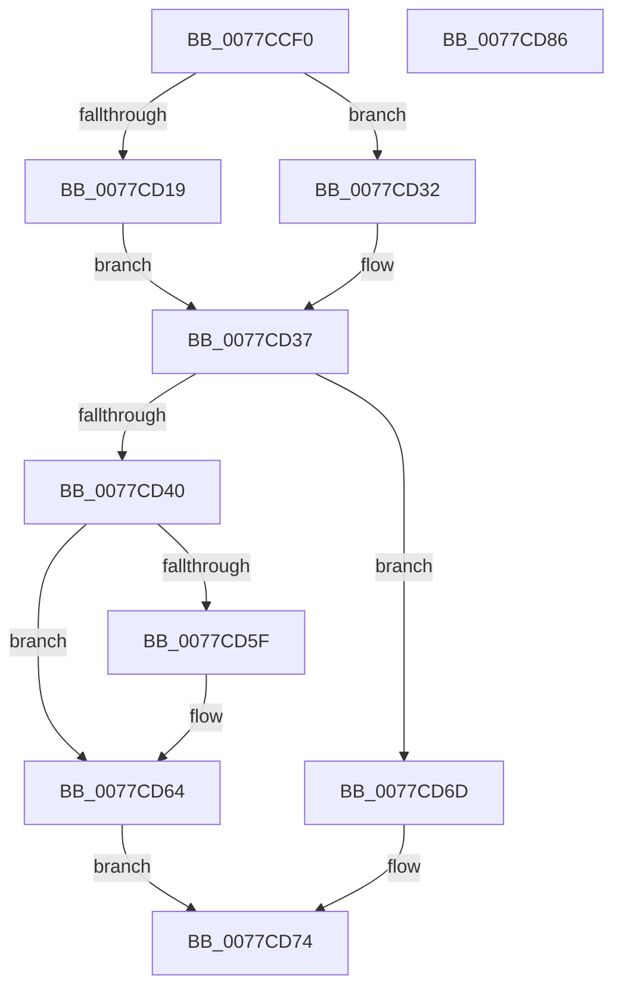

# TtmiResetInactivityTimer

- RVA: `0x0077CCF0`–`0x0077CD87` (길이 `151` bytes)
- VA: `0x000000014077CCF0`
- 실행 섹션: `PAGE`
- PDB 이름 있음: `예`; PDB Function 태그: `아니요`
- unwind 정보 RVA: `0x00064C80`
- 디코드: `37`개 명령, `151/151` bytes 표시
- 미해석 바이트: `0` (있으면 어셈블리에 `.byte`로 보존)

> 이 문서는 커널 이미지의 기계어와 PDB 기호를 분석해 생성했습니다. 4번과 5번은 함수 원형과 자료형을 바이너리 사용 방식에서 추정한 C 해석이며 원본 소스 복구 결과는 아닙니다.

## 1. Dependencies

- 직접 호출 지점: **6**; 고유 호출 대상: **5**
- 직접 호출자로 확인된 함수: **3**
- RIP 상대 이미지 참조: **6**

### Outgoing calls
- `0x0077CD01` → [ExAcquireResourceExclusiveLite](../../text/21/ExAcquireResourceExclusiveLite_function_00214E20.md) (function, `0x00214E20`)
- `0x0077CD2B` → [KiSetTimerEx](../../text/23/KiSetTimerEx_function_00232CB0.md) (function, `0x00232CB0`)
- `0x0077CD32` → [KeCancelTimer](../../text/23/KeCancelTimer_function_002327E0.md) (function, `0x002327E0`)
- `0x0077CD5F` → [TtmiLogInactivityTimerReset](TtmiLogInactivityTimerReset_function_0077A36C.md) (function, `0x0077A36C`)
- `0x0077CD6F` → [TtmiLogInactivityTimerReset](TtmiLogInactivityTimerReset_function_0077A36C.md) (function, `0x0077A36C`)
- `0x0077CD7B` → [ExReleaseResourceLite](../../text/25/ExReleaseResourceLite_function_0025FA10.md) (function, `0x0025FA10`)

### Direct callers
- [TtmiResetTerminalTimeouts](TtmiResetTerminalTimeouts_function_0077CD90.md) at `0x0077CDC1`
- [TtmpUpdateTerminalState](TtmpUpdateTerminalState_function_0077D7D0.md) at `0x0077D8A2`
- [TtmpWnfInactivityTimeoutCallback](TtmpWnfInactivityTimeoutCallback_function_0077D990.md) at `0x0077D9FD`

### Static image references
- `0x0077CCFA` → RVA `0x00F067E0` (`.data`; read)
- `0x0077CD06` → RVA `0x00F068E0` (`.data`; read)
- `0x0077CD0D` → RVA `0x00F068A0` (`.data`; read)
- `0x0077CD19` → RVA `0x00F06860` (`.data`; read)
- `0x0077CD50` → RVA `0x00F06920` (`.data`; read)
- `0x0077CD64` → RVA `0x00F06920` (`.data`; write)

## 2. Other-region calls and transfers

- 다른 실행 섹션으로 향하는 call: **4**
  - `0x0077CD01` → [ExAcquireResourceExclusiveLite](../../text/21/ExAcquireResourceExclusiveLite_function_00214E20.md) (`PAGE` → `.text`)
  - `0x0077CD2B` → [KiSetTimerEx](../../text/23/KiSetTimerEx_function_00232CB0.md) (`PAGE` → `.text`)
  - `0x0077CD32` → [KeCancelTimer](../../text/23/KeCancelTimer_function_002327E0.md) (`PAGE` → `.text`)
  - `0x0077CD7B` → [ExReleaseResourceLite](../../text/25/ExReleaseResourceLite_function_0025FA10.md) (`PAGE` → `.text`)
- 별도 외부 분기/꼬리 이동을 확인하지 못했습니다.

## 3. Assembly (complete function range)

```asm
0077CCF0  40 53                           push rbx
0077CCF2  48 83 EC 30                     sub rsp, 0x30
0077CCF6  8B D9                           mov ebx, ecx
0077CCF8  B2 01                           mov dl, 1
0077CCFA  48 8D 0D DF 9A 78 00            lea rcx, [rip + 0x789adf]
0077CD01  E8 1A 81 A9 FF                  call 0x140214e20
0077CD06  48 8B 15 D3 9B 78 00            mov rdx, qword ptr [rip + 0x789bd3]
0077CD0D  48 8D 0D 8C 9B 78 00            lea rcx, [rip + 0x789b8c]
0077CD14  48 85 D2                        test rdx, rdx
0077CD17  74 19                           je 0x14077cd32
0077CD19  48 8D 05 40 9B 78 00            lea rax, [rip + 0x789b40]
0077CD20  45 33 C9                        xor r9d, r9d
0077CD23  45 33 C0                        xor r8d, r8d
0077CD26  48 89 44 24 20                  mov qword ptr [rsp + 0x20], rax
0077CD2B  E8 80 5F AB FF                  call 0x140232cb0
0077CD30  EB 05                           jmp 0x14077cd37
0077CD32  E8 A9 5A AB FF                  call 0x1402327e0
0077CD37  B9 04 00 00 00                  mov ecx, 4
0077CD3C  3B D9                           cmp ebx, ecx
0077CD3E  75 2D                           jne 0x14077cd6d
0077CD40  48 BB 08 00 00 00 80 F7 FF FF   movabs rbx, 0xfffff78000000008
0077CD4A  48 8B 1B                        mov rbx, qword ptr [rbx]
0077CD4D  48 8B C3                        mov rax, rbx
0077CD50  48 2B 05 C9 9B 78 00            sub rax, qword ptr [rip + 0x789bc9]
0077CD57  48 3D 00 2D 31 01               cmp rax, 0x1312d00
0077CD5D  76 05                           jbe 0x14077cd64
0077CD5F  E8 08 D6 FF FF                  call 0x14077a36c
0077CD64  48 89 1D B5 9B 78 00            mov qword ptr [rip + 0x789bb5], rbx
0077CD6B  EB 07                           jmp 0x14077cd74
0077CD6D  8B CB                           mov ecx, ebx
0077CD6F  E8 F8 D5 FF FF                  call 0x14077a36c
0077CD74  48 8D 0D 65 9A 78 00            lea rcx, [rip + 0x789a65]
0077CD7B  E8 90 2C AE FF                  call 0x14025fa10
0077CD80  48 83 C4 30                     add rsp, 0x30
0077CD84  5B                              pop rbx
0077CD85  C3                              ret
0077CD86  CC                              int3
```

## 4. C-style interpretation (structured pseudocode)

```c
__int64 __fastcall TtmiResetInactivityTimer(int a1, __int64 a2, int a3, int a4)
{
    __int64 result;
    __int64 v_rsp;
    unsigned __int64 v_stack_m18;

    v_rsp = (v_rsp) - (48);
    result = ExAcquireResourceExclusiveLite(v_rip + 7903967, 1, a3, a4);
    if (*(unsigned __int64 *)(v_rip + 7904211) == 0) goto loc_0077CD32;
    a4 = 0;
    a3 = 0;
    v_stack_m18 = v_rip + 7904064;
    result = KiSetTimerEx(v_rip + 7904140, *(unsigned __int64 *)(v_rip + 7904211), a3, a4);
    goto loc_0077CD37;
loc_0077CD32:
    result = KeCancelTimer(v_rip + 7904140, *(unsigned __int64 *)(v_rip + 7904211), a3, a4);
loc_0077CD37:
    if (((unsigned int)((unsigned int)(a1))) != 4) goto loc_0077CD6D;
    result = (*(unsigned __int64 *)((unsigned int)(a1))) - (*(unsigned __int64 *)(v_rip + 7904201));
    if (result >= = 0x1312D00ULL) {
        result = TtmiLogInactivityTimerReset(4, *(unsigned __int64 *)(v_rip + 7904211), a3, a4);
    }
    *(unsigned __int64 *)(v_rip + 7904181) = *(unsigned __int64 *)((unsigned int)(a1));
    goto loc_0077CD74;
loc_0077CD6D:
    result = TtmiLogInactivityTimerReset((unsigned int)((unsigned int)(*(unsigned __int64 *)((unsigned int)(a1)))), *(unsigned __int64 *)(v_rip + 7904211), a3, a4);
loc_0077CD74:
    result = ExReleaseResourceLite(v_rip + 7903845, *(unsigned __int64 *)(v_rip + 7904211), a3, a4);
    v_rsp = (v_rsp) + (48);
    return result;
}
```

## 5. (Beta) C Style

```c
int64_t TtmiResetInactivityTimer(int32_t Arg1, int64_t Arg2, int32_t Arg3, int32_t Arg4)
{
    int64_t result;
    int64_t local_rsp;
    uint64_t v_stack_m18;

    local_rsp = (local_rsp) - (48);
    result = ExAcquireResourceExclusiveLite(v_rip + 7903967, 1, Arg3, Arg4);
    if (*(uint64_t *)(v_rip + 0x789BD3) == 0) goto loc_0077CD32;
    Arg4 = 0;
    Arg3 = 0;
    v_stack_m18 = v_rip + 7904064;
    result = KiSetTimerEx(v_rip + 7904140, *(uint64_t *)(v_rip + 0x789BD3), Arg3, Arg4);
    goto loc_0077CD37;
loc_0077CD32:
    result = KeCancelTimer(v_rip + 7904140, *(uint64_t *)(v_rip + 0x789BD3), Arg3, Arg4);
loc_0077CD37:
    if (((uint32_t)((uint32_t)(Arg1))) != 4) goto loc_0077CD6D;
    result = (*(uint64_t *)((uint32_t)(Arg1))) - (*(uint64_t *)(v_rip + 0x789BC9));
    if (result >= = 0x1312D00ULL) {
        result = TtmiLogInactivityTimerReset(4, *(uint64_t *)(v_rip + 0x789BD3), Arg3, Arg4);
    }
    *(uint64_t *)(v_rip + 0x789BB5) = *(uint64_t *)((uint32_t)(Arg1));
    goto loc_0077CD74;
loc_0077CD6D:
    result = TtmiLogInactivityTimerReset((uint32_t)((uint32_t)(*(uint64_t *)((uint32_t)(Arg1)))), *(uint64_t *)(v_rip + 0x789BD3), Arg3, Arg4);
loc_0077CD74:
    result = ExReleaseResourceLite(v_rip + 7903845, *(uint64_t *)(v_rip + 0x789BD3), Arg3, Arg4);
    local_rsp = (local_rsp) + (48);
    return result;
}
```

## 6. Execution-region graph

[열기: 2D/3D 그래프와 함수 탐색 컨트롤 패널](../../../control-panel.html?section=page&rva=0x0077CCF0&view=graph)

- 2D 그래프는 위에서 아래로 흐르고, 3D 그래프는 빈 공간을 드래그해 회전합니다. Shift+드래그는 이동, 휠은 확대·축소, 함수 노드 선택은 대상 보고서 이동입니다.

### Static fallback


