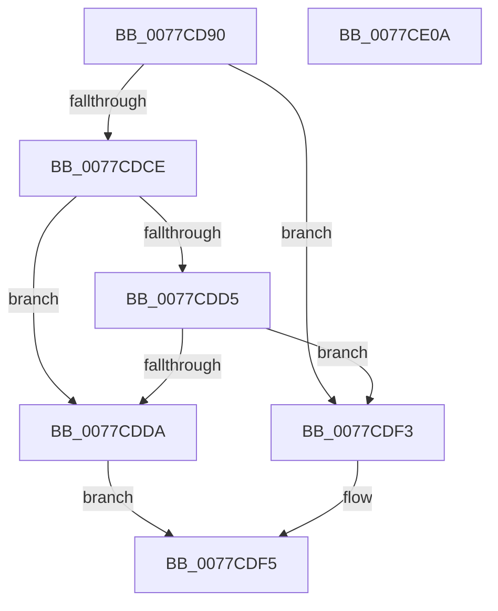

# TtmiResetTerminalTimeouts

- RVA: `0x0077CD90`–`0x0077CE0B` (길이 `123` bytes)
- VA: `0x000000014077CD90`
- 실행 섹션: `PAGE`
- PDB 이름 있음: `예`; PDB Function 태그: `아니요`
- unwind 정보 RVA: `0x00066400`
- 디코드: `36`개 명령, `123/123` bytes 표시
- 미해석 바이트: `0` (있으면 어셈블리에 `.byte`로 보존)

> 이 문서는 커널 이미지의 기계어와 PDB 기호를 분석해 생성했습니다. 4번과 5번은 함수 원형과 자료형을 바이너리 사용 방식에서 추정한 C 해석이며 원본 소스 복구 결과는 아닙니다.

## 1. Dependencies

- 직접 호출 지점: **2**; 고유 호출 대상: **2**
- 직접 호출자로 확인된 함수: **4**
- RIP 상대 이미지 참조: **0**

### Outgoing calls
- `0x0077CDC1` → [TtmiResetInactivityTimer](TtmiResetInactivityTimer_function_0077CCF0.md) (function, `0x0077CCF0`)
- `0x0077CDEA` → [TtmiSetPendingOnOffRequest](TtmiSetPendingOnOffRequest_function_0077D074.md) (function, `0x0077D074`)

### Direct callers
- [TtmNotifyDeviceInput](TtmNotifyDeviceInput_function_007758B0.md) at `0x00775A27`
- [TtmNotifyConsoleUserPresent](../91/TtmNotifyConsoleUserPresent_function_0091327C.md) at `0x009132D7`
- [TtmNotifySessionTerminalInput](../98/TtmNotifySessionTerminalInput_function_0098A984.md) at `0x0098A9EF`
- [TtmNotifySessionDisplayBurst](../98/TtmNotifySessionDisplayBurst_function_0098B300.md) at `0x0098B36D`

### Static image references
- 디코드된 RIP-relative 메모리 참조가 없습니다.

## 2. Other-region calls and transfers

- 다른 실행 섹션으로 향하는 call: **0**
- 별도 외부 분기/꼬리 이동을 확인하지 못했습니다.

## 3. Assembly (complete function range)

```asm
0077CD90  48 89 5C 24 08                  mov qword ptr [rsp + 8], rbx
0077CD95  48 89 6C 24 10                  mov qword ptr [rsp + 0x10], rbp
0077CD9A  48 89 74 24 18                  mov qword ptr [rsp + 0x18], rsi
0077CD9F  57                              push rdi
0077CDA0  48 83 EC 30                     sub rsp, 0x30
0077CDA4  48 A1 08 00 00 00 80 F7 FF FF   movabs rax, qword ptr [0xfffff78000000008]
0077CDAE  48 8B E9                        mov rbp, rcx
0077CDB1  41 8B C8                        mov ecx, r8d
0077CDB4  48 89 42 50                     mov qword ptr [rdx + 0x50], rax
0077CDB8  41 8B F1                        mov esi, r9d
0077CDBB  41 8B F8                        mov edi, r8d
0077CDBE  48 8B DA                        mov rbx, rdx
0077CDC1  E8 2A FF FF FF                  call 0x14077ccf0
0077CDC6  8B 43 28                        mov eax, dword ptr [rbx + 0x28]
0077CDC9  83 F8 03                        cmp eax, 3
0077CDCC  74 25                           je 0x14077cdf3
0077CDCE  80 7C 24 60 00                  cmp byte ptr [rsp + 0x60], 0
0077CDD3  75 05                           jne 0x14077cdda
0077CDD5  83 F8 02                        cmp eax, 2
0077CDD8  75 19                           jne 0x14077cdf3
0077CDDA  44 8B CF                        mov r9d, edi
0077CDDD  89 74 24 20                     mov dword ptr [rsp + 0x20], esi
0077CDE1  41 B0 01                        mov r8b, 1
0077CDE4  48 8B D3                        mov rdx, rbx
0077CDE7  48 8B CD                        mov rcx, rbp
0077CDEA  E8 85 02 00 00                  call 0x14077d074
0077CDEF  B0 01                           mov al, 1
0077CDF1  EB 02                           jmp 0x14077cdf5
0077CDF3  32 C0                           xor al, al
0077CDF5  48 8B 5C 24 40                  mov rbx, qword ptr [rsp + 0x40]
0077CDFA  48 8B 6C 24 48                  mov rbp, qword ptr [rsp + 0x48]
0077CDFF  48 8B 74 24 50                  mov rsi, qword ptr [rsp + 0x50]
0077CE04  48 83 C4 30                     add rsp, 0x30
0077CE08  5F                              pop rdi
0077CE09  C3                              ret
0077CE0A  CC                              int3
```

## 4. C-style interpretation (structured pseudocode)

```c
__int64 __fastcall TtmiResetTerminalTimeouts(__int64 a1, __int64 a2, int a3, int a4, unsigned __int8 a5)
{
    __int64 result;
    __int64 v_rsp;
    unsigned int v_stack_m18;
    unsigned __int64 v_stack_p10;
    unsigned __int64 v_stack_p18;
    unsigned __int64 v_stack_p8;

    v_stack_p8 = v_rbx;
    v_stack_p10 = v_rbp;
    v_stack_p18 = v_rsi;
    v_rsp = (v_rsp) - (48);
    *(unsigned __int64 *)(a2 + 80) = result;
    result = TtmiResetInactivityTimer((unsigned int)(a3), a2, a3, a4);
    if (((unsigned int)((unsigned int)(*(unsigned int *)(a2 + 40)))) == 3) goto loc_0077CDF3;
    if (a5 != 0) goto loc_0077CDDA;
    if (((unsigned int)((unsigned int)(*(unsigned int *)(a2 + 40)))) != 2) goto loc_0077CDF3;
loc_0077CDDA:
    v_stack_m18 = (unsigned int)((unsigned int)(a4));
    result = TtmiSetPendingOnOffRequest(a1, a2, 1, (unsigned int)((unsigned int)((unsigned int)(a3))));
    goto loc_0077CDF5;
loc_0077CDF3:
    result = 0;
loc_0077CDF5:
    v_rsp = (v_rsp) + (48);
    return result;
}
```

## 5. (Beta) C Style

```c
int64_t TtmiResetTerminalTimeouts(int64_t Arg1, void *Arg2, int32_t Arg3, int32_t Arg4, uint8_t Arg5)
{
    uint8_t *arg2 = (uint8_t *)Arg2;

    int64_t result;
    int64_t local_rsp;
    uint32_t v_stack_m18;
    uint64_t v_stack_p10;
    uint64_t v_stack_p18;
    uint64_t v_stack_p8;

    v_stack_p8 = local_rbx;
    v_stack_p10 = local_rbp;
    v_stack_p18 = local_rsi;
    local_rsp = (local_rsp) - (48);
    *(uint64_t *)(arg2 + 0x50) = result;
    result = TtmiResetInactivityTimer((uint32_t)(Arg3), Arg2, Arg3, Arg4);
    if (((uint32_t)((uint32_t)(*(uint32_t *)(arg2 + 0x28)))) == 3) goto loc_0077CDF3;
    if (Arg5 != 0) goto loc_0077CDDA;
    if (((uint32_t)((uint32_t)(*(uint32_t *)(arg2 + 0x28)))) != 2) goto loc_0077CDF3;
loc_0077CDDA:
    v_stack_m18 = (uint32_t)((uint32_t)(Arg4));
    result = TtmiSetPendingOnOffRequest(Arg1, Arg2, 1, (uint32_t)((uint32_t)((uint32_t)(Arg3))));
    goto loc_0077CDF5;
loc_0077CDF3:
    result = 0;
loc_0077CDF5:
    local_rsp = (local_rsp) + (48);
    return result;
}
```

### 관측된 메모리 오프셋

구조체 형식이 확인되지 않은 접근은 인자 기준의 오프셋으로만 기록했습니다.

| 기준 인자 | 오프셋 표현 | 폭 (bit) | 접근 |
|---|---:|---:|---|
| `Arg2` | `+ 0x28` | `32` | `R` |
| `Arg2` | `+ 0x50` | `64` | `W` |

## 6. Execution-region graph

[열기: 2D/3D 그래프와 함수 탐색 컨트롤 패널](../../../control-panel.html?section=page&rva=0x0077CD90&view=graph)

- 2D 그래프는 위에서 아래로 흐르고, 3D 그래프는 빈 공간을 드래그해 회전합니다. Shift+드래그는 이동, 휠은 확대·축소, 함수 노드 선택은 대상 보고서 이동입니다.

### Static fallback


