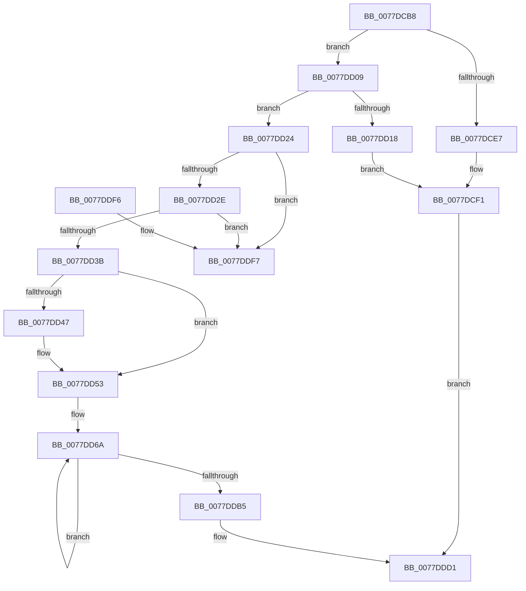

# TtmiRetrieveEventFromQueue

- RVA: `0x0077DCB8`–`0x0077DDFE` (길이 `326` bytes)
- VA: `0x000000014077DCB8`
- 실행 섹션: `PAGE`
- PDB 이름 있음: `예`; PDB Function 태그: `아니요`
- unwind 정보 RVA: `0x0006B020`
- 디코드: `84`개 명령, `326/326` bytes 표시
- 미해석 바이트: `0` (있으면 어셈블리에 `.byte`로 보존)

> 이 문서는 커널 이미지의 기계어와 PDB 기호를 분석해 생성했습니다. 4번과 5번은 함수 원형과 자료형을 바이너리 사용 방식에서 추정한 C 해석이며 원본 소스 복구 결과는 아닙니다.

## 1. Dependencies

- 직접 호출 지점: **6**; 고유 호출 대상: **6**
- 직접 호출자로 확인된 함수: **1**
- RIP 상대 이미지 참조: **1**

### Outgoing calls
- `0x0077DCD7` → [TtmpAcquireQueueLock](TtmpAcquireQueueLock_function_0077DF48.md) (function, `0x0077DF48`)
- `0x0077DCFF` → [TtmiLogError](../98/TtmiLogError_function_0098B39C.md) (function, `0x0098B39C`)
- `0x0077DD4E` → [KeResetEvent](../../text/24/KeResetEvent_function_00248350.md) (function, `0x00248350`)
- `0x0077DD5D` → [TtmiLogQueueDequeueEvent](TtmiLogQueueDequeueEvent_function_0077AA14.md) (function, `0x0077AA14`)
- `0x0077DDCC` → [ExFreePoolWithTag](../../poolcode/B8/ExFreePoolWithTag_function_00B82870.md) (function, `0x00B82870`)
- `0x0077DDD4` → [TtmpReleaseQueueLock](TtmpReleaseQueueLock_function_0077E0C0.md) (function, `0x0077E0C0`)

### Direct callers
- [TtmpDispatchGetTerminalEvent](TtmpDispatchGetTerminalEvent_function_007789F4.md) at `0x00778A78`

### Static image references
- `0x0077DCF5` → RVA `0x00B04700` (` ?? ::NNGAKEGL::`string'`; read)

## 2. Other-region calls and transfers

- 다른 실행 섹션으로 향하는 call: **2**
  - `0x0077DD4E` → [KeResetEvent](../../text/24/KeResetEvent_function_00248350.md) (`PAGE` → `.text`)
  - `0x0077DDCC` → [ExFreePoolWithTag](../../poolcode/B8/ExFreePoolWithTag_function_00B82870.md) (`PAGE` → `POOLCODE`)
- 별도 외부 분기/꼬리 이동을 확인하지 못했습니다.

## 3. Assembly (complete function range)

```asm
0077DCB8  48 8B C4                        mov rax, rsp
0077DCBB  48 89 58 08                     mov qword ptr [rax + 8], rbx
0077DCBF  48 89 68 10                     mov qword ptr [rax + 0x10], rbp
0077DCC3  48 89 70 18                     mov qword ptr [rax + 0x18], rsi
0077DCC7  48 89 78 20                     mov qword ptr [rax + 0x20], rdi
0077DCCB  41 56                           push r14
0077DCCD  48 83 EC 20                     sub rsp, 0x20
0077DCD1  48 8B EA                        mov rbp, rdx
0077DCD4  48 8B D9                        mov rbx, rcx
0077DCD7  E8 6C 02 00 00                  call 0x14077df48
0077DCDC  33 F6                           xor esi, esi
0077DCDE  40 38 B3 A8 00 00 00            cmp byte ptr [rbx + 0xa8], sil
0077DCE5  75 22                           jne 0x14077dd09
0077DCE7  BE 00 07 00 C0                  mov esi, 0xc0000700
0077DCEC  BA DC 01 00 00                  mov edx, 0x1dc
0077DCF1  41 83 C8 FF                     or r8d, 0xffffffff
0077DCF5  48 8D 0D 04 6A 38 00            lea rcx, [rip + 0x386a04]
0077DCFC  44 8B CE                        mov r9d, esi
0077DCFF  E8 98 D6 20 00                  call 0x14098b39c
0077DD04  E9 C8 00 00 00                  jmp 0x14077ddd1
0077DD09  48 8D 83 98 00 00 00            lea rax, [rbx + 0x98]
0077DD10  4C 8B 30                        mov r14, qword ptr [rax]
0077DD13  4C 3B F0                        cmp r14, rax
0077DD16  75 0C                           jne 0x14077dd24
0077DD18  BE 1A 00 00 80                  mov esi, 0x8000001a
0077DD1D  BA E1 01 00 00                  mov edx, 0x1e1
0077DD22  EB CD                           jmp 0x14077dcf1
0077DD24  49 39 46 08                     cmp qword ptr [r14 + 8], rax
0077DD28  0F 85 C9 00 00 00               jne 0x14077ddf7
0077DD2E  49 8B 0E                        mov rcx, qword ptr [r14]
0077DD31  4C 39 71 08                     cmp qword ptr [rcx + 8], r14
0077DD35  0F 85 BC 00 00 00               jne 0x14077ddf7
0077DD3B  48 89 08                        mov qword ptr [rax], rcx
0077DD3E  48 89 41 08                     mov qword ptr [rcx + 8], rax
0077DD42  48 39 00                        cmp qword ptr [rax], rax
0077DD45  75 0C                           jne 0x14077dd53
0077DD47  48 8D 8B 80 00 00 00            lea rcx, [rbx + 0x80]
0077DD4E  E8 FD A5 AC FF                  call 0x140248350
0077DD53  49 8D 7E 10                     lea rdi, [r14 + 0x10]
0077DD57  48 8B CB                        mov rcx, rbx
0077DD5A  48 8B D7                        mov rdx, rdi
0077DD5D  E8 B2 CC FF FF                  call 0x14077aa14
0077DD62  B8 04 00 00 00                  mov eax, 4
0077DD67  8D 48 7C                        lea ecx, [rax + 0x7c]
0077DD6A  0F 10 07                        movups xmm0, xmmword ptr [rdi]
0077DD6D  0F 11 45 00                     movups xmmword ptr [rbp], xmm0
0077DD71  0F 10 4F 10                     movups xmm1, xmmword ptr [rdi + 0x10]
0077DD75  0F 11 4D 10                     movups xmmword ptr [rbp + 0x10], xmm1
0077DD79  0F 10 47 20                     movups xmm0, xmmword ptr [rdi + 0x20]
0077DD7D  0F 11 45 20                     movups xmmword ptr [rbp + 0x20], xmm0
0077DD81  0F 10 4F 30                     movups xmm1, xmmword ptr [rdi + 0x30]
0077DD85  0F 11 4D 30                     movups xmmword ptr [rbp + 0x30], xmm1
0077DD89  0F 10 47 40                     movups xmm0, xmmword ptr [rdi + 0x40]
0077DD8D  0F 11 45 40                     movups xmmword ptr [rbp + 0x40], xmm0
0077DD91  0F 10 4F 50                     movups xmm1, xmmword ptr [rdi + 0x50]
0077DD95  0F 11 4D 50                     movups xmmword ptr [rbp + 0x50], xmm1
0077DD99  0F 10 47 60                     movups xmm0, xmmword ptr [rdi + 0x60]
0077DD9D  0F 11 45 60                     movups xmmword ptr [rbp + 0x60], xmm0
0077DDA1  48 03 E9                        add rbp, rcx
0077DDA4  0F 10 4F 70                     movups xmm1, xmmword ptr [rdi + 0x70]
0077DDA8  48 03 F9                        add rdi, rcx
0077DDAB  0F 11 4D F0                     movups xmmword ptr [rbp - 0x10], xmm1
0077DDAF  48 83 E8 01                     sub rax, 1
0077DDB3  75 B5                           jne 0x14077dd6a
0077DDB5  0F 10 07                        movups xmm0, xmmword ptr [rdi]
0077DDB8  BA 54 74 6D 71                  mov edx, 0x716d7454
0077DDBD  49 8B CE                        mov rcx, r14
0077DDC0  0F 11 45 00                     movups xmmword ptr [rbp], xmm0
0077DDC4  0F 10 4F 10                     movups xmm1, xmmword ptr [rdi + 0x10]
0077DDC8  0F 11 4D 10                     movups xmmword ptr [rbp + 0x10], xmm1
0077DDCC  E8 9F 4A 40 00                  call 0x140b82870
0077DDD1  48 8B CB                        mov rcx, rbx
0077DDD4  E8 E7 02 00 00                  call 0x14077e0c0
0077DDD9  48 8B 5C 24 30                  mov rbx, qword ptr [rsp + 0x30]
0077DDDE  8B C6                           mov eax, esi
0077DDE0  48 8B 74 24 40                  mov rsi, qword ptr [rsp + 0x40]
0077DDE5  48 8B 6C 24 38                  mov rbp, qword ptr [rsp + 0x38]
0077DDEA  48 8B 7C 24 48                  mov rdi, qword ptr [rsp + 0x48]
0077DDEF  48 83 C4 20                     add rsp, 0x20
0077DDF3  41 5E                           pop r14
0077DDF5  C3                              ret
0077DDF6  CC                              int3
0077DDF7  B9 03 00 00 00                  mov ecx, 3
0077DDFC  CD 29                           int 0x29
```

## 4. C-style interpretation (structured pseudocode)

```c
__int64 __fastcall TtmiRetrieveEventFromQueue(__int64 a1, __int64 a2, int a3)
{
    __int64 result;
    __int64 v_rbp;
    __int64 v_rdi;
    __int64 v_rsi;
    __int64 v_rsp;
    unsigned __int64 v_stack_p10;
    unsigned __int64 v_stack_p18;
    unsigned __int64 v_stack_p20;
    unsigned __int64 v_stack_p8;

    *(unsigned __int64 *)(v_rsp + 8) = v_rbx;
    *(unsigned __int64 *)(v_rsp + 16) = v_rbp;
    *(unsigned __int64 *)(v_rsp + 24) = v_rsi;
    *(unsigned __int64 *)(v_rsp + 32) = v_rdi;
    v_rsp = (v_rsp) - (32);
    result = TtmpAcquireQueueLock(a1, a2, a3, a4);
    v_rsi = 0;
    if ((*(unsigned __int8 *)(a1 + 168)) != 0) goto loc_0077DD09;
loc_0077DCF1:
    a3 = (unsigned int)((a3) | (0xFFFFFFFFULL));
    result = TtmiLogError(v_rip + 3697156, 476, a3, (unsigned int)((unsigned int)((unsigned int)(0xC0000700ULL))));
    goto loc_0077DDD1;
loc_0077DD09:
    if ((*(unsigned __int64 *)(a1 + 152)) != (a1 + 152)) goto loc_0077DD24;
    goto loc_0077DCF1;
loc_0077DD24:
    if ((*(unsigned __int64 *)(*(unsigned __int64 *)(a1 + 152) + 8)) != (a1 + 152)) goto loc_0077DDF7;
    if ((*(unsigned __int64 *)(*(unsigned __int64 *)(*(unsigned __int64 *)(a1 + 152)) + 8)) != (*(unsigned __int64 *)(a1 + 152))) goto loc_0077DDF7;
    *(unsigned __int64 *)(a1 + 152) = *(unsigned __int64 *)(*(unsigned __int64 *)(a1 + 152));
    *(unsigned __int64 *)(*(unsigned __int64 *)(*(unsigned __int64 *)(a1 + 152)) + 8) = a1 + 152;
    result = a1 + 152;
    if ((*(unsigned __int64 *)(a1 + 152)) == (a1 + 152)) {
        a1 = a1 + 128;
        result = KeResetEvent(a1, 481, a3, (unsigned int)((unsigned int)((unsigned int)(0xC0000700ULL))));
    }
    result = TtmiLogQueueDequeueEvent(a1, *(unsigned __int64 *)(a1 + 152) + 16, a3, (unsigned int)((unsigned int)((unsigned int)(0xC0000700ULL))));
loc_0077DD6A:
    *(unsigned __int64 *)(a2) = v_xmm0;
    *(unsigned __int64 *)(a2 + 16) = v_xmm1;
    *(unsigned __int64 *)(a2 + 32) = v_xmm0;
    *(unsigned __int64 *)(a2 + 48) = v_xmm1;
    *(unsigned __int64 *)(a2 + 64) = v_xmm0;
    *(unsigned __int64 *)(a2 + 80) = v_xmm1;
    *(unsigned __int64 *)(a2 + 96) = v_xmm0;
    v_rbp = (a2) + (4 + 124);
    v_rdi = (*(unsigned __int64 *)(a1 + 152) + 16) + (4 + 124);
    *(unsigned __int64 *)(v_rbp - 16) = v_xmm1;
    result = (4) - (1);
    if (condition_is_not_equal) goto loc_0077DD6A;
    *(unsigned __int64 *)(v_rbp) = v_xmm0;
    *(unsigned __int64 *)(v_rbp + 16) = v_xmm1;
    result = ExFreePoolWithTag(*(unsigned __int64 *)(a1 + 152), (unsigned int)(0x716D7454ULL), a3, (unsigned int)((unsigned int)((unsigned int)(0xC0000700ULL))));
loc_0077DDD1:
    result = TtmpReleaseQueueLock(a1, (unsigned int)(0x716D7454ULL), a3, (unsigned int)((unsigned int)((unsigned int)(0xC0000700ULL))));
    v_rsp = (v_rsp) + (32);
    return (unsigned int)((unsigned int)((unsigned int)(0x8000001AULL)));
loc_0077DDF7:
    return (unsigned int)((unsigned int)((unsigned int)(0x8000001AULL)));
}
```

## 5. (Beta) C Style

```c
int64_t TtmiRetrieveEventFromQueue(void *Arg1, void *Arg2, int32_t Arg3)
{
    uint8_t *arg1 = (uint8_t *)Arg1;
    uint8_t *arg2 = (uint8_t *)Arg2;

    int64_t result;
    int64_t local_rbp;
    int64_t local_rdi;
    int64_t local_rsi;
    int64_t local_rsp;
    uint64_t v_stack_p10;
    uint64_t v_stack_p18;
    uint64_t v_stack_p20;
    uint64_t v_stack_p8;

    *(uint64_t *)(local_rsp + 0x8) = local_rbx;
    *(uint64_t *)(local_rsp + 0x10) = local_rbp;
    *(uint64_t *)(local_rsp + 0x18) = local_rsi;
    *(uint64_t *)(local_rsp + 0x20) = local_rdi;
    local_rsp = (local_rsp) - (32);
    result = TtmpAcquireQueueLock(Arg1, Arg2, Arg3, a4);
    local_rsi = 0;
    if ((*(uint8_t *)(arg1 + 0xA8)) != 0) goto loc_0077DD09;
loc_0077DCF1:
    Arg3 = (uint32_t)((Arg3) | (0xFFFFFFFFULL));
    result = TtmiLogError(v_rip + 3697156, 476, Arg3, (uint32_t)((uint32_t)((uint32_t)(0xC0000700ULL))));
    goto loc_0077DDD1;
loc_0077DD09:
    if ((*(uint64_t *)(arg1 + 0x98)) != (Arg1 + 152)) goto loc_0077DD24;
    goto loc_0077DCF1;
loc_0077DD24:
    if ((*(uint64_t *)(*(uint64_t *)(arg1 + 0x98) + 0x8)) != (Arg1 + 152)) goto loc_0077DDF7;
    if ((*(uint64_t *)(*(uint64_t *)(*(uint64_t *)(arg1 + 0x98)) + 0x8)) != (*(uint64_t *)(arg1 + 0x98))) goto loc_0077DDF7;
    *(uint64_t *)(arg1 + 0x98) = *(uint64_t *)(*(uint64_t *)(arg1 + 0x98));
    *(void **)(*(uint64_t *)(*(uint64_t *)(arg1 + 0x98)) + 0x8) = Arg1 + 152;
    result = Arg1 + 152;
    if ((*(uint64_t *)(arg1 + 0x98)) == (Arg1 + 152)) {
        Arg1 = Arg1 + 128;
        result = KeResetEvent(Arg1, 481, Arg3, (uint32_t)((uint32_t)((uint32_t)(0xC0000700ULL))));
    }
    result = TtmiLogQueueDequeueEvent(Arg1, *(uint64_t *)(arg1 + 0x98) + 16, Arg3, (uint32_t)((uint32_t)((uint32_t)(0xC0000700ULL))));
loc_0077DD6A:
    *(uint64_t *)(arg2) = v_xmm0;
    *(uint64_t *)(arg2 + 0x10) = v_xmm1;
    *(uint64_t *)(arg2 + 0x20) = v_xmm0;
    *(uint64_t *)(arg2 + 0x30) = v_xmm1;
    *(uint64_t *)(arg2 + 0x40) = v_xmm0;
    *(uint64_t *)(arg2 + 0x50) = v_xmm1;
    *(uint64_t *)(arg2 + 0x60) = v_xmm0;
    local_rbp = (Arg2) + (4 + 124);
    local_rdi = (*(uint64_t *)(arg1 + 0x98) + 16) + (4 + 124);
    *(uint64_t *)(local_rbp - 0x10) = v_xmm1;
    result = (4) - (1);
    if (condition_is_not_equal) goto loc_0077DD6A;
    *(uint64_t *)(local_rbp) = v_xmm0;
    *(uint64_t *)(local_rbp + 0x10) = v_xmm1;
    result = ExFreePoolWithTag(*(uint64_t *)(arg1 + 0x98), (uint32_t)(0x716D7454ULL), Arg3, (uint32_t)((uint32_t)((uint32_t)(0xC0000700ULL))));
loc_0077DDD1:
    result = TtmpReleaseQueueLock(Arg1, (uint32_t)(0x716D7454ULL), Arg3, (uint32_t)((uint32_t)((uint32_t)(0xC0000700ULL))));
    local_rsp = (local_rsp) + (32);
    return (uint32_t)((uint32_t)((uint32_t)(0x8000001AULL)));
loc_0077DDF7:
    return (uint32_t)((uint32_t)((uint32_t)(0x8000001AULL)));
}
```

### 관측된 메모리 오프셋

구조체 형식이 확인되지 않은 접근은 인자 기준의 오프셋으로만 기록했습니다.

| 기준 인자 | 오프셋 표현 | 폭 (bit) | 접근 |
|---|---:|---:|---|
| `Arg1` | `+ 0x0` | `64` | `R` |
| `Arg1` | `+ 0x0` | `64` | `W` |
| `Arg1` | `+ 0x80` | `64` | `R` |
| `Arg1` | `+ 0x98` | `64` | `R` |
| `Arg1` | `+ 0xA8` | `8` | `R` |
| `Arg2` | `- 0x10` | `128` | `R` |
| `Arg2` | `+ 0x0` | `128` | `R` |
| `Arg2` | `+ 0x10` | `128` | `R` |
| `Arg2` | `+ 0x20` | `128` | `R` |
| `Arg2` | `+ 0x30` | `128` | `R` |
| `Arg2` | `+ 0x40` | `128` | `R` |
| `Arg2` | `+ 0x50` | `128` | `R` |
| `Arg2` | `+ 0x60` | `128` | `R` |

## 6. Execution-region graph

[열기: 2D/3D 그래프와 함수 탐색 컨트롤 패널](../../../control-panel.html?section=page&rva=0x0077DCB8&view=graph)

- 2D 그래프는 위에서 아래로 흐르고, 3D 그래프는 빈 공간을 드래그해 회전합니다. Shift+드래그는 이동, 휠은 확대·축소, 함수 노드 선택은 대상 보고서 이동입니다.

### Static fallback


