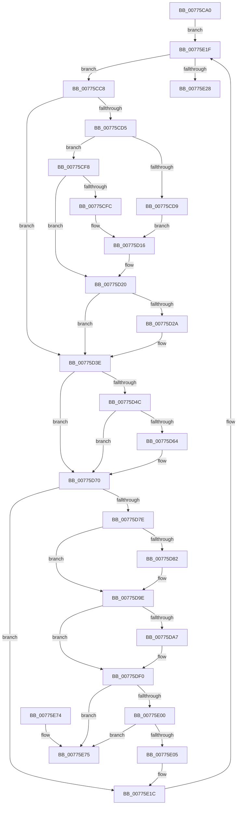

# TtmiSessionDeviceListWorker

- RVA: `0x00775CA0`–`0x00775E7C` (길이 `476` bytes)
- VA: `0x0000000140775CA0`
- 실행 섹션: `PAGE`
- PDB 이름 있음: `예`; PDB Function 태그: `아니요`
- unwind 정보 RVA: `0x000A72E8`
- 디코드: `130`개 명령, `476/476` bytes 표시
- 미해석 바이트: `0` (있으면 어셈블리에 `.byte`로 보존)

> 이 문서는 커널 이미지의 기계어와 PDB 기호를 분석해 생성했습니다. 4번과 5번은 함수 원형과 자료형을 바이너리 사용 방식에서 추정한 C 해석이며 원본 소스 복구 결과는 아닙니다.

## 1. Dependencies

- 직접 호출 지점: **14**; 고유 호출 대상: **9**
- 직접 호출자로 확인된 함수: **1**
- RIP 상대 이미지 참조: **0**

### Outgoing calls
- `0x00775CEB` → [TtmpApplyDeviceAutoAssignment](TtmpApplyDeviceAutoAssignment_function_00775F48.md) (function, `0x00775F48`)
- `0x00775D0B` → [TtmpApplyDeviceAutoAssignment](TtmpApplyDeviceAutoAssignment_function_00775F48.md) (function, `0x00775F48`)
- `0x00775D1B` → [TtmpPublishDeviceEvent](TtmpPublishDeviceEvent_function_00776718.md) (function, `0x00776718`)
- `0x00775D39` → [TtmpCallAssignedToTerminal](TtmpCallAssignedToTerminal_function_00775F70.md) (function, `0x00775F70`)
- `0x00775D5B` → [TtmpPushTerminalState](TtmpPushTerminalState_function_007768F0.md) (function, `0x007768F0`)
- `0x00775D99` → [TtmpPublishDeviceEvent](TtmpPublishDeviceEvent_function_00776718.md) (function, `0x00776718`)
- `0x00775DD3` → [TtmpStartCallout](TtmpStartCallout_function_00776AA4.md) (function, `0x00776AA4`)
- `0x00775DDF` → [guard_dispatch_icall](../../text/6B/guard_dispatch_icall_function_006BAAD0.md) (function, `0x006BAAD0`)
- `0x00775DEB` → [TtmpStopCallout](TtmpStopCallout_function_00776C24.md) (function, `0x00776C24`)
- `0x00775E17` → [ExFreePoolWithTag](../../poolcode/B8/ExFreePoolWithTag_function_00B82870.md) (function, `0x00B82870`)
- `0x00775E2D` → [TtmpCommitTerminalDisplayStateUpdateWorker](TtmpCommitTerminalDisplayStateUpdateWorker_function_00776390.md) (function, `0x00776390`)
- `0x00775E3A` → [TtmpCommitTerminalDisplayStateUpdateWorker](TtmpCommitTerminalDisplayStateUpdateWorker_function_00776390.md) (function, `0x00776390`)
- `0x00775E47` → [TtmpCommitTerminalDisplayStateUpdateWorker](TtmpCommitTerminalDisplayStateUpdateWorker_function_00776390.md) (function, `0x00776390`)
- `0x00775E54` → [TtmpCommitTerminalDisplayStateUpdateWorker](TtmpCommitTerminalDisplayStateUpdateWorker_function_00776390.md) (function, `0x00776390`)

### Direct callers
- [TtmpSessionWorker](TtmpSessionWorker_function_00777F60.md) at `0x00778047`

### Static image references
- 디코드된 RIP-relative 메모리 참조가 없습니다.

## 2. Other-region calls and transfers

- 다른 실행 섹션으로 향하는 call: **2**
  - `0x00775DDF` → [guard_dispatch_icall](../../text/6B/guard_dispatch_icall_function_006BAAD0.md) (`PAGE` → `.text`)
  - `0x00775E17` → [ExFreePoolWithTag](../../poolcode/B8/ExFreePoolWithTag_function_00B82870.md) (`PAGE` → `POOLCODE`)
- 별도 외부 분기/꼬리 이동을 확인하지 못했습니다.

## 3. Assembly (complete function range)

```asm
00775CA0  48 8B C4                        mov rax, rsp
00775CA3  48 89 58 08                     mov qword ptr [rax + 8], rbx
00775CA7  48 89 68 10                     mov qword ptr [rax + 0x10], rbp
00775CAB  48 89 70 18                     mov qword ptr [rax + 0x18], rsi
00775CAF  48 89 78 20                     mov qword ptr [rax + 0x20], rdi
00775CB3  41 56                           push r14
00775CB5  48 83 EC 60                     sub rsp, 0x60
00775CB9  48 8D 71 60                     lea rsi, [rcx + 0x60]
00775CBD  48 8B F9                        mov rdi, rcx
00775CC0  48 8B 1E                        mov rbx, qword ptr [rsi]
00775CC3  E9 57 01 00 00                  jmp 0x140775e1f
00775CC8  8B 83 58 02 00 00               mov eax, dword ptr [rbx + 0x258]
00775CCE  4C 8B F3                        mov r14, rbx
00775CD1  A8 04                           test al, 4
00775CD3  75 69                           jne 0x140775d3e
00775CD5  A8 01                           test al, 1
00775CD7  74 1F                           je 0x140775cf8
00775CD9  83 E0 FE                        and eax, 0xfffffffe
00775CDC  48 8B D3                        mov rdx, rbx
00775CDF  83 C8 02                        or eax, 2
00775CE2  48 8B CF                        mov rcx, rdi
00775CE5  89 83 58 02 00 00               mov dword ptr [rbx + 0x258], eax
00775CEB  E8 58 02 00 00                  call 0x140775f48
00775CF0  41 B9 03 00 00 00               mov r9d, 3
00775CF6  EB 1E                           jmp 0x140775d16
00775CF8  A8 10                           test al, 0x10
00775CFA  74 24                           je 0x140775d20
00775CFC  83 E0 EF                        and eax, 0xffffffef
00775CFF  48 8B D3                        mov rdx, rbx
00775D02  48 8B CF                        mov rcx, rdi
00775D05  89 83 58 02 00 00               mov dword ptr [rbx + 0x258], eax
00775D0B  E8 38 02 00 00                  call 0x140775f48
00775D10  41 B9 04 00 00 00               mov r9d, 4
00775D16  4C 8B C3                        mov r8, rbx
00775D19  33 D2                           xor edx, edx
00775D1B  E8 F8 09 00 00                  call 0x140776718
00775D20  8B 83 58 02 00 00               mov eax, dword ptr [rbx + 0x258]
00775D26  A8 20                           test al, 0x20
00775D28  74 14                           je 0x140775d3e
00775D2A  83 E0 DF                        and eax, 0xffffffdf
00775D2D  48 8B D3                        mov rdx, rbx
00775D30  48 8B CF                        mov rcx, rdi
00775D33  89 83 58 02 00 00               mov dword ptr [rbx + 0x258], eax
00775D39  E8 32 02 00 00                  call 0x140775f70
00775D3E  8B 8B 58 02 00 00               mov ecx, dword ptr [rbx + 0x258]
00775D44  8B C1                           mov eax, ecx
00775D46  24 44                           and al, 0x44
00775D48  3C 40                           cmp al, 0x40
00775D4A  75 24                           jne 0x140775d70
00775D4C  83 E1 BF                        and ecx, 0xffffffbf
00775D4F  48 8B D3                        mov rdx, rbx
00775D52  89 8B 58 02 00 00               mov dword ptr [rbx + 0x258], ecx
00775D58  48 8B CF                        mov rcx, rdi
00775D5B  E8 90 0B 00 00                  call 0x1407768f0
00775D60  84 C0                           test al, al
00775D62  74 0C                           je 0x140775d70
00775D64  83 8B 58 02 00 00 40            or dword ptr [rbx + 0x258], 0x40
00775D6B  0F BA 6F 04 0C                  bts dword ptr [rdi + 4], 0xc
00775D70  8B 83 58 02 00 00               mov eax, dword ptr [rbx + 0x258]
00775D76  A8 04                           test al, 4
00775D78  0F 84 9E 00 00 00               je 0x140775e1c
00775D7E  A8 02                           test al, 2
00775D80  74 1C                           je 0x140775d9e
00775D82  83 C8 08                        or eax, 8
00775D85  41 B9 05 00 00 00               mov r9d, 5
00775D8B  4C 8B C3                        mov r8, rbx
00775D8E  89 83 58 02 00 00               mov dword ptr [rbx + 0x258], eax
00775D94  33 D2                           xor edx, edx
00775D96  48 8B CF                        mov rcx, rdi
00775D99  E8 7A 09 00 00                  call 0x140776718
00775D9E  48 8B 6B 28                     mov rbp, qword ptr [rbx + 0x28]
00775DA2  48 85 ED                        test rbp, rbp
00775DA5  74 49                           je 0x140775df0
00775DA7  33 C0                           xor eax, eax
00775DA9  48 8D 4C 24 30                  lea rcx, [rsp + 0x30]
00775DAE  21 44 24 28                     and dword ptr [rsp + 0x28], eax
00775DB2  0F 57 C0                        xorps xmm0, xmm0
00775DB5  4C 8B C3                        mov r8, rbx
00775DB8  48 89 44 24 50                  mov qword ptr [rsp + 0x50], rax
00775DBD  48 8B D7                        mov rdx, rdi
00775DC0  48 89 6C 24 20                  mov qword ptr [rsp + 0x20], rbp
00775DC5  44 8D 48 02                     lea r9d, [rax + 2]
00775DC9  0F 11 44 24 30                  movups xmmword ptr [rsp + 0x30], xmm0
00775DCE  0F 11 44 24 40                  movups xmmword ptr [rsp + 0x40], xmm0
00775DD3  E8 CC 0C 00 00                  call 0x140776aa4
00775DD8  48 8B 4B 18                     mov rcx, qword ptr [rbx + 0x18]
00775DDC  48 8B C5                        mov rax, rbp
00775DDF  E8 EC 4C F4 FF                  call 0x1406baad0
00775DE4  33 D2                           xor edx, edx
00775DE6  48 8D 4C 24 30                  lea rcx, [rsp + 0x30]
00775DEB  E8 34 0E 00 00                  call 0x140776c24
00775DF0  49 8B 16                        mov rdx, qword ptr [r14]
00775DF3  48 8B 43 08                     mov rax, qword ptr [rbx + 8]
00775DF7  48 8B D8                        mov rbx, rax
00775DFA  4C 39 72 08                     cmp qword ptr [rdx + 8], r14
00775DFE  75 75                           jne 0x140775e75
00775E00  4C 39 30                        cmp qword ptr [rax], r14
00775E03  75 70                           jne 0x140775e75
00775E05  48 89 10                        mov qword ptr [rax], rdx
00775E08  49 8B CE                        mov rcx, r14
00775E0B  48 89 42 08                     mov qword ptr [rdx + 8], rax
00775E0F  BA 54 74 6D 44                  mov edx, 0x446d7454
00775E14  FF 4F 74                        dec dword ptr [rdi + 0x74]
00775E17  E8 54 CA 40 00                  call 0x140b82870
00775E1C  48 8B 1B                        mov rbx, qword ptr [rbx]
00775E1F  48 3B DE                        cmp rbx, rsi
00775E22  0F 85 A0 FE FF FF               jne 0x140775cc8
00775E28  33 D2                           xor edx, edx
00775E2A  48 8B CF                        mov rcx, rdi
00775E2D  E8 5E 05 00 00                  call 0x140776390
00775E32  BA 01 00 00 00                  mov edx, 1
00775E37  48 8B CF                        mov rcx, rdi
00775E3A  E8 51 05 00 00                  call 0x140776390
00775E3F  BA 02 00 00 00                  mov edx, 2
00775E44  48 8B CF                        mov rcx, rdi
00775E47  E8 44 05 00 00                  call 0x140776390
00775E4C  BA 03 00 00 00                  mov edx, 3
00775E51  48 8B CF                        mov rcx, rdi
00775E54  E8 37 05 00 00                  call 0x140776390
00775E59  4C 8D 5C 24 60                  lea r11, [rsp + 0x60]
00775E5E  49 8B 5B 10                     mov rbx, qword ptr [r11 + 0x10]
00775E62  49 8B 6B 18                     mov rbp, qword ptr [r11 + 0x18]
00775E66  49 8B 73 20                     mov rsi, qword ptr [r11 + 0x20]
00775E6A  49 8B 7B 28                     mov rdi, qword ptr [r11 + 0x28]
00775E6E  49 8B E3                        mov rsp, r11
00775E71  41 5E                           pop r14
00775E73  C3                              ret
00775E74  CC                              int3
00775E75  B9 03 00 00 00                  mov ecx, 3
00775E7A  CD 29                           int 0x29
```

## 4. C-style interpretation (structured pseudocode)

```c
__int64 __fastcall TtmiSessionDeviceListWorker(__int64 a1)
{
    __int64 result;
    __int64 v_rsp;
    unsigned __int64 v_stack_m18;
    unsigned __int64 v_stack_m28;
    unsigned __int64 v_stack_m38;
    unsigned int v_stack_m40;
    unsigned __int64 v_stack_m48;
    unsigned __int64 v_stack_m8;

    *(unsigned __int64 *)(v_rsp + 8) = v_rbx;
    *(unsigned __int64 *)(v_rsp + 16) = v_rbp;
    *(unsigned __int64 *)(v_rsp + 24) = v_rsi;
    *(unsigned __int64 *)(v_rsp + 32) = v_rdi;
    v_rsp = (v_rsp) - (96);
    goto loc_00775E1F;
loc_00775CC8:
    if ((((unsigned __int8)((unsigned int)(*(unsigned int *)(*(unsigned __int64 *)(a1 + 96) + 600)))) & (4)) != 0) goto loc_00775D3E;
    if ((((unsigned __int8)((unsigned int)(*(unsigned int *)(*(unsigned __int64 *)(a1 + 96) + 600)))) & (1)) == 0) goto loc_00775CF8;
    result = (unsigned int)(((unsigned int)(*(unsigned int *)(*(unsigned __int64 *)(a1 + 96) + 600))) & (0xFFFFFFFEULL));
    result = (unsigned int)((result) | (2));
    *(unsigned int *)(*(unsigned __int64 *)(a1 + 96) + 600) = (unsigned int)(result);
    result = TtmpApplyDeviceAutoAssignment(a1, *(unsigned __int64 *)(a1 + 96), a3, a4);
    goto loc_00775D16;
loc_00775CF8:
    if ((((unsigned __int8)(result)) & (16)) == 0) goto loc_00775D20;
    result = (unsigned int)((result) & (0xFFFFFFEFULL));
    *(unsigned int *)(*(unsigned __int64 *)(a1 + 96) + 600) = (unsigned int)(result);
    result = TtmpApplyDeviceAutoAssignment(a1, *(unsigned __int64 *)(a1 + 96), a3, 3);
loc_00775D16:
    a2 = 0;
    result = TtmpPublishDeviceEvent(a1, a2, *(unsigned __int64 *)(a1 + 96), 4);
loc_00775D20:
    result = (unsigned int)(*(unsigned int *)(*(unsigned __int64 *)(a1 + 96) + 600));
    if ((((unsigned __int8)((unsigned int)(*(unsigned int *)(*(unsigned __int64 *)(a1 + 96) + 600)))) & (32)) != 0) {
        result = (unsigned int)(((unsigned int)(*(unsigned int *)(*(unsigned __int64 *)(a1 + 96) + 600))) & (0xFFFFFFDFULL));
        a2 = *(unsigned __int64 *)(a1 + 96);
        a1 = a1;
        *(unsigned int *)(*(unsigned __int64 *)(a1 + 96) + 600) = (unsigned int)(result);
        result = TtmpCallAssignedToTerminal(a1, a2, *(unsigned __int64 *)(a1 + 96), 4);
    }
    result = (unsigned __int8)(((unsigned int)((unsigned int)((unsigned int)(*(unsigned int *)(*(unsigned __int64 *)(a1 + 96) + 600))))) & (68));
    if (((unsigned __int8)(result)) != 64) goto loc_00775D70;
    a1 = (unsigned int)(((unsigned int)(*(unsigned int *)(*(unsigned __int64 *)(a1 + 96) + 600))) & (0xFFFFFFBFULL));
    *(unsigned int *)(*(unsigned __int64 *)(a1 + 96) + 600) = (unsigned int)(a1);
    result = TtmpPushTerminalState(a1, *(unsigned __int64 *)(a1 + 96), *(unsigned __int64 *)(a1 + 96), 4);
    if ((unsigned __int8)(result) != 0) {
    }
    if ((((unsigned __int8)((unsigned int)(*(unsigned int *)(*(unsigned __int64 *)(a1 + 96) + 600)))) & (4)) == 0) goto loc_00775E1C;
    result = (unsigned int)(*(unsigned int *)(*(unsigned __int64 *)(a1 + 96) + 600));
    if ((((unsigned __int8)((unsigned int)(*(unsigned int *)(*(unsigned __int64 *)(a1 + 96) + 600)))) & (2)) != 0) {
        result = (unsigned int)(((unsigned int)(*(unsigned int *)(*(unsigned __int64 *)(a1 + 96) + 600))) | (8));
        a4 = 5;
        a3 = *(unsigned __int64 *)(a1 + 96);
        *(unsigned int *)(*(unsigned __int64 *)(a1 + 96) + 600) = (unsigned int)(result);
        a2 = 0;
        a1 = a1;
        result = TtmpPublishDeviceEvent(a1, a2, a3, a4);
    }
    if (*(unsigned __int64 *)(*(unsigned __int64 *)(a1 + 96) + 40) != 0) {
        result = 0;
        a1 = v_stack_m38;
        a3 = *(unsigned __int64 *)(a1 + 96);
        v_stack_m18 = 0;
        a2 = a1;
        v_stack_m48 = *(unsigned __int64 *)(*(unsigned __int64 *)(a1 + 96) + 40);
        a4 = result + 2;
        v_stack_m38 = v_xmm0;
        v_stack_m28 = v_xmm0;
        result = TtmpStartCallout(a1, a2, a3, a4);
        a1 = *(unsigned __int64 *)(*(unsigned __int64 *)(a1 + 96) + 24);
        result = *(unsigned __int64 *)(*(unsigned __int64 *)(a1 + 96) + 40);
        result = guard_dispatch_icall(a1, a2, a3, a4);
        a2 = 0;
        a1 = v_stack_m38;
        result = TtmpStopCallout(a1, a2, a3, a4);
    }
    if ((*(unsigned __int64 *)(*(unsigned __int64 *)(*(unsigned __int64 *)(a1 + 96)) + 8)) != (*(unsigned __int64 *)(a1 + 96))) goto loc_00775E75;
    if ((*(unsigned __int64 *)(*(unsigned __int64 *)(*(unsigned __int64 *)(a1 + 96) + 8))) != (*(unsigned __int64 *)(a1 + 96))) goto loc_00775E75;
    *(unsigned __int64 *)(*(unsigned __int64 *)(*(unsigned __int64 *)(a1 + 96) + 8)) = *(unsigned __int64 *)(*(unsigned __int64 *)(a1 + 96));
    *(unsigned __int64 *)(*(unsigned __int64 *)(*(unsigned __int64 *)(a1 + 96)) + 8) = *(unsigned __int64 *)(*(unsigned __int64 *)(a1 + 96) + 8);
    result = ExFreePoolWithTag(*(unsigned __int64 *)(a1 + 96), (unsigned int)(0x446D7454ULL), a3, a4);
loc_00775E1C:
loc_00775E1F:
    if ((*(unsigned __int64 *)(*(unsigned __int64 *)(*(unsigned __int64 *)(a1 + 96) + 8))) != (a1 + 96)) goto loc_00775CC8;
    a2 = 0;
    result = TtmpCommitTerminalDisplayStateUpdateWorker(a1, a2, a3, a4);
    result = TtmpCommitTerminalDisplayStateUpdateWorker(a1, 1, a3, a4);
    result = TtmpCommitTerminalDisplayStateUpdateWorker(a1, 2, a3, a4);
    result = TtmpCommitTerminalDisplayStateUpdateWorker(a1, 3, a3, a4);
    return result;
loc_00775E75:
    return result;
}
```

## 5. (Beta) C Style

```c
int64_t TtmiSessionDeviceListWorker(void *Arg1)
{
    uint8_t *arg1 = (uint8_t *)Arg1;

    int64_t result;
    int64_t local_rsp;
    uint64_t v_stack_m18;
    uint64_t v_stack_m28;
    uint64_t v_stack_m38;
    uint32_t v_stack_m40;
    uint64_t v_stack_m48;
    uint64_t v_stack_m8;

    *(uint64_t *)(local_rsp + 0x8) = local_rbx;
    *(uint64_t *)(local_rsp + 0x10) = local_rbp;
    *(uint64_t *)(local_rsp + 0x18) = local_rsi;
    *(uint64_t *)(local_rsp + 0x20) = local_rdi;
    local_rsp = (local_rsp) - (96);
    goto loc_00775E1F;
loc_00775CC8:
    if ((((uint8_t)((uint32_t)(*(uint32_t *)(*(uint64_t *)(arg1 + 0x60) + 0x258)))) & (4)) != 0) goto loc_00775D3E;
    if ((((uint8_t)((uint32_t)(*(uint32_t *)(*(uint64_t *)(arg1 + 0x60) + 0x258)))) & (1)) == 0) goto loc_00775CF8;
    result = (uint32_t)(((uint32_t)(*(uint32_t *)(*(uint64_t *)(arg1 + 0x60) + 0x258))) & (0xFFFFFFFEULL));
    result = (uint32_t)((result) | (2));
    *(uint32_t *)(*(uint64_t *)(arg1 + 0x60) + 0x258) = (uint32_t)(result);
    result = TtmpApplyDeviceAutoAssignment(Arg1, *(uint64_t *)(arg1 + 0x60), a3, a4);
    goto loc_00775D16;
loc_00775CF8:
    if ((((uint8_t)(result)) & (16)) == 0) goto loc_00775D20;
    result = (uint32_t)((result) & (0xFFFFFFEFULL));
    *(uint32_t *)(*(uint64_t *)(arg1 + 0x60) + 0x258) = (uint32_t)(result);
    result = TtmpApplyDeviceAutoAssignment(Arg1, *(uint64_t *)(arg1 + 0x60), a3, 3);
loc_00775D16:
    a2 = 0;
    result = TtmpPublishDeviceEvent(Arg1, a2, *(uint64_t *)(arg1 + 0x60), 4);
loc_00775D20:
    result = (uint32_t)(*(uint32_t *)(*(uint64_t *)(arg1 + 0x60) + 0x258));
    if ((((uint8_t)((uint32_t)(*(uint32_t *)(*(uint64_t *)(arg1 + 0x60) + 0x258)))) & (32)) != 0) {
        result = (uint32_t)(((uint32_t)(*(uint32_t *)(*(uint64_t *)(arg1 + 0x60) + 0x258))) & (0xFFFFFFDFULL));
        a2 = *(uint64_t *)(arg1 + 0x60);
        Arg1 = Arg1;
        *(uint32_t *)(*(uint64_t *)(arg1 + 0x60) + 0x258) = (uint32_t)(result);
        result = TtmpCallAssignedToTerminal(Arg1, a2, *(uint64_t *)(arg1 + 0x60), 4);
    }
    result = (uint8_t)(((uint32_t)((uint32_t)((uint32_t)(*(uint32_t *)(*(uint64_t *)(arg1 + 0x60) + 0x258))))) & (68));
    if (((uint8_t)(result)) != 64) goto loc_00775D70;
    Arg1 = (uint32_t)(((uint32_t)(*(uint32_t *)(*(uint64_t *)(arg1 + 0x60) + 0x258))) & (0xFFFFFFBFULL));
    *(uint32_t *)(*(uint64_t *)(arg1 + 0x60) + 0x258) = (uint32_t)(Arg1);
    result = TtmpPushTerminalState(Arg1, *(uint64_t *)(arg1 + 0x60), *(uint64_t *)(arg1 + 0x60), 4);
    if ((uint8_t)(result) != 0) {
    }
    if ((((uint8_t)((uint32_t)(*(uint32_t *)(*(uint64_t *)(arg1 + 0x60) + 0x258)))) & (4)) == 0) goto loc_00775E1C;
    result = (uint32_t)(*(uint32_t *)(*(uint64_t *)(arg1 + 0x60) + 0x258));
    if ((((uint8_t)((uint32_t)(*(uint32_t *)(*(uint64_t *)(arg1 + 0x60) + 0x258)))) & (2)) != 0) {
        result = (uint32_t)(((uint32_t)(*(uint32_t *)(*(uint64_t *)(arg1 + 0x60) + 0x258))) | (8));
        a4 = 5;
        a3 = *(uint64_t *)(arg1 + 0x60);
        *(uint32_t *)(*(uint64_t *)(arg1 + 0x60) + 0x258) = (uint32_t)(result);
        a2 = 0;
        Arg1 = Arg1;
        result = TtmpPublishDeviceEvent(Arg1, a2, a3, a4);
    }
    if (*(uint64_t *)(*(uint64_t *)(arg1 + 0x60) + 0x28) != 0) {
        result = 0;
        Arg1 = v_stack_m38;
        a3 = *(uint64_t *)(arg1 + 0x60);
        v_stack_m18 = 0;
        a2 = Arg1;
        v_stack_m48 = *(uint64_t *)(*(uint64_t *)(arg1 + 0x60) + 0x28);
        a4 = result + 2;
        v_stack_m38 = v_xmm0;
        v_stack_m28 = v_xmm0;
        result = TtmpStartCallout(Arg1, a2, a3, a4);
        Arg1 = *(uint64_t *)(*(uint64_t *)(arg1 + 0x60) + 0x18);
        result = *(uint64_t *)(*(uint64_t *)(arg1 + 0x60) + 0x28);
        result = guard_dispatch_icall(Arg1, a2, a3, a4);
        a2 = 0;
        Arg1 = v_stack_m38;
        result = TtmpStopCallout(Arg1, a2, a3, a4);
    }
    if ((*(uint64_t *)(*(uint64_t *)(*(uint64_t *)(arg1 + 0x60)) + 0x8)) != (*(uint64_t *)(arg1 + 0x60))) goto loc_00775E75;
    if ((*(uint64_t *)(*(uint64_t *)(*(uint64_t *)(arg1 + 0x60) + 0x8))) != (*(uint64_t *)(arg1 + 0x60))) goto loc_00775E75;
    *(uint64_t *)(*(uint64_t *)(*(uint64_t *)(arg1 + 0x60) + 0x8)) = *(uint64_t *)(*(uint64_t *)(arg1 + 0x60));
    *(uint64_t *)(*(uint64_t *)(*(uint64_t *)(arg1 + 0x60)) + 0x8) = *(uint64_t *)(*(uint64_t *)(arg1 + 0x60) + 0x8);
    result = ExFreePoolWithTag(*(uint64_t *)(arg1 + 0x60), (uint32_t)(0x446D7454ULL), a3, a4);
loc_00775E1C:
loc_00775E1F:
    if ((*(uint64_t *)(*(uint64_t *)(*(uint64_t *)(arg1 + 0x60) + 0x8))) != (Arg1 + 96)) goto loc_00775CC8;
    a2 = 0;
    result = TtmpCommitTerminalDisplayStateUpdateWorker(Arg1, a2, a3, a4);
    result = TtmpCommitTerminalDisplayStateUpdateWorker(Arg1, 1, a3, a4);
    result = TtmpCommitTerminalDisplayStateUpdateWorker(Arg1, 2, a3, a4);
    result = TtmpCommitTerminalDisplayStateUpdateWorker(Arg1, 3, a3, a4);
    return result;
loc_00775E75:
    return result;
}
```

### 관측된 메모리 오프셋

구조체 형식이 확인되지 않은 접근은 인자 기준의 오프셋으로만 기록했습니다.

| 기준 인자 | 오프셋 표현 | 폭 (bit) | 접근 |
|---|---:|---:|---|
| `Arg1` | `+ 0x0` | `64` | `R` |
| `Arg1` | `+ 0x4` | `32` | `R/W` |
| `Arg1` | `+ 0x60` | `64` | `R` |
| `Arg1` | `+ 0x74` | `32` | `R/W` |

## 6. Execution-region graph

[열기: 2D/3D 그래프와 함수 탐색 컨트롤 패널](../../../control-panel.html?section=page&rva=0x00775CA0&view=graph)

- 2D 그래프는 위에서 아래로 흐르고, 3D 그래프는 빈 공간을 드래그해 회전합니다. Shift+드래그는 이동, 휠은 확대·축소, 함수 노드 선택은 대상 보고서 이동입니다.

### Static fallback


