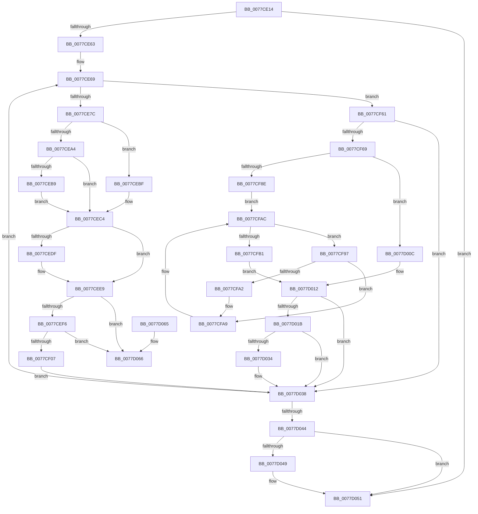

# TtmiSessionTerminalListWorker

- RVA: `0x0077CE14`–`0x0077D06D` (길이 `601` bytes)
- VA: `0x000000014077CE14`
- 실행 섹션: `PAGE`
- PDB 이름 있음: `예`; PDB Function 태그: `아니요`
- unwind 정보 RVA: `0x000CDE38`
- 디코드: `160`개 명령, `601/601` bytes 표시
- 미해석 바이트: `0` (있으면 어셈블리에 `.byte`로 보존)

> 이 문서는 커널 이미지의 기계어와 PDB 기호를 분석해 생성했습니다. 4번과 5번은 함수 원형과 자료형을 바이너리 사용 방식에서 추정한 C 해석이며 원본 소스 복구 결과는 아닙니다.

## 1. Dependencies

- 직접 호출 지점: **11**; 고유 호출 대상: **10**
- 직접 호출자로 확인된 함수: **1**
- RIP 상대 이미지 참조: **0**

### Outgoing calls
- `0x0077CE98` → [TtmiLogTerminalCleanup](TtmiLogTerminalCleanup_function_0077BA08.md) (function, `0x0077BA08`)
- `0x0077CEAD` → [TtmiUpdateActiveTerminalCount](TtmiUpdateActiveTerminalCount_function_007774C4.md) (function, `0x007774C4`)
- `0x0077CED6` → [TtmiEvacuateDevices](TtmiEvacuateDevices_function_00775BA4.md) (function, `0x00775BA4`)
- `0x0077CF16` → [TtmpDereferenceSessionMaybeLast](TtmpDereferenceSessionMaybeLast_function_00777898.md) (function, `0x00777898`)
- `0x0077CF51` → [ObfDereferenceObject](../../text/2F/ObfDereferenceObject_function_002F9350.md) (function, `0x002F9350`)
- `0x0077CF80` → [TtmpUpdateTerminalState](TtmpUpdateTerminalState_function_0077D7D0.md) (function, `0x0077D7D0`)
- `0x0077CFBE` → [memset](../../text/6C/memset_function_006C6C40.md) (function, `0x006C6C40`)
- `0x0077CFE8` → [TtmiLogTerminalDisplayStateChangedEvent](TtmiLogTerminalDisplayStateChangedEvent_function_0077BC54.md) (function, `0x0077BC54`)
- `0x0077CFF5` → [TtmiWriteEventToAllQueues](TtmiWriteEventToAllQueues_function_007775AC.md) (function, `0x007775AC`)
- `0x0077D02B` → [TtmiUpdateActiveTerminalCount](TtmiUpdateActiveTerminalCount_function_007774C4.md) (function, `0x007774C4`)
- `0x0077D04C` → [TtmiPurgeSessionPowerRequestEntries](TtmiPurgeSessionPowerRequestEntries_function_00777070.md) (function, `0x00777070`)

### Direct callers
- [TtmpSessionWorker](TtmpSessionWorker_function_00777F60.md) at `0x00777FE2`

### Static image references
- 디코드된 RIP-relative 메모리 참조가 없습니다.

## 2. Other-region calls and transfers

- 다른 실행 섹션으로 향하는 call: **2**
  - `0x0077CF51` → [ObfDereferenceObject](../../text/2F/ObfDereferenceObject_function_002F9350.md) (`PAGE` → `.text`)
  - `0x0077CFBE` → [memset](../../text/6C/memset_function_006C6C40.md) (`PAGE` → `.text`)
- 별도 외부 분기/꼬리 이동을 확인하지 못했습니다.

## 3. Assembly (complete function range)

```asm
0077CE14  4C 89 44 24 18                  mov qword ptr [rsp + 0x18], r8
0077CE19  55                              push rbp
0077CE1A  53                              push rbx
0077CE1B  56                              push rsi
0077CE1C  57                              push rdi
0077CE1D  41 54                           push r12
0077CE1F  41 55                           push r13
0077CE21  41 56                           push r14
0077CE23  41 57                           push r15
0077CE25  48 8D AC 24 A8 FE FF FF         lea rbp, [rsp - 0x158]
0077CE2D  48 81 EC 58 02 00 00            sub rsp, 0x258
0077CE34  4C 8D 61 28                     lea r12, [rcx + 0x28]
0077CE38  C6 85 A8 01 00 00 00            mov byte ptr [rbp + 0x1a8], 0
0077CE3F  49 8B 1C 24                     mov rbx, qword ptr [r12]
0077CE43  45 32 FF                        xor r15b, r15b
0077CE46  C6 85 A0 01 00 00 00            mov byte ptr [rbp + 0x1a0], 0
0077CE4D  4C 8B EA                        mov r13, rdx
0077CE50  C6 02 00                        mov byte ptr [rdx], 0
0077CE53  48 8B F9                        mov rdi, rcx
0077CE56  41 C6 00 00                     mov byte ptr [r8], 0
0077CE5A  49 3B DC                        cmp rbx, r12
0077CE5D  0F 84 EE 01 00 00               je 0x14077d051
0077CE63  41 BA 01 00 00 00               mov r10d, 1
0077CE69  4C 8D 73 24                     lea r14, [rbx + 0x24]
0077CE6D  48 8B F3                        mov rsi, rbx
0077CE70  41 8B 06                        mov eax, dword ptr [r14]
0077CE73  41 84 C2                        test r10b, al
0077CE76  0F 84 E5 00 00 00               je 0x14077cf61
0077CE7C  44 8B 46 1C                     mov r8d, dword ptr [rsi + 0x1c]
0077CE80  48 8D 43 08                     lea rax, [rbx + 8]
0077CE84  8B 17                           mov edx, dword ptr [rdi]
0077CE86  48 8B CE                        mov rcx, rsi
0077CE89  48 8B 18                        mov rbx, qword ptr [rax]
0077CE8C  48 89 44 24 20                  mov qword ptr [rsp + 0x20], rax
0077CE91  44 89 85 B8 01 00 00            mov dword ptr [rbp + 0x1b8], r8d
0077CE98  E8 6B EB FF FF                  call 0x14077ba08
0077CE9D  41 8B 06                        mov eax, dword ptr [r14]
0077CEA0  A8 10                           test al, 0x10
0077CEA2  74 1B                           je 0x14077cebf
0077CEA4  33 D2                           xor edx, edx
0077CEA6  48 8B CF                        mov rcx, rdi
0077CEA9  44 8D 42 1A                     lea r8d, [rdx + 0x1a]
0077CEAD  E8 12 A6 FF FF                  call 0x1407774c4
0077CEB2  84 C0                           test al, al
0077CEB4  8D 42 01                        lea eax, [rdx + 1]
0077CEB7  74 0B                           je 0x14077cec4
0077CEB9  41 88 45 00                     mov byte ptr [r13], al
0077CEBD  EB 05                           jmp 0x14077cec4
0077CEBF  B8 01 00 00 00                  mov eax, 1
0077CEC4  83 7E 20 00                     cmp dword ptr [rsi + 0x20], 0
0077CEC8  48 8B D6                        mov rdx, rsi
0077CECB  45 0F B6 FF                     movzx r15d, r15b
0077CECF  48 8B CF                        mov rcx, rdi
0077CED2  44 0F 45 F8                     cmovne r15d, eax
0077CED6  E8 C9 8C FF FF                  call 0x140775ba4
0077CEDB  84 C0                           test al, al
0077CEDD  74 0A                           je 0x14077cee9
0077CEDF  48 8B 85 B0 01 00 00            mov rax, qword ptr [rbp + 0x1b0]
0077CEE6  C6 00 01                        mov byte ptr [rax], 1
0077CEE9  48 8B 0E                        mov rcx, qword ptr [rsi]
0077CEEC  48 39 71 08                     cmp qword ptr [rcx + 8], rsi
0077CEF0  0F 85 70 01 00 00               jne 0x14077d066
0077CEF6  48 8B 44 24 20                  mov rax, qword ptr [rsp + 0x20]
0077CEFB  48 8B 00                        mov rax, qword ptr [rax]
0077CEFE  48 39 30                        cmp qword ptr [rax], rsi
0077CF01  0F 85 5F 01 00 00               jne 0x14077d066
0077CF07  48 89 08                        mov qword ptr [rax], rcx
0077CF0A  48 89 41 08                     mov qword ptr [rcx + 8], rax
0077CF0E  48 8B CF                        mov rcx, rdi
0077CF11  48 83 66 10 00                  and qword ptr [rsi + 0x10], 0
0077CF16  E8 7D A9 FF FF                  call 0x140777898
0077CF1B  8B 8D B8 01 00 00               mov ecx, dword ptr [rbp + 0x1b8]
0077CF21  8B D1                           mov edx, ecx
0077CF23  83 E1 07                        and ecx, 7
0077CF26  48 C1 EA 03                     shr rdx, 3
0077CF2A  48 03 57 40                     add rdx, qword ptr [rdi + 0x40]
0077CF2E  0F BE 02                        movsx eax, byte ptr [rdx]
0077CF31  0F B3 C8                        btr eax, ecx
0077CF34  48 8B CE                        mov rcx, rsi
0077CF37  88 02                           mov byte ptr [rdx], al
0077CF39  41 8B 06                        mov eax, dword ptr [r14]
0077CF3C  48 83 66 10 00                  and qword ptr [rsi + 0x10], 0
0077CF41  83 E0 FE                        and eax, 0xfffffffe
0077CF44  83 C8 02                        or eax, 2
0077CF47  C7 46 18 54 74 78 54            mov dword ptr [rsi + 0x18], 0x54787454
0077CF4E  41 89 06                        mov dword ptr [r14], eax
0077CF51  E8 FA C3 B7 FF                  call 0x1402f9350
0077CF56  41 BA 01 00 00 00               mov r10d, 1
0077CF5C  E9 D7 00 00 00                  jmp 0x14077d038
0077CF61  A8 04                           test al, 4
0077CF63  0F 84 CF 00 00 00               je 0x14077d038
0077CF69  83 E0 FB                        and eax, 0xfffffffb
0077CF6C  4C 8D 8D A0 01 00 00            lea r9, [rbp + 0x1a0]
0077CF73  4C 8D 85 A8 01 00 00            lea r8, [rbp + 0x1a8]
0077CF7A  41 89 06                        mov dword ptr [r14], eax
0077CF7D  48 8B D3                        mov rdx, rbx
0077CF80  E8 4B 08 00 00                  call 0x14077d7d0
0077CF85  80 BD A0 01 00 00 00            cmp byte ptr [rbp + 0x1a0], 0
0077CF8C  74 7E                           je 0x14077d00c
0077CF8E  48 8D 57 60                     lea rdx, [rdi + 0x60]
0077CF92  48 8B 0A                        mov rcx, qword ptr [rdx]
0077CF95  EB 15                           jmp 0x14077cfac
0077CF97  8B 43 1C                        mov eax, dword ptr [rbx + 0x1c]
0077CF9A  39 81 54 02 00 00               cmp dword ptr [rcx + 0x254], eax
0077CFA0  75 07                           jne 0x14077cfa9
0077CFA2  83 89 58 02 00 00 40            or dword ptr [rcx + 0x258], 0x40
0077CFA9  48 8B 09                        mov rcx, qword ptr [rcx]
0077CFAC  48 3B CA                        cmp rcx, rdx
0077CFAF  75 E6                           jne 0x14077cf97
0077CFB1  33 D2                           xor edx, edx
0077CFB3  48 8D 4C 24 30                  lea rcx, [rsp + 0x30]
0077CFB8  41 B8 20 02 00 00               mov r8d, 0x220
0077CFBE  E8 7D 9C F4 FF                  call 0x1406c6c40
0077CFC3  8B 4B 1C                        mov ecx, dword ptr [rbx + 0x1c]
0077CFC6  8B 93 14 01 00 00               mov edx, dword ptr [rbx + 0x114]
0077CFCC  44 8B 83 18 01 00 00            mov r8d, dword ptr [rbx + 0x118]
0077CFD3  89 4C 24 38                     mov dword ptr [rsp + 0x38], ecx
0077CFD7  89 54 24 3C                     mov dword ptr [rsp + 0x3c], edx
0077CFDB  44 89 44 24 40                  mov dword ptr [rsp + 0x40], r8d
0077CFE0  C7 44 24 30 02 00 00 00         mov dword ptr [rsp + 0x30], 2
0077CFE8  E8 67 EC FF FF                  call 0x14077bc54
0077CFED  48 8D 54 24 30                  lea rdx, [rsp + 0x30]
0077CFF2  48 8B CF                        mov rcx, rdi
0077CFF5  E8 B2 A5 FF FF                  call 0x1407775ac
0077CFFA  48 8B 85 B0 01 00 00            mov rax, qword ptr [rbp + 0x1b0]
0077D001  41 BA 01 00 00 00               mov r10d, 1
0077D007  44 88 10                        mov byte ptr [rax], r10b
0077D00A  EB 06                           jmp 0x14077d012
0077D00C  41 BA 01 00 00 00               mov r10d, 1
0077D012  80 BD A8 01 00 00 00            cmp byte ptr [rbp + 0x1a8], 0
0077D019  74 1D                           je 0x14077d038
0077D01B  8B 53 24                        mov edx, dword ptr [rbx + 0x24]
0077D01E  48 8B CF                        mov rcx, rdi
0077D021  44 8B 43 2C                     mov r8d, dword ptr [rbx + 0x2c]
0077D025  C1 EA 04                        shr edx, 4
0077D028  41 22 D2                        and dl, r10b
0077D02B  E8 94 A4 FF FF                  call 0x1407774c4
0077D030  84 C0                           test al, al
0077D032  74 04                           je 0x14077d038
0077D034  45 88 55 00                     mov byte ptr [r13], r10b
0077D038  48 8B 1B                        mov rbx, qword ptr [rbx]
0077D03B  49 3B DC                        cmp rbx, r12
0077D03E  0F 85 25 FE FF FF               jne 0x14077ce69
0077D044  45 84 FF                        test r15b, r15b
0077D047  74 08                           je 0x14077d051
0077D049  48 8B CF                        mov rcx, rdi
0077D04C  E8 1F A0 FF FF                  call 0x140777070
0077D051  48 81 C4 58 02 00 00            add rsp, 0x258
0077D058  41 5F                           pop r15
0077D05A  41 5E                           pop r14
0077D05C  41 5D                           pop r13
0077D05E  41 5C                           pop r12
0077D060  5F                              pop rdi
0077D061  5E                              pop rsi
0077D062  5B                              pop rbx
0077D063  5D                              pop rbp
0077D064  C3                              ret
0077D065  CC                              int3
0077D066  B9 03 00 00 00                  mov ecx, 3
0077D06B  CD 29                           int 0x29
```

## 4. C-style interpretation (structured pseudocode)

```c
__int64 __fastcall TtmiSessionTerminalListWorker(__int64 a1, __int64 a2, __int64 a3)
{
    __int64 result;
    __int64 v_r15;
    __int64 v_rsp;
    unsigned __int64 v_stack_m198;
    unsigned int v_stack_m258;
    unsigned int v_stack_m25C;
    unsigned int v_stack_m260;
    unsigned __int64 v_stack_m268;
    unsigned __int64 v_stack_m278;
    unsigned __int8 v_stack_p10;
    unsigned __int64 v_stack_p18;
    unsigned int v_stack_p20;
    unsigned __int8 v_stack_p8;

    v_stack_p18 = a3;
    v_rsp = (v_rsp) - (600);
    v_stack_p10 = 0;
    v_r15 = 0;
    v_stack_p8 = 0;
    *(unsigned __int8 *)(a2) = 0;
    *(unsigned __int8 *)(a3) = 0;
    if ((*(unsigned __int64 *)(a1 + 40)) == (a1 + 40)) goto loc_0077D051;
loc_0077CE69:
    if (((1) & ((unsigned __int8)((unsigned int)(*(unsigned int *)(*(unsigned __int64 *)(a1 + 40) + 36))))) == 0) goto loc_0077CF61;
    v_stack_m278 = *(unsigned __int64 *)(a1 + 40) + 8;
    v_stack_p20 = (unsigned int)((unsigned int)(*(unsigned int *)(*(unsigned __int64 *)(a1 + 40) + 28)));
    result = TtmiLogTerminalCleanup(*(unsigned __int64 *)(a1 + 40), (unsigned int)(*(unsigned int *)(a1)), (unsigned int)(*(unsigned int *)(*(unsigned __int64 *)(a1 + 40) + 28)), a4);
    if ((((unsigned __int8)((unsigned int)(*(unsigned int *)(*(unsigned __int64 *)(a1 + 40) + 36)))) & (16)) == 0) goto loc_0077CEBF;
    a2 = 0;
    result = TtmiUpdateActiveTerminalCount(a1, a2, a2 + 26, a4);
    if ((unsigned __int8)(result) == 0) goto loc_0077CEC4;
    *(unsigned __int8 *)(a2) = (unsigned __int8)(a2 + 1);
    goto loc_0077CEC4;
loc_0077CEBF:
loc_0077CEC4:
    v_r15 = 0;
    if ((*(unsigned int *)(*(unsigned __int64 *)(a1 + 40) + 32)) != 0) { v_r15 = 1; }
    result = TtmiEvacuateDevices(a1, *(unsigned __int64 *)(a1 + 40), a2 + 26, a4);
    if ((unsigned __int8)(result) != 0) {
        result = v_stack_p18;
        *(unsigned __int8 *)(result) = 1;
    }
    if ((*(unsigned __int64 *)(*(unsigned __int64 *)(*(unsigned __int64 *)(a1 + 40)) + 8)) != (*(unsigned __int64 *)(a1 + 40))) goto loc_0077D066;
    if ((*(unsigned __int64 *)(*(unsigned __int64 *)(v_stack_m278))) != (*(unsigned __int64 *)(a1 + 40))) goto loc_0077D066;
    *(unsigned __int64 *)(*(unsigned __int64 *)(v_stack_m278)) = *(unsigned __int64 *)(*(unsigned __int64 *)(a1 + 40));
    *(unsigned __int64 *)(*(unsigned __int64 *)(*(unsigned __int64 *)(a1 + 40)) + 8) = *(unsigned __int64 *)(v_stack_m278);
    result = TtmpDereferenceSessionMaybeLast(a1, *(unsigned __int64 *)(a1 + 40), a2 + 26, a4);
    a1 = (unsigned int)(((unsigned int)(v_stack_p20)) & (7));
    a2 = ((unsigned int)((unsigned int)((unsigned int)(v_stack_p20)))) >> (3);
    a2 = (a2) + (*(unsigned __int64 *)(a1 + 64));
    *(unsigned __int8 *)(a2) = (unsigned __int8)((__int8)(*(unsigned __int8 *)(a2)));
    result = (unsigned int)(((unsigned int)(*(unsigned int *)(*(unsigned __int64 *)(a1 + 40) + 36))) & (0xFFFFFFFEULL));
    result = (unsigned int)((result) | (2));
    *(unsigned int *)(*(unsigned __int64 *)(a1 + 40) + 24) = 0x54787454ULL;
    *(unsigned int *)(*(unsigned __int64 *)(a1 + 40) + 36) = (unsigned int)(result);
    result = ObfDereferenceObject(*(unsigned __int64 *)(a1 + 40), a2, a2 + 26, a4);
    goto loc_0077D038;
loc_0077CF61:
    if ((((unsigned __int8)(result)) & (4)) == 0) goto loc_0077D038;
    result = (unsigned int)((result) & (0xFFFFFFFBULL));
    *(unsigned int *)(*(unsigned __int64 *)(a1 + 40) + 36) = (unsigned int)(result);
    result = TtmpUpdateTerminalState(*(unsigned __int64 *)(a1 + 40), *(unsigned __int64 *)(*(unsigned __int64 *)(a1 + 40) + 8), v_stack_p10, v_stack_p8);
    if (v_stack_p8 == 0) goto loc_0077D00C;
    goto loc_0077CFAC;
loc_0077CF97:
    if ((*(unsigned int *)(*(unsigned __int64 *)(a1 + 96) + 596)) == ((unsigned int)((unsigned int)(*(unsigned int *)(*(unsigned __int64 *)(*(unsigned __int64 *)(a1 + 40) + 8) + 28))))) {
    }
loc_0077CFAC:
    if ((*(unsigned __int64 *)(*(unsigned __int64 *)(a1 + 96))) != (a1 + 96)) goto loc_0077CF97;
    a2 = 0;
    result = memset(v_stack_m268, a2, 544, v_stack_p8);
    v_stack_m260 = (unsigned int)((unsigned int)(*(unsigned int *)(*(unsigned __int64 *)(*(unsigned __int64 *)(a1 + 40) + 8) + 28)));
    v_stack_m25C = (unsigned int)((unsigned int)(*(unsigned int *)(*(unsigned __int64 *)(*(unsigned __int64 *)(a1 + 40) + 8) + 276)));
    v_stack_m258 = (unsigned int)((unsigned int)(*(unsigned int *)(*(unsigned __int64 *)(*(unsigned __int64 *)(a1 + 40) + 8) + 280)));
    v_stack_m268 = 2;
    result = TtmiLogTerminalDisplayStateChangedEvent((unsigned int)(*(unsigned int *)(*(unsigned __int64 *)(*(unsigned __int64 *)(a1 + 40) + 8) + 28)), (unsigned int)(*(unsigned int *)(*(unsigned __int64 *)(*(unsigned __int64 *)(a1 + 40) + 8) + 276)), (unsigned int)(*(unsigned int *)(*(unsigned __int64 *)(*(unsigned __int64 *)(a1 + 40) + 8) + 280)), v_stack_p8);
    result = TtmiWriteEventToAllQueues(a1, v_stack_m268, (unsigned int)(*(unsigned int *)(*(unsigned __int64 *)(*(unsigned __int64 *)(a1 + 40) + 8) + 280)), v_stack_p8);
    *(unsigned __int8 *)(v_stack_p18) = 1;
    goto loc_0077D012;
loc_0077D00C:
loc_0077D012:
    if (v_stack_p10 == 0) goto loc_0077D038;
    a2 = (unsigned int)(((unsigned int)(*(unsigned int *)(*(unsigned __int64 *)(*(unsigned __int64 *)(a1 + 40) + 8) + 36))) >> (4));
    a2 = (unsigned __int8)((a2) & (1));
    result = TtmiUpdateActiveTerminalCount(a1, a2, (unsigned int)(*(unsigned int *)(*(unsigned __int64 *)(*(unsigned __int64 *)(a1 + 40) + 8) + 44)), v_stack_p8);
    if ((unsigned __int8)(result) != 0) {
        *(unsigned __int8 *)(a2) = 1;
    }
    if ((*(unsigned __int64 *)(*(unsigned __int64 *)(*(unsigned __int64 *)(a1 + 40) + 8))) != (a1 + 40)) goto loc_0077CE69;
    if ((unsigned __int8)(v_r15) != 0) {
        a1 = a1;
        result = TtmiPurgeSessionPowerRequestEntries(a1, a2, (unsigned int)(*(unsigned int *)(*(unsigned __int64 *)(*(unsigned __int64 *)(a1 + 40) + 8) + 44)), v_stack_p8);
    }
    v_rsp = (v_rsp) + (600);
    return result;
loc_0077D066:
    return result;
}
```

## 5. (Beta) C Style

```c
int64_t TtmiSessionTerminalListWorker(void *Arg1, void *Arg2, void *Arg3)
{
    uint8_t *arg1 = (uint8_t *)Arg1;
    uint8_t *arg2 = (uint8_t *)Arg2;
    uint8_t *arg3 = (uint8_t *)Arg3;

    int64_t result;
    int64_t local_r15;
    int64_t local_rsp;
    uint64_t v_stack_m198;
    uint32_t v_stack_m258;
    uint32_t v_stack_m25C;
    uint32_t v_stack_m260;
    uint64_t v_stack_m268;
    uint64_t v_stack_m278;
    uint8_t v_stack_p10;
    uint64_t v_stack_p18;
    uint32_t v_stack_p20;
    uint8_t v_stack_p8;

    v_stack_p18 = Arg3;
    local_rsp = (local_rsp) - (600);
    v_stack_p10 = 0;
    local_r15 = 0;
    v_stack_p8 = 0;
    *(uint8_t *)(arg2) = 0;
    *(uint8_t *)(arg3) = 0;
    if ((*(uint64_t *)(arg1 + 0x28)) == (Arg1 + 40)) goto loc_0077D051;
loc_0077CE69:
    if (((1) & ((uint8_t)((uint32_t)(*(uint32_t *)(*(uint64_t *)(arg1 + 0x28) + 0x24))))) == 0) goto loc_0077CF61;
    v_stack_m278 = *(uint64_t *)(arg1 + 0x28) + 8;
    v_stack_p20 = (uint32_t)((uint32_t)(*(uint32_t *)(*(uint64_t *)(arg1 + 0x28) + 0x1C)));
    result = TtmiLogTerminalCleanup(*(uint64_t *)(arg1 + 0x28), (uint32_t)(*(uint32_t *)(arg1)), (uint32_t)(*(uint32_t *)(*(uint64_t *)(arg1 + 0x28) + 0x1C)), a4);
    if ((((uint8_t)((uint32_t)(*(uint32_t *)(*(uint64_t *)(arg1 + 0x28) + 0x24)))) & (16)) == 0) goto loc_0077CEBF;
    Arg2 = 0;
    result = TtmiUpdateActiveTerminalCount(Arg1, Arg2, Arg2 + 26, a4);
    if ((uint8_t)(result) == 0) goto loc_0077CEC4;
    *(uint8_t *)(arg2) = (uint8_t)(Arg2 + 1);
    goto loc_0077CEC4;
loc_0077CEBF:
loc_0077CEC4:
    local_r15 = 0;
    if ((*(uint32_t *)(*(uint64_t *)(arg1 + 0x28) + 0x20)) != 0) { local_r15 = 1; }
    result = TtmiEvacuateDevices(Arg1, *(uint64_t *)(arg1 + 0x28), Arg2 + 26, a4);
    if ((uint8_t)(result) != 0) {
        result = v_stack_p18;
        *(uint8_t *)(result) = 1;
    }
    if ((*(uint64_t *)(*(uint64_t *)(*(uint64_t *)(arg1 + 0x28)) + 0x8)) != (*(uint64_t *)(arg1 + 0x28))) goto loc_0077D066;
    if ((*(uint64_t *)(*(uint64_t *)(v_stack_m278))) != (*(uint64_t *)(arg1 + 0x28))) goto loc_0077D066;
    *(uint64_t *)(*(uint64_t *)(v_stack_m278)) = *(uint64_t *)(*(uint64_t *)(arg1 + 0x28));
    *(uint64_t *)(*(uint64_t *)(*(uint64_t *)(arg1 + 0x28)) + 0x8) = *(uint64_t *)(v_stack_m278);
    result = TtmpDereferenceSessionMaybeLast(Arg1, *(uint64_t *)(arg1 + 0x28), Arg2 + 26, a4);
    Arg1 = (uint32_t)(((uint32_t)(v_stack_p20)) & (7));
    Arg2 = ((uint32_t)((uint32_t)((uint32_t)(v_stack_p20)))) >> (3);
    Arg2 = (Arg2) + (*(uint64_t *)(arg1 + 0x40));
    *(uint8_t *)(arg2) = (uint8_t)((int8_t)(*(uint8_t *)(arg2)));
    result = (uint32_t)(((uint32_t)(*(uint32_t *)(*(uint64_t *)(arg1 + 0x28) + 0x24))) & (0xFFFFFFFEULL));
    result = (uint32_t)((result) | (2));
    *(uint32_t *)(*(uint64_t *)(arg1 + 0x28) + 0x18) = 0x54787454ULL;
    *(uint32_t *)(*(uint64_t *)(arg1 + 0x28) + 0x24) = (uint32_t)(result);
    result = ObfDereferenceObject(*(uint64_t *)(arg1 + 0x28), Arg2, Arg2 + 26, a4);
    goto loc_0077D038;
loc_0077CF61:
    if ((((uint8_t)(result)) & (4)) == 0) goto loc_0077D038;
    result = (uint32_t)((result) & (0xFFFFFFFBULL));
    *(uint32_t *)(*(uint64_t *)(arg1 + 0x28) + 0x24) = (uint32_t)(result);
    result = TtmpUpdateTerminalState(*(uint64_t *)(arg1 + 0x28), *(uint64_t *)(*(uint64_t *)(arg1 + 0x28) + 0x8), v_stack_p10, v_stack_p8);
    if (v_stack_p8 == 0) goto loc_0077D00C;
    goto loc_0077CFAC;
loc_0077CF97:
    if ((*(uint32_t *)(*(uint64_t *)(arg1 + 0x60) + 0x254)) == ((uint32_t)((uint32_t)(*(uint32_t *)(*(uint64_t *)(*(uint64_t *)(arg1 + 0x28) + 0x8) + 0x1C))))) {
    }
loc_0077CFAC:
    if ((*(uint64_t *)(*(uint64_t *)(arg1 + 0x60))) != (Arg1 + 96)) goto loc_0077CF97;
    Arg2 = 0;
    result = memset(v_stack_m268, Arg2, 544, v_stack_p8);
    v_stack_m260 = (uint32_t)((uint32_t)(*(uint32_t *)(*(uint64_t *)(*(uint64_t *)(arg1 + 0x28) + 0x8) + 0x1C)));
    v_stack_m25C = (uint32_t)((uint32_t)(*(uint32_t *)(*(uint64_t *)(*(uint64_t *)(arg1 + 0x28) + 0x8) + 0x114)));
    v_stack_m258 = (uint32_t)((uint32_t)(*(uint32_t *)(*(uint64_t *)(*(uint64_t *)(arg1 + 0x28) + 0x8) + 0x118)));
    v_stack_m268 = 2;
    result = TtmiLogTerminalDisplayStateChangedEvent((uint32_t)(*(uint32_t *)(*(uint64_t *)(*(uint64_t *)(arg1 + 0x28) + 0x8) + 0x1C)), (uint32_t)(*(uint32_t *)(*(uint64_t *)(*(uint64_t *)(arg1 + 0x28) + 0x8) + 0x114)), (uint32_t)(*(uint32_t *)(*(uint64_t *)(*(uint64_t *)(arg1 + 0x28) + 0x8) + 0x118)), v_stack_p8);
    result = TtmiWriteEventToAllQueues(Arg1, v_stack_m268, (uint32_t)(*(uint32_t *)(*(uint64_t *)(*(uint64_t *)(arg1 + 0x28) + 0x8) + 0x118)), v_stack_p8);
    *(uint8_t *)(v_stack_p18) = 1;
    goto loc_0077D012;
loc_0077D00C:
loc_0077D012:
    if (v_stack_p10 == 0) goto loc_0077D038;
    Arg2 = (uint32_t)(((uint32_t)(*(uint32_t *)(*(uint64_t *)(*(uint64_t *)(arg1 + 0x28) + 0x8) + 0x24))) >> (4));
    Arg2 = (uint8_t)((Arg2) & (1));
    result = TtmiUpdateActiveTerminalCount(Arg1, Arg2, (uint32_t)(*(uint32_t *)(*(uint64_t *)(*(uint64_t *)(arg1 + 0x28) + 0x8) + 0x2C)), v_stack_p8);
    if ((uint8_t)(result) != 0) {
        *(uint8_t *)(arg2) = 1;
    }
    if ((*(uint64_t *)(*(uint64_t *)(*(uint64_t *)(arg1 + 0x28) + 0x8))) != (Arg1 + 40)) goto loc_0077CE69;
    if ((uint8_t)(local_r15) != 0) {
        Arg1 = Arg1;
        result = TtmiPurgeSessionPowerRequestEntries(Arg1, Arg2, (uint32_t)(*(uint32_t *)(*(uint64_t *)(*(uint64_t *)(arg1 + 0x28) + 0x8) + 0x2C)), v_stack_p8);
    }
    local_rsp = (local_rsp) + (600);
    return result;
loc_0077D066:
    return result;
}
```

### 관측된 메모리 오프셋

구조체 형식이 확인되지 않은 접근은 인자 기준의 오프셋으로만 기록했습니다.

| 기준 인자 | 오프셋 표현 | 폭 (bit) | 접근 |
|---|---:|---:|---|
| `Arg1` | `+ 0x0` | `32` | `R` |
| `Arg1` | `+ 0x0` | `64` | `R` |
| `Arg1` | `+ 0x28` | `64` | `R` |
| `Arg1` | `+ 0x40` | `64` | `R` |
| `Arg1` | `+ 0x60` | `64` | `R` |
| `Arg2` | `+ 0x0` | `8` | `W` |
| `Arg3` | `+ 0x0` | `8` | `W` |

## 6. Execution-region graph

[열기: 2D/3D 그래프와 함수 탐색 컨트롤 패널](../../../control-panel.html?section=page&rva=0x0077CE14&view=graph)

- 2D 그래프는 위에서 아래로 흐르고, 3D 그래프는 빈 공간을 드래그해 회전합니다. Shift+드래그는 이동, 휠은 확대·축소, 함수 노드 선택은 대상 보고서 이동입니다.

### Static fallback


