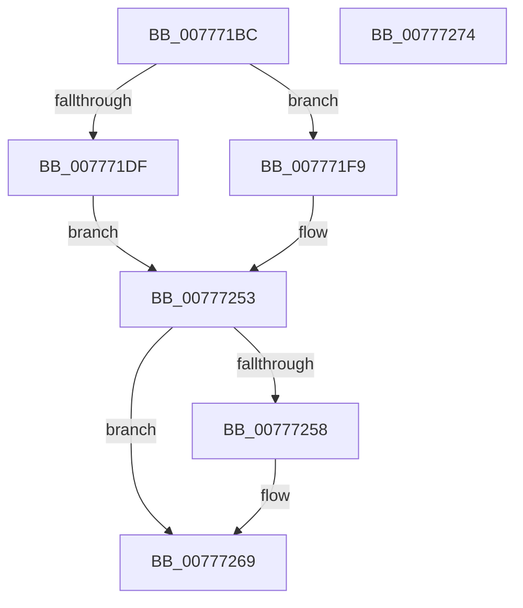

# TtmiSessionsRundown

- RVA: `0x007771BC`–`0x00777275` (길이 `185` bytes)
- VA: `0x00000001407771BC`
- 실행 섹션: `PAGE`
- PDB 이름 있음: `예`; PDB Function 태그: `아니요`
- unwind 정보 RVA: `0x000BDDB4`
- 디코드: `52`개 명령, `185/185` bytes 표시
- 미해석 바이트: `0` (있으면 어셈블리에 `.byte`로 보존)

> 이 문서는 커널 이미지의 기계어와 PDB 기호를 분석해 생성했습니다. 4번과 5번은 함수 원형과 자료형을 바이너리 사용 방식에서 추정한 C 해석이며 원본 소스 복구 결과는 아닙니다.

## 1. Dependencies

- 직접 호출 지점: **7**; 고유 호출 대상: **7**
- 직접 호출자로 확인된 함수: **1**
- RIP 상대 이미지 참조: **2**

### Outgoing calls
- `0x007771D2` → [TtmiAcquireCurrentSession](TtmiAcquireCurrentSession_function_00777010.md) (function, `0x00777010`)
- `0x007771F2` → [TtmiLogError](../98/TtmiLogError_function_0098B39C.md) (function, `0x0098B39C`)
- `0x0077723E` → [TtmiLogSessionRundown](TtmiLogSessionRundown_function_0077B670.md) (function, `0x0077B670`)
- `0x00777246` → [TtmiTerminalsRundown](TtmiTerminalsRundown_function_0077D280.md) (function, `0x0077D280`)
- `0x0077724E` → [TtmiDevicesRundown](TtmiDevicesRundown_function_00775AFC.md) (function, `0x00775AFC`)
- `0x0077725F` → [ExReleaseResourceLite](../../text/25/ExReleaseResourceLite_function_0025FA10.md) (function, `0x0025FA10`)
- `0x00777264` → [KeLeaveCriticalRegion](../../text/25/KeLeaveCriticalRegion_function_0025D8B0.md) (function, `0x0025D8B0`)

### Direct callers
- [TtmpTraceLoggingCallback](TtmpTraceLoggingCallback_function_0077C720.md) at `0x0077C729`

### Static image references
- `0x007771E3` → RVA `0x00B042F0` (` ?? ::NNGAKEGL::`string'`; read)
- `0x00777258` → RVA `0x00F06940` (`.data`; read)

## 2. Other-region calls and transfers

- 다른 실행 섹션으로 향하는 call: **2**
  - `0x0077725F` → [ExReleaseResourceLite](../../text/25/ExReleaseResourceLite_function_0025FA10.md) (`PAGE` → `.text`)
  - `0x00777264` → [KeLeaveCriticalRegion](../../text/25/KeLeaveCriticalRegion_function_0025D8B0.md) (`PAGE` → `.text`)
- 별도 외부 분기/꼬리 이동을 확인하지 못했습니다.

## 3. Assembly (complete function range)

```asm
007771BC  48 89 5C 24 10                  mov qword ptr [rsp + 0x10], rbx
007771C1  55                              push rbp
007771C2  48 8B EC                        mov rbp, rsp
007771C5  48 83 EC 50                     sub rsp, 0x50
007771C9  48 83 65 10 00                  and qword ptr [rbp + 0x10], 0
007771CE  48 8D 4D 10                     lea rcx, [rbp + 0x10]
007771D2  E8 39 FE FF FF                  call 0x140777010
007771D7  48 8B 5D 10                     mov rbx, qword ptr [rbp + 0x10]
007771DB  85 C0                           test eax, eax
007771DD  79 1A                           jns 0x1407771f9
007771DF  41 83 C9 FF                     or r9d, 0xffffffff
007771E3  48 8D 0D 06 D1 38 00            lea rcx, [rip + 0x38d106]
007771EA  44 8B C0                        mov r8d, eax
007771ED  BA A0 10 00 00                  mov edx, 0x10a0
007771F2  E8 A5 41 21 00                  call 0x14098b39c
007771F7  EB 5A                           jmp 0x140777253
007771F9  8B 03                           mov eax, dword ptr [rbx]
007771FB  48 8D 4D D0                     lea rcx, [rbp - 0x30]
007771FF  89 45 D0                        mov dword ptr [rbp - 0x30], eax
00777202  8B 43 04                        mov eax, dword ptr [rbx + 4]
00777205  89 45 D4                        mov dword ptr [rbp - 0x2c], eax
00777208  8B 43 08                        mov eax, dword ptr [rbx + 8]
0077720B  89 45 D8                        mov dword ptr [rbp - 0x28], eax
0077720E  8B 43 4C                        mov eax, dword ptr [rbx + 0x4c]
00777211  89 45 DC                        mov dword ptr [rbp - 0x24], eax
00777214  8B 43 74                        mov eax, dword ptr [rbx + 0x74]
00777217  89 45 E0                        mov dword ptr [rbp - 0x20], eax
0077721A  8B 43 0C                        mov eax, dword ptr [rbx + 0xc]
0077721D  89 45 E4                        mov dword ptr [rbp - 0x1c], eax
00777220  8B 43 10                        mov eax, dword ptr [rbx + 0x10]
00777223  89 45 E8                        mov dword ptr [rbp - 0x18], eax
00777226  8B 43 14                        mov eax, dword ptr [rbx + 0x14]
00777229  89 45 EC                        mov dword ptr [rbp - 0x14], eax
0077722C  8B 83 08 01 00 00               mov eax, dword ptr [rbx + 0x108]
00777232  89 45 F0                        mov dword ptr [rbp - 0x10], eax
00777235  8B 83 0C 01 00 00               mov eax, dword ptr [rbx + 0x10c]
0077723B  89 45 F4                        mov dword ptr [rbp - 0xc], eax
0077723E  E8 2D 44 00 00                  call 0x14077b670
00777243  48 8B CB                        mov rcx, rbx
00777246  E8 35 60 00 00                  call 0x14077d280
0077724B  48 8B CB                        mov rcx, rbx
0077724E  E8 A9 E8 FF FF                  call 0x140775afc
00777253  48 85 DB                        test rbx, rbx
00777256  74 11                           je 0x140777269
00777258  48 8D 0D E1 F6 78 00            lea rcx, [rip + 0x78f6e1]
0077725F  E8 AC 87 AE FF                  call 0x14025fa10
00777264  E8 47 66 AE FF                  call 0x14025d8b0
00777269  48 8B 5C 24 68                  mov rbx, qword ptr [rsp + 0x68]
0077726E  48 83 C4 50                     add rsp, 0x50
00777272  5D                              pop rbp
00777273  C3                              ret
00777274  CC                              int3
```

## 4. C-style interpretation (structured pseudocode)

```c
__int64 __fastcall TtmiSessionsRundown(__int64 a1, __int64 a2, __int64 a3, int a4)
{
    __int64 result;
    __int64 v_rsp;
    unsigned int v_stack_m14;
    unsigned int v_stack_m18;
    unsigned int v_stack_m1C;
    unsigned int v_stack_m20;
    unsigned int v_stack_m24;
    unsigned int v_stack_m28;
    unsigned int v_stack_m2C;
    unsigned int v_stack_m30;
    unsigned int v_stack_m34;
    unsigned __int64 v_stack_m38;
    unsigned __int64 v_stack_p10;
    unsigned __int64 v_stack_p8;

    v_stack_p10 = v_rbx;
    v_rsp = (v_rsp) - (80);
    result = TtmiAcquireCurrentSession(v_stack_p8, a2, a3, a4);
    if (!sign_flag) goto loc_007771F9;
    a4 = (unsigned int)((a4) | (0xFFFFFFFFULL));
    result = TtmiLogError(v_rip + 3723526, (unsigned int)(0x10A0ULL), (unsigned int)((unsigned int)(result)), a4);
    goto loc_00777253;
loc_007771F9:
    v_stack_m38 = (unsigned int)((unsigned int)(*(unsigned int *)(v_stack_p8)));
    v_stack_m34 = (unsigned int)((unsigned int)(*(unsigned int *)(v_stack_p8 + 4)));
    v_stack_m30 = (unsigned int)((unsigned int)(*(unsigned int *)(v_stack_p8 + 8)));
    v_stack_m2C = (unsigned int)((unsigned int)(*(unsigned int *)(v_stack_p8 + 76)));
    v_stack_m28 = (unsigned int)((unsigned int)(*(unsigned int *)(v_stack_p8 + 116)));
    v_stack_m24 = (unsigned int)((unsigned int)(*(unsigned int *)(v_stack_p8 + 12)));
    v_stack_m20 = (unsigned int)((unsigned int)(*(unsigned int *)(v_stack_p8 + 16)));
    v_stack_m1C = (unsigned int)((unsigned int)(*(unsigned int *)(v_stack_p8 + 20)));
    v_stack_m18 = (unsigned int)((unsigned int)(*(unsigned int *)(v_stack_p8 + 264)));
    v_stack_m14 = (unsigned int)((unsigned int)(*(unsigned int *)(v_stack_p8 + 268)));
    result = TtmiLogSessionRundown(v_stack_m38, (unsigned int)(0x10A0ULL), (unsigned int)((unsigned int)(result)), a4);
    result = TtmiTerminalsRundown(v_stack_p8, (unsigned int)(0x10A0ULL), (unsigned int)((unsigned int)(result)), a4);
    result = TtmiDevicesRundown(v_stack_p8, (unsigned int)(0x10A0ULL), (unsigned int)((unsigned int)(result)), a4);
loc_00777253:
    if (v_stack_p8 != 0) {
        a1 = v_rip + 7927521;
        result = ExReleaseResourceLite(a1, (unsigned int)(0x10A0ULL), (unsigned int)((unsigned int)(result)), a4);
        result = KeLeaveCriticalRegion(a1, (unsigned int)(0x10A0ULL), (unsigned int)((unsigned int)(result)), a4);
    }
    v_rsp = (v_rsp) + (80);
    return result;
}
```

## 5. (Beta) C Style

```c
int64_t TtmiSessionsRundown(int64_t Arg1, int64_t Arg2, int64_t Arg3, int32_t Arg4)
{
    int64_t result;
    int64_t local_rsp;
    uint32_t v_stack_m14;
    uint32_t v_stack_m18;
    uint32_t v_stack_m1C;
    uint32_t v_stack_m20;
    uint32_t v_stack_m24;
    uint32_t v_stack_m28;
    uint32_t v_stack_m2C;
    uint32_t v_stack_m30;
    uint32_t v_stack_m34;
    uint64_t v_stack_m38;
    uint64_t v_stack_p10;
    uint64_t v_stack_p8;

    v_stack_p10 = local_rbx;
    local_rsp = (local_rsp) - (80);
    result = TtmiAcquireCurrentSession(v_stack_p8, Arg2, Arg3, Arg4);
    if (!sign_flag) goto loc_007771F9;
    Arg4 = (uint32_t)((Arg4) | (0xFFFFFFFFULL));
    result = TtmiLogError(v_rip + 3723526, (uint32_t)(0x10A0ULL), (uint32_t)((uint32_t)(result)), Arg4);
    goto loc_00777253;
loc_007771F9:
    v_stack_m38 = (uint32_t)((uint32_t)(*(uint32_t *)(v_stack_p8)));
    v_stack_m34 = (uint32_t)((uint32_t)(*(uint32_t *)(v_stack_p8 + 0x4)));
    v_stack_m30 = (uint32_t)((uint32_t)(*(uint32_t *)(v_stack_p8 + 0x8)));
    v_stack_m2C = (uint32_t)((uint32_t)(*(uint32_t *)(v_stack_p8 + 0x4C)));
    v_stack_m28 = (uint32_t)((uint32_t)(*(uint32_t *)(v_stack_p8 + 0x74)));
    v_stack_m24 = (uint32_t)((uint32_t)(*(uint32_t *)(v_stack_p8 + 0xC)));
    v_stack_m20 = (uint32_t)((uint32_t)(*(uint32_t *)(v_stack_p8 + 0x10)));
    v_stack_m1C = (uint32_t)((uint32_t)(*(uint32_t *)(v_stack_p8 + 0x14)));
    v_stack_m18 = (uint32_t)((uint32_t)(*(uint32_t *)(v_stack_p8 + 0x108)));
    v_stack_m14 = (uint32_t)((uint32_t)(*(uint32_t *)(v_stack_p8 + 0x10C)));
    result = TtmiLogSessionRundown(v_stack_m38, (uint32_t)(0x10A0ULL), (uint32_t)((uint32_t)(result)), Arg4);
    result = TtmiTerminalsRundown(v_stack_p8, (uint32_t)(0x10A0ULL), (uint32_t)((uint32_t)(result)), Arg4);
    result = TtmiDevicesRundown(v_stack_p8, (uint32_t)(0x10A0ULL), (uint32_t)((uint32_t)(result)), Arg4);
loc_00777253:
    if (v_stack_p8 != 0) {
        Arg1 = v_rip + 7927521;
        result = ExReleaseResourceLite(Arg1, (uint32_t)(0x10A0ULL), (uint32_t)((uint32_t)(result)), Arg4);
        result = KeLeaveCriticalRegion(Arg1, (uint32_t)(0x10A0ULL), (uint32_t)((uint32_t)(result)), Arg4);
    }
    local_rsp = (local_rsp) + (80);
    return result;
}
```

## 6. Execution-region graph

[열기: 2D/3D 그래프와 함수 탐색 컨트롤 패널](../../../control-panel.html?section=page&rva=0x007771BC&view=graph)

- 2D 그래프는 위에서 아래로 흐르고, 3D 그래프는 빈 공간을 드래그해 회전합니다. Shift+드래그는 이동, 휠은 확대·축소, 함수 노드 선택은 대상 보고서 이동입니다.

### Static fallback


