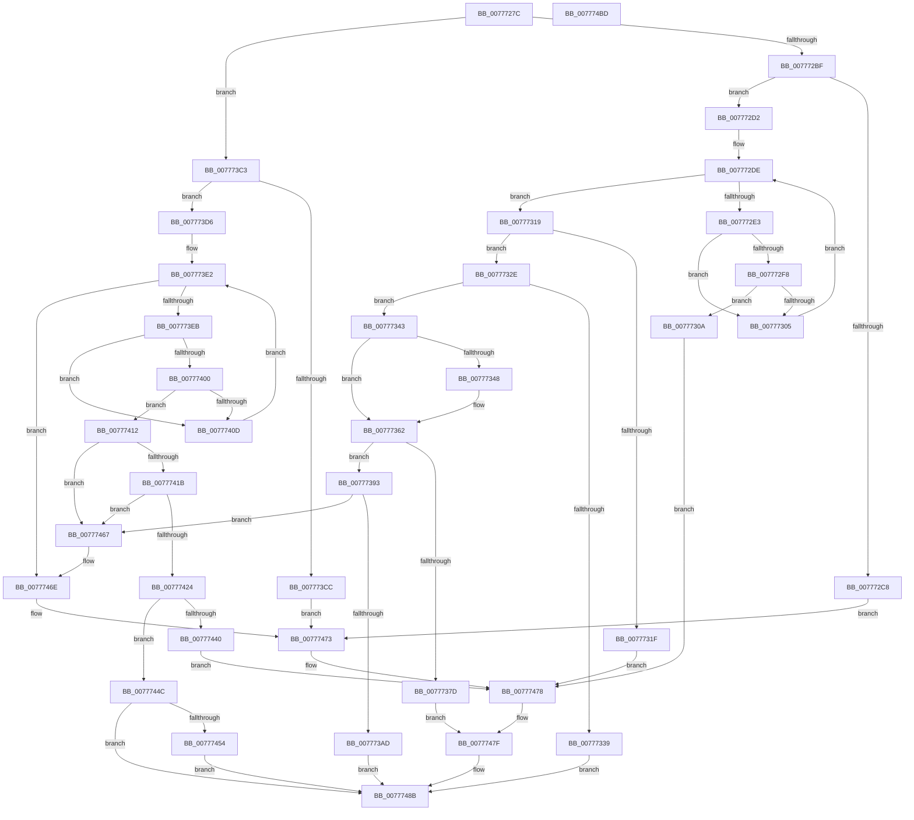

# TtmiSetDisplayPowerRequest

- RVA: `0x0077727C`–`0x007774BE` (길이 `578` bytes)
- VA: `0x000000014077727C`
- 실행 섹션: `PAGE`
- PDB 이름 있음: `예`; PDB Function 태그: `아니요`
- unwind 정보 RVA: `0x0008A668`
- 디코드: `160`개 명령, `578/578` bytes 표시
- 미해석 바이트: `0` (있으면 어셈블리에 `.byte`로 보존)

> 이 문서는 커널 이미지의 기계어와 PDB 기호를 분석해 생성했습니다. 4번과 5번은 함수 원형과 자료형을 바이너리 사용 방식에서 추정한 C 해석이며 원본 소스 복구 결과는 아닙니다.

## 1. Dependencies

- 직접 호출 지점: **10**; 고유 호출 대상: **8**
- 직접 호출자로 확인된 함수: **1**
- RIP 상대 이미지 참조: **1**

### Outgoing calls
- `0x007772BF` → [TtmpFindPowerRequestEntryById](TtmpFindPowerRequestEntryById_function_007778C4.md) (function, `0x007778C4`)
- `0x007772EF` → [TtmiGetTerminalById](TtmiGetTerminalById_function_0077CA04.md) (function, `0x0077CA04`)
- `0x0077735D` → [TtmiSetPendingOnOffRequest](TtmiSetPendingOnOffRequest_function_0077D074.md) (function, `0x0077D074`)
- `0x00777370` → [ExAllocatePool2](../../poolcode/B8/ExAllocatePool2_function_00B820F0.md) (function, `0x00B820F0`)
- `0x007773C3` → [TtmpFindPowerRequestEntryById](TtmpFindPowerRequestEntryById_function_007778C4.md) (function, `0x007778C4`)
- `0x007773F7` → [TtmiGetTerminalById](TtmiGetTerminalById_function_0077CA04.md) (function, `0x0077CA04`)
- `0x00777434` → [ExFreePoolWithTag](../../poolcode/B8/ExFreePoolWithTag_function_00B82870.md) (function, `0x00B82870`)
- `0x00777460` → [TtmiScheduleSessionWorker](TtmiScheduleSessionWorker_function_00777184.md) (function, `0x00777184`)
- `0x00777486` → [TtmiLogError](../98/TtmiLogError_function_0098B39C.md) (function, `0x0098B39C`)
- `0x00777497` → [TtmiLogDisplayPowerRequestSet](TtmiLogDisplayPowerRequestSet_function_0077A058.md) (function, `0x0077A058`)

### Direct callers
- [TtmpDispatchSetDisplayPowerRequest](TtmpDispatchSetDisplayPowerRequest_function_00778C10.md) at `0x00778C75`

### Static image references
- `0x0077747F` → RVA `0x00B04270` (` ?? ::NNGAKEGL::`string'`; read)

## 2. Other-region calls and transfers

- 다른 실행 섹션으로 향하는 call: **2**
  - `0x00777370` → [ExAllocatePool2](../../poolcode/B8/ExAllocatePool2_function_00B820F0.md) (`PAGE` → `POOLCODE`)
  - `0x00777434` → [ExFreePoolWithTag](../../poolcode/B8/ExFreePoolWithTag_function_00B82870.md) (`PAGE` → `POOLCODE`)
- 별도 외부 분기/꼬리 이동을 확인하지 못했습니다.

## 3. Assembly (complete function range)

```asm
0077727C  48 8B C4                        mov rax, rsp
0077727F  48 89 58 08                     mov qword ptr [rax + 8], rbx
00777283  48 89 68 10                     mov qword ptr [rax + 0x10], rbp
00777287  48 89 70 18                     mov qword ptr [rax + 0x18], rsi
0077728B  48 89 78 20                     mov qword ptr [rax + 0x20], rdi
0077728F  41 54                           push r12
00777291  41 56                           push r14
00777293  41 57                           push r15
00777295  48 83 EC 40                     sub rsp, 0x40
00777299  33 DB                           xor ebx, ebx
0077729B  45 8B F8                        mov r15d, r8d
0077729E  48 89 58 D8                     mov qword ptr [rax - 0x28], rbx
007772A2  48 8B FA                        mov rdi, rdx
007772A5  48 89 58 E0                     mov qword ptr [rax - 0x20], rbx
007772A9  45 8B E1                        mov r12d, r9d
007772AC  4C 8D 40 D8                     lea r8, [rax - 0x28]
007772B0  48 8B F1                        mov rsi, rcx
007772B3  41 8B D7                        mov edx, r15d
007772B6  45 85 C9                        test r9d, r9d
007772B9  0F 84 04 01 00 00               je 0x1407773c3
007772BF  E8 00 06 00 00                  call 0x1407778c4
007772C4  84 C0                           test al, al
007772C6  75 0A                           jne 0x1407772d2
007772C8  BA 33 03 00 00                  mov edx, 0x333
007772CD  E9 A1 01 00 00                  jmp 0x140777473
007772D2  48 8B 6C 24 30                  mov rbp, qword ptr [rsp + 0x30]
007772D7  4C 8D 5D 30                     lea r11, [rbp + 0x30]
007772DB  4D 8B 13                        mov r10, qword ptr [r11]
007772DE  4D 3B D3                        cmp r10, r11
007772E1  74 36                           je 0x140777319
007772E3  45 8B 42 F8                     mov r8d, dword ptr [r10 - 8]
007772E7  48 8D 4C 24 38                  lea rcx, [rsp + 0x38]
007772EC  48 8B D6                        mov rdx, rsi
007772EF  E8 10 57 00 00                  call 0x14077ca04
007772F4  85 C0                           test eax, eax
007772F6  78 0D                           js 0x140777305
007772F8  48 8B 44 24 38                  mov rax, qword ptr [rsp + 0x38]
007772FD  8B 4F 1C                        mov ecx, dword ptr [rdi + 0x1c]
00777300  39 48 1C                        cmp dword ptr [rax + 0x1c], ecx
00777303  74 05                           je 0x14077730a
00777305  4D 8B 12                        mov r10, qword ptr [r10]
00777308  EB D4                           jmp 0x1407772de
0077730A  BB 2A 02 00 C0                  mov ebx, 0xc000022a
0077730F  BA 5E 03 00 00                  mov edx, 0x35e
00777314  E9 5F 01 00 00                  jmp 0x140777478
00777319  83 7F 20 FF                     cmp dword ptr [rdi + 0x20], -1
0077731D  75 0F                           jne 0x14077732e
0077731F  BB 95 00 00 C0                  mov ebx, 0xc0000095
00777324  BA 6B 03 00 00                  mov edx, 0x36b
00777329  E9 4A 01 00 00                  jmp 0x140777478
0077732E  8B 4F 28                        mov ecx, dword ptr [rdi + 0x28]
00777331  8D 41 FE                        lea eax, [rcx - 2]
00777334  83 F8 01                        cmp eax, 1
00777337  76 0A                           jbe 0x140777343
00777339  BB BB 00 00 C0                  mov ebx, 0xc00000bb
0077733E  E9 48 01 00 00                  jmp 0x14077748b
00777343  83 F9 02                        cmp ecx, 2
00777346  75 1A                           jne 0x140777362
00777348  44 8D 49 06                     lea r9d, [rcx + 6]
0077734C  C7 44 24 20 55 64 41 54         mov dword ptr [rsp + 0x20], 0x54416455
00777354  48 8B CE                        mov rcx, rsi
00777357  41 B0 01                        mov r8b, 1
0077735A  48 8B D7                        mov rdx, rdi
0077735D  E8 12 5D 00 00                  call 0x14077d074
00777362  BA 18 00 00 00                  mov edx, 0x18
00777367  41 B8 54 74 50 52               mov r8d, 0x52507454
0077736D  8D 4A 28                        lea ecx, [rdx + 0x28]
00777370  E8 7B AD 40 00                  call 0x140b820f0
00777375  48 8B C8                        mov rcx, rax
00777378  48 85 C0                        test rax, rax
0077737B  75 16                           jne 0x140777393
0077737D  BB 9A 00 00 C0                  mov ebx, 0xc000009a
00777382  41 83 C8 FF                     or r8d, 0xffffffff
00777386  44 8B CB                        mov r9d, ebx
00777389  BA 7D 03 00 00                  mov edx, 0x37d
0077738E  E9 EC 00 00 00                  jmp 0x14077747f
00777393  8B 47 1C                        mov eax, dword ptr [rdi + 0x1c]
00777396  89 01                           mov dword ptr [rcx], eax
00777398  48 8D 41 08                     lea rax, [rcx + 8]
0077739C  48 8D 4D 30                     lea rcx, [rbp + 0x30]
007773A0  48 8B 51 08                     mov rdx, qword ptr [rcx + 8]
007773A4  48 39 0A                        cmp qword ptr [rdx], rcx
007773A7  0F 85 BA 00 00 00               jne 0x140777467
007773AD  48 89 08                        mov qword ptr [rax], rcx
007773B0  48 89 50 08                     mov qword ptr [rax + 8], rdx
007773B4  48 89 02                        mov qword ptr [rdx], rax
007773B7  48 89 41 08                     mov qword ptr [rcx + 8], rax
007773BB  FF 47 20                        inc dword ptr [rdi + 0x20]
007773BE  E9 C8 00 00 00                  jmp 0x14077748b
007773C3  E8 FC 04 00 00                  call 0x1407778c4
007773C8  84 C0                           test al, al
007773CA  75 0A                           jne 0x1407773d6
007773CC  BA A7 03 00 00                  mov edx, 0x3a7
007773D1  E9 9D 00 00 00                  jmp 0x140777473
007773D6  4C 8B 5C 24 30                  mov r11, qword ptr [rsp + 0x30]
007773DB  49 83 C3 30                     add r11, 0x30
007773DF  4D 8B 13                        mov r10, qword ptr [r11]
007773E2  4D 3B D3                        cmp r10, r11
007773E5  0F 84 83 00 00 00               je 0x14077746e
007773EB  45 8B 42 F8                     mov r8d, dword ptr [r10 - 8]
007773EF  48 8D 4C 24 38                  lea rcx, [rsp + 0x38]
007773F4  48 8B D6                        mov rdx, rsi
007773F7  E8 08 56 00 00                  call 0x14077ca04
007773FC  85 C0                           test eax, eax
007773FE  78 0D                           js 0x14077740d
00777400  48 8B 44 24 38                  mov rax, qword ptr [rsp + 0x38]
00777405  8B 4F 1C                        mov ecx, dword ptr [rdi + 0x1c]
00777408  39 48 1C                        cmp dword ptr [rax + 0x1c], ecx
0077740B  74 05                           je 0x140777412
0077740D  4D 8B 12                        mov r10, qword ptr [r10]
00777410  EB D0                           jmp 0x1407773e2
00777412  49 8B 12                        mov rdx, qword ptr [r10]
00777415  4C 39 52 08                     cmp qword ptr [rdx + 8], r10
00777419  75 4C                           jne 0x140777467
0077741B  49 8B 42 08                     mov rax, qword ptr [r10 + 8]
0077741F  4C 39 10                        cmp qword ptr [rax], r10
00777422  75 43                           jne 0x140777467
00777424  48 89 10                        mov qword ptr [rax], rdx
00777427  49 8D 4A F8                     lea rcx, [r10 - 8]
0077742B  48 89 42 08                     mov qword ptr [rdx + 8], rax
0077742F  BA 54 74 50 52                  mov edx, 0x52507454
00777434  E8 37 B4 40 00                  call 0x140b82870
00777439  8B 47 20                        mov eax, dword ptr [rdi + 0x20]
0077743C  85 C0                           test eax, eax
0077743E  75 0C                           jne 0x14077744c
00777440  BB 0D 00 00 C0                  mov ebx, 0xc000000d
00777445  BA EE 03 00 00                  mov edx, 0x3ee
0077744A  EB 2C                           jmp 0x140777478
0077744C  83 E8 01                        sub eax, 1
0077744F  89 47 20                        mov dword ptr [rdi + 0x20], eax
00777452  75 37                           jne 0x14077748b
00777454  83 4F 24 24                     or dword ptr [rdi + 0x24], 0x24
00777458  BA 02 00 00 00                  mov edx, 2
0077745D  48 8B CE                        mov rcx, rsi
00777460  E8 1F FD FF FF                  call 0x140777184
00777465  EB 24                           jmp 0x14077748b
00777467  B9 03 00 00 00                  mov ecx, 3
0077746C  CD 29                           int 0x29
0077746E  BA D3 03 00 00                  mov edx, 0x3d3
00777473  BB 25 02 00 C0                  mov ebx, 0xc0000225
00777478  41 83 C9 FF                     or r9d, 0xffffffff
0077747C  44 8B C3                        mov r8d, ebx
0077747F  48 8D 0D EA CD 38 00            lea rcx, [rip + 0x38cdea]
00777486  E8 11 3F 21 00                  call 0x14098b39c
0077748B  8B 4F 1C                        mov ecx, dword ptr [rdi + 0x1c]
0077748E  44 8B CB                        mov r9d, ebx
00777491  45 8B C4                        mov r8d, r12d
00777494  41 8B D7                        mov edx, r15d
00777497  E8 BC 2B 00 00                  call 0x14077a058
0077749C  48 8B 6C 24 68                  mov rbp, qword ptr [rsp + 0x68]
007774A1  8B C3                           mov eax, ebx
007774A3  48 8B 5C 24 60                  mov rbx, qword ptr [rsp + 0x60]
007774A8  48 8B 74 24 70                  mov rsi, qword ptr [rsp + 0x70]
007774AD  48 8B 7C 24 78                  mov rdi, qword ptr [rsp + 0x78]
007774B2  48 83 C4 40                     add rsp, 0x40
007774B6  41 5F                           pop r15
007774B8  41 5E                           pop r14
007774BA  41 5C                           pop r12
007774BC  C3                              ret
007774BD  CC                              int3
```

## 4. C-style interpretation (structured pseudocode)

```c
__int64 __fastcall TtmiSetDisplayPowerRequest(__int64 a1, __int64 a2, int a3, int a4)
{
    __int64 result;
    __int64 v_r11;
    __int64 v_rbx;
    __int64 v_rsp;
    unsigned __int64 v_stack_m20;
    unsigned __int64 v_stack_m28;
    unsigned int v_stack_m38;
    unsigned __int64 v_stack_p10;
    unsigned __int64 v_stack_p18;
    unsigned __int64 v_stack_p20;
    unsigned __int64 v_stack_p8;

    *(unsigned __int64 *)(v_rsp + 8) = v_rbx;
    *(unsigned __int64 *)(v_rsp + 16) = v_rbp;
    *(unsigned __int64 *)(v_rsp + 24) = v_rsi;
    *(unsigned __int64 *)(v_rsp + 32) = v_rdi;
    v_rsp = (v_rsp) - (64);
    v_rbx = 0;
    *(unsigned __int64 *)(v_rsp - 40) = 0;
    *(unsigned __int64 *)(v_rsp - 32) = 0;
    if (a4 == 0) goto loc_007773C3;
    result = TtmpFindPowerRequestEntryById(a1, (unsigned int)((unsigned int)((unsigned int)(a3))), v_rsp - 40, a4);
    if ((unsigned __int8)(result) != 0) goto loc_007772D2;
    goto loc_00777473;
loc_007772D2:
loc_007772DE:
    if ((*(unsigned __int64 *)(v_stack_m28 + 48)) == (v_stack_m28 + 48)) goto loc_00777319;
    result = TtmiGetTerminalById(v_stack_m20, a1, (unsigned int)(*(unsigned int *)(*(unsigned __int64 *)(v_stack_m28 + 48) - 8)), a4);
    if (sign_flag) goto loc_00777305;
    if ((*(unsigned int *)(v_stack_m20 + 28)) == ((unsigned int)((unsigned int)(*(unsigned int *)(a2 + 28))))) goto loc_0077730A;
loc_00777305:
    goto loc_007772DE;
loc_0077730A:
    goto loc_00777478;
loc_00777319:
    if ((*(unsigned int *)(a2 + 32)) != -1) goto loc_0077732E;
    goto loc_00777478;
loc_0077732E:
    if (((unsigned int)((unsigned int)(*(unsigned int *)(a2 + 40)) - 2)) <= 1) goto loc_00777343;
    goto loc_0077748B;
loc_00777343:
    result = (unsigned int)(*(unsigned int *)(a2 + 40)) - 2;
    if (((unsigned int)((unsigned int)(*(unsigned int *)(a2 + 40)))) == 2) {
        a4 = (unsigned int)(*(unsigned int *)(a2 + 40)) + 6;
        v_stack_m38 = 0x54416455ULL;
        a1 = a1;
        a3 = 1;
        a2 = a2;
        result = TtmiSetPendingOnOffRequest(a1, a2, a3, a4);
    }
    result = ExAllocatePool2(24 + 40, 24, (unsigned int)(0x52507454ULL), a4);
    if (result != 0) goto loc_00777393;
    a3 = (unsigned int)(((unsigned int)(0x52507454ULL)) | (0xFFFFFFFFULL));
    goto loc_0077747F;
loc_00777393:
    *(unsigned int *)(result) = (unsigned int)((unsigned int)(*(unsigned int *)(a2 + 28)));
    if ((*(unsigned __int64 *)(*(unsigned __int64 *)(v_stack_m28 + 48 + 8))) != (v_stack_m28 + 48)) goto loc_00777467;
    *(unsigned __int64 *)(result + 8) = v_stack_m28 + 48;
    *(unsigned __int64 *)(result + 8 + 8) = *(unsigned __int64 *)(v_stack_m28 + 48 + 8);
    *(unsigned __int64 *)(*(unsigned __int64 *)(v_stack_m28 + 48 + 8)) = result + 8;
    *(unsigned __int64 *)(v_stack_m28 + 48 + 8) = result + 8;
    goto loc_0077748B;
loc_007773C3:
    result = TtmpFindPowerRequestEntryById(v_stack_m28 + 48, *(unsigned __int64 *)(v_stack_m28 + 48 + 8), a3, (unsigned int)((unsigned int)((unsigned int)(0xC000009AULL))));
    if ((unsigned __int8)(result) != 0) goto loc_007773D6;
    goto loc_00777473;
loc_007773D6:
    v_r11 = (v_stack_m28) + (48);
loc_007773E2:
    if ((*(unsigned __int64 *)(v_r11)) == v_r11) goto loc_0077746E;
    result = TtmiGetTerminalById(v_stack_m20, a1, (unsigned int)(*(unsigned int *)(*(unsigned __int64 *)(v_r11) - 8)), (unsigned int)((unsigned int)((unsigned int)(0xC000009AULL))));
    if (sign_flag) goto loc_0077740D;
    if ((*(unsigned int *)(v_stack_m20 + 28)) == ((unsigned int)((unsigned int)(*(unsigned int *)(a2 + 28))))) goto loc_00777412;
loc_0077740D:
    goto loc_007773E2;
loc_00777412:
    if ((*(unsigned __int64 *)(*(unsigned __int64 *)(*(unsigned __int64 *)(*(unsigned __int64 *)(v_r11))) + 8)) != (*(unsigned __int64 *)(*(unsigned __int64 *)(v_r11)))) goto loc_00777467;
    if ((*(unsigned __int64 *)(*(unsigned __int64 *)(*(unsigned __int64 *)(*(unsigned __int64 *)(v_r11)) + 8))) != (*(unsigned __int64 *)(*(unsigned __int64 *)(v_r11)))) goto loc_00777467;
    *(unsigned __int64 *)(*(unsigned __int64 *)(*(unsigned __int64 *)(*(unsigned __int64 *)(v_r11)) + 8)) = *(unsigned __int64 *)(*(unsigned __int64 *)(*(unsigned __int64 *)(v_r11)));
    *(unsigned __int64 *)(*(unsigned __int64 *)(*(unsigned __int64 *)(*(unsigned __int64 *)(v_r11))) + 8) = *(unsigned __int64 *)(*(unsigned __int64 *)(*(unsigned __int64 *)(v_r11)) + 8);
    result = ExFreePoolWithTag(*(unsigned __int64 *)(*(unsigned __int64 *)(v_r11)) - 8, (unsigned int)(0x52507454ULL), (unsigned int)(*(unsigned int *)(*(unsigned __int64 *)(v_r11) - 8)), (unsigned int)((unsigned int)((unsigned int)(0xC000009AULL))));
    if ((unsigned int)((unsigned int)(*(unsigned int *)(a2 + 32))) != 0) goto loc_0077744C;
    goto loc_00777478;
loc_0077744C:
    result = (unsigned int)(((unsigned int)(*(unsigned int *)(a2 + 32))) - (1));
    *(unsigned int *)(a2 + 32) = (unsigned int)(result);
    if (condition_is_not_equal) goto loc_0077748B;
    result = TtmiScheduleSessionWorker(a1, 2, (unsigned int)(*(unsigned int *)(*(unsigned __int64 *)(v_r11) - 8)), (unsigned int)((unsigned int)((unsigned int)(0xC000009AULL))));
    goto loc_0077748B;
loc_00777467:
loc_0077746E:
loc_00777473:
loc_00777478:
    a4 = (unsigned int)(((unsigned int)((unsigned int)((unsigned int)(0xC000009AULL)))) | (0xFFFFFFFFULL));
loc_0077747F:
    result = TtmiLogError(v_rip + 3722730, 979, (unsigned int)((unsigned int)((unsigned int)(0xC0000225ULL))), a4);
loc_0077748B:
    result = TtmiLogDisplayPowerRequestSet((unsigned int)(*(unsigned int *)(a2 + 28)), (unsigned int)((unsigned int)((unsigned int)(a3))), (unsigned int)((unsigned int)((unsigned int)(a4))), (unsigned int)((unsigned int)((unsigned int)(0xC0000225ULL))));
    v_rsp = (v_rsp) + (64);
    return (unsigned int)((unsigned int)((unsigned int)(0xC0000225ULL)));
}
```

## 5. (Beta) C Style

```c
int64_t TtmiSetDisplayPowerRequest(int64_t Arg1, void *Arg2, int32_t Arg3, int32_t Arg4)
{
    uint8_t *arg2 = (uint8_t *)Arg2;

    int64_t result;
    int64_t local_r11;
    int64_t local_rbx;
    int64_t local_rsp;
    uint64_t v_stack_m20;
    uint64_t v_stack_m28;
    uint32_t v_stack_m38;
    uint64_t v_stack_p10;
    uint64_t v_stack_p18;
    uint64_t v_stack_p20;
    uint64_t v_stack_p8;

    *(uint64_t *)(local_rsp + 0x8) = local_rbx;
    *(uint64_t *)(local_rsp + 0x10) = local_rbp;
    *(uint64_t *)(local_rsp + 0x18) = local_rsi;
    *(uint64_t *)(local_rsp + 0x20) = local_rdi;
    local_rsp = (local_rsp) - (64);
    local_rbx = 0;
    *(uint64_t *)(local_rsp - 0x28) = 0;
    *(uint64_t *)(local_rsp - 0x20) = 0;
    if (Arg4 == 0) goto loc_007773C3;
    result = TtmpFindPowerRequestEntryById(Arg1, (uint32_t)((uint32_t)((uint32_t)(Arg3))), local_rsp - 40, Arg4);
    if ((uint8_t)(result) != 0) goto loc_007772D2;
    goto loc_00777473;
loc_007772D2:
loc_007772DE:
    if ((*(uint64_t *)(v_stack_m28 + 0x30)) == (v_stack_m28 + 48)) goto loc_00777319;
    result = TtmiGetTerminalById(v_stack_m20, Arg1, (uint32_t)(*(uint32_t *)(*(uint64_t *)(v_stack_m28 + 0x30) - 0x8)), Arg4);
    if (sign_flag) goto loc_00777305;
    if ((*(uint32_t *)(v_stack_m20 + 0x1C)) == ((uint32_t)((uint32_t)(*(uint32_t *)(arg2 + 0x1C))))) goto loc_0077730A;
loc_00777305:
    goto loc_007772DE;
loc_0077730A:
    goto loc_00777478;
loc_00777319:
    if ((*(uint32_t *)(arg2 + 0x20)) != -1) goto loc_0077732E;
    goto loc_00777478;
loc_0077732E:
    if (((uint32_t)((uint32_t)(*(uint32_t *)(arg2 + 0x28)) - 2)) <= 1) goto loc_00777343;
    goto loc_0077748B;
loc_00777343:
    result = (uint32_t)(*(uint32_t *)(arg2 + 0x28)) - 2;
    if (((uint32_t)((uint32_t)(*(uint32_t *)(arg2 + 0x28)))) == 2) {
        Arg4 = (uint32_t)(*(uint32_t *)(arg2 + 0x28)) + 6;
        v_stack_m38 = 0x54416455ULL;
        Arg1 = Arg1;
        Arg3 = 1;
        Arg2 = Arg2;
        result = TtmiSetPendingOnOffRequest(Arg1, Arg2, Arg3, Arg4);
    }
    result = ExAllocatePool2(24 + 40, 24, (uint32_t)(0x52507454ULL), Arg4);
    if (result != 0) goto loc_00777393;
    Arg3 = (uint32_t)(((uint32_t)(0x52507454ULL)) | (0xFFFFFFFFULL));
    goto loc_0077747F;
loc_00777393:
    *(uint32_t *)(result) = (uint32_t)((uint32_t)(*(uint32_t *)(arg2 + 0x1C)));
    if ((*(uint64_t *)(*(uint64_t *)(v_stack_m28 + 0x30 + 0x8))) != (v_stack_m28 + 48)) goto loc_00777467;
    *(uint64_t *)(result + 0x8) = v_stack_m28 + 48;
    *(uint64_t *)(result + 0x8 + 0x8) = *(uint64_t *)(v_stack_m28 + 0x30 + 0x8);
    *(uint64_t *)(*(uint64_t *)(v_stack_m28 + 0x30 + 0x8)) = result + 8;
    *(uint64_t *)(v_stack_m28 + 0x30 + 0x8) = result + 8;
    goto loc_0077748B;
loc_007773C3:
    result = TtmpFindPowerRequestEntryById(v_stack_m28 + 48, *(uint64_t *)(v_stack_m28 + 0x30 + 0x8), Arg3, (uint32_t)((uint32_t)((uint32_t)(0xC000009AULL))));
    if ((uint8_t)(result) != 0) goto loc_007773D6;
    goto loc_00777473;
loc_007773D6:
    local_r11 = (v_stack_m28) + (48);
loc_007773E2:
    if ((*(uint64_t *)(local_r11)) == local_r11) goto loc_0077746E;
    result = TtmiGetTerminalById(v_stack_m20, Arg1, (uint32_t)(*(uint32_t *)(*(uint64_t *)(local_r11) - 0x8)), (uint32_t)((uint32_t)((uint32_t)(0xC000009AULL))));
    if (sign_flag) goto loc_0077740D;
    if ((*(uint32_t *)(v_stack_m20 + 0x1C)) == ((uint32_t)((uint32_t)(*(uint32_t *)(arg2 + 0x1C))))) goto loc_00777412;
loc_0077740D:
    goto loc_007773E2;
loc_00777412:
    if ((*(uint64_t *)(*(uint64_t *)(*(uint64_t *)(*(uint64_t *)(local_r11))) + 0x8)) != (*(uint64_t *)(*(uint64_t *)(local_r11)))) goto loc_00777467;
    if ((*(uint64_t *)(*(uint64_t *)(*(uint64_t *)(*(uint64_t *)(local_r11)) + 0x8))) != (*(uint64_t *)(*(uint64_t *)(local_r11)))) goto loc_00777467;
    *(uint64_t *)(*(uint64_t *)(*(uint64_t *)(*(uint64_t *)(local_r11)) + 0x8)) = *(uint64_t *)(*(uint64_t *)(*(uint64_t *)(local_r11)));
    *(uint64_t *)(*(uint64_t *)(*(uint64_t *)(*(uint64_t *)(local_r11))) + 0x8) = *(uint64_t *)(*(uint64_t *)(*(uint64_t *)(local_r11)) + 0x8);
    result = ExFreePoolWithTag(*(uint64_t *)(*(uint64_t *)(local_r11)) - 8, (uint32_t)(0x52507454ULL), (uint32_t)(*(uint32_t *)(*(uint64_t *)(local_r11) - 0x8)), (uint32_t)((uint32_t)((uint32_t)(0xC000009AULL))));
    if ((uint32_t)((uint32_t)(*(uint32_t *)(arg2 + 0x20))) != 0) goto loc_0077744C;
    goto loc_00777478;
loc_0077744C:
    result = (uint32_t)(((uint32_t)(*(uint32_t *)(arg2 + 0x20))) - (1));
    *(uint32_t *)(arg2 + 0x20) = (uint32_t)(result);
    if (condition_is_not_equal) goto loc_0077748B;
    result = TtmiScheduleSessionWorker(Arg1, 2, (uint32_t)(*(uint32_t *)(*(uint64_t *)(local_r11) - 0x8)), (uint32_t)((uint32_t)((uint32_t)(0xC000009AULL))));
    goto loc_0077748B;
loc_00777467:
loc_0077746E:
loc_00777473:
loc_00777478:
    Arg4 = (uint32_t)(((uint32_t)((uint32_t)((uint32_t)(0xC000009AULL)))) | (0xFFFFFFFFULL));
loc_0077747F:
    result = TtmiLogError(v_rip + 3722730, 979, (uint32_t)((uint32_t)((uint32_t)(0xC0000225ULL))), Arg4);
loc_0077748B:
    result = TtmiLogDisplayPowerRequestSet((uint32_t)(*(uint32_t *)(arg2 + 0x1C)), (uint32_t)((uint32_t)((uint32_t)(Arg3))), (uint32_t)((uint32_t)((uint32_t)(Arg4))), (uint32_t)((uint32_t)((uint32_t)(0xC0000225ULL))));
    local_rsp = (local_rsp) + (64);
    return (uint32_t)((uint32_t)((uint32_t)(0xC0000225ULL)));
}
```

### 관측된 메모리 오프셋

구조체 형식이 확인되지 않은 접근은 인자 기준의 오프셋으로만 기록했습니다.

| 기준 인자 | 오프셋 표현 | 폭 (bit) | 접근 |
|---|---:|---:|---|
| `Arg2` | `+ 0x1C` | `32` | `R` |
| `Arg2` | `+ 0x20` | `32` | `R` |
| `Arg2` | `+ 0x20` | `32` | `R/W` |
| `Arg2` | `+ 0x20` | `32` | `W` |
| `Arg2` | `+ 0x24` | `32` | `R/W` |
| `Arg2` | `+ 0x28` | `32` | `R` |

## 6. Execution-region graph

[열기: 2D/3D 그래프와 함수 탐색 컨트롤 패널](../../../control-panel.html?section=page&rva=0x0077727C&view=graph)

- 2D 그래프는 위에서 아래로 흐르고, 3D 그래프는 빈 공간을 드래그해 회전합니다. Shift+드래그는 이동, 휠은 확대·축소, 함수 노드 선택은 대상 보고서 이동입니다.

### Static fallback


