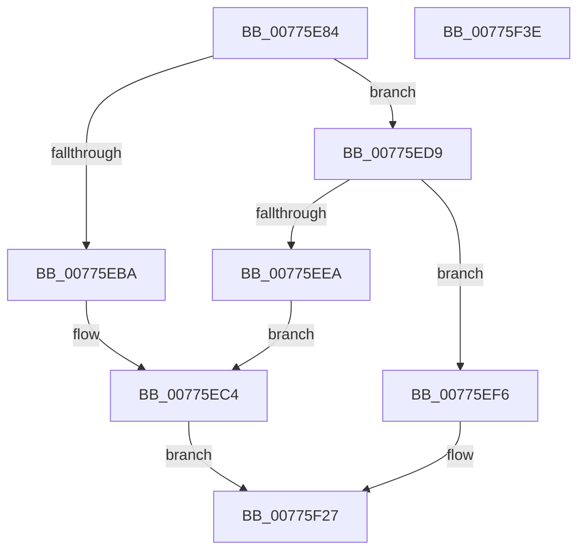

# TtmiSetInputWakeCapability

- RVA: `0x00775E84`–`0x00775F3F` (길이 `187` bytes)
- VA: `0x0000000140775E84`
- 실행 섹션: `PAGE`
- PDB 이름 있음: `예`; PDB Function 태그: `아니요`
- unwind 정보 RVA: `0x00066400`
- 디코드: `51`개 명령, `187/187` bytes 표시
- 미해석 바이트: `0` (있으면 어셈블리에 `.byte`로 보존)

> 이 문서는 커널 이미지의 기계어와 PDB 기호를 분석해 생성했습니다. 4번과 5번은 함수 원형과 자료형을 바이너리 사용 방식에서 추정한 C 해석이며 원본 소스 복구 결과는 아닙니다.

## 1. Dependencies

- 직접 호출 지점: **4**; 고유 호출 대상: **4**
- 직접 호출자로 확인된 함수: **1**
- RIP 상대 이미지 참조: **1**

### Outgoing calls
- `0x00775EB1` → [TtmpFindDeviceByDeviceId](TtmpFindDeviceByDeviceId_function_00776534.md) (function, `0x00776534`)
- `0x00775ED2` → [TtmiLogError](../98/TtmiLogError_function_0098B39C.md) (function, `0x0098B39C`)
- `0x00775EF9` → [TtmiLogDeviceSetInputWakeCapability](TtmiLogDeviceSetInputWakeCapability_function_00779E58.md) (function, `0x00779E58`)
- `0x00775F22` → [TtmiScheduleSessionWorker](TtmiScheduleSessionWorker_function_00777184.md) (function, `0x00777184`)

### Direct callers
- [TtmpDispatchSetInputWakeCapability](TtmpDispatchSetInputWakeCapability_function_00778E2C.md) at `0x00778E91`

### Static image references
- `0x00775EC8` → RVA `0x00B03F60` (` ?? ::NNGAKEGL::`string'`; read)

## 2. Other-region calls and transfers

- 다른 실행 섹션으로 향하는 call: **0**
- 별도 외부 분기/꼬리 이동을 확인하지 못했습니다.

## 3. Assembly (complete function range)

```asm
00775E84  48 8B C4                        mov rax, rsp
00775E87  48 89 58 08                     mov qword ptr [rax + 8], rbx
00775E8B  48 89 68 10                     mov qword ptr [rax + 0x10], rbp
00775E8F  48 89 70 18                     mov qword ptr [rax + 0x18], rsi
00775E93  57                              push rdi
00775E94  48 83 EC 30                     sub rsp, 0x30
00775E98  45 8B D8                        mov r11d, r8d
00775E9B  4C 8B D2                        mov r10, rdx
00775E9E  33 DB                           xor ebx, ebx
00775EA0  4C 8D 40 E8                     lea r8, [rax - 0x18]
00775EA4  41 8B D3                        mov edx, r11d
00775EA7  48 89 58 E8                     mov qword ptr [rax - 0x18], rbx
00775EAB  41 8B F9                        mov edi, r9d
00775EAE  48 8B E9                        mov rbp, rcx
00775EB1  E8 7E 06 00 00                  call 0x140776534
00775EB6  84 C0                           test al, al
00775EB8  75 1F                           jne 0x140775ed9
00775EBA  BB 25 02 00 C0                  mov ebx, 0xc0000225
00775EBF  BA 32 05 00 00                  mov edx, 0x532
00775EC4  41 83 C8 FF                     or r8d, 0xffffffff
00775EC8  48 8D 0D 91 E0 38 00            lea rcx, [rip + 0x38e091]
00775ECF  44 8B CB                        mov r9d, ebx
00775ED2  E8 C5 54 21 00                  call 0x14098b39c
00775ED7  EB 4E                           jmp 0x140775f27
00775ED9  48 8B 74 24 20                  mov rsi, qword ptr [rsp + 0x20]
00775EDE  41 8B 4A 1C                     mov ecx, dword ptr [r10 + 0x1c]
00775EE2  3B 8E 54 02 00 00               cmp ecx, dword ptr [rsi + 0x254]
00775EE8  74 0C                           je 0x140775ef6
00775EEA  BB 0D 00 00 C0                  mov ebx, 0xc000000d
00775EEF  BA 3B 05 00 00                  mov edx, 0x53b
00775EF4  EB CE                           jmp 0x140775ec4
00775EF6  44 8B C7                        mov r8d, edi
00775EF9  E8 5A 3F 00 00                  call 0x140779e58
00775EFE  8B 8E 58 02 00 00               mov ecx, dword ptr [rsi + 0x258]
00775F04  BA 01 00 00 00                  mov edx, 1
00775F09  C1 E7 07                        shl edi, 7
00775F0C  33 F9                           xor edi, ecx
00775F0E  81 E7 80 00 00 00               and edi, 0x80
00775F14  33 F9                           xor edi, ecx
00775F16  48 8B CD                        mov rcx, rbp
00775F19  83 CF 40                        or edi, 0x40
00775F1C  89 BE 58 02 00 00               mov dword ptr [rsi + 0x258], edi
00775F22  E8 5D 12 00 00                  call 0x140777184
00775F27  48 8B 6C 24 48                  mov rbp, qword ptr [rsp + 0x48]
00775F2C  8B C3                           mov eax, ebx
00775F2E  48 8B 5C 24 40                  mov rbx, qword ptr [rsp + 0x40]
00775F33  48 8B 74 24 50                  mov rsi, qword ptr [rsp + 0x50]
00775F38  48 83 C4 30                     add rsp, 0x30
00775F3C  5F                              pop rdi
00775F3D  C3                              ret
00775F3E  CC                              int3
```

## 4. C-style interpretation (structured pseudocode)

```c
__int64 __fastcall TtmiSetInputWakeCapability(__int64 a1, __int64 a2, int a3, int a4)
{
    __int64 result;
    __int64 v_rbx;
    __int64 v_rdi;
    __int64 v_rsp;
    unsigned __int64 v_stack_m18;
    unsigned __int64 v_stack_p10;
    unsigned __int64 v_stack_p18;
    unsigned __int64 v_stack_p8;

    *(unsigned __int64 *)(v_rsp + 8) = v_rbx;
    *(unsigned __int64 *)(v_rsp + 16) = v_rbp;
    *(unsigned __int64 *)(v_rsp + 24) = v_rsi;
    v_rsp = (v_rsp) - (48);
    v_rbx = 0;
    *(unsigned __int64 *)(v_rsp - 24) = 0;
    result = TtmpFindDeviceByDeviceId(a1, (unsigned int)((unsigned int)((unsigned int)(a3))), v_rsp - 24, a4);
    if ((unsigned __int8)(result) != 0) goto loc_00775ED9;
loc_00775EC4:
    a3 = (unsigned int)((v_rsp - 24) | (0xFFFFFFFFULL));
    result = TtmiLogError(v_rip + 3727505, (unsigned int)(0x532ULL), a3, (unsigned int)((unsigned int)((unsigned int)(0xC0000225ULL))));
    goto loc_00775F27;
loc_00775ED9:
    if (((unsigned int)((unsigned int)(*(unsigned int *)(a2 + 28)))) == (*(unsigned int *)(v_stack_m18 + 596))) goto loc_00775EF6;
    goto loc_00775EC4;
loc_00775EF6:
    result = TtmiLogDeviceSetInputWakeCapability((unsigned int)(*(unsigned int *)(a2 + 28)), (unsigned int)(0x53BULL), (unsigned int)((unsigned int)((unsigned int)(a4))), (unsigned int)((unsigned int)((unsigned int)(0xC0000225ULL))));
    v_rdi = (unsigned int)(((unsigned int)(a4)) << (7));
    v_rdi = (unsigned int)((v_rdi) ^ ((unsigned int)((unsigned int)(*(unsigned int *)(v_stack_m18 + 600)))));
    v_rdi = (unsigned int)((v_rdi) & (128));
    v_rdi = (unsigned int)((v_rdi) ^ ((unsigned int)((unsigned int)(*(unsigned int *)(v_stack_m18 + 600)))));
    v_rdi = (unsigned int)((v_rdi) | (64));
    *(unsigned int *)(v_stack_m18 + 600) = (unsigned int)(v_rdi);
    result = TtmiScheduleSessionWorker(a1, 1, (unsigned int)((unsigned int)((unsigned int)(a4))), (unsigned int)((unsigned int)((unsigned int)(0xC0000225ULL))));
loc_00775F27:
    v_rsp = (v_rsp) + (48);
    return (unsigned int)((unsigned int)((unsigned int)(0xC000000DULL)));
}
```

## 5. (Beta) C Style

```c
int64_t TtmiSetInputWakeCapability(int64_t Arg1, int64_t Arg2, int32_t Arg3, int32_t Arg4)
{
    int64_t result;
    int64_t local_rbx;
    int64_t local_rdi;
    int64_t local_rsp;
    uint64_t v_stack_m18;
    uint64_t v_stack_p10;
    uint64_t v_stack_p18;
    uint64_t v_stack_p8;

    *(uint64_t *)(local_rsp + 0x8) = local_rbx;
    *(uint64_t *)(local_rsp + 0x10) = local_rbp;
    *(uint64_t *)(local_rsp + 0x18) = local_rsi;
    local_rsp = (local_rsp) - (48);
    local_rbx = 0;
    *(uint64_t *)(local_rsp - 0x18) = 0;
    result = TtmpFindDeviceByDeviceId(Arg1, (uint32_t)((uint32_t)((uint32_t)(Arg3))), local_rsp - 24, Arg4);
    if ((uint8_t)(result) != 0) goto loc_00775ED9;
loc_00775EC4:
    Arg3 = (uint32_t)((local_rsp - 24) | (0xFFFFFFFFULL));
    result = TtmiLogError(v_rip + 3727505, (uint32_t)(0x532ULL), Arg3, (uint32_t)((uint32_t)((uint32_t)(0xC0000225ULL))));
    goto loc_00775F27;
loc_00775ED9:
    if (((uint32_t)((uint32_t)(*(uint32_t *)(Arg2 + 0x1C)))) == (*(uint32_t *)(v_stack_m18 + 0x254))) goto loc_00775EF6;
    goto loc_00775EC4;
loc_00775EF6:
    result = TtmiLogDeviceSetInputWakeCapability((uint32_t)(*(uint32_t *)(Arg2 + 0x1C)), (uint32_t)(0x53BULL), (uint32_t)((uint32_t)((uint32_t)(Arg4))), (uint32_t)((uint32_t)((uint32_t)(0xC0000225ULL))));
    local_rdi = (uint32_t)(((uint32_t)(Arg4)) << (7));
    local_rdi = (uint32_t)((local_rdi) ^ ((uint32_t)((uint32_t)(*(uint32_t *)(v_stack_m18 + 0x258)))));
    local_rdi = (uint32_t)((local_rdi) & (128));
    local_rdi = (uint32_t)((local_rdi) ^ ((uint32_t)((uint32_t)(*(uint32_t *)(v_stack_m18 + 0x258)))));
    local_rdi = (uint32_t)((local_rdi) | (64));
    *(uint32_t *)(v_stack_m18 + 0x258) = (uint32_t)(local_rdi);
    result = TtmiScheduleSessionWorker(Arg1, 1, (uint32_t)((uint32_t)((uint32_t)(Arg4))), (uint32_t)((uint32_t)((uint32_t)(0xC0000225ULL))));
loc_00775F27:
    local_rsp = (local_rsp) + (48);
    return (uint32_t)((uint32_t)((uint32_t)(0xC000000DULL)));
}
```

## 6. Execution-region graph

[열기: 2D/3D 그래프와 함수 탐색 컨트롤 패널](../../../control-panel.html?section=page&rva=0x00775E84&view=graph)

- 2D 그래프는 위에서 아래로 흐르고, 3D 그래프는 빈 공간을 드래그해 회전합니다. Shift+드래그는 이동, 휠은 확대·축소, 함수 노드 선택은 대상 보고서 이동입니다.

### Static fallback


