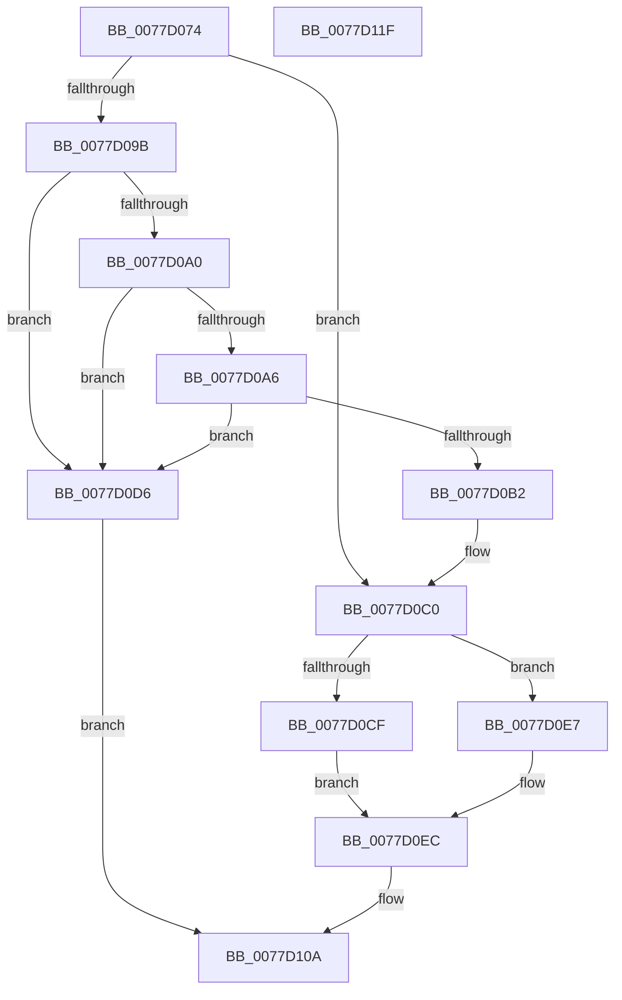

# TtmiSetPendingOnOffRequest

- RVA: `0x0077D074`–`0x0077D120` (길이 `172` bytes)
- VA: `0x000000014077D074`
- 실행 섹션: `PAGE`
- PDB 이름 있음: `예`; PDB Function 태그: `아니요`
- unwind 정보 RVA: `0x0005C954`
- 디코드: `53`개 명령, `172/172` bytes 표시
- 미해석 바이트: `0` (있으면 어셈블리에 `.byte`로 보존)

> 이 문서는 커널 이미지의 기계어와 PDB 기호를 분석해 생성했습니다. 4번과 5번은 함수 원형과 자료형을 바이너리 사용 방식에서 추정한 C 해석이며 원본 소스 복구 결과는 아닙니다.

## 1. Dependencies

- 직접 호출 지점: **6**; 고유 호출 대상: **6**
- 직접 호출자로 확인된 함수: **4**
- RIP 상대 이미지 참조: **0**

### Outgoing calls
- `0x0077D0A9` → [TtmpShouldEscapeProximity](TtmpShouldEscapeProximity_function_0077D5F4.md) (function, `0x0077D5F4`)
- `0x0077D0BB` → [TtmpExitProximity](TtmpExitProximity_function_0077D438.md) (function, `0x0077D438`)
- `0x0077D0CF` → [TtmiLogTerminalOffRequest](TtmiLogTerminalOffRequest_function_0077C02C.md) (function, `0x0077C02C`)
- `0x0077D0E0` → [TtmiLogProximityBlockedRequest](TtmiLogProximityBlockedRequest_function_0077A6D0.md) (function, `0x0077A6D0`)
- `0x0077D0E7` → [TtmiLogTerminalOnRequest](TtmiLogTerminalOnRequest_function_0077C144.md) (function, `0x0077C144`)
- `0x0077D105` → [TtmiScheduleSessionWorker](TtmiScheduleSessionWorker_function_00777184.md) (function, `0x00777184`)

### Direct callers
- [TtmiSetDisplayPowerRequest](TtmiSetDisplayPowerRequest_function_0077727C.md) at `0x0077735D`
- [TtmpDispatchSetDisplayState](TtmpDispatchSetDisplayState_function_00778CBC.md) at `0x00778D29`
- [TtmiResetTerminalTimeouts](TtmiResetTerminalTimeouts_function_0077CD90.md) at `0x0077CDEA`
- [TtmiTerminalMonitorControl](TtmiTerminalMonitorControl_function_0077D128.md) at `0x0077D192`

### Static image references
- 디코드된 RIP-relative 메모리 참조가 없습니다.

## 2. Other-region calls and transfers

- 다른 실행 섹션으로 향하는 call: **0**
- 별도 외부 분기/꼬리 이동을 확인하지 못했습니다.

## 3. Assembly (complete function range)

```asm
0077D074  48 89 5C 24 08                  mov qword ptr [rsp + 8], rbx
0077D079  48 89 6C 24 10                  mov qword ptr [rsp + 0x10], rbp
0077D07E  48 89 74 24 18                  mov qword ptr [rsp + 0x18], rsi
0077D083  57                              push rdi
0077D084  48 83 EC 20                     sub rsp, 0x20
0077D088  8B 42 24                        mov eax, dword ptr [rdx + 0x24]
0077D08B  41 8B F1                        mov esi, r9d
0077D08E  41 8A F8                        mov dil, r8b
0077D091  48 8B DA                        mov rbx, rdx
0077D094  48 8B E9                        mov rbp, rcx
0077D097  A8 08                           test al, 8
0077D099  74 25                           je 0x14077d0c0
0077D09B  45 84 C0                        test r8b, r8b
0077D09E  74 36                           je 0x14077d0d6
0077D0A0  41 83 F9 01                     cmp r9d, 1
0077D0A4  75 30                           jne 0x14077d0d6
0077D0A6  48 8B CA                        mov rcx, rdx
0077D0A9  E8 46 05 00 00                  call 0x14077d5f4
0077D0AE  84 C0                           test al, al
0077D0B0  74 24                           je 0x14077d0d6
0077D0B2  44 8A C6                        mov r8b, sil
0077D0B5  48 8B D3                        mov rdx, rbx
0077D0B8  48 8B CD                        mov rcx, rbp
0077D0BB  E8 78 03 00 00                  call 0x14077d438
0077D0C0  8B 4B 1C                        mov ecx, dword ptr [rbx + 0x1c]
0077D0C3  8B D6                           mov edx, esi
0077D0C5  44 8B 44 24 50                  mov r8d, dword ptr [rsp + 0x50]
0077D0CA  40 84 FF                        test dil, dil
0077D0CD  75 18                           jne 0x14077d0e7
0077D0CF  E8 58 EF FF FF                  call 0x14077c02c
0077D0D4  EB 16                           jmp 0x14077d0ec
0077D0D6  44 8B 44 24 50                  mov r8d, dword ptr [rsp + 0x50]
0077D0DB  8B D6                           mov edx, esi
0077D0DD  40 8A CF                        mov cl, dil
0077D0E0  E8 EB D5 FF FF                  call 0x14077a6d0
0077D0E5  EB 23                           jmp 0x14077d10a
0077D0E7  E8 58 F0 FF FF                  call 0x14077c144
0077D0EC  40 F6 DF                        neg dil
0077D0EF  89 73 38                        mov dword ptr [rbx + 0x38], esi
0077D0F2  BA 02 00 00 00                  mov edx, 2
0077D0F7  48 8B CD                        mov rcx, rbp
0077D0FA  1B C0                           sbb eax, eax
0077D0FC  83 4B 24 04                     or dword ptr [rbx + 0x24], 4
0077D100  03 C2                           add eax, edx
0077D102  89 43 34                        mov dword ptr [rbx + 0x34], eax
0077D105  E8 7A A0 FF FF                  call 0x140777184
0077D10A  48 8B 5C 24 30                  mov rbx, qword ptr [rsp + 0x30]
0077D10F  48 8B 6C 24 38                  mov rbp, qword ptr [rsp + 0x38]
0077D114  48 8B 74 24 40                  mov rsi, qword ptr [rsp + 0x40]
0077D119  48 83 C4 20                     add rsp, 0x20
0077D11D  5F                              pop rdi
0077D11E  C3                              ret
0077D11F  CC                              int3
```

## 4. C-style interpretation (structured pseudocode)

```c
__int64 __fastcall TtmiSetPendingOnOffRequest(__int64 a1, __int64 a2, unsigned __int8 a3, int a4, unsigned int a5)
{
    __int64 result;
    __int64 v_rdi;
    __int64 v_rsp;
    unsigned __int64 v_stack_p10;
    unsigned __int64 v_stack_p18;
    unsigned __int64 v_stack_p8;

    v_stack_p8 = v_rbx;
    v_stack_p10 = v_rbp;
    v_stack_p18 = v_rsi;
    v_rsp = (v_rsp) - (32);
    if ((((unsigned __int8)((unsigned int)(*(unsigned int *)(a2 + 36)))) & (8)) == 0) goto loc_0077D0C0;
    if (a3 == 0) goto loc_0077D0D6;
    if (a4 != 1) goto loc_0077D0D6;
    result = TtmpShouldEscapeProximity(a2, a2, a3, a4);
    if ((unsigned __int8)(result) == 0) goto loc_0077D0D6;
    result = TtmpExitProximity(a1, a2, (unsigned __int8)((unsigned int)(a4)), a4);
loc_0077D0C0:
    if (a3 != 0) goto loc_0077D0E7;
    result = TtmiLogTerminalOffRequest((unsigned int)(*(unsigned int *)(a2 + 28)), (unsigned int)((unsigned int)((unsigned int)(a4))), (unsigned int)(a5), a4);
    goto loc_0077D0EC;
loc_0077D0D6:
    result = TtmiLogProximityBlockedRequest(a3, (unsigned int)((unsigned int)((unsigned int)(a4))), (unsigned int)(a5), a4);
    goto loc_0077D10A;
loc_0077D0E7:
    result = TtmiLogTerminalOnRequest(a3, (unsigned int)((unsigned int)((unsigned int)(a4))), (unsigned int)(a5), a4);
loc_0077D0EC:
    v_rdi = (unsigned __int8)(-(a3));
    *(unsigned int *)(a2 + 56) = (unsigned int)((unsigned int)(a4));
    result = (unsigned int)((result) + (2));
    *(unsigned int *)(a2 + 52) = (unsigned int)(result);
    result = TtmiScheduleSessionWorker(a1, 2, (unsigned int)(a5), a4);
loc_0077D10A:
    v_rsp = (v_rsp) + (32);
    return result;
}
```

## 5. (Beta) C Style

```c
int64_t TtmiSetPendingOnOffRequest(int64_t Arg1, void *Arg2, uint8_t Arg3, int32_t Arg4, uint32_t Arg5)
{
    uint8_t *arg2 = (uint8_t *)Arg2;

    int64_t result;
    int64_t local_rdi;
    int64_t local_rsp;
    uint64_t v_stack_p10;
    uint64_t v_stack_p18;
    uint64_t v_stack_p8;

    v_stack_p8 = local_rbx;
    v_stack_p10 = local_rbp;
    v_stack_p18 = local_rsi;
    local_rsp = (local_rsp) - (32);
    if ((((uint8_t)((uint32_t)(*(uint32_t *)(arg2 + 0x24)))) & (8)) == 0) goto loc_0077D0C0;
    if (Arg3 == 0) goto loc_0077D0D6;
    if (Arg4 != 1) goto loc_0077D0D6;
    result = TtmpShouldEscapeProximity(Arg2, Arg2, Arg3, Arg4);
    if ((uint8_t)(result) == 0) goto loc_0077D0D6;
    result = TtmpExitProximity(Arg1, Arg2, (uint8_t)((uint32_t)(Arg4)), Arg4);
loc_0077D0C0:
    if (Arg3 != 0) goto loc_0077D0E7;
    result = TtmiLogTerminalOffRequest((uint32_t)(*(uint32_t *)(arg2 + 0x1C)), (uint32_t)((uint32_t)((uint32_t)(Arg4))), (uint32_t)(Arg5), Arg4);
    goto loc_0077D0EC;
loc_0077D0D6:
    result = TtmiLogProximityBlockedRequest(Arg3, (uint32_t)((uint32_t)((uint32_t)(Arg4))), (uint32_t)(Arg5), Arg4);
    goto loc_0077D10A;
loc_0077D0E7:
    result = TtmiLogTerminalOnRequest(Arg3, (uint32_t)((uint32_t)((uint32_t)(Arg4))), (uint32_t)(Arg5), Arg4);
loc_0077D0EC:
    local_rdi = (uint8_t)(-(Arg3));
    *(uint32_t *)(arg2 + 0x38) = (uint32_t)((uint32_t)(Arg4));
    result = (uint32_t)((result) + (2));
    *(uint32_t *)(arg2 + 0x34) = (uint32_t)(result);
    result = TtmiScheduleSessionWorker(Arg1, 2, (uint32_t)(Arg5), Arg4);
loc_0077D10A:
    local_rsp = (local_rsp) + (32);
    return result;
}
```

### 관측된 메모리 오프셋

구조체 형식이 확인되지 않은 접근은 인자 기준의 오프셋으로만 기록했습니다.

| 기준 인자 | 오프셋 표현 | 폭 (bit) | 접근 |
|---|---:|---:|---|
| `Arg2` | `+ 0x1C` | `32` | `R` |
| `Arg2` | `+ 0x24` | `32` | `R` |
| `Arg2` | `+ 0x24` | `32` | `R/W` |
| `Arg2` | `+ 0x34` | `32` | `W` |
| `Arg2` | `+ 0x38` | `32` | `W` |

## 6. Execution-region graph

[열기: 2D/3D 그래프와 함수 탐색 컨트롤 패널](../../../control-panel.html?section=page&rva=0x0077D074&view=graph)

- 2D 그래프는 위에서 아래로 흐르고, 3D 그래프는 빈 공간을 드래그해 회전합니다. Shift+드래그는 이동, 휠은 확대·축소, 함수 노드 선택은 대상 보고서 이동입니다.

### Static fallback


