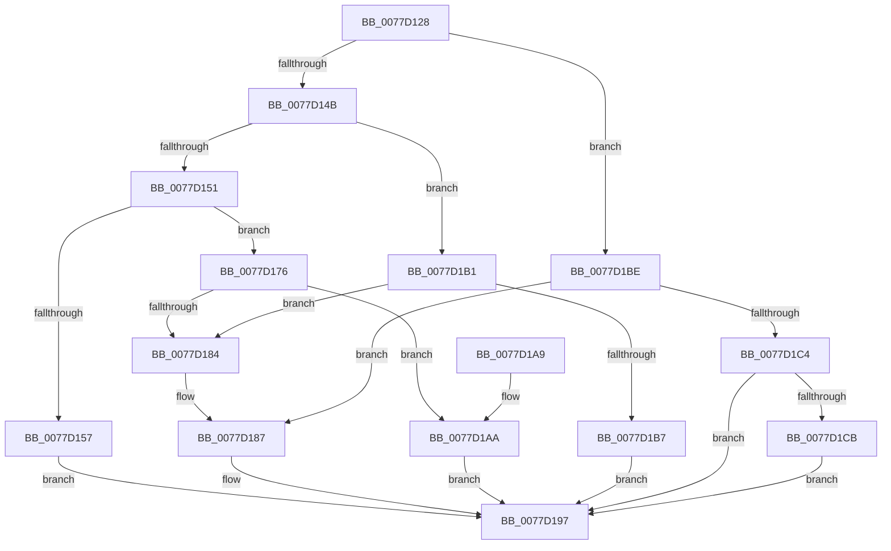

# TtmiTerminalMonitorControl

- RVA: `0x0077D128`–`0x0077D1FD` (길이 `213` bytes)
- VA: `0x000000014077D128`
- 실행 섹션: `PAGE`
- PDB 이름 있음: `예`; PDB Function 태그: `아니요`
- unwind 정보 RVA: `0x000CDE74`
- 디코드: `59`개 명령, `213/213` bytes 표시
- 미해석 바이트: `0` (있으면 어셈블리에 `.byte`로 보존)

> 이 문서는 커널 이미지의 기계어와 PDB 기호를 분석해 생성했습니다. 4번과 5번은 함수 원형과 자료형을 바이너리 사용 방식에서 추정한 C 해석이며 원본 소스 복구 결과는 아닙니다.

## 1. Dependencies

- 직접 호출 지점: **5**; 고유 호출 대상: **5**
- 직접 호출자로 확인된 함수: **1**
- RIP 상대 이미지 참조: **1**

### Outgoing calls
- `0x0077D16F` → [TtmiLogError](../98/TtmiLogError_function_0098B39C.md) (function, `0x0098B39C`)
- `0x0077D192` → [TtmiSetPendingOnOffRequest](TtmiSetPendingOnOffRequest_function_0077D074.md) (function, `0x0077D074`)
- `0x0077D1B7` → [TtmpExitProximity](TtmpExitProximity_function_0077D438.md) (function, `0x0077D438`)
- `0x0077D1E5` → [TtmiLogEnterProximity](TtmiLogEnterProximity_function_0077A188.md) (function, `0x0077A188`)
- `0x0077D1F6` → [TtmiScheduleSessionWorker](TtmiScheduleSessionWorker_function_00777184.md) (function, `0x00777184`)

### Direct callers
- [TtmSessionMonitorControl](../98/TtmSessionMonitorControl_function_0098B174.md) at `0x0098B1BE`

### Static image references
- `0x0077D15C` → RVA `0x00B04630` (` ?? ::NNGAKEGL::`string'`; read)

## 2. Other-region calls and transfers

- 다른 실행 섹션으로 향하는 call: **0**
- 별도 외부 분기/꼬리 이동을 확인하지 못했습니다.

## 3. Assembly (complete function range)

```asm
0077D128  48 89 5C 24 08                  mov qword ptr [rsp + 8], rbx
0077D12D  48 89 74 24 10                  mov qword ptr [rsp + 0x10], rsi
0077D132  57                              push rdi
0077D133  48 83 EC 30                     sub rsp, 0x30
0077D137  45 8B D0                        mov r10d, r8d
0077D13A  48 8B DA                        mov rbx, rdx
0077D13D  45 33 C0                        xor r8d, r8d
0077D140  48 8B F1                        mov rsi, rcx
0077D143  41 8B F8                        mov edi, r8d
0077D146  45 85 C9                        test r9d, r9d
0077D149  74 73                           je 0x14077d1be
0077D14B  41 83 E9 01                     sub r9d, 1
0077D14F  74 60                           je 0x14077d1b1
0077D151  41 83 F9 01                     cmp r9d, 1
0077D155  74 1F                           je 0x14077d176
0077D157  BF 0D 00 00 C0                  mov edi, 0xc000000d
0077D15C  48 8D 0D CD 74 38 00            lea rcx, [rip + 0x3874cd]
0077D163  44 8B CF                        mov r9d, edi
0077D166  41 83 C8 FF                     or r8d, 0xffffffff
0077D16A  BA DA 05 00 00                  mov edx, 0x5da
0077D16F  E8 28 E2 20 00                  call 0x14098b39c
0077D174  EB 21                           jmp 0x14077d197
0077D176  8B 82 14 01 00 00               mov eax, dword ptr [rdx + 0x114]
0077D17C  83 E8 02                        sub eax, 2
0077D17F  83 F8 01                        cmp eax, 1
0077D182  76 26                           jbe 0x14077d1aa
0077D184  41 B0 01                        mov r8b, 1
0077D187  45 8B CA                        mov r9d, r10d
0077D18A  C7 44 24 20 53 65 4D 43         mov dword ptr [rsp + 0x20], 0x434d6553
0077D192  E8 DD FE FF FF                  call 0x14077d074
0077D197  48 8B 5C 24 40                  mov rbx, qword ptr [rsp + 0x40]
0077D19C  8B C7                           mov eax, edi
0077D19E  48 8B 74 24 48                  mov rsi, qword ptr [rsp + 0x48]
0077D1A3  48 83 C4 30                     add rsp, 0x30
0077D1A7  5F                              pop rdi
0077D1A8  C3                              ret
0077D1A9  CC                              int3
0077D1AA  BF FF 00 00 00                  mov edi, 0xff
0077D1AF  EB E6                           jmp 0x14077d197
0077D1B1  41 83 FA 16                     cmp r10d, 0x16
0077D1B5  75 CD                           jne 0x14077d184
0077D1B7  E8 7C 02 00 00                  call 0x14077d438
0077D1BC  EB D9                           jmp 0x14077d197
0077D1BE  41 83 FA 16                     cmp r10d, 0x16
0077D1C2  75 C3                           jne 0x14077d187
0077D1C4  8B 42 24                        mov eax, dword ptr [rdx + 0x24]
0077D1C7  A8 08                           test al, 8
0077D1C9  75 CC                           jne 0x14077d197
0077D1CB  FF 82 0C 01 00 00               inc dword ptr [rdx + 0x10c]
0077D1D1  83 C8 08                        or eax, 8
0077D1D4  8B 8A 0C 01 00 00               mov ecx, dword ptr [rdx + 0x10c]
0077D1DA  48 83 8A 00 01 00 00 FF         or qword ptr [rdx + 0x100], 0xffffffffffffffff
0077D1E2  89 42 24                        mov dword ptr [rdx + 0x24], eax
0077D1E5  E8 9E CF FF FF                  call 0x14077a188
0077D1EA  83 4B 24 04                     or dword ptr [rbx + 0x24], 4
0077D1EE  BA 02 00 00 00                  mov edx, 2
0077D1F3  48 8B CE                        mov rcx, rsi
0077D1F6  E8 89 9F FF FF                  call 0x140777184
0077D1FB  EB 9A                           jmp 0x14077d197
```

## 4. C-style interpretation (structured pseudocode)

```c
__int64 __fastcall TtmiTerminalMonitorControl(__int64 a1, __int64 a2, int a3, int a4)
{
    __int64 result;
    __int64 v_rsp;
    unsigned int v_stack_m18;
    unsigned __int64 v_stack_p10;
    unsigned __int64 v_stack_p8;

    v_stack_p8 = v_rbx;
    v_stack_p10 = v_rsi;
    v_rsp = (v_rsp) - (48);
    a3 = 0;
    if (a4 == 0) goto loc_0077D1BE;
    a4 = (unsigned int)((a4) - (1));
    if (condition_is_equal) goto loc_0077D1B1;
    if (a4 == 1) goto loc_0077D176;
    a3 = (unsigned int)((a3) | (0xFFFFFFFFULL));
    result = TtmiLogError(v_rip + 3699917, (unsigned int)(0x5DAULL), a3, (unsigned int)((unsigned int)((unsigned int)(0xC000000DULL))));
    goto loc_0077D197;
loc_0077D176:
    result = (unsigned int)(((unsigned int)(*(unsigned int *)((unsigned int)(0x5DAULL) + 276))) - (2));
    if (((unsigned int)(result)) <= 1) goto loc_0077D1AA;
loc_0077D184:
loc_0077D187:
    v_stack_m18 = 0x434D6553ULL;
    result = TtmiSetPendingOnOffRequest(v_rip + 3699917, (unsigned int)(0x5DAULL), 1, (unsigned int)((unsigned int)((unsigned int)(a3))));
loc_0077D197:
    v_rsp = (v_rsp) + (48);
    return (unsigned int)((unsigned int)((unsigned int)(0xC000000DULL)));
loc_0077D1AA:
    goto loc_0077D197;
loc_0077D1B1:
    if (((unsigned int)((unsigned int)(a3))) != 22) goto loc_0077D184;
    result = TtmpExitProximity(v_rip + 3699917, (unsigned int)(0x5DAULL), 1, (unsigned int)((unsigned int)((unsigned int)(a3))));
    goto loc_0077D197;
loc_0077D1BE:
    if (((unsigned int)((unsigned int)(a3))) != 22) goto loc_0077D187;
    if ((((unsigned __int8)((unsigned int)(*(unsigned int *)((unsigned int)(0x5DAULL) + 36)))) & (8)) != 0) goto loc_0077D197;
    result = (unsigned int)(((unsigned int)(*(unsigned int *)((unsigned int)(0x5DAULL) + 36))) | (8));
    *(unsigned int *)((unsigned int)(0x5DAULL) + 36) = (unsigned int)(result);
    result = TtmiLogEnterProximity((unsigned int)(*(unsigned int *)((unsigned int)(0x5DAULL) + 268)), (unsigned int)(0x5DAULL), 1, (unsigned int)((unsigned int)((unsigned int)(a3))));
    result = TtmiScheduleSessionWorker(v_stack_p10, 2, 1, (unsigned int)((unsigned int)((unsigned int)(a3))));
    goto loc_0077D197;
}
```

## 5. (Beta) C Style

```c
int64_t TtmiTerminalMonitorControl(int64_t Arg1, void *Arg2, int32_t Arg3, int32_t Arg4)
{
    uint8_t *arg2 = (uint8_t *)Arg2;

    int64_t result;
    int64_t local_rsp;
    uint32_t v_stack_m18;
    uint64_t v_stack_p10;
    uint64_t v_stack_p8;

    v_stack_p8 = local_rbx;
    v_stack_p10 = local_rsi;
    local_rsp = (local_rsp) - (48);
    Arg3 = 0;
    if (Arg4 == 0) goto loc_0077D1BE;
    Arg4 = (uint32_t)((Arg4) - (1));
    if (condition_is_equal) goto loc_0077D1B1;
    if (Arg4 == 1) goto loc_0077D176;
    Arg3 = (uint32_t)((Arg3) | (0xFFFFFFFFULL));
    result = TtmiLogError(v_rip + 3699917, (uint32_t)(0x5DAULL), Arg3, (uint32_t)((uint32_t)((uint32_t)(0xC000000DULL))));
    goto loc_0077D197;
loc_0077D176:
    result = (uint32_t)(((uint32_t)(*(uint32_t *)((uint32_t)(0x5DAULL) + 0x114))) - (2));
    if (((uint32_t)(result)) <= 1) goto loc_0077D1AA;
loc_0077D184:
loc_0077D187:
    v_stack_m18 = 0x434D6553ULL;
    result = TtmiSetPendingOnOffRequest(v_rip + 3699917, (uint32_t)(0x5DAULL), 1, (uint32_t)((uint32_t)((uint32_t)(Arg3))));
loc_0077D197:
    local_rsp = (local_rsp) + (48);
    return (uint32_t)((uint32_t)((uint32_t)(0xC000000DULL)));
loc_0077D1AA:
    goto loc_0077D197;
loc_0077D1B1:
    if (((uint32_t)((uint32_t)(Arg3))) != 22) goto loc_0077D184;
    result = TtmpExitProximity(v_rip + 3699917, (uint32_t)(0x5DAULL), 1, (uint32_t)((uint32_t)((uint32_t)(Arg3))));
    goto loc_0077D197;
loc_0077D1BE:
    if (((uint32_t)((uint32_t)(Arg3))) != 22) goto loc_0077D187;
    if ((((uint8_t)((uint32_t)(*(uint32_t *)((uint32_t)(0x5DAULL) + 0x24)))) & (8)) != 0) goto loc_0077D197;
    result = (uint32_t)(((uint32_t)(*(uint32_t *)((uint32_t)(0x5DAULL) + 0x24))) | (8));
    *(uint32_t *)((uint32_t)(0x5DAULL) + 0x24) = (uint32_t)(result);
    result = TtmiLogEnterProximity((uint32_t)(*(uint32_t *)((uint32_t)(0x5DAULL) + 0x10C)), (uint32_t)(0x5DAULL), 1, (uint32_t)((uint32_t)((uint32_t)(Arg3))));
    result = TtmiScheduleSessionWorker(v_stack_p10, 2, 1, (uint32_t)((uint32_t)((uint32_t)(Arg3))));
    goto loc_0077D197;
}
```

### 관측된 메모리 오프셋

구조체 형식이 확인되지 않은 접근은 인자 기준의 오프셋으로만 기록했습니다.

| 기준 인자 | 오프셋 표현 | 폭 (bit) | 접근 |
|---|---:|---:|---|
| `Arg2` | `+ 0x24` | `32` | `R` |
| `Arg2` | `+ 0x24` | `32` | `R/W` |
| `Arg2` | `+ 0x24` | `32` | `W` |
| `Arg2` | `+ 0x100` | `64` | `R/W` |
| `Arg2` | `+ 0x10C` | `32` | `R` |
| `Arg2` | `+ 0x10C` | `32` | `R/W` |
| `Arg2` | `+ 0x114` | `32` | `R` |

## 6. Execution-region graph

[열기: 2D/3D 그래프와 함수 탐색 컨트롤 패널](../../../control-panel.html?section=page&rva=0x0077D128&view=graph)

- 2D 그래프는 위에서 아래로 흐르고, 3D 그래프는 빈 공간을 드래그해 회전합니다. Shift+드래그는 이동, 휠은 확대·축소, 함수 노드 선택은 대상 보고서 이동입니다.

### Static fallback


