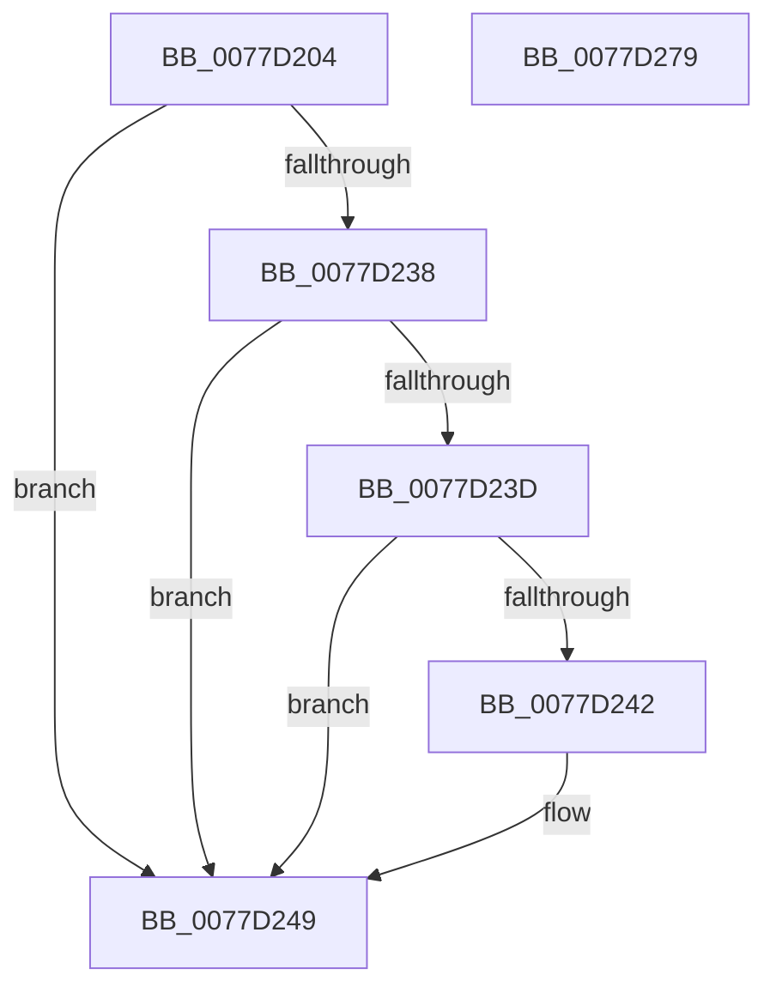

# TtmiTerminalSetDisplayTimeouts

- RVA: `0x0077D204`–`0x0077D27A` (길이 `118` bytes)
- VA: `0x000000014077D204`
- 실행 섹션: `PAGE`
- PDB 이름 있음: `예`; PDB Function 태그: `아니요`
- unwind 정보 RVA: `0x0006E5F8`
- 디코드: `34`개 명령, `118/118` bytes 표시
- 미해석 바이트: `0` (있으면 어셈블리에 `.byte`로 보존)

> 이 문서는 커널 이미지의 기계어와 PDB 기호를 분석해 생성했습니다. 4번과 5번은 함수 원형과 자료형을 바이너리 사용 방식에서 추정한 C 해석이며 원본 소스 복구 결과는 아닙니다.

## 1. Dependencies

- 직접 호출 지점: **2**; 고유 호출 대상: **2**
- 직접 호출자로 확인된 함수: **2**
- RIP 상대 이미지 참조: **0**

### Outgoing calls
- `0x0077D258` → [TtmiLogTerminalDisplayTimeouts](TtmiLogTerminalDisplayTimeouts_function_0077BD64.md) (function, `0x0077BD64`)
- `0x0077D269` → [TtmiScheduleSessionWorker](TtmiScheduleSessionWorker_function_00777184.md) (function, `0x00777184`)

### Direct callers
- [TtmpTerminal0PowerSettingCallback](TtmpTerminal0PowerSettingCallback_function_00778250.md) at `0x007782CD`
- [TtmpDispatchSetDisplayTimeouts](TtmpDispatchSetDisplayTimeouts_function_00778D70.md) at `0x00778DEA`

### Static image references
- 디코드된 RIP-relative 메모리 참조가 없습니다.

## 2. Other-region calls and transfers

- 다른 실행 섹션으로 향하는 call: **0**
- 별도 외부 분기/꼬리 이동을 확인하지 못했습니다.

## 3. Assembly (complete function range)

```asm
0077D204  48 89 5C 24 08                  mov qword ptr [rsp + 8], rbx
0077D209  57                              push rdi
0077D20A  48 83 EC 30                     sub rsp, 0x30
0077D20E  48 8B DA                        mov rbx, rdx
0077D211  41 8B C1                        mov eax, r9d
0077D214  48 69 D0 80 96 98 00            imul rdx, rax, 0x989680
0077D21B  41 8B C0                        mov eax, r8d
0077D21E  48 8B F9                        mov rdi, rcx
0077D221  4C 69 D0 80 96 98 00            imul r10, rax, 0x989680
0077D228  48 89 53 48                     mov qword ptr [rbx + 0x48], rdx
0077D22C  4C 89 53 40                     mov qword ptr [rbx + 0x40], r10
0077D230  49 8B C2                        mov rax, r10
0077D233  4D 85 D2                        test r10, r10
0077D236  74 11                           je 0x14077d249
0077D238  48 85 D2                        test rdx, rdx
0077D23B  74 0C                           je 0x14077d249
0077D23D  4C 3B D2                        cmp r10, rdx
0077D240  72 07                           jb 0x14077d249
0077D242  48 83 63 40 00                  and qword ptr [rbx + 0x40], 0
0077D247  33 C0                           xor eax, eax
0077D249  8B 09                           mov ecx, dword ptr [rcx]
0077D24B  48 89 54 24 28                  mov qword ptr [rsp + 0x28], rdx
0077D250  8B 53 1C                        mov edx, dword ptr [rbx + 0x1c]
0077D253  48 89 44 24 20                  mov qword ptr [rsp + 0x20], rax
0077D258  E8 07 EB FF FF                  call 0x14077bd64
0077D25D  83 4B 24 04                     or dword ptr [rbx + 0x24], 4
0077D261  BA 02 00 00 00                  mov edx, 2
0077D266  48 8B CF                        mov rcx, rdi
0077D269  E8 16 9F FF FF                  call 0x140777184
0077D26E  48 8B 5C 24 40                  mov rbx, qword ptr [rsp + 0x40]
0077D273  48 83 C4 30                     add rsp, 0x30
0077D277  5F                              pop rdi
0077D278  C3                              ret
0077D279  CC                              int3
```

## 4. C-style interpretation (structured pseudocode)

```c
__int64 __fastcall TtmiTerminalSetDisplayTimeouts(__int64 a1, __int64 a2, int a3, int a4)
{
    __int64 result;
    __int64 v_r10;
    __int64 v_rsp;
    unsigned __int64 v_stack_m10;
    unsigned __int64 v_stack_m18;
    unsigned __int64 v_stack_p8;

    v_stack_p8 = v_rbx;
    v_rsp = (v_rsp) - (48);
    a2 = (a2) * ((unsigned int)(a4));
    v_r10 = (v_r10) * ((unsigned int)(a3));
    *(unsigned __int64 *)(a2 + 72) = a2;
    *(unsigned __int64 *)(a2 + 64) = v_r10;
    if (v_r10 == 0) goto loc_0077D249;
    if (a2 == 0) goto loc_0077D249;
    result = v_r10;
    if (v_r10 >= a2) {
        result = 0;
    }
    v_stack_m10 = a2;
    v_stack_m18 = 0;
    result = TtmiLogTerminalDisplayTimeouts((unsigned int)(*(unsigned int *)(a1)), (unsigned int)(*(unsigned int *)(a2 + 28)), a3, a4);
    result = TtmiScheduleSessionWorker(a1, 2, a3, a4);
    v_rsp = (v_rsp) + (48);
    return result;
}
```

## 5. (Beta) C Style

```c
int64_t TtmiTerminalSetDisplayTimeouts(void *Arg1, void *Arg2, int32_t Arg3, int32_t Arg4)
{
    uint8_t *arg1 = (uint8_t *)Arg1;
    uint8_t *arg2 = (uint8_t *)Arg2;

    int64_t result;
    int64_t local_r10;
    int64_t local_rsp;
    uint64_t v_stack_m10;
    uint64_t v_stack_m18;
    uint64_t v_stack_p8;

    v_stack_p8 = local_rbx;
    local_rsp = (local_rsp) - (48);
    Arg2 = (Arg2) * ((uint32_t)(Arg4));
    local_r10 = (local_r10) * ((uint32_t)(Arg3));
    *(void **)(arg2 + 0x48) = Arg2;
    *(uint64_t *)(arg2 + 0x40) = local_r10;
    if (local_r10 == 0) goto loc_0077D249;
    if (Arg2 == NULL) goto loc_0077D249;
    result = local_r10;
    if (local_r10 >= Arg2) {
        result = 0;
    }
    v_stack_m10 = Arg2;
    v_stack_m18 = 0;
    result = TtmiLogTerminalDisplayTimeouts((uint32_t)(*(uint32_t *)(arg1)), (uint32_t)(*(uint32_t *)(arg2 + 0x1C)), Arg3, Arg4);
    result = TtmiScheduleSessionWorker(Arg1, 2, Arg3, Arg4);
    local_rsp = (local_rsp) + (48);
    return result;
}
```

### 관측된 메모리 오프셋

구조체 형식이 확인되지 않은 접근은 인자 기준의 오프셋으로만 기록했습니다.

| 기준 인자 | 오프셋 표현 | 폭 (bit) | 접근 |
|---|---:|---:|---|
| `Arg1` | `+ 0x0` | `32` | `R` |
| `Arg2` | `+ 0x1C` | `32` | `R` |
| `Arg2` | `+ 0x24` | `32` | `R/W` |
| `Arg2` | `+ 0x40` | `64` | `R/W` |
| `Arg2` | `+ 0x40` | `64` | `W` |
| `Arg2` | `+ 0x48` | `64` | `W` |

## 6. Execution-region graph

[열기: 2D/3D 그래프와 함수 탐색 컨트롤 패널](../../../control-panel.html?section=page&rva=0x0077D204&view=graph)

- 2D 그래프는 위에서 아래로 흐르고, 3D 그래프는 빈 공간을 드래그해 회전합니다. Shift+드래그는 이동, 휠은 확대·축소, 함수 노드 선택은 대상 보고서 이동입니다.

### Static fallback


