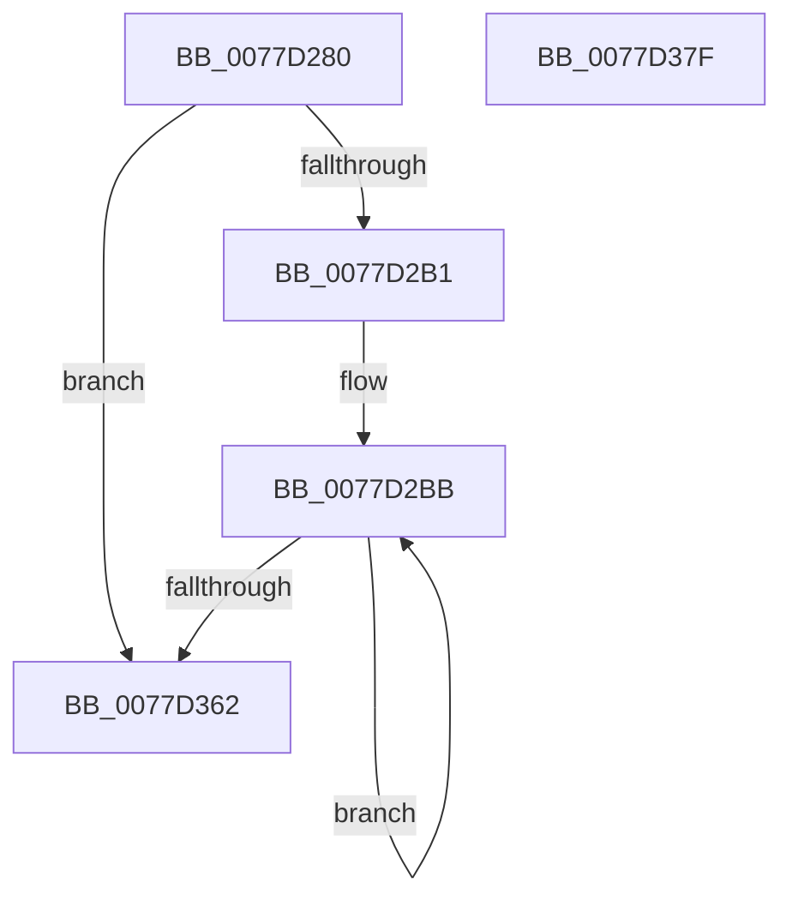

# TtmiTerminalsRundown

- RVA: `0x0077D280`–`0x0077D380` (길이 `256` bytes)
- VA: `0x000000014077D280`
- 실행 섹션: `PAGE`
- PDB 이름 있음: `예`; PDB Function 태그: `아니요`
- unwind 정보 RVA: `0x000BDF9C`
- 디코드: `68`개 명령, `256/256` bytes 표시
- 미해석 바이트: `0` (있으면 어셈블리에 `.byte`로 보존)

> 이 문서는 커널 이미지의 기계어와 PDB 기호를 분석해 생성했습니다. 4번과 5번은 함수 원형과 자료형을 바이너리 사용 방식에서 추정한 C 해석이며 원본 소스 복구 결과는 아닙니다.

## 1. Dependencies

- 직접 호출 지점: **1**; 고유 호출 대상: **1**
- 직접 호출자로 확인된 함수: **1**
- RIP 상대 이미지 참조: **0**

### Outgoing calls
- `0x0077D351` → [TtmiLogTerminalRundown](TtmiLogTerminalRundown_function_0077C25C.md) (function, `0x0077C25C`)

### Direct callers
- [TtmiSessionsRundown](TtmiSessionsRundown_function_007771BC.md) at `0x00777246`

### Static image references
- 디코드된 RIP-relative 메모리 참조가 없습니다.

## 2. Other-region calls and transfers

- 다른 실행 섹션으로 향하는 call: **0**
- 별도 외부 분기/꼬리 이동을 확인하지 못했습니다.

## 3. Assembly (complete function range)

```asm
0077D280  48 8B C4                        mov rax, rsp
0077D283  48 89 58 08                     mov qword ptr [rax + 8], rbx
0077D287  48 89 70 10                     mov qword ptr [rax + 0x10], rsi
0077D28B  48 89 78 18                     mov qword ptr [rax + 0x18], rdi
0077D28F  4C 89 70 20                     mov qword ptr [rax + 0x20], r14
0077D293  55                              push rbp
0077D294  48 8B EC                        mov rbp, rsp
0077D297  48 81 EC 80 00 00 00            sub rsp, 0x80
0077D29E  48 8D 79 28                     lea rdi, [rcx + 0x28]
0077D2A2  48 8B F1                        mov rsi, rcx
0077D2A5  48 8B 1F                        mov rbx, qword ptr [rdi]
0077D2A8  48 3B DF                        cmp rbx, rdi
0077D2AB  0F 84 B1 00 00 00               je 0x14077d362
0077D2B1  49 BE BD 42 7A E5 D5 94 BF D6   movabs r14, 0xd6bf94d5e57a42bd
0077D2BB  33 C0                           xor eax, eax
0077D2BD  48 8D 4D A0                     lea rcx, [rbp - 0x60]
0077D2C1  89 45 F4                        mov dword ptr [rbp - 0xc], eax
0077D2C4  8B 06                           mov eax, dword ptr [rsi]
0077D2C6  89 45 A0                        mov dword ptr [rbp - 0x60], eax
0077D2C9  8B 43 1C                        mov eax, dword ptr [rbx + 0x1c]
0077D2CC  89 45 A4                        mov dword ptr [rbp - 0x5c], eax
0077D2CF  8B 43 24                        mov eax, dword ptr [rbx + 0x24]
0077D2D2  89 45 A8                        mov dword ptr [rbp - 0x58], eax
0077D2D5  8B 43 28                        mov eax, dword ptr [rbx + 0x28]
0077D2D8  89 45 AC                        mov dword ptr [rbp - 0x54], eax
0077D2DB  8B 43 2C                        mov eax, dword ptr [rbx + 0x2c]
0077D2DE  89 45 B0                        mov dword ptr [rbp - 0x50], eax
0077D2E1  8B 43 30                        mov eax, dword ptr [rbx + 0x30]
0077D2E4  89 45 B4                        mov dword ptr [rbp - 0x4c], eax
0077D2E7  8B 43 34                        mov eax, dword ptr [rbx + 0x34]
0077D2EA  89 45 B8                        mov dword ptr [rbp - 0x48], eax
0077D2ED  8B 43 38                        mov eax, dword ptr [rbx + 0x38]
0077D2F0  89 45 BC                        mov dword ptr [rbp - 0x44], eax
0077D2F3  49 8B C6                        mov rax, r14
0077D2F6  48 F7 63 40                     mul qword ptr [rbx + 0x40]
0077D2FA  49 8B C6                        mov rax, r14
0077D2FD  48 C1 EA 17                     shr rdx, 0x17
0077D301  48 89 55 C0                     mov qword ptr [rbp - 0x40], rdx
0077D305  48 F7 63 48                     mul qword ptr [rbx + 0x48]
0077D309  48 8B 43 50                     mov rax, qword ptr [rbx + 0x50]
0077D30D  48 89 45 D0                     mov qword ptr [rbp - 0x30], rax
0077D311  48 8B 83 00 01 00 00            mov rax, qword ptr [rbx + 0x100]
0077D318  48 89 45 D8                     mov qword ptr [rbp - 0x28], rax
0077D31C  8B 83 08 01 00 00               mov eax, dword ptr [rbx + 0x108]
0077D322  89 45 E0                        mov dword ptr [rbp - 0x20], eax
0077D325  8B 83 0C 01 00 00               mov eax, dword ptr [rbx + 0x10c]
0077D32B  89 45 E4                        mov dword ptr [rbp - 0x1c], eax
0077D32E  8B 83 10 01 00 00               mov eax, dword ptr [rbx + 0x110]
0077D334  89 45 E8                        mov dword ptr [rbp - 0x18], eax
0077D337  8B 83 14 01 00 00               mov eax, dword ptr [rbx + 0x114]
0077D33D  89 45 EC                        mov dword ptr [rbp - 0x14], eax
0077D340  8B 83 18 01 00 00               mov eax, dword ptr [rbx + 0x118]
0077D346  48 C1 EA 17                     shr rdx, 0x17
0077D34A  89 45 F0                        mov dword ptr [rbp - 0x10], eax
0077D34D  48 89 55 C8                     mov qword ptr [rbp - 0x38], rdx
0077D351  E8 06 EF FF FF                  call 0x14077c25c
0077D356  48 8B 1B                        mov rbx, qword ptr [rbx]
0077D359  48 3B DF                        cmp rbx, rdi
0077D35C  0F 85 59 FF FF FF               jne 0x14077d2bb
0077D362  4C 8D 9C 24 80 00 00 00         lea r11, [rsp + 0x80]
0077D36A  49 8B 5B 10                     mov rbx, qword ptr [r11 + 0x10]
0077D36E  49 8B 73 18                     mov rsi, qword ptr [r11 + 0x18]
0077D372  49 8B 7B 20                     mov rdi, qword ptr [r11 + 0x20]
0077D376  4D 8B 73 28                     mov r14, qword ptr [r11 + 0x28]
0077D37A  49 8B E3                        mov rsp, r11
0077D37D  5D                              pop rbp
0077D37E  C3                              ret
0077D37F  CC                              int3
```

## 4. C-style interpretation (structured pseudocode)

```c
__int64 __fastcall TtmiTerminalsRundown(__int64 a1, __int64 a2)
{
    __int64 result;
    __int64 v_rsp;
    unsigned int v_stack_m14;
    unsigned int v_stack_m18;
    unsigned int v_stack_m1C;
    unsigned int v_stack_m20;
    unsigned int v_stack_m24;
    unsigned int v_stack_m28;
    unsigned __int64 v_stack_m30;
    unsigned __int64 v_stack_m38;
    unsigned __int64 v_stack_m40;
    unsigned __int64 v_stack_m48;
    unsigned int v_stack_m4C;
    unsigned int v_stack_m50;
    unsigned int v_stack_m54;
    unsigned int v_stack_m58;
    unsigned int v_stack_m5C;
    unsigned int v_stack_m60;
    unsigned int v_stack_m64;
    unsigned __int64 v_stack_m68;
    unsigned __int64 v_stack_m8;

    *(unsigned __int64 *)(v_rsp + 8) = v_rbx;
    *(unsigned __int64 *)(v_rsp + 16) = v_rsi;
    *(unsigned __int64 *)(v_rsp + 24) = v_rdi;
    *(unsigned __int64 *)(v_rsp + 32) = v_r14;
    v_rsp = (v_rsp) - (128);
    if ((*(unsigned __int64 *)(a1 + 40)) == (a1 + 40)) goto loc_0077D362;
loc_0077D2BB:
    result = 0;
    v_stack_m14 = 0;
    v_stack_m68 = (unsigned int)((unsigned int)(*(unsigned int *)(a1)));
    v_stack_m64 = (unsigned int)((unsigned int)(*(unsigned int *)(*(unsigned __int64 *)(a1 + 40) + 28)));
    v_stack_m60 = (unsigned int)((unsigned int)(*(unsigned int *)(*(unsigned __int64 *)(a1 + 40) + 36)));
    v_stack_m5C = (unsigned int)((unsigned int)(*(unsigned int *)(*(unsigned __int64 *)(a1 + 40) + 40)));
    v_stack_m58 = (unsigned int)((unsigned int)(*(unsigned int *)(*(unsigned __int64 *)(a1 + 40) + 44)));
    v_stack_m54 = (unsigned int)((unsigned int)(*(unsigned int *)(*(unsigned __int64 *)(a1 + 40) + 48)));
    v_stack_m50 = (unsigned int)((unsigned int)(*(unsigned int *)(*(unsigned __int64 *)(a1 + 40) + 52)));
    v_stack_m4C = (unsigned int)((unsigned int)(*(unsigned int *)(*(unsigned __int64 *)(a1 + 40) + 56)));
    a2 = (a2) >> (23);
    v_stack_m48 = a2;
    v_stack_m38 = *(unsigned __int64 *)(*(unsigned __int64 *)(a1 + 40) + 80);
    v_stack_m30 = *(unsigned __int64 *)(*(unsigned __int64 *)(a1 + 40) + 256);
    v_stack_m28 = (unsigned int)((unsigned int)(*(unsigned int *)(*(unsigned __int64 *)(a1 + 40) + 264)));
    v_stack_m24 = (unsigned int)((unsigned int)(*(unsigned int *)(*(unsigned __int64 *)(a1 + 40) + 268)));
    v_stack_m20 = (unsigned int)((unsigned int)(*(unsigned int *)(*(unsigned __int64 *)(a1 + 40) + 272)));
    v_stack_m1C = (unsigned int)((unsigned int)(*(unsigned int *)(*(unsigned __int64 *)(a1 + 40) + 276)));
    a2 = (a2) >> (23);
    v_stack_m18 = (unsigned int)((unsigned int)(*(unsigned int *)(*(unsigned __int64 *)(a1 + 40) + 280)));
    v_stack_m40 = a2;
    result = TtmiLogTerminalRundown(v_stack_m68, a2, a3, a4);
    if ((*(unsigned __int64 *)(*(unsigned __int64 *)(a1 + 40))) != (a1 + 40)) goto loc_0077D2BB;
loc_0077D362:
    return result;
}
```

## 5. (Beta) C Style

```c
int64_t TtmiTerminalsRundown(void *Arg1, int64_t Arg2)
{
    uint8_t *arg1 = (uint8_t *)Arg1;

    int64_t result;
    int64_t local_rsp;
    uint32_t v_stack_m14;
    uint32_t v_stack_m18;
    uint32_t v_stack_m1C;
    uint32_t v_stack_m20;
    uint32_t v_stack_m24;
    uint32_t v_stack_m28;
    uint64_t v_stack_m30;
    uint64_t v_stack_m38;
    uint64_t v_stack_m40;
    uint64_t v_stack_m48;
    uint32_t v_stack_m4C;
    uint32_t v_stack_m50;
    uint32_t v_stack_m54;
    uint32_t v_stack_m58;
    uint32_t v_stack_m5C;
    uint32_t v_stack_m60;
    uint32_t v_stack_m64;
    uint64_t v_stack_m68;
    uint64_t v_stack_m8;

    *(uint64_t *)(local_rsp + 0x8) = local_rbx;
    *(uint64_t *)(local_rsp + 0x10) = local_rsi;
    *(uint64_t *)(local_rsp + 0x18) = local_rdi;
    *(uint64_t *)(local_rsp + 0x20) = local_r14;
    local_rsp = (local_rsp) - (128);
    if ((*(uint64_t *)(arg1 + 0x28)) == (Arg1 + 40)) goto loc_0077D362;
loc_0077D2BB:
    result = 0;
    v_stack_m14 = 0;
    v_stack_m68 = (uint32_t)((uint32_t)(*(uint32_t *)(arg1)));
    v_stack_m64 = (uint32_t)((uint32_t)(*(uint32_t *)(*(uint64_t *)(arg1 + 0x28) + 0x1C)));
    v_stack_m60 = (uint32_t)((uint32_t)(*(uint32_t *)(*(uint64_t *)(arg1 + 0x28) + 0x24)));
    v_stack_m5C = (uint32_t)((uint32_t)(*(uint32_t *)(*(uint64_t *)(arg1 + 0x28) + 0x28)));
    v_stack_m58 = (uint32_t)((uint32_t)(*(uint32_t *)(*(uint64_t *)(arg1 + 0x28) + 0x2C)));
    v_stack_m54 = (uint32_t)((uint32_t)(*(uint32_t *)(*(uint64_t *)(arg1 + 0x28) + 0x30)));
    v_stack_m50 = (uint32_t)((uint32_t)(*(uint32_t *)(*(uint64_t *)(arg1 + 0x28) + 0x34)));
    v_stack_m4C = (uint32_t)((uint32_t)(*(uint32_t *)(*(uint64_t *)(arg1 + 0x28) + 0x38)));
    Arg2 = (Arg2) >> (23);
    v_stack_m48 = Arg2;
    v_stack_m38 = *(uint64_t *)(*(uint64_t *)(arg1 + 0x28) + 0x50);
    v_stack_m30 = *(uint64_t *)(*(uint64_t *)(arg1 + 0x28) + 0x100);
    v_stack_m28 = (uint32_t)((uint32_t)(*(uint32_t *)(*(uint64_t *)(arg1 + 0x28) + 0x108)));
    v_stack_m24 = (uint32_t)((uint32_t)(*(uint32_t *)(*(uint64_t *)(arg1 + 0x28) + 0x10C)));
    v_stack_m20 = (uint32_t)((uint32_t)(*(uint32_t *)(*(uint64_t *)(arg1 + 0x28) + 0x110)));
    v_stack_m1C = (uint32_t)((uint32_t)(*(uint32_t *)(*(uint64_t *)(arg1 + 0x28) + 0x114)));
    Arg2 = (Arg2) >> (23);
    v_stack_m18 = (uint32_t)((uint32_t)(*(uint32_t *)(*(uint64_t *)(arg1 + 0x28) + 0x118)));
    v_stack_m40 = Arg2;
    result = TtmiLogTerminalRundown(v_stack_m68, Arg2, a3, a4);
    if ((*(uint64_t *)(*(uint64_t *)(arg1 + 0x28))) != (Arg1 + 40)) goto loc_0077D2BB;
loc_0077D362:
    return result;
}
```

### 관측된 메모리 오프셋

구조체 형식이 확인되지 않은 접근은 인자 기준의 오프셋으로만 기록했습니다.

| 기준 인자 | 오프셋 표현 | 폭 (bit) | 접근 |
|---|---:|---:|---|
| `Arg1` | `+ 0x0` | `32` | `R` |
| `Arg1` | `+ 0x0` | `64` | `R` |
| `Arg1` | `+ 0x28` | `64` | `R` |

## 6. Execution-region graph

[열기: 2D/3D 그래프와 함수 탐색 컨트롤 패널](../../../control-panel.html?section=page&rva=0x0077D280&view=graph)

- 2D 그래프는 위에서 아래로 흐르고, 3D 그래프는 빈 공간을 드래그해 회전합니다. Shift+드래그는 이동, 휠은 확대·축소, 함수 노드 선택은 대상 보고서 이동입니다.

### Static fallback


