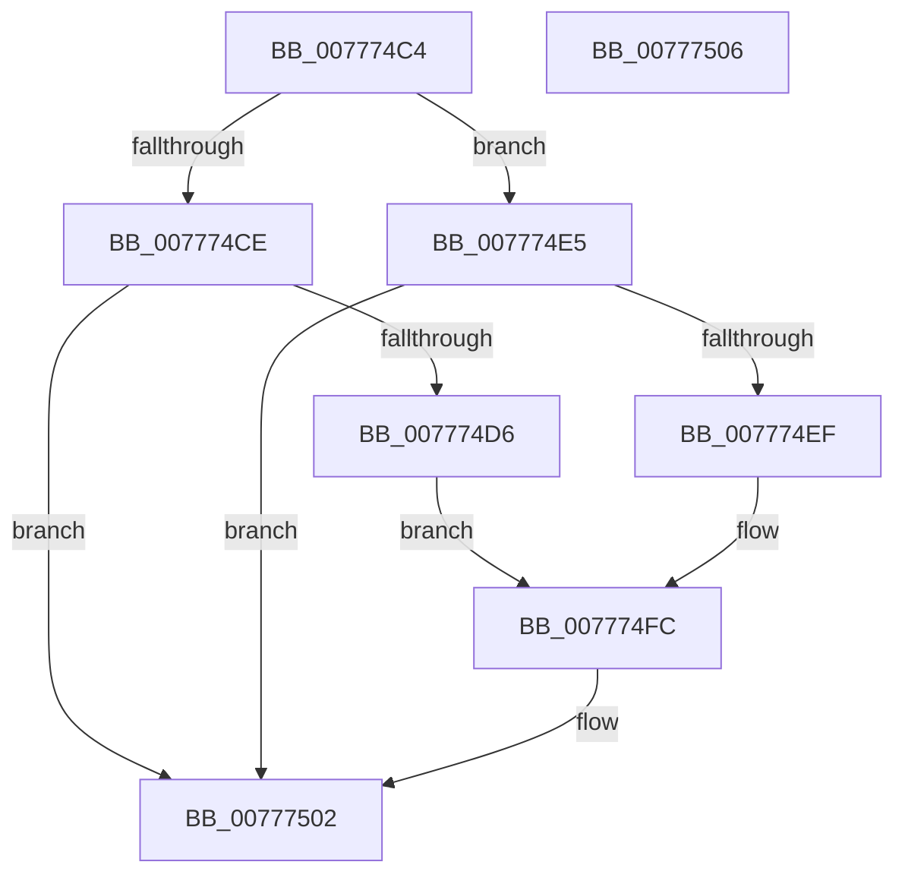

# TtmiUpdateActiveTerminalCount

- RVA: `0x007774C4`–`0x00777507` (길이 `67` bytes)
- VA: `0x00000001407774C4`
- 실행 섹션: `PAGE`
- PDB 이름 있음: `예`; PDB Function 태그: `아니요`
- unwind 정보 RVA: `0x000DB714`
- 디코드: `25`개 명령, `67/67` bytes 표시
- 미해석 바이트: `0` (있으면 어셈블리에 `.byte`로 보존)

> 이 문서는 커널 이미지의 기계어와 PDB 기호를 분석해 생성했습니다. 4번과 5번은 함수 원형과 자료형을 바이너리 사용 방식에서 추정한 C 해석이며 원본 소스 복구 결과는 아닙니다.

## 1. Dependencies

- 직접 호출 지점: **0**; 고유 호출 대상: **0**
- 직접 호출자로 확인된 함수: **3**
- RIP 상대 이미지 참조: **0**

### Outgoing calls
- 직접 디코드된 call 명령이 없습니다.

### Direct callers
- [TtmiCreateTerminal](TtmiCreateTerminal_function_0077C748.md) at `0x0077C8D4`
- [TtmiSessionTerminalListWorker](TtmiSessionTerminalListWorker_function_0077CE14.md) at `0x0077CEAD`
- [TtmiSessionTerminalListWorker](TtmiSessionTerminalListWorker_function_0077CE14.md) at `0x0077D02B`
- [TtmInitCurrentSession](../98/TtmInitCurrentSession_function_0098AA18.md) at `0x0098ABB1`

### Static image references
- 디코드된 RIP-relative 메모리 참조가 없습니다.

## 2. Other-region calls and transfers

- 다른 실행 섹션으로 향하는 call: **0**
- 별도 외부 분기/꼬리 이동을 확인하지 못했습니다.

## 3. Assembly (complete function range)

```asm
007774C4  8B 41 4C                        mov eax, dword ptr [rcx + 0x4c]
007774C7  45 33 C9                        xor r9d, r9d
007774CA  84 D2                           test dl, dl
007774CC  75 17                           jne 0x1407774e5
007774CE  83 E8 01                        sub eax, 1
007774D1  89 41 4C                        mov dword ptr [rcx + 0x4c], eax
007774D4  75 2C                           jne 0x140777502
007774D6  8B 41 04                        mov eax, dword ptr [rcx + 4]
007774D9  83 E0 EF                        and eax, 0xffffffef
007774DC  44 89 41 10                     mov dword ptr [rcx + 0x10], r8d
007774E0  83 C8 20                        or eax, 0x20
007774E3  EB 17                           jmp 0x1407774fc
007774E5  FF C0                           inc eax
007774E7  89 41 4C                        mov dword ptr [rcx + 0x4c], eax
007774EA  83 F8 01                        cmp eax, 1
007774ED  75 13                           jne 0x140777502
007774EF  8B 41 04                        mov eax, dword ptr [rcx + 4]
007774F2  83 E0 DF                        and eax, 0xffffffdf
007774F5  44 89 41 0C                     mov dword ptr [rcx + 0xc], r8d
007774F9  83 C8 10                        or eax, 0x10
007774FC  41 B1 01                        mov r9b, 1
007774FF  89 41 04                        mov dword ptr [rcx + 4], eax
00777502  41 8A C1                        mov al, r9b
00777505  C3                              ret
00777506  CC                              int3
```

## 4. C-style interpretation (structured pseudocode)

```c
__int64 __fastcall TtmiUpdateActiveTerminalCount(__int64 a1, unsigned __int8 a2, int a3, int a4)
{
    __int64 result;

    a4 = 0;
    if (a2 != 0) goto loc_007774E5;
    result = (unsigned int)(((unsigned int)(*(unsigned int *)(a1 + 76))) - (1));
    *(unsigned int *)(a1 + 76) = (unsigned int)(result);
    if (condition_is_not_equal) goto loc_00777502;
    result = (unsigned int)(((unsigned int)(*(unsigned int *)(a1 + 4))) & (0xFFFFFFEFULL));
    *(unsigned int *)(a1 + 16) = a3;
    result = (unsigned int)((result) | (32));
    goto loc_007774FC;
loc_007774E5:
    result = (unsigned int)((result) + 1);
    *(unsigned int *)(a1 + 76) = (unsigned int)(result);
    if (((unsigned int)(result)) != 1) goto loc_00777502;
    result = (unsigned int)(((unsigned int)(*(unsigned int *)(a1 + 4))) & (0xFFFFFFDFULL));
    *(unsigned int *)(a1 + 12) = a3;
    result = (unsigned int)((result) | (16));
loc_007774FC:
    *(unsigned int *)(a1 + 4) = (unsigned int)(result);
loc_00777502:
    return 1;
}
```

## 5. (Beta) C Style

```c
int64_t TtmiUpdateActiveTerminalCount(void *Arg1, uint8_t Arg2, int32_t Arg3, int32_t Arg4)
{
    uint8_t *arg1 = (uint8_t *)Arg1;

    int64_t result;

    Arg4 = 0;
    if (Arg2 != 0) goto loc_007774E5;
    result = (uint32_t)(((uint32_t)(*(uint32_t *)(arg1 + 0x4C))) - (1));
    *(uint32_t *)(arg1 + 0x4C) = (uint32_t)(result);
    if (condition_is_not_equal) goto loc_00777502;
    result = (uint32_t)(((uint32_t)(*(uint32_t *)(arg1 + 0x4))) & (0xFFFFFFEFULL));
    *(uint32_t *)(arg1 + 0x10) = Arg3;
    result = (uint32_t)((result) | (32));
    goto loc_007774FC;
loc_007774E5:
    result = (uint32_t)((result) + 1);
    *(uint32_t *)(arg1 + 0x4C) = (uint32_t)(result);
    if (((uint32_t)(result)) != 1) goto loc_00777502;
    result = (uint32_t)(((uint32_t)(*(uint32_t *)(arg1 + 0x4))) & (0xFFFFFFDFULL));
    *(uint32_t *)(arg1 + 0xC) = Arg3;
    result = (uint32_t)((result) | (16));
loc_007774FC:
    *(uint32_t *)(arg1 + 0x4) = (uint32_t)(result);
loc_00777502:
    return 1;
}
```

### 관측된 메모리 오프셋

구조체 형식이 확인되지 않은 접근은 인자 기준의 오프셋으로만 기록했습니다.

| 기준 인자 | 오프셋 표현 | 폭 (bit) | 접근 |
|---|---:|---:|---|
| `Arg1` | `+ 0x4` | `32` | `R` |
| `Arg1` | `+ 0x4` | `32` | `W` |
| `Arg1` | `+ 0xC` | `32` | `W` |
| `Arg1` | `+ 0x10` | `32` | `W` |
| `Arg1` | `+ 0x4C` | `32` | `R` |
| `Arg1` | `+ 0x4C` | `32` | `W` |

## 6. Execution-region graph

[열기: 2D/3D 그래프와 함수 탐색 컨트롤 패널](../../../control-panel.html?section=page&rva=0x007774C4&view=graph)

- 2D 그래프는 위에서 아래로 흐르고, 3D 그래프는 빈 공간을 드래그해 회전합니다. Shift+드래그는 이동, 휠은 확대·축소, 함수 노드 선택은 대상 보고서 이동입니다.

### Static fallback


