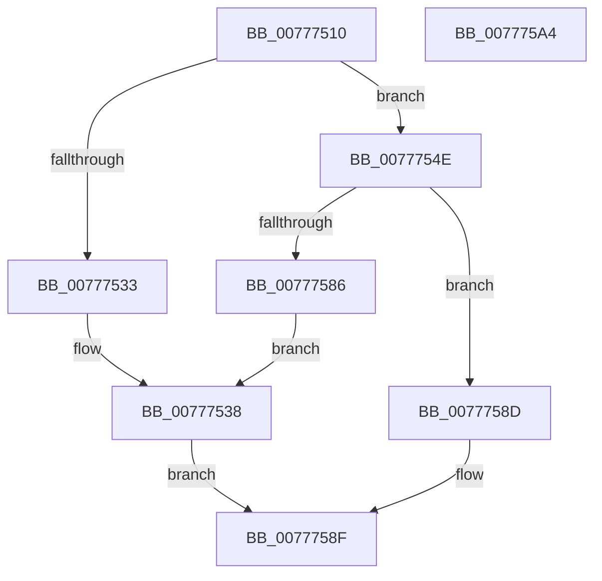

# TtmiWriteEnumerationEventsToQueue

- RVA: `0x00777510`–`0x007775A5` (길이 `149` bytes)
- VA: `0x0000000140777510`
- 실행 섹션: `PAGE`
- PDB 이름 있음: `예`; PDB Function 태그: `아니요`
- unwind 정보 RVA: `0x000CDC6C`
- 디코드: `41`개 명령, `149/149` bytes 표시
- 미해석 바이트: `0` (있으면 어셈블리에 `.byte`로 보존)

> 이 문서는 커널 이미지의 기계어와 PDB 기호를 분석해 생성했습니다. 4번과 5번은 함수 원형과 자료형을 바이너리 사용 방식에서 추정한 C 해석이며 원본 소스 복구 결과는 아닙니다.

## 1. Dependencies

- 직접 호출 지점: **5**; 고유 호출 대상: **5**
- 직접 호출자로 확인된 함수: **1**
- RIP 상대 이미지 참조: **1**

### Outgoing calls
- `0x00777528` → [TtmiPublishDeviceEnumerationEvents](TtmiPublishDeviceEnumerationEvents_function_00775C0C.md) (function, `0x00775C0C`)
- `0x00777545` → [TtmiLogError](../98/TtmiLogError_function_0098B39C.md) (function, `0x0098B39C`)
- `0x00777554` → [TtmpPublishDisplayRequiredPowerRequestEvents](TtmpPublishDisplayRequiredPowerRequestEvents_function_00777E14.md) (function, `0x00777E14`)
- `0x00777566` → [memset](../../text/6C/memset_function_006C6C40.md) (function, `0x006C6C40`)
- `0x0077757B` → [TtmiWriteEventToSingleQueue](TtmiWriteEventToSingleQueue_function_0077DE04.md) (function, `0x0077DE04`)

### Direct callers
- [TtmpDispatchCreateEventQueue](TtmpDispatchCreateEventQueue_function_00778718.md) at `0x007787B8`

### Static image references
- `0x0077753B` → RVA `0x00B04220` (` ?? ::NNGAKEGL::`string'`; read)

## 2. Other-region calls and transfers

- 다른 실행 섹션으로 향하는 call: **1**
  - `0x00777566` → [memset](../../text/6C/memset_function_006C6C40.md) (`PAGE` → `.text`)
- 별도 외부 분기/꼬리 이동을 확인하지 못했습니다.

## 3. Assembly (complete function range)

```asm
00777510  48 89 5C 24 08                  mov qword ptr [rsp + 8], rbx
00777515  48 89 74 24 10                  mov qword ptr [rsp + 0x10], rsi
0077751A  57                              push rdi
0077751B  48 81 EC 40 02 00 00            sub rsp, 0x240
00777522  48 8B FA                        mov rdi, rdx
00777525  48 8B F1                        mov rsi, rcx
00777528  E8 DF E6 FF FF                  call 0x140775c0c
0077752D  8B D8                           mov ebx, eax
0077752F  85 C0                           test eax, eax
00777531  79 1B                           jns 0x14077754e
00777533  BA 41 08 00 00                  mov edx, 0x841
00777538  44 8B C3                        mov r8d, ebx
0077753B  48 8D 0D DE CC 38 00            lea rcx, [rip + 0x38ccde]
00777542  44 8B CB                        mov r9d, ebx
00777545  E8 52 3E 21 00                  call 0x14098b39c
0077754A  8B C3                           mov eax, ebx
0077754C  EB 41                           jmp 0x14077758f
0077754E  48 8B D7                        mov rdx, rdi
00777551  48 8B CE                        mov rcx, rsi
00777554  E8 BB 08 00 00                  call 0x140777e14
00777559  33 D2                           xor edx, edx
0077755B  48 8D 4C 24 24                  lea rcx, [rsp + 0x24]
00777560  41 B8 1C 02 00 00               mov r8d, 0x21c
00777566  E8 D5 F6 F4 FF                  call 0x1406c6c40
0077756B  48 8D 54 24 20                  lea rdx, [rsp + 0x20]
00777570  C7 44 24 20 01 00 00 00         mov dword ptr [rsp + 0x20], 1
00777578  48 8B CF                        mov rcx, rdi
0077757B  E8 84 68 00 00                  call 0x14077de04
00777580  8B D8                           mov ebx, eax
00777582  85 C0                           test eax, eax
00777584  79 07                           jns 0x14077758d
00777586  BA 54 08 00 00                  mov edx, 0x854
0077758B  EB AB                           jmp 0x140777538
0077758D  33 C0                           xor eax, eax
0077758F  4C 8D 9C 24 40 02 00 00         lea r11, [rsp + 0x240]
00777597  49 8B 5B 10                     mov rbx, qword ptr [r11 + 0x10]
0077759B  49 8B 73 18                     mov rsi, qword ptr [r11 + 0x18]
0077759F  49 8B E3                        mov rsp, r11
007775A2  5F                              pop rdi
007775A3  C3                              ret
007775A4  CC                              int3
```

## 4. C-style interpretation (structured pseudocode)

```c
__int64 __fastcall TtmiWriteEnumerationEventsToQueue(__int64 a1, __int64 a2)
{
    __int64 result;
    __int64 v_rsp;
    unsigned __int64 v_stack_m224;
    unsigned __int64 v_stack_m228;
    unsigned __int64 v_stack_m8;
    unsigned __int64 v_stack_p10;
    unsigned __int64 v_stack_p8;

    v_stack_p8 = v_rbx;
    v_stack_p10 = v_rsi;
    v_rsp = (v_rsp) - (576);
    result = TtmiPublishDeviceEnumerationEvents(a1, a2, a3, a4);
    if (!sign_flag) goto loc_0077754E;
loc_00777538:
    result = TtmiLogError(v_rip + 3722462, (unsigned int)(0x841ULL), (unsigned int)((unsigned int)((unsigned int)((unsigned int)(result)))), (unsigned int)((unsigned int)((unsigned int)((unsigned int)(result)))));
    goto loc_0077758F;
loc_0077754E:
    result = TtmpPublishDisplayRequiredPowerRequestEvents(a1, a2, (unsigned int)((unsigned int)((unsigned int)((unsigned int)(result)))), (unsigned int)((unsigned int)((unsigned int)((unsigned int)(result)))));
    a2 = 0;
    result = memset(v_stack_m224, a2, 540, (unsigned int)((unsigned int)((unsigned int)((unsigned int)(result)))));
    v_stack_m228 = 1;
    result = TtmiWriteEventToSingleQueue(0, v_stack_m228, 540, (unsigned int)((unsigned int)((unsigned int)((unsigned int)(result)))));
    if (!sign_flag) goto loc_0077758D;
    goto loc_00777538;
loc_0077758D:
    result = 0;
loc_0077758F:
    return result;
}
```

## 5. (Beta) C Style

```c
int64_t TtmiWriteEnumerationEventsToQueue(int64_t Arg1, int64_t Arg2)
{
    int64_t result;
    int64_t local_rsp;
    uint64_t v_stack_m224;
    uint64_t v_stack_m228;
    uint64_t v_stack_m8;
    uint64_t v_stack_p10;
    uint64_t v_stack_p8;

    v_stack_p8 = local_rbx;
    v_stack_p10 = local_rsi;
    local_rsp = (local_rsp) - (576);
    result = TtmiPublishDeviceEnumerationEvents(Arg1, Arg2, a3, a4);
    if (!sign_flag) goto loc_0077754E;
loc_00777538:
    result = TtmiLogError(v_rip + 3722462, (uint32_t)(0x841ULL), (uint32_t)((uint32_t)((uint32_t)((uint32_t)(result)))), (uint32_t)((uint32_t)((uint32_t)((uint32_t)(result)))));
    goto loc_0077758F;
loc_0077754E:
    result = TtmpPublishDisplayRequiredPowerRequestEvents(Arg1, Arg2, (uint32_t)((uint32_t)((uint32_t)((uint32_t)(result)))), (uint32_t)((uint32_t)((uint32_t)((uint32_t)(result)))));
    Arg2 = 0;
    result = memset(v_stack_m224, Arg2, 540, (uint32_t)((uint32_t)((uint32_t)((uint32_t)(result)))));
    v_stack_m228 = 1;
    result = TtmiWriteEventToSingleQueue(0, v_stack_m228, 540, (uint32_t)((uint32_t)((uint32_t)((uint32_t)(result)))));
    if (!sign_flag) goto loc_0077758D;
    goto loc_00777538;
loc_0077758D:
    result = 0;
loc_0077758F:
    return result;
}
```

## 6. Execution-region graph

[열기: 2D/3D 그래프와 함수 탐색 컨트롤 패널](../../../control-panel.html?section=page&rva=0x00777510&view=graph)

- 2D 그래프는 위에서 아래로 흐르고, 3D 그래프는 빈 공간을 드래그해 회전합니다. Shift+드래그는 이동, 휠은 확대·축소, 함수 노드 선택은 대상 보고서 이동입니다.

### Static fallback


