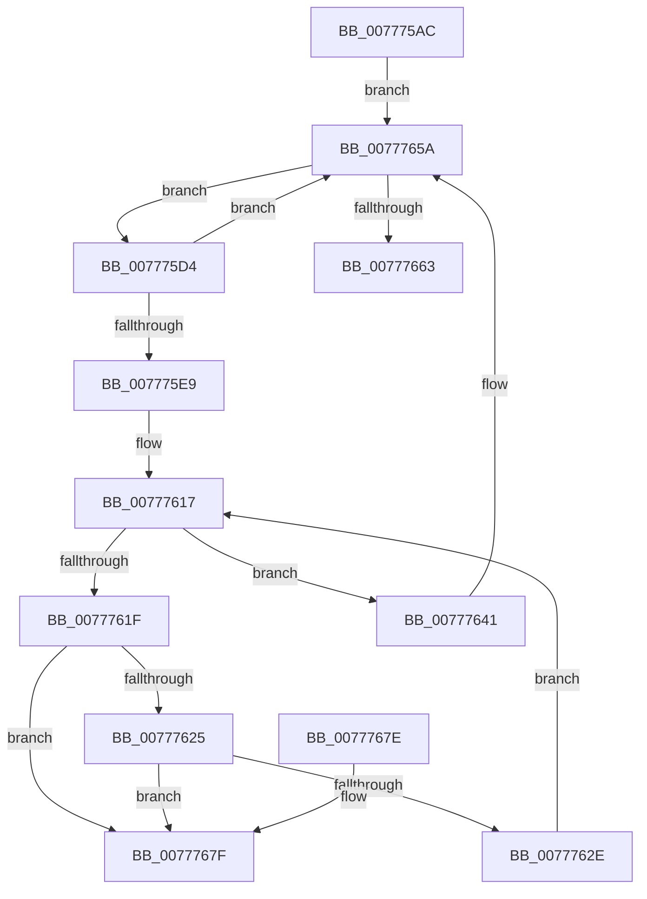

# TtmiWriteEventToAllQueues

- RVA: `0x007775AC`–`0x00777686` (길이 `218` bytes)
- VA: `0x00000001407775AC`
- 실행 섹션: `PAGE`
- PDB 이름 있음: `예`; PDB Function 태그: `아니요`
- unwind 정보 RVA: `0x0006B020`
- 디코드: `58`개 명령, `218/218` bytes 표시
- 미해석 바이트: `0` (있으면 어셈블리에 `.byte`로 보존)

> 이 문서는 커널 이미지의 기계어와 PDB 기호를 분석해 생성했습니다. 4번과 5번은 함수 원형과 자료형을 바이너리 사용 방식에서 추정한 C 해석이며 원본 소스 복구 결과는 아닙니다.

## 1. Dependencies

- 직접 호출 지점: **6**; 고유 호출 대상: **6**
- 직접 호출자로 확인된 함수: **3**
- RIP 상대 이미지 참조: **1**

### Outgoing calls
- `0x007775E0` → [TtmiWriteEventToSingleQueue](TtmiWriteEventToSingleQueue_function_0077DE04.md) (function, `0x0077DE04`)
- `0x007775FC` → [TtmiLogError](../98/TtmiLogError_function_0098B39C.md) (function, `0x0098B39C`)
- `0x00777604` → [TtmpAcquireQueueLock](TtmpAcquireQueueLock_function_0077DF48.md) (function, `0x0077DF48`)
- `0x0077763A` → [ExFreePoolWithTag](../../poolcode/B8/ExFreePoolWithTag_function_00B82870.md) (function, `0x00B82870`)
- `0x0077764D` → [KeSetEvent](../../text/33/KeSetEvent_function_0033F310.md) (function, `0x0033F310`)
- `0x00777655` → [TtmpReleaseQueueLock](TtmpReleaseQueueLock_function_0077E0C0.md) (function, `0x0077E0C0`)

### Direct callers
- [TtmpPublishDeviceEvent](TtmpPublishDeviceEvent_function_00776718.md) at `0x0077680B`
- [TtmpWriteDisplayRequiredPowerRequestUpdatedEvent](TtmpWriteDisplayRequiredPowerRequestUpdatedEvent_function_00778498.md) at `0x00778520`
- [TtmiSessionTerminalListWorker](TtmiSessionTerminalListWorker_function_0077CE14.md) at `0x0077CFF5`

### Static image references
- `0x007775ED` → RVA `0x00B041C0` (` ?? ::NNGAKEGL::`string'`; read)

## 2. Other-region calls and transfers

- 다른 실행 섹션으로 향하는 call: **2**
  - `0x0077763A` → [ExFreePoolWithTag](../../poolcode/B8/ExFreePoolWithTag_function_00B82870.md) (`PAGE` → `POOLCODE`)
  - `0x0077764D` → [KeSetEvent](../../text/33/KeSetEvent_function_0033F310.md) (`PAGE` → `.text`)
- 별도 외부 분기/꼬리 이동을 확인하지 못했습니다.

## 3. Assembly (complete function range)

```asm
007775AC  48 8B C4                        mov rax, rsp
007775AF  48 89 58 08                     mov qword ptr [rax + 8], rbx
007775B3  48 89 68 10                     mov qword ptr [rax + 0x10], rbp
007775B7  48 89 70 18                     mov qword ptr [rax + 0x18], rsi
007775BB  48 89 78 20                     mov qword ptr [rax + 0x20], rdi
007775BF  41 56                           push r14
007775C1  48 83 EC 20                     sub rsp, 0x20
007775C5  4C 8D 71 50                     lea r14, [rcx + 0x50]
007775C9  48 8B EA                        mov rbp, rdx
007775CC  49 8B 1E                        mov rbx, qword ptr [r14]
007775CF  E9 86 00 00 00                  jmp 0x14077765a
007775D4  48 8B FB                        mov rdi, rbx
007775D7  48 8B D5                        mov rdx, rbp
007775DA  48 8B 1B                        mov rbx, qword ptr [rbx]
007775DD  48 8B CF                        mov rcx, rdi
007775E0  E8 1F 68 00 00                  call 0x14077de04
007775E5  85 C0                           test eax, eax
007775E7  79 71                           jns 0x14077765a
007775E9  41 83 C9 FF                     or r9d, 0xffffffff
007775ED  48 8D 0D CC CB 38 00            lea rcx, [rip + 0x38cbcc]
007775F4  44 8B C0                        mov r8d, eax
007775F7  BA 92 08 00 00                  mov edx, 0x892
007775FC  E8 9B 3D 21 00                  call 0x14098b39c
00777601  48 8B CF                        mov rcx, rdi
00777604  E8 3F 69 00 00                  call 0x14077df48
00777609  C6 87 A8 00 00 00 00            mov byte ptr [rdi + 0xa8], 0
00777610  48 8D B7 98 00 00 00            lea rsi, [rdi + 0x98]
00777617  48 8B 0E                        mov rcx, qword ptr [rsi]
0077761A  48 3B CE                        cmp rcx, rsi
0077761D  74 22                           je 0x140777641
0077761F  48 39 71 08                     cmp qword ptr [rcx + 8], rsi
00777623  75 5A                           jne 0x14077767f
00777625  48 8B 01                        mov rax, qword ptr [rcx]
00777628  48 39 48 08                     cmp qword ptr [rax + 8], rcx
0077762C  75 51                           jne 0x14077767f
0077762E  48 89 06                        mov qword ptr [rsi], rax
00777631  BA 54 74 6D 71                  mov edx, 0x716d7454
00777636  48 89 70 08                     mov qword ptr [rax + 8], rsi
0077763A  E8 31 B2 40 00                  call 0x140b82870
0077763F  EB D6                           jmp 0x140777617
00777641  48 8D 8F 80 00 00 00            lea rcx, [rdi + 0x80]
00777648  45 33 C0                        xor r8d, r8d
0077764B  33 D2                           xor edx, edx
0077764D  E8 BE 7C BC FF                  call 0x14033f310
00777652  48 8B CF                        mov rcx, rdi
00777655  E8 66 6A 00 00                  call 0x14077e0c0
0077765A  49 3B DE                        cmp rbx, r14
0077765D  0F 85 71 FF FF FF               jne 0x1407775d4
00777663  48 8B 5C 24 30                  mov rbx, qword ptr [rsp + 0x30]
00777668  48 8B 6C 24 38                  mov rbp, qword ptr [rsp + 0x38]
0077766D  48 8B 74 24 40                  mov rsi, qword ptr [rsp + 0x40]
00777672  48 8B 7C 24 48                  mov rdi, qword ptr [rsp + 0x48]
00777677  48 83 C4 20                     add rsp, 0x20
0077767B  41 5E                           pop r14
0077767D  C3                              ret
0077767E  CC                              int3
0077767F  B9 03 00 00 00                  mov ecx, 3
00777684  CD 29                           int 0x29
```

## 4. C-style interpretation (structured pseudocode)

```c
__int64 __fastcall TtmiWriteEventToAllQueues(__int64 a1, __int64 a2, __int64 a3, int a4)
{
    __int64 result;
    __int64 v_rsp;
    unsigned __int64 v_stack_p10;
    unsigned __int64 v_stack_p18;
    unsigned __int64 v_stack_p20;
    unsigned __int64 v_stack_p8;

    *(unsigned __int64 *)(v_rsp + 8) = v_rbx;
    *(unsigned __int64 *)(v_rsp + 16) = v_rbp;
    *(unsigned __int64 *)(v_rsp + 24) = v_rsi;
    *(unsigned __int64 *)(v_rsp + 32) = v_rdi;
    v_rsp = (v_rsp) - (32);
    goto loc_0077765A;
loc_007775D4:
    result = TtmiWriteEventToSingleQueue(*(unsigned __int64 *)(a1 + 80), a2, a3, a4);
    if (!sign_flag) goto loc_0077765A;
    a4 = (unsigned int)((a4) | (0xFFFFFFFFULL));
    result = TtmiLogError(v_rip + 3722188, (unsigned int)(0x892ULL), (unsigned int)((unsigned int)(result)), a4);
    result = TtmpAcquireQueueLock(*(unsigned __int64 *)(a1 + 80), (unsigned int)(0x892ULL), (unsigned int)((unsigned int)(result)), a4);
    *(unsigned __int8 *)(*(unsigned __int64 *)(a1 + 80) + 168) = 0;
loc_00777617:
    if ((*(unsigned __int64 *)(*(unsigned __int64 *)(a1 + 80) + 152)) == (*(unsigned __int64 *)(a1 + 80) + 152)) goto loc_00777641;
    if ((*(unsigned __int64 *)(*(unsigned __int64 *)(*(unsigned __int64 *)(a1 + 80) + 152) + 8)) != (*(unsigned __int64 *)(a1 + 80) + 152)) goto loc_0077767F;
    if ((*(unsigned __int64 *)(*(unsigned __int64 *)(*(unsigned __int64 *)(*(unsigned __int64 *)(a1 + 80) + 152)) + 8)) != (*(unsigned __int64 *)(*(unsigned __int64 *)(a1 + 80) + 152))) goto loc_0077767F;
    *(unsigned __int64 *)(*(unsigned __int64 *)(a1 + 80) + 152) = *(unsigned __int64 *)(*(unsigned __int64 *)(*(unsigned __int64 *)(a1 + 80) + 152));
    *(unsigned __int64 *)(*(unsigned __int64 *)(*(unsigned __int64 *)(*(unsigned __int64 *)(a1 + 80) + 152)) + 8) = *(unsigned __int64 *)(a1 + 80) + 152;
    result = ExFreePoolWithTag(*(unsigned __int64 *)(*(unsigned __int64 *)(a1 + 80) + 152), (unsigned int)(0x716D7454ULL), (unsigned int)((unsigned int)(result)), a4);
    goto loc_00777617;
loc_00777641:
    a3 = 0;
    a2 = 0;
    result = KeSetEvent(*(unsigned __int64 *)(a1 + 80) + 128, a2, a3, a4);
    result = TtmpReleaseQueueLock(*(unsigned __int64 *)(a1 + 80), a2, a3, a4);
loc_0077765A:
    if ((*(unsigned __int64 *)(*(unsigned __int64 *)(a1 + 80))) != (a1 + 80)) goto loc_007775D4;
    v_rsp = (v_rsp) + (32);
    return result;
loc_0077767F:
    return result;
}
```

## 5. (Beta) C Style

```c
int64_t TtmiWriteEventToAllQueues(void *Arg1, int64_t Arg2, int64_t Arg3, int32_t Arg4)
{
    uint8_t *arg1 = (uint8_t *)Arg1;

    int64_t result;
    int64_t local_rsp;
    uint64_t v_stack_p10;
    uint64_t v_stack_p18;
    uint64_t v_stack_p20;
    uint64_t v_stack_p8;

    *(uint64_t *)(local_rsp + 0x8) = local_rbx;
    *(uint64_t *)(local_rsp + 0x10) = local_rbp;
    *(uint64_t *)(local_rsp + 0x18) = local_rsi;
    *(uint64_t *)(local_rsp + 0x20) = local_rdi;
    local_rsp = (local_rsp) - (32);
    goto loc_0077765A;
loc_007775D4:
    result = TtmiWriteEventToSingleQueue(*(uint64_t *)(arg1 + 0x50), Arg2, Arg3, Arg4);
    if (!sign_flag) goto loc_0077765A;
    Arg4 = (uint32_t)((Arg4) | (0xFFFFFFFFULL));
    result = TtmiLogError(v_rip + 3722188, (uint32_t)(0x892ULL), (uint32_t)((uint32_t)(result)), Arg4);
    result = TtmpAcquireQueueLock(*(uint64_t *)(arg1 + 0x50), (uint32_t)(0x892ULL), (uint32_t)((uint32_t)(result)), Arg4);
    *(uint8_t *)(*(uint64_t *)(arg1 + 0x50) + 0xA8) = 0;
loc_00777617:
    if ((*(uint64_t *)(*(uint64_t *)(arg1 + 0x50) + 0x98)) == (*(uint64_t *)(arg1 + 0x50) + 152)) goto loc_00777641;
    if ((*(uint64_t *)(*(uint64_t *)(*(uint64_t *)(arg1 + 0x50) + 0x98) + 0x8)) != (*(uint64_t *)(arg1 + 0x50) + 152)) goto loc_0077767F;
    if ((*(uint64_t *)(*(uint64_t *)(*(uint64_t *)(*(uint64_t *)(arg1 + 0x50) + 0x98)) + 0x8)) != (*(uint64_t *)(*(uint64_t *)(arg1 + 0x50) + 0x98))) goto loc_0077767F;
    *(uint64_t *)(*(uint64_t *)(arg1 + 0x50) + 0x98) = *(uint64_t *)(*(uint64_t *)(*(uint64_t *)(arg1 + 0x50) + 0x98));
    *(uint64_t *)(*(uint64_t *)(*(uint64_t *)(*(uint64_t *)(arg1 + 0x50) + 0x98)) + 0x8) = *(uint64_t *)(arg1 + 0x50) + 152;
    result = ExFreePoolWithTag(*(uint64_t *)(*(uint64_t *)(arg1 + 0x50) + 0x98), (uint32_t)(0x716D7454ULL), (uint32_t)((uint32_t)(result)), Arg4);
    goto loc_00777617;
loc_00777641:
    Arg3 = 0;
    Arg2 = 0;
    result = KeSetEvent(*(uint64_t *)(arg1 + 0x50) + 128, Arg2, Arg3, Arg4);
    result = TtmpReleaseQueueLock(*(uint64_t *)(arg1 + 0x50), Arg2, Arg3, Arg4);
loc_0077765A:
    if ((*(uint64_t *)(*(uint64_t *)(arg1 + 0x50))) != (Arg1 + 80)) goto loc_007775D4;
    local_rsp = (local_rsp) + (32);
    return result;
loc_0077767F:
    return result;
}
```

### 관측된 메모리 오프셋

구조체 형식이 확인되지 않은 접근은 인자 기준의 오프셋으로만 기록했습니다.

| 기준 인자 | 오프셋 표현 | 폭 (bit) | 접근 |
|---|---:|---:|---|
| `Arg1` | `+ 0x0` | `64` | `R` |
| `Arg1` | `+ 0x50` | `64` | `R` |

## 6. Execution-region graph

[열기: 2D/3D 그래프와 함수 탐색 컨트롤 패널](../../../control-panel.html?section=page&rva=0x007775AC&view=graph)

- 2D 그래프는 위에서 아래로 흐르고, 3D 그래프는 빈 공간을 드래그해 회전합니다. Shift+드래그는 이동, 휠은 확대·축소, 함수 노드 선택은 대상 보고서 이동입니다.

### Static fallback


