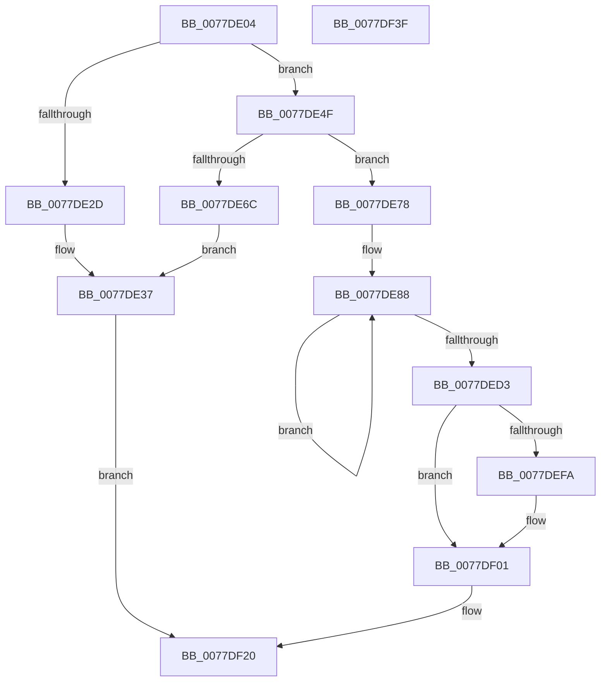

# TtmiWriteEventToSingleQueue

- RVA: `0x0077DE04`–`0x0077DF40` (길이 `316` bytes)
- VA: `0x000000014077DE04`
- 실행 섹션: `PAGE`
- PDB 이름 있음: `예`; PDB Function 태그: `아니요`
- unwind 정보 RVA: `0x0005C954`
- 디코드: `82`개 명령, `316/316` bytes 표시
- 미해석 바이트: `0` (있으면 어셈블리에 `.byte`로 보존)

> 이 문서는 커널 이미지의 기계어와 PDB 기호를 분석해 생성했습니다. 4번과 5번은 함수 원형과 자료형을 바이너리 사용 방식에서 추정한 C 해석이며 원본 소스 복구 결과는 아닙니다.

## 1. Dependencies

- 직접 호출 지점: **6**; 고유 호출 대상: **6**
- 직접 호출자로 확인된 함수: **4**
- RIP 상대 이미지 참조: **1**

### Outgoing calls
- `0x0077DE1E` → [TtmpAcquireQueueLock](TtmpAcquireQueueLock_function_0077DF48.md) (function, `0x0077DF48`)
- `0x0077DE45` → [TtmiLogError](../98/TtmiLogError_function_0098B39C.md) (function, `0x0098B39C`)
- `0x0077DE5F` → [ExAllocatePool2](../../poolcode/B8/ExAllocatePool2_function_00B820F0.md) (function, `0x00B820F0`)
- `0x0077DEE5` → [TtmiLogQueueEnqueueEvent](TtmiLogQueueEnqueueEvent_function_0077AB6C.md) (function, `0x0077AB6C`)
- `0x0077DF1B` → [KeSetEvent](../../text/33/KeSetEvent_function_0033F310.md) (function, `0x0033F310`)
- `0x0077DF23` → [TtmpReleaseQueueLock](TtmpReleaseQueueLock_function_0077E0C0.md) (function, `0x0077E0C0`)

### Direct callers
- [TtmpPublishDeviceEvent](TtmpPublishDeviceEvent_function_00776718.md) at `0x007767FF`
- [TtmiWriteEnumerationEventsToQueue](TtmiWriteEnumerationEventsToQueue_function_00777510.md) at `0x0077757B`
- [TtmiWriteEventToAllQueues](TtmiWriteEventToAllQueues_function_007775AC.md) at `0x007775E0`
- [TtmpWriteDisplayRequiredPowerRequestUpdatedEvent](TtmpWriteDisplayRequiredPowerRequestUpdatedEvent_function_00778498.md) at `0x007784FA`

### Static image references
- `0x0077DE3B` → RVA `0x00B04760` (` ?? ::NNGAKEGL::`string'`; read)

## 2. Other-region calls and transfers

- 다른 실행 섹션으로 향하는 call: **2**
  - `0x0077DE5F` → [ExAllocatePool2](../../poolcode/B8/ExAllocatePool2_function_00B820F0.md) (`PAGE` → `POOLCODE`)
  - `0x0077DF1B` → [KeSetEvent](../../text/33/KeSetEvent_function_0033F310.md) (`PAGE` → `.text`)
- 별도 외부 분기/꼬리 이동을 확인하지 못했습니다.

## 3. Assembly (complete function range)

```asm
0077DE04  48 89 5C 24 08                  mov qword ptr [rsp + 8], rbx
0077DE09  48 89 6C 24 10                  mov qword ptr [rsp + 0x10], rbp
0077DE0E  48 89 74 24 18                  mov qword ptr [rsp + 0x18], rsi
0077DE13  57                              push rdi
0077DE14  48 83 EC 20                     sub rsp, 0x20
0077DE18  48 8B EA                        mov rbp, rdx
0077DE1B  48 8B F9                        mov rdi, rcx
0077DE1E  E8 25 01 00 00                  call 0x14077df48
0077DE23  33 DB                           xor ebx, ebx
0077DE25  38 9F A8 00 00 00               cmp byte ptr [rdi + 0xa8], bl
0077DE2B  75 22                           jne 0x14077de4f
0077DE2D  BB 00 07 00 C0                  mov ebx, 0xc0000700
0077DE32  BA 9C 01 00 00                  mov edx, 0x19c
0077DE37  41 83 C8 FF                     or r8d, 0xffffffff
0077DE3B  48 8D 0D 1E 69 38 00            lea rcx, [rip + 0x38691e]
0077DE42  44 8B CB                        mov r9d, ebx
0077DE45  E8 52 D5 20 00                  call 0x14098b39c
0077DE4A  E9 D1 00 00 00                  jmp 0x14077df20
0077DE4F  BA 30 02 00 00                  mov edx, 0x230
0077DE54  B9 00 01 00 00                  mov ecx, 0x100
0077DE59  41 B8 54 74 6D 71               mov r8d, 0x716d7454
0077DE5F  E8 8C 42 40 00                  call 0x140b820f0
0077DE64  48 8B F0                        mov rsi, rax
0077DE67  48 85 C0                        test rax, rax
0077DE6A  75 0C                           jne 0x14077de78
0077DE6C  BB 9A 00 00 C0                  mov ebx, 0xc000009a
0077DE71  BA A9 01 00 00                  mov edx, 0x1a9
0077DE76  EB BF                           jmp 0x14077de37
0077DE78  B9 04 00 00 00                  mov ecx, 4
0077DE7D  48 8D 50 10                     lea rdx, [rax + 0x10]
0077DE81  48 8B C2                        mov rax, rdx
0077DE84  44 8D 41 7C                     lea r8d, [rcx + 0x7c]
0077DE88  0F 10 45 00                     movups xmm0, xmmword ptr [rbp]
0077DE8C  0F 11 00                        movups xmmword ptr [rax], xmm0
0077DE8F  0F 10 4D 10                     movups xmm1, xmmword ptr [rbp + 0x10]
0077DE93  0F 11 48 10                     movups xmmword ptr [rax + 0x10], xmm1
0077DE97  0F 10 45 20                     movups xmm0, xmmword ptr [rbp + 0x20]
0077DE9B  0F 11 40 20                     movups xmmword ptr [rax + 0x20], xmm0
0077DE9F  0F 10 4D 30                     movups xmm1, xmmword ptr [rbp + 0x30]
0077DEA3  0F 11 48 30                     movups xmmword ptr [rax + 0x30], xmm1
0077DEA7  0F 10 45 40                     movups xmm0, xmmword ptr [rbp + 0x40]
0077DEAB  0F 11 40 40                     movups xmmword ptr [rax + 0x40], xmm0
0077DEAF  0F 10 4D 50                     movups xmm1, xmmword ptr [rbp + 0x50]
0077DEB3  0F 11 48 50                     movups xmmword ptr [rax + 0x50], xmm1
0077DEB7  0F 10 45 60                     movups xmm0, xmmword ptr [rbp + 0x60]
0077DEBB  0F 11 40 60                     movups xmmword ptr [rax + 0x60], xmm0
0077DEBF  49 03 C0                        add rax, r8
0077DEC2  0F 10 4D 70                     movups xmm1, xmmword ptr [rbp + 0x70]
0077DEC6  49 03 E8                        add rbp, r8
0077DEC9  0F 11 48 F0                     movups xmmword ptr [rax - 0x10], xmm1
0077DECD  48 83 E9 01                     sub rcx, 1
0077DED1  75 B5                           jne 0x14077de88
0077DED3  0F 10 45 00                     movups xmm0, xmmword ptr [rbp]
0077DED7  48 8B CF                        mov rcx, rdi
0077DEDA  0F 11 00                        movups xmmword ptr [rax], xmm0
0077DEDD  0F 10 4D 10                     movups xmm1, xmmword ptr [rbp + 0x10]
0077DEE1  0F 11 48 10                     movups xmmword ptr [rax + 0x10], xmm1
0077DEE5  E8 82 CC FF FF                  call 0x14077ab6c
0077DEEA  48 8D 87 98 00 00 00            lea rax, [rdi + 0x98]
0077DEF1  48 8B 48 08                     mov rcx, qword ptr [rax + 8]
0077DEF5  48 39 01                        cmp qword ptr [rcx], rax
0077DEF8  74 07                           je 0x14077df01
0077DEFA  B9 03 00 00 00                  mov ecx, 3
0077DEFF  CD 29                           int 0x29
0077DF01  48 89 4E 08                     mov qword ptr [rsi + 8], rcx
0077DF05  45 33 C0                        xor r8d, r8d
0077DF08  48 89 06                        mov qword ptr [rsi], rax
0077DF0B  33 D2                           xor edx, edx
0077DF0D  48 89 31                        mov qword ptr [rcx], rsi
0077DF10  48 8D 8F 80 00 00 00            lea rcx, [rdi + 0x80]
0077DF17  48 89 70 08                     mov qword ptr [rax + 8], rsi
0077DF1B  E8 F0 13 BC FF                  call 0x14033f310
0077DF20  48 8B CF                        mov rcx, rdi
0077DF23  E8 98 01 00 00                  call 0x14077e0c0
0077DF28  48 8B 6C 24 38                  mov rbp, qword ptr [rsp + 0x38]
0077DF2D  8B C3                           mov eax, ebx
0077DF2F  48 8B 5C 24 30                  mov rbx, qword ptr [rsp + 0x30]
0077DF34  48 8B 74 24 40                  mov rsi, qword ptr [rsp + 0x40]
0077DF39  48 83 C4 20                     add rsp, 0x20
0077DF3D  5F                              pop rdi
0077DF3E  C3                              ret
0077DF3F  CC                              int3
```

## 4. C-style interpretation (structured pseudocode)

```c
__int64 __fastcall TtmiWriteEventToSingleQueue(__int64 a1, __int64 a2, int a3)
{
    __int64 result;
    __int64 v_rbp;
    __int64 v_rbx;
    __int64 v_rsp;
    unsigned __int64 v_stack_p10;
    unsigned __int64 v_stack_p18;
    unsigned __int64 v_stack_p8;

    v_stack_p8 = v_rbx;
    v_stack_p10 = v_rbp;
    v_stack_p18 = v_rsi;
    v_rsp = (v_rsp) - (32);
    result = TtmpAcquireQueueLock(a1, a2, a3, a4);
    v_rbx = 0;
    if ((*(unsigned __int8 *)(a1 + 168)) != 0) goto loc_0077DE4F;
loc_0077DE37:
    a3 = (unsigned int)((a3) | (0xFFFFFFFFULL));
    result = TtmiLogError(v_rip + 3696926, 412, a3, (unsigned int)((unsigned int)((unsigned int)(0xC0000700ULL))));
    goto loc_0077DF20;
loc_0077DE4F:
    result = ExAllocatePool2(256, 560, (unsigned int)(0x716D7454ULL), (unsigned int)((unsigned int)((unsigned int)(0xC0000700ULL))));
    if (result != 0) goto loc_0077DE78;
    goto loc_0077DE37;
loc_0077DE78:
loc_0077DE88:
    *(unsigned __int64 *)(result + 16) = v_xmm0;
    *(unsigned __int64 *)(result + 16 + 16) = v_xmm1;
    *(unsigned __int64 *)(result + 16 + 32) = v_xmm0;
    *(unsigned __int64 *)(result + 16 + 48) = v_xmm1;
    *(unsigned __int64 *)(result + 16 + 64) = v_xmm0;
    *(unsigned __int64 *)(result + 16 + 80) = v_xmm1;
    *(unsigned __int64 *)(result + 16 + 96) = v_xmm0;
    result = (result + 16) + (4 + 124);
    v_rbp = (a2) + (4 + 124);
    *(unsigned __int64 *)(result - 16) = v_xmm1;
    a1 = (4) - (1);
    if (condition_is_not_equal) goto loc_0077DE88;
    *(unsigned __int64 *)(result) = v_xmm0;
    *(unsigned __int64 *)(result + 16) = v_xmm1;
    result = TtmiLogQueueEnqueueEvent(a1, result + 16, 4 + 124, (unsigned int)((unsigned int)((unsigned int)(0xC0000700ULL))));
    if ((*(unsigned __int64 *)(*(unsigned __int64 *)(a1 + 152 + 8))) != (a1 + 152)) {
        a1 = 3;
    }
    *(unsigned __int64 *)(result + 8) = a1;
    a3 = 0;
    *(unsigned __int64 *)(result) = a1 + 152;
    a2 = 0;
    *(unsigned __int64 *)(a1) = result;
    *(unsigned __int64 *)(a1 + 152 + 8) = result;
    result = KeSetEvent(a1 + 128, a2, a3, (unsigned int)((unsigned int)((unsigned int)(0xC0000700ULL))));
loc_0077DF20:
    result = TtmpReleaseQueueLock(a1, a2, a3, (unsigned int)((unsigned int)((unsigned int)(0xC0000700ULL))));
    v_rsp = (v_rsp) + (32);
    return (unsigned int)((unsigned int)((unsigned int)(0xC000009AULL)));
}
```

## 5. (Beta) C Style

```c
int64_t TtmiWriteEventToSingleQueue(void *Arg1, void *Arg2, int32_t Arg3)
{
    uint8_t *arg1 = (uint8_t *)Arg1;
    uint8_t *arg2 = (uint8_t *)Arg2;

    int64_t result;
    int64_t local_rbp;
    int64_t local_rbx;
    int64_t local_rsp;
    uint64_t v_stack_p10;
    uint64_t v_stack_p18;
    uint64_t v_stack_p8;

    v_stack_p8 = local_rbx;
    v_stack_p10 = local_rbp;
    v_stack_p18 = local_rsi;
    local_rsp = (local_rsp) - (32);
    result = TtmpAcquireQueueLock(Arg1, Arg2, Arg3, a4);
    local_rbx = 0;
    if ((*(uint8_t *)(arg1 + 0xA8)) != 0) goto loc_0077DE4F;
loc_0077DE37:
    Arg3 = (uint32_t)((Arg3) | (0xFFFFFFFFULL));
    result = TtmiLogError(v_rip + 3696926, 412, Arg3, (uint32_t)((uint32_t)((uint32_t)(0xC0000700ULL))));
    goto loc_0077DF20;
loc_0077DE4F:
    result = ExAllocatePool2(256, 560, (uint32_t)(0x716D7454ULL), (uint32_t)((uint32_t)((uint32_t)(0xC0000700ULL))));
    if (result != 0) goto loc_0077DE78;
    goto loc_0077DE37;
loc_0077DE78:
loc_0077DE88:
    *(uint64_t *)(result + 0x10) = v_xmm0;
    *(uint64_t *)(result + 0x10 + 0x10) = v_xmm1;
    *(uint64_t *)(result + 0x10 + 0x20) = v_xmm0;
    *(uint64_t *)(result + 0x10 + 0x30) = v_xmm1;
    *(uint64_t *)(result + 0x10 + 0x40) = v_xmm0;
    *(uint64_t *)(result + 0x10 + 0x50) = v_xmm1;
    *(uint64_t *)(result + 0x10 + 0x60) = v_xmm0;
    result = (result + 16) + (4 + 124);
    local_rbp = (Arg2) + (4 + 124);
    *(uint64_t *)(result - 0x10) = v_xmm1;
    Arg1 = (4) - (1);
    if (condition_is_not_equal) goto loc_0077DE88;
    *(uint64_t *)(result) = v_xmm0;
    *(uint64_t *)(result + 0x10) = v_xmm1;
    result = TtmiLogQueueEnqueueEvent(Arg1, result + 16, 4 + 124, (uint32_t)((uint32_t)((uint32_t)(0xC0000700ULL))));
    if ((*(uint64_t *)(*(uint64_t *)(arg1 + 0x98 + 0x8))) != (Arg1 + 152)) {
        Arg1 = 3;
    }
    *(void **)(result + 0x8) = Arg1;
    Arg3 = 0;
    *(void **)(result) = Arg1 + 152;
    Arg2 = 0;
    *(uint64_t *)(arg1) = result;
    *(uint64_t *)(arg1 + 0x98 + 0x8) = result;
    result = KeSetEvent(Arg1 + 128, Arg2, Arg3, (uint32_t)((uint32_t)((uint32_t)(0xC0000700ULL))));
loc_0077DF20:
    result = TtmpReleaseQueueLock(Arg1, Arg2, Arg3, (uint32_t)((uint32_t)((uint32_t)(0xC0000700ULL))));
    local_rsp = (local_rsp) + (32);
    return (uint32_t)((uint32_t)((uint32_t)(0xC000009AULL)));
}
```

### 관측된 메모리 오프셋

구조체 형식이 확인되지 않은 접근은 인자 기준의 오프셋으로만 기록했습니다.

| 기준 인자 | 오프셋 표현 | 폭 (bit) | 접근 |
|---|---:|---:|---|
| `Arg1` | `+ 0x8` | `64` | `R` |
| `Arg1` | `+ 0x8` | `64` | `W` |
| `Arg1` | `+ 0x80` | `64` | `R` |
| `Arg1` | `+ 0x98` | `64` | `R` |
| `Arg1` | `+ 0xA8` | `8` | `R` |
| `Arg2` | `+ 0x0` | `128` | `R` |
| `Arg2` | `+ 0x10` | `128` | `R` |
| `Arg2` | `+ 0x20` | `128` | `R` |
| `Arg2` | `+ 0x30` | `128` | `R` |
| `Arg2` | `+ 0x40` | `128` | `R` |
| `Arg2` | `+ 0x50` | `128` | `R` |
| `Arg2` | `+ 0x60` | `128` | `R` |
| `Arg2` | `+ 0x70` | `128` | `R` |

## 6. Execution-region graph

[열기: 2D/3D 그래프와 함수 탐색 컨트롤 패널](../../../control-panel.html?section=page&rva=0x0077DE04&view=graph)

- 2D 그래프는 위에서 아래로 흐르고, 3D 그래프는 빈 공간을 드래그해 회전합니다. Shift+드래그는 이동, 휠은 확대·축소, 함수 노드 선택은 대상 보고서 이동입니다.

### Static fallback


