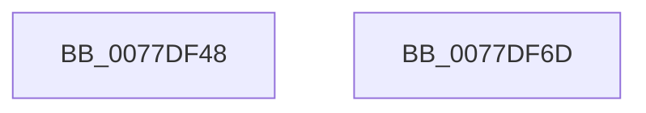

# TtmpAcquireQueueLock

- RVA: `0x0077DF48`–`0x0077DF6E` (길이 `38` bytes)
- VA: `0x000000014077DF48`
- 실행 섹션: `PAGE`
- PDB 이름 있음: `예`; PDB Function 태그: `아니요`
- unwind 정보 RVA: `0x0005C788`
- 디코드: `10`개 명령, `38/38` bytes 표시
- 미해석 바이트: `0` (있으면 어셈블리에 `.byte`로 보존)

> 이 문서는 커널 이미지의 기계어와 PDB 기호를 분석해 생성했습니다. 4번과 5번은 함수 원형과 자료형을 바이너리 사용 방식에서 추정한 C 해석이며 원본 소스 복구 결과는 아닙니다.

## 1. Dependencies

- 직접 호출 지점: **1**; 고유 호출 대상: **1**
- 직접 호출자로 확인된 함수: **3**
- RIP 상대 이미지 참조: **0**

### Outgoing calls
- `0x0077DF63` → [ExAcquireResourceExclusiveLite](../../text/21/ExAcquireResourceExclusiveLite_function_00214E20.md) (function, `0x00214E20`)

### Direct callers
- [TtmiWriteEventToAllQueues](TtmiWriteEventToAllQueues_function_007775AC.md) at `0x00777604`
- [TtmiRetrieveEventFromQueue](TtmiRetrieveEventFromQueue_function_0077DCB8.md) at `0x0077DCD7`
- [TtmiWriteEventToSingleQueue](TtmiWriteEventToSingleQueue_function_0077DE04.md) at `0x0077DE1E`

### Static image references
- 디코드된 RIP-relative 메모리 참조가 없습니다.

## 2. Other-region calls and transfers

- 다른 실행 섹션으로 향하는 call: **1**
  - `0x0077DF63` → [ExAcquireResourceExclusiveLite](../../text/21/ExAcquireResourceExclusiveLite_function_00214E20.md) (`PAGE` → `.text`)
- 별도 외부 분기/꼬리 이동을 확인하지 못했습니다.

## 3. Assembly (complete function range)

```asm
0077DF48  48 83 EC 28                     sub rsp, 0x28
0077DF4C  65 48 8B 04 25 88 01 00 00      mov rax, qword ptr gs:[0x188]
0077DF55  48 83 C1 18                     add rcx, 0x18
0077DF59  B2 01                           mov dl, 1
0077DF5B  66 FF 88 E4 01 00 00            dec word ptr [rax + 0x1e4]
0077DF62  90                              nop
0077DF63  E8 B8 6E A9 FF                  call 0x140214e20
0077DF68  48 83 C4 28                     add rsp, 0x28
0077DF6C  C3                              ret
0077DF6D  CC                              int3
```

## 4. C-style interpretation (structured pseudocode)

```c
__int64 __fastcall TtmpAcquireQueueLock(__int64 a1)
{
    __int64 result;
    __int64 v_rsp;

    v_rsp = (v_rsp) - (40);
    a1 = (a1) + (24);
    result = ExAcquireResourceExclusiveLite(a1, 1, a3, a4);
    v_rsp = (v_rsp) + (40);
    return result;
}
```

## 5. (Beta) C Style

```c
int64_t TtmpAcquireQueueLock(int64_t Arg1)
{
    int64_t result;
    int64_t local_rsp;

    local_rsp = (local_rsp) - (40);
    Arg1 = (Arg1) + (24);
    result = ExAcquireResourceExclusiveLite(Arg1, 1, a3, a4);
    local_rsp = (local_rsp) + (40);
    return result;
}
```

## 6. Execution-region graph

[열기: 2D/3D 그래프와 함수 탐색 컨트롤 패널](../../../control-panel.html?section=page&rva=0x0077DF48&view=graph)

- 2D 그래프는 위에서 아래로 흐르고, 3D 그래프는 빈 공간을 드래그해 회전합니다. Shift+드래그는 이동, 휠은 확대·축소, 함수 노드 선택은 대상 보고서 이동입니다.

### Static fallback


