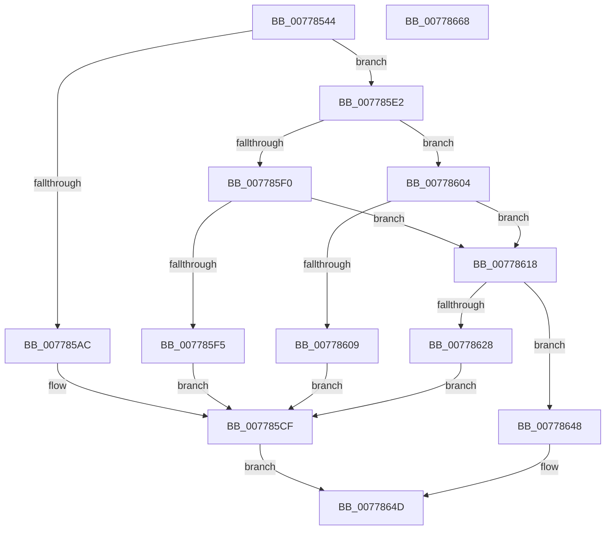

# TtmpAcquireSessionFromTerminalHandle

- RVA: `0x00778544`–`0x00778669` (길이 `293` bytes)
- VA: `0x0000000140778544`
- 실행 섹션: `PAGE`
- PDB 이름 있음: `예`; PDB Function 태그: `아니요`
- unwind 정보 RVA: `0x0005D7BC`
- 디코드: `76`개 명령, `293/293` bytes 표시
- 미해석 바이트: `0` (있으면 어셈블리에 `.byte`로 보존)

> 이 문서는 커널 이미지의 기계어와 PDB 기호를 분석해 생성했습니다. 4번과 5번은 함수 원형과 자료형을 바이너리 사용 방식에서 추정한 C 해석이며 원본 소스 복구 결과는 아닙니다.

## 1. Dependencies

- 직접 호출 지점: **6**; 고유 호출 대상: **5**
- 직접 호출자로 확인된 함수: **9**
- RIP 상대 이미지 참조: **4**

### Outgoing calls
- `0x007785A1` → [ObReferenceObjectByHandle](../86/ObReferenceObjectByHandle_function_00868DB0.md) (function, `0x00868DB0`)
- `0x007785C2` → [TtmiLogError](../98/TtmiLogError_function_0098B39C.md) (function, `0x0098B39C`)
- `0x007785D9` → [TtmiLogError](../98/TtmiLogError_function_0098B39C.md) (function, `0x0098B39C`)
- `0x00778618` → [TtmpAcquireSessionLock](../70/TtmpAcquireSessionLock_function_00700408.md) (function, `0x00700408`)
- `0x0077862F` → [ExReleaseResourceLite](../../text/25/ExReleaseResourceLite_function_0025FA10.md) (function, `0x0025FA10`)
- `0x00778634` → [KeLeaveCriticalRegion](../../text/25/KeLeaveCriticalRegion_function_0025D8B0.md) (function, `0x0025D8B0`)

### Direct callers
- [TtmpDispatchAssignDevice](TtmpDispatchAssignDevice_function_00778670.md) at `0x0077869F`
- [TtmpDispatchCreateEventQueue](TtmpDispatchCreateEventQueue_function_00778718.md) at `0x00778756`
- [TtmpDispatchCreateTerminal](TtmpDispatchCreateTerminal_function_00778858.md) at `0x0077888D`
- [TtmpDispatchEvacuateDevices](TtmpDispatchEvacuateDevices_function_00778948.md) at `0x0077896F`
- [TtmpDispatchSetDefaultDeviceAssignment](TtmpDispatchSetDefaultDeviceAssignment_function_00778B54.md) at `0x00778B86`
- [TtmpDispatchSetDisplayPowerRequest](TtmpDispatchSetDisplayPowerRequest_function_00778C10.md) at `0x00778C3F`
- [TtmpDispatchSetDisplayState](TtmpDispatchSetDisplayState_function_00778CBC.md) at `0x00778CEB`
- [TtmpDispatchSetDisplayTimeouts](TtmpDispatchSetDisplayTimeouts_function_00778D70.md) at `0x00778DA1`
- [TtmpDispatchSetInputWakeCapability](TtmpDispatchSetInputWakeCapability_function_00778E2C.md) at `0x00778E5B`

### Static image references
- `0x0077858D` → RVA `0x00FD9D08` (`PAGEDATA`; read)
- `0x007785B0` → RVA `0x00B04670` (` ?? ::NNGAKEGL::`string'`; read)
- `0x007785D2` → RVA `0x00B04460` (` ?? ::NNGAKEGL::`string'`; read)
- `0x00778628` → RVA `0x00F06940` (`.data`; read)

## 2. Other-region calls and transfers

- 다른 실행 섹션으로 향하는 call: **2**
  - `0x0077862F` → [ExReleaseResourceLite](../../text/25/ExReleaseResourceLite_function_0025FA10.md) (`PAGE` → `.text`)
  - `0x00778634` → [KeLeaveCriticalRegion](../../text/25/KeLeaveCriticalRegion_function_0025D8B0.md) (`PAGE` → `.text`)
- 별도 외부 분기/꼬리 이동을 확인하지 못했습니다.

## 3. Assembly (complete function range)

```asm
00778544  4C 8B DC                        mov r11, rsp
00778547  49 89 5B 08                     mov qword ptr [r11 + 8], rbx
0077854B  49 89 6B 10                     mov qword ptr [r11 + 0x10], rbp
0077854F  49 89 73 18                     mov qword ptr [r11 + 0x18], rsi
00778553  49 89 7B 20                     mov qword ptr [r11 + 0x20], rdi
00778557  41 56                           push r14
00778559  48 83 EC 30                     sub rsp, 0x30
0077855D  65 48 8B 04 25 88 01 00 00      mov rax, qword ptr gs:[0x188]
00778566  49 8B F1                        mov rsi, r9
00778569  48 8B 7C 24 60                  mov rdi, qword ptr [rsp + 0x60]
0077856E  41 8A E8                        mov bpl, r8b
00778571  49 83 21 00                     and qword ptr [r9], 0
00778575  44 8A F2                        mov r14b, dl
00778578  49 83 63 F0 00                  and qword ptr [r11 - 0x10], 0
0077857D  BA 02 00 00 00                  mov edx, 2
00778582  44 8A 88 32 02 00 00            mov r9b, byte ptr [rax + 0x232]
00778589  49 8D 43 28                     lea rax, [r11 + 0x28]
0077858D  4C 8B 05 74 17 86 00            mov r8, qword ptr [rip + 0x861774]
00778594  48 83 27 00                     and qword ptr [rdi], 0
00778598  49 83 63 28 00                  and qword ptr [r11 + 0x28], 0
0077859D  49 89 43 E8                     mov qword ptr [r11 - 0x18], rax
007785A1  E8 0A 08 0F 00                  call 0x140868db0
007785A6  8B D8                           mov ebx, eax
007785A8  85 C0                           test eax, eax
007785AA  79 36                           jns 0x1407785e2
007785AC  48 83 27 00                     and qword ptr [rdi], 0
007785B0  48 8D 0D B9 C0 38 00            lea rcx, [rip + 0x38c0b9]
007785B7  44 8B C8                        mov r9d, eax
007785BA  44 8B C0                        mov r8d, eax
007785BD  BA F0 03 00 00                  mov edx, 0x3f0
007785C2  E8 D5 2D 21 00                  call 0x14098b39c
007785C7  44 8B C3                        mov r8d, ebx
007785CA  BA 58 00 00 00                  mov edx, 0x58
007785CF  44 8B CB                        mov r9d, ebx
007785D2  48 8D 0D 87 BE 38 00            lea rcx, [rip + 0x38be87]
007785D9  E8 BE 2D 21 00                  call 0x14098b39c
007785DE  8B C3                           mov eax, ebx
007785E0  EB 6B                           jmp 0x14077864d
007785E2  48 8B 5C 24 60                  mov rbx, qword ptr [rsp + 0x60]
007785E7  48 89 1F                        mov qword ptr [rdi], rbx
007785EA  83 7B 1C 00                     cmp dword ptr [rbx + 0x1c], 0
007785EE  75 14                           jne 0x140778604
007785F0  45 84 F6                        test r14b, r14b
007785F3  75 23                           jne 0x140778618
007785F5  41 83 C8 FF                     or r8d, 0xffffffff
007785F9  BB 24 00 00 C0                  mov ebx, 0xc0000024
007785FE  41 8D 50 5E                     lea edx, [r8 + 0x5e]
00778602  EB CB                           jmp 0x1407785cf
00778604  40 84 ED                        test bpl, bpl
00778607  75 0F                           jne 0x140778618
00778609  41 83 C8 FF                     or r8d, 0xffffffff
0077860D  BB 24 00 00 C0                  mov ebx, 0xc0000024
00778612  41 8D 50 63                     lea edx, [r8 + 0x63]
00778616  EB B7                           jmp 0x1407785cf
00778618  E8 EB 7D F8 FF                  call 0x140700408
0077861D  48 8B 4B 10                     mov rcx, qword ptr [rbx + 0x10]
00778621  8B 41 04                        mov eax, dword ptr [rcx + 4]
00778624  A8 04                           test al, 4
00778626  74 20                           je 0x140778648
00778628  48 8D 0D 11 E3 78 00            lea rcx, [rip + 0x78e311]
0077862F  E8 DC 73 AE FF                  call 0x14025fa10
00778634  E8 77 52 AE FF                  call 0x14025d8b0
00778639  41 83 C8 FF                     or r8d, 0xffffffff
0077863D  BB 55 04 00 C0                  mov ebx, 0xc0000455
00778642  41 8D 50 6A                     lea edx, [r8 + 0x6a]
00778646  EB 87                           jmp 0x1407785cf
00778648  48 89 0E                        mov qword ptr [rsi], rcx
0077864B  33 C0                           xor eax, eax
0077864D  48 8B 5C 24 40                  mov rbx, qword ptr [rsp + 0x40]
00778652  48 8B 6C 24 48                  mov rbp, qword ptr [rsp + 0x48]
00778657  48 8B 74 24 50                  mov rsi, qword ptr [rsp + 0x50]
0077865C  48 8B 7C 24 58                  mov rdi, qword ptr [rsp + 0x58]
00778661  48 83 C4 30                     add rsp, 0x30
00778665  41 5E                           pop r14
00778667  C3                              ret
00778668  CC                              int3
```

## 4. C-style interpretation (structured pseudocode)

```c
__int64 __fastcall TtmpAcquireSessionFromTerminalHandle(__int64 a1, unsigned __int8 a2, unsigned __int8 a3, __int64 a4, __int64 a5)
{
    __int64 result;
    __int64 v_rsp;
    unsigned __int64 v_stack_p10;
    unsigned __int64 v_stack_p18;
    unsigned __int64 v_stack_p20;
    unsigned __int64 v_stack_p8;

    *(unsigned __int64 *)(v_rsp + 8) = v_rbx;
    *(unsigned __int64 *)(v_rsp + 16) = v_rbp;
    *(unsigned __int64 *)(v_rsp + 24) = v_rsi;
    *(unsigned __int64 *)(v_rsp + 32) = v_rdi;
    v_rsp = (v_rsp) - (48);
    *(unsigned __int64 *)(v_rsp - 24) = v_rsp + 40;
    result = ObReferenceObjectByHandle(a1, 2, *(unsigned __int64 *)(v_rip + 8787828), *(unsigned __int8 *)(*(unsigned __int64 *)(gs_base + (0 + 392)) + 562));
    if (!sign_flag) goto loc_007785E2;
    result = TtmiLogError(v_rip + 3719353, (unsigned int)(0x3F0ULL), (unsigned int)((unsigned int)(result)), (unsigned int)((unsigned int)(result)));
loc_007785CF:
    result = TtmiLogError(v_rip + 3718791, 88, (unsigned int)((unsigned int)((unsigned int)((unsigned int)(result)))), (unsigned int)((unsigned int)((unsigned int)((unsigned int)(result)))));
    goto loc_0077864D;
loc_007785E2:
    *(unsigned __int64 *)(a5) = a5;
    if ((*(unsigned int *)(a5 + 28)) != 0) goto loc_00778604;
    if (a2 != 0) goto loc_00778618;
    a3 = (unsigned int)(((unsigned int)((unsigned int)((unsigned int)((unsigned int)(result))))) | (0xFFFFFFFFULL));
    goto loc_007785CF;
loc_00778604:
    if (a3 != 0) goto loc_00778618;
    a3 = (unsigned int)((a3) | (0xFFFFFFFFULL));
    goto loc_007785CF;
loc_00778618:
    result = TtmpAcquireSessionLock(v_rip + 3718791, a3 + 99, a3, (unsigned int)((unsigned int)((unsigned int)((unsigned int)(result)))));
    if ((((unsigned __int8)((unsigned int)(*(unsigned int *)(*(unsigned __int64 *)((unsigned int)(0xC0000024ULL) + 16) + 4)))) & (4)) == 0) goto loc_00778648;
    result = ExReleaseResourceLite(v_rip + 7922449, a3 + 99, a3, (unsigned int)((unsigned int)((unsigned int)((unsigned int)(result)))));
    result = KeLeaveCriticalRegion(v_rip + 7922449, a3 + 99, a3, (unsigned int)((unsigned int)((unsigned int)((unsigned int)(result)))));
    a3 = (unsigned int)((a3) | (0xFFFFFFFFULL));
    goto loc_007785CF;
loc_00778648:
    *(unsigned __int64 *)(a4) = v_rip + 7922449;
    result = 0;
loc_0077864D:
    v_rsp = (v_rsp) + (48);
    return result;
}
```

## 5. (Beta) C Style

```c
int64_t TtmpAcquireSessionFromTerminalHandle(int64_t Arg1, uint8_t Arg2, uint8_t Arg3, void *Arg4, void *Arg5)
{
    uint8_t *arg4 = (uint8_t *)Arg4;
    uint8_t *arg5 = (uint8_t *)Arg5;

    int64_t result;
    int64_t local_rsp;
    uint64_t v_stack_p10;
    uint64_t v_stack_p18;
    uint64_t v_stack_p20;
    uint64_t v_stack_p8;

    *(uint64_t *)(local_rsp + 0x8) = local_rbx;
    *(uint64_t *)(local_rsp + 0x10) = local_rbp;
    *(uint64_t *)(local_rsp + 0x18) = local_rsi;
    *(uint64_t *)(local_rsp + 0x20) = local_rdi;
    local_rsp = (local_rsp) - (48);
    *(uint64_t *)(local_rsp - 0x18) = local_rsp + 40;
    result = ObReferenceObjectByHandle(Arg1, 2, *(uint64_t *)(v_rip + 0x861774), *(uint8_t *)(*(uint64_t *)(gs_base + (0 + 0x188)) + 0x232));
    if (!sign_flag) goto loc_007785E2;
    result = TtmiLogError(v_rip + 3719353, (uint32_t)(0x3F0ULL), (uint32_t)((uint32_t)(result)), (uint32_t)((uint32_t)(result)));
loc_007785CF:
    result = TtmiLogError(v_rip + 3718791, 88, (uint32_t)((uint32_t)((uint32_t)((uint32_t)(result)))), (uint32_t)((uint32_t)((uint32_t)((uint32_t)(result)))));
    goto loc_0077864D;
loc_007785E2:
    *(void **)(arg5) = Arg5;
    if ((*(uint32_t *)(arg5 + 0x1C)) != 0) goto loc_00778604;
    if (Arg2 != 0) goto loc_00778618;
    Arg3 = (uint32_t)(((uint32_t)((uint32_t)((uint32_t)((uint32_t)(result))))) | (0xFFFFFFFFULL));
    goto loc_007785CF;
loc_00778604:
    if (Arg3 != 0) goto loc_00778618;
    Arg3 = (uint32_t)((Arg3) | (0xFFFFFFFFULL));
    goto loc_007785CF;
loc_00778618:
    result = TtmpAcquireSessionLock(v_rip + 3718791, Arg3 + 99, Arg3, (uint32_t)((uint32_t)((uint32_t)((uint32_t)(result)))));
    if ((((uint8_t)((uint32_t)(*(uint32_t *)(*(uint64_t *)((uint32_t)(0xC0000024ULL) + 0x10) + 0x4)))) & (4)) == 0) goto loc_00778648;
    result = ExReleaseResourceLite(v_rip + 7922449, Arg3 + 99, Arg3, (uint32_t)((uint32_t)((uint32_t)((uint32_t)(result)))));
    result = KeLeaveCriticalRegion(v_rip + 7922449, Arg3 + 99, Arg3, (uint32_t)((uint32_t)((uint32_t)((uint32_t)(result)))));
    Arg3 = (uint32_t)((Arg3) | (0xFFFFFFFFULL));
    goto loc_007785CF;
loc_00778648:
    *(uint64_t *)(arg4) = v_rip + 7922449;
    result = 0;
loc_0077864D:
    local_rsp = (local_rsp) + (48);
    return result;
}
```

### 관측된 메모리 오프셋

구조체 형식이 확인되지 않은 접근은 인자 기준의 오프셋으로만 기록했습니다.

| 기준 인자 | 오프셋 표현 | 폭 (bit) | 접근 |
|---|---:|---:|---|
| `Arg4` | `+ 0x0` | `64` | `R/W` |
| `Arg4` | `+ 0x0` | `64` | `W` |
| `Arg5` | `+ 0x0` | `64` | `R/W` |
| `Arg5` | `+ 0x0` | `64` | `W` |
| `Arg5` | `+ 0x10` | `64` | `R` |
| `Arg5` | `+ 0x1C` | `32` | `R` |

## 6. Execution-region graph

[열기: 2D/3D 그래프와 함수 탐색 컨트롤 패널](../../../control-panel.html?section=page&rva=0x00778544&view=graph)

- 2D 그래프는 위에서 아래로 흐르고, 3D 그래프는 빈 공간을 드래그해 회전합니다. Shift+드래그는 이동, 휠은 확대·축소, 함수 노드 선택은 대상 보고서 이동입니다.

### Static fallback


