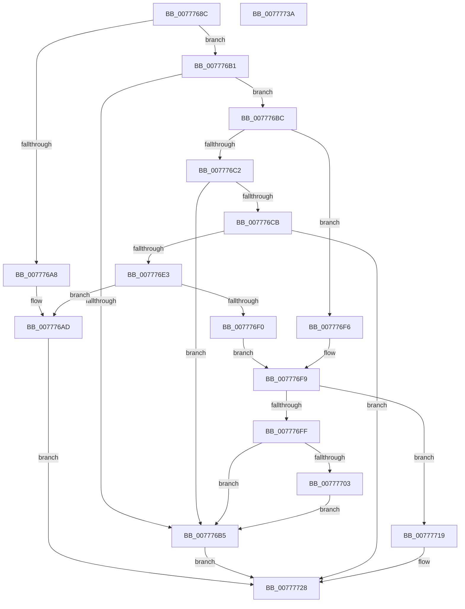

# TtmpActivateSessionWorker

- RVA: `0x0077768C`–`0x0077773B` (길이 `175` bytes)
- VA: `0x000000014077768C`
- 실행 섹션: `PAGE`
- PDB 이름 있음: `예`; PDB Function 태그: `아니요`
- unwind 정보 RVA: `0x00060BC4`
- 디코드: `62`개 명령, `175/175` bytes 표시
- 미해석 바이트: `0` (있으면 어셈블리에 `.byte`로 보존)

> 이 문서는 커널 이미지의 기계어와 PDB 기호를 분석해 생성했습니다. 4번과 5번은 함수 원형과 자료형을 바이너리 사용 방식에서 추정한 C 해석이며 원본 소스 복구 결과는 아닙니다.

## 1. Dependencies

- 직접 호출 지점: **3**; 고유 호출 대상: **3**
- 직접 호출자로 확인된 함수: **1**
- RIP 상대 이미지 참조: **0**

### Outgoing calls
- `0x007776D8` → [TtmpInitiateModernStandbyTransition](TtmpInitiateModernStandbyTransition_function_00777A18.md) (function, `0x00777A18`)
- `0x00777712` → [TtmpSessionPowerControl](TtmpSessionPowerControl_function_00777ECC.md) (function, `0x00777ECC`)
- `0x00777723` → [TtmiLogSessionActivate](TtmiLogSessionActivate_function_0077ADB8.md) (function, `0x0077ADB8`)

### Direct callers
- [TtmpSessionWorker](TtmpSessionWorker_function_00777F60.md) at `0x0077801F`

### Static image references
- 디코드된 RIP-relative 메모리 참조가 없습니다.

## 2. Other-region calls and transfers

- 다른 실행 섹션으로 향하는 call: **0**
- 별도 외부 분기/꼬리 이동을 확인하지 못했습니다.

## 3. Assembly (complete function range)

```asm
0077768C  48 89 5C 24 08                  mov qword ptr [rsp + 8], rbx
00777691  48 89 74 24 10                  mov qword ptr [rsp + 0x10], rsi
00777696  57                              push rdi
00777697  48 83 EC 20                     sub rsp, 0x20
0077769B  48 8D 79 04                     lea rdi, [rcx + 4]
0077769F  48 8B F1                        mov rsi, rcx
007776A2  8B 07                           mov eax, dword ptr [rdi]
007776A4  A8 08                           test al, 8
007776A6  74 09                           je 0x1407776b1
007776A8  83 E0 EF                        and eax, 0xffffffef
007776AB  89 07                           mov dword ptr [rdi], eax
007776AD  33 DB                           xor ebx, ebx
007776AF  EB 77                           jmp 0x140777728
007776B1  A8 40                           test al, 0x40
007776B3  74 07                           je 0x1407776bc
007776B5  BB 03 01 00 00                  mov ebx, 0x103
007776BA  EB 6C                           jmp 0x140777728
007776BC  0F BA E0 09                     bt eax, 9
007776C0  73 34                           jae 0x1407776f6
007776C2  B9 00 01 00 00                  mov ecx, 0x100
007776C7  85 C1                           test ecx, eax
007776C9  75 EA                           jne 0x1407776b5
007776CB  44 8B 46 0C                     mov r8d, dword ptr [rsi + 0xc]
007776CF  0B C1                           or eax, ecx
007776D1  48 8B CE                        mov rcx, rsi
007776D4  89 07                           mov dword ptr [rdi], eax
007776D6  33 D2                           xor edx, edx
007776D8  E8 3B 03 00 00                  call 0x140777a18
007776DD  8B D8                           mov ebx, eax
007776DF  85 C0                           test eax, eax
007776E1  75 45                           jne 0x140777728
007776E3  8B 07                           mov eax, dword ptr [rdi]
007776E5  25 FF FC FF FF                  and eax, 0xfffffcff
007776EA  89 07                           mov dword ptr [rdi], eax
007776EC  A8 10                           test al, 0x10
007776EE  74 BD                           je 0x1407776ad
007776F0  48 8D 4E 04                     lea rcx, [rsi + 4]
007776F4  EB 03                           jmp 0x1407776f9
007776F6  48 8B CF                        mov rcx, rdi
007776F9  0F BA E0 0A                     bt eax, 0xa
007776FD  73 1A                           jae 0x140777719
007776FF  84 C0                           test al, al
00777701  78 B2                           js 0x1407776b5
00777703  44 8B 46 0C                     mov r8d, dword ptr [rsi + 0xc]
00777707  0F BA E8 07                     bts eax, 7
0077770B  B2 01                           mov dl, 1
0077770D  89 07                           mov dword ptr [rdi], eax
0077770F  48 8B CE                        mov rcx, rsi
00777712  E8 B5 07 00 00                  call 0x140777ecc
00777717  EB 9C                           jmp 0x1407776b5
00777719  83 C8 08                        or eax, 8
0077771C  33 DB                           xor ebx, ebx
0077771E  83 E0 EF                        and eax, 0xffffffef
00777721  89 01                           mov dword ptr [rcx], eax
00777723  E8 90 36 00 00                  call 0x14077adb8
00777728  48 8B 74 24 38                  mov rsi, qword ptr [rsp + 0x38]
0077772D  8B C3                           mov eax, ebx
0077772F  48 8B 5C 24 30                  mov rbx, qword ptr [rsp + 0x30]
00777734  48 83 C4 20                     add rsp, 0x20
00777738  5F                              pop rdi
00777739  C3                              ret
0077773A  CC                              int3
```

## 4. C-style interpretation (structured pseudocode)

```c
__int64 __fastcall TtmpActivateSessionWorker(__int64 a1, int a2)
{
    __int64 result;
    __int64 v_rbx;
    __int64 v_rsp;
    unsigned __int64 v_stack_p10;
    unsigned __int64 v_stack_p8;

    v_stack_p8 = v_rbx;
    v_stack_p10 = v_rsi;
    v_rsp = (v_rsp) - (32);
    if ((((unsigned __int8)((unsigned int)(*(unsigned int *)(a1 + 4)))) & (8)) == 0) goto loc_007776B1;
    result = (unsigned int)(((unsigned int)(*(unsigned int *)(a1 + 4))) & (0xFFFFFFEFULL));
    *(unsigned int *)(a1 + 4) = (unsigned int)(result);
loc_007776AD:
    v_rbx = 0;
    goto loc_00777728;
loc_007776B1:
    if ((((unsigned __int8)(result)) & (64)) == 0) goto loc_007776BC;
loc_007776B5:
    goto loc_00777728;
loc_007776BC:
    if (condition_is_above_or_equal) goto loc_007776F6;
    if (((256) & ((unsigned int)(result))) != 0) goto loc_007776B5;
    result = (unsigned int)((result) | (256));
    *(unsigned int *)(a1 + 4) = (unsigned int)(result);
    a2 = 0;
    result = TtmpInitiateModernStandbyTransition(a1, a2, (unsigned int)(*(unsigned int *)(a1 + 12)), a4);
    if ((unsigned int)(result) != 0) goto loc_00777728;
    result = (unsigned int)(((unsigned int)(*(unsigned int *)(a1 + 4))) & (0xFFFFFCFFULL));
    *(unsigned int *)(a1 + 4) = (unsigned int)(result);
    if ((((unsigned __int8)(result)) & (16)) == 0) goto loc_007776AD;
    goto loc_007776F9;
loc_007776F6:
loc_007776F9:
    if (condition_is_above_or_equal) goto loc_00777719;
    if (sign_flag) goto loc_007776B5;
    *(unsigned int *)(a1 + 4) = (unsigned int)(result);
    result = TtmpSessionPowerControl(a1, 1, (unsigned int)(*(unsigned int *)(a1 + 12)), a4);
    goto loc_007776B5;
loc_00777719:
    result = (unsigned int)((result) | (8));
    v_rbx = 0;
    result = (unsigned int)((result) & (0xFFFFFFEFULL));
    *(unsigned int *)(a1) = (unsigned int)(result);
    result = TtmiLogSessionActivate(a1, 1, (unsigned int)(*(unsigned int *)(a1 + 12)), a4);
loc_00777728:
    v_rsp = (v_rsp) + (32);
    return 0;
}
```

## 5. (Beta) C Style

```c
int64_t TtmpActivateSessionWorker(void *Arg1, int32_t Arg2)
{
    uint8_t *arg1 = (uint8_t *)Arg1;

    int64_t result;
    int64_t local_rbx;
    int64_t local_rsp;
    uint64_t v_stack_p10;
    uint64_t v_stack_p8;

    v_stack_p8 = local_rbx;
    v_stack_p10 = local_rsi;
    local_rsp = (local_rsp) - (32);
    if ((((uint8_t)((uint32_t)(*(uint32_t *)(arg1 + 0x4)))) & (8)) == 0) goto loc_007776B1;
    result = (uint32_t)(((uint32_t)(*(uint32_t *)(arg1 + 0x4))) & (0xFFFFFFEFULL));
    *(uint32_t *)(arg1 + 0x4) = (uint32_t)(result);
loc_007776AD:
    local_rbx = 0;
    goto loc_00777728;
loc_007776B1:
    if ((((uint8_t)(result)) & (64)) == 0) goto loc_007776BC;
loc_007776B5:
    goto loc_00777728;
loc_007776BC:
    if (condition_is_above_or_equal) goto loc_007776F6;
    if (((256) & ((uint32_t)(result))) != 0) goto loc_007776B5;
    result = (uint32_t)((result) | (256));
    *(uint32_t *)(arg1 + 0x4) = (uint32_t)(result);
    Arg2 = 0;
    result = TtmpInitiateModernStandbyTransition(Arg1, Arg2, (uint32_t)(*(uint32_t *)(arg1 + 0xC)), a4);
    if ((uint32_t)(result) != 0) goto loc_00777728;
    result = (uint32_t)(((uint32_t)(*(uint32_t *)(arg1 + 0x4))) & (0xFFFFFCFFULL));
    *(uint32_t *)(arg1 + 0x4) = (uint32_t)(result);
    if ((((uint8_t)(result)) & (16)) == 0) goto loc_007776AD;
    goto loc_007776F9;
loc_007776F6:
loc_007776F9:
    if (condition_is_above_or_equal) goto loc_00777719;
    if (sign_flag) goto loc_007776B5;
    *(uint32_t *)(arg1 + 0x4) = (uint32_t)(result);
    result = TtmpSessionPowerControl(Arg1, 1, (uint32_t)(*(uint32_t *)(arg1 + 0xC)), a4);
    goto loc_007776B5;
loc_00777719:
    result = (uint32_t)((result) | (8));
    local_rbx = 0;
    result = (uint32_t)((result) & (0xFFFFFFEFULL));
    *(uint32_t *)(arg1) = (uint32_t)(result);
    result = TtmiLogSessionActivate(Arg1, 1, (uint32_t)(*(uint32_t *)(arg1 + 0xC)), a4);
loc_00777728:
    local_rsp = (local_rsp) + (32);
    return 0;
}
```

### 관측된 메모리 오프셋

구조체 형식이 확인되지 않은 접근은 인자 기준의 오프셋으로만 기록했습니다.

| 기준 인자 | 오프셋 표현 | 폭 (bit) | 접근 |
|---|---:|---:|---|
| `Arg1` | `+ 0x0` | `32` | `R` |
| `Arg1` | `+ 0x0` | `32` | `W` |
| `Arg1` | `+ 0x4` | `64` | `R` |
| `Arg1` | `+ 0xC` | `32` | `R` |

## 6. Execution-region graph

[열기: 2D/3D 그래프와 함수 탐색 컨트롤 패널](../../../control-panel.html?section=page&rva=0x0077768C&view=graph)

- 2D 그래프는 위에서 아래로 흐르고, 3D 그래프는 빈 공간을 드래그해 회전합니다. Shift+드래그는 이동, 휠은 확대·축소, 함수 노드 선택은 대상 보고서 이동입니다.

### Static fallback


