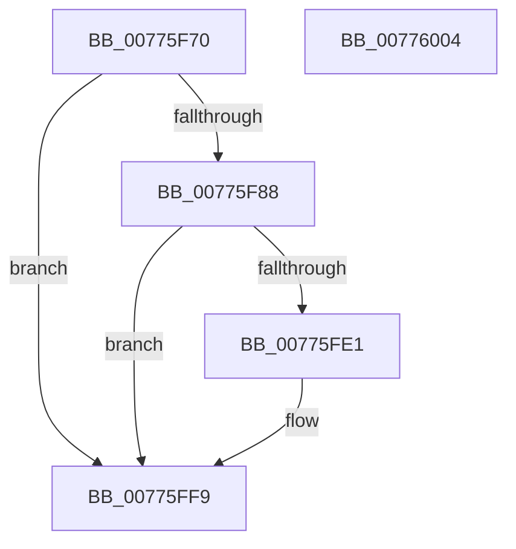

# TtmpCallAssignedToTerminal

- RVA: `0x00775F70`–`0x00776005` (길이 `149` bytes)
- VA: `0x0000000140775F70`
- 실행 섹션: `PAGE`
- PDB 이름 있음: `예`; PDB Function 태그: `아니요`
- unwind 정보 RVA: `0x0008C33C`
- 디코드: `41`개 명령, `149/149` bytes 표시
- 미해석 바이트: `0` (있으면 어셈블리에 `.byte`로 보존)

> 이 문서는 커널 이미지의 기계어와 PDB 기호를 분석해 생성했습니다. 4번과 5번은 함수 원형과 자료형을 바이너리 사용 방식에서 추정한 C 해석이며 원본 소스 복구 결과는 아닙니다.

## 1. Dependencies

- 직접 호출 지점: **4**; 고유 호출 대상: **4**
- 직접 호출자로 확인된 함수: **1**
- RIP 상대 이미지 참조: **1**

### Outgoing calls
- `0x00775FB8` → [TtmpStartCallout](TtmpStartCallout_function_00776AA4.md) (function, `0x00776AA4`)
- `0x00775FCA` → [guard_dispatch_icall](../../text/6B/guard_dispatch_icall_function_006BAAD0.md) (function, `0x006BAAD0`)
- `0x00775FD8` → [TtmpStopCallout](TtmpStopCallout_function_00776C24.md) (function, `0x00776C24`)
- `0x00775FF4` → [TtmiLogError](../98/TtmiLogError_function_0098B39C.md) (function, `0x0098B39C`)

### Direct callers
- [TtmiSessionDeviceListWorker](TtmiSessionDeviceListWorker_function_00775CA0.md) at `0x00775D39`

### Static image references
- `0x00775FE5` → RVA `0x00B03F80` (` ?? ::NNGAKEGL::`string'`; read)

## 2. Other-region calls and transfers

- 다른 실행 섹션으로 향하는 call: **1**
  - `0x00775FCA` → [guard_dispatch_icall](../../text/6B/guard_dispatch_icall_function_006BAAD0.md) (`PAGE` → `.text`)
- 별도 외부 분기/꼬리 이동을 확인하지 못했습니다.

## 3. Assembly (complete function range)

```asm
00775F70  4C 8B DC                        mov r11, rsp
00775F73  49 89 5B 08                     mov qword ptr [r11 + 8], rbx
00775F77  57                              push rdi
00775F78  48 83 EC 60                     sub rsp, 0x60
00775F7C  48 8B 7A 30                     mov rdi, qword ptr [rdx + 0x30]
00775F80  48 8B DA                        mov rbx, rdx
00775F83  48 85 FF                        test rdi, rdi
00775F86  74 71                           je 0x140775ff9
00775F88  44 8B 82 54 02 00 00            mov r8d, dword ptr [rdx + 0x254]
00775F8F  33 C0                           xor eax, eax
00775F91  45 89 43 C0                     mov dword ptr [r11 - 0x40], r8d
00775F95  0F 57 C0                        xorps xmm0, xmm0
00775F98  4C 8B C2                        mov r8, rdx
00775F9B  49 89 7B B8                     mov qword ptr [r11 - 0x48], rdi
00775F9F  48 8B D1                        mov rdx, rcx
00775FA2  49 8D 4B C8                     lea rcx, [r11 - 0x38]
00775FA6  0F 11 44 24 30                  movups xmmword ptr [rsp + 0x30], xmm0
00775FAB  44 8D 48 01                     lea r9d, [rax + 1]
00775FAF  0F 11 44 24 40                  movups xmmword ptr [rsp + 0x40], xmm0
00775FB4  49 89 43 E8                     mov qword ptr [r11 - 0x18], rax
00775FB8  E8 E7 0A 00 00                  call 0x140776aa4
00775FBD  8B 93 54 02 00 00               mov edx, dword ptr [rbx + 0x254]
00775FC3  48 8B C7                        mov rax, rdi
00775FC6  48 8B 4B 18                     mov rcx, qword ptr [rbx + 0x18]
00775FCA  E8 01 4B F4 FF                  call 0x1406baad0
00775FCF  8B D0                           mov edx, eax
00775FD1  48 8D 4C 24 30                  lea rcx, [rsp + 0x30]
00775FD6  8B D8                           mov ebx, eax
00775FD8  E8 47 0C 00 00                  call 0x140776c24
00775FDD  85 DB                           test ebx, ebx
00775FDF  79 18                           jns 0x140775ff9
00775FE1  41 83 C9 FF                     or r9d, 0xffffffff
00775FE5  48 8D 0D 94 DF 38 00            lea rcx, [rip + 0x38df94]
00775FEC  44 8B C3                        mov r8d, ebx
00775FEF  BA 4C 09 00 00                  mov edx, 0x94c
00775FF4  E8 A3 53 21 00                  call 0x14098b39c
00775FF9  48 8B 5C 24 70                  mov rbx, qword ptr [rsp + 0x70]
00775FFE  48 83 C4 60                     add rsp, 0x60
00776002  5F                              pop rdi
00776003  C3                              ret
00776004  CC                              int3
```

## 4. C-style interpretation (structured pseudocode)

```c
__int64 __fastcall TtmpCallAssignedToTerminal(__int64 a1, __int64 a2)
{
    __int64 result;
    __int64 v_rsp;
    unsigned __int64 v_stack_m28;
    unsigned __int64 v_stack_m38;
    unsigned __int64 v_stack_p8;

    *(unsigned __int64 *)(v_rsp + 8) = v_rbx;
    v_rsp = (v_rsp) - (96);
    if (*(unsigned __int64 *)(a2 + 48) == 0) goto loc_00775FF9;
    result = 0;
    *(unsigned int *)(v_rsp - 64) = (unsigned int)((unsigned int)(*(unsigned int *)(a2 + 596)));
    *(unsigned __int64 *)(v_rsp - 72) = *(unsigned __int64 *)(a2 + 48);
    v_stack_m38 = v_xmm0;
    v_stack_m28 = v_xmm0;
    *(unsigned __int64 *)(v_rsp - 24) = 0;
    result = TtmpStartCallout(v_rsp - 56, a1, a2, result + 1);
    result = guard_dispatch_icall(*(unsigned __int64 *)(a2 + 24), (unsigned int)(*(unsigned int *)(a2 + 596)), a2, result + 1);
    result = TtmpStopCallout(v_stack_m38, (unsigned int)((unsigned int)(result)), a2, result + 1);
    if (sign_flag) {
        a4 = (unsigned int)((result + 1) | (0xFFFFFFFFULL));
        a1 = v_rip + 3727252;
        a3 = (unsigned int)((unsigned int)((unsigned int)(result)));
        a2 = 0x94CULL;
        result = TtmiLogError(a1, a2, a3, a4);
    }
    v_rsp = (v_rsp) + (96);
    return result;
}
```

## 5. (Beta) C Style

```c
int64_t TtmpCallAssignedToTerminal(int64_t Arg1, void *Arg2)
{
    uint8_t *arg2 = (uint8_t *)Arg2;

    int64_t result;
    int64_t local_rsp;
    uint64_t v_stack_m28;
    uint64_t v_stack_m38;
    uint64_t v_stack_p8;

    *(uint64_t *)(local_rsp + 0x8) = local_rbx;
    local_rsp = (local_rsp) - (96);
    if (*(uint64_t *)(arg2 + 0x30) == 0) goto loc_00775FF9;
    result = 0;
    *(uint32_t *)(local_rsp - 0x40) = (uint32_t)((uint32_t)(*(uint32_t *)(arg2 + 0x254)));
    *(uint64_t *)(local_rsp - 0x48) = *(uint64_t *)(arg2 + 0x30);
    v_stack_m38 = v_xmm0;
    v_stack_m28 = v_xmm0;
    *(uint64_t *)(local_rsp - 0x18) = 0;
    result = TtmpStartCallout(local_rsp - 56, Arg1, Arg2, result + 1);
    result = guard_dispatch_icall(*(uint64_t *)(arg2 + 0x18), (uint32_t)(*(uint32_t *)(arg2 + 0x254)), Arg2, result + 1);
    result = TtmpStopCallout(v_stack_m38, (uint32_t)((uint32_t)(result)), Arg2, result + 1);
    if (sign_flag) {
        a4 = (uint32_t)((result + 1) | (0xFFFFFFFFULL));
        Arg1 = v_rip + 3727252;
        a3 = (uint32_t)((uint32_t)((uint32_t)(result)));
        Arg2 = 0x94CULL;
        result = TtmiLogError(Arg1, Arg2, a3, a4);
    }
    local_rsp = (local_rsp) + (96);
    return result;
}
```

### 관측된 메모리 오프셋

구조체 형식이 확인되지 않은 접근은 인자 기준의 오프셋으로만 기록했습니다.

| 기준 인자 | 오프셋 표현 | 폭 (bit) | 접근 |
|---|---:|---:|---|
| `Arg2` | `+ 0x18` | `64` | `R` |
| `Arg2` | `+ 0x30` | `64` | `R` |
| `Arg2` | `+ 0x254` | `32` | `R` |

## 6. Execution-region graph

[열기: 2D/3D 그래프와 함수 탐색 컨트롤 패널](../../../control-panel.html?section=page&rva=0x00775F70&view=graph)

- 2D 그래프는 위에서 아래로 흐르고, 3D 그래프는 빈 공간을 드래그해 회전합니다. Shift+드래그는 이동, 휠은 확대·축소, 함수 노드 선택은 대상 보고서 이동입니다.

### Static fallback


