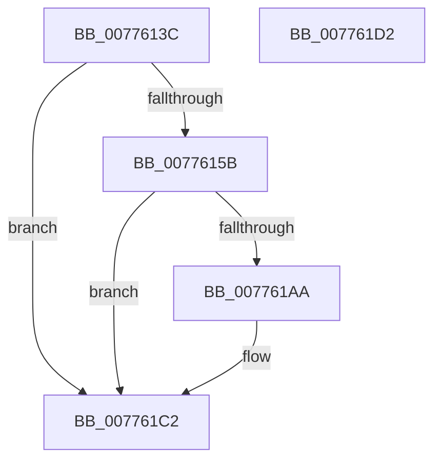

# TtmpCallSetInputMode

- RVA: `0x0077613C`–`0x007761D3` (길이 `151` bytes)
- VA: `0x000000014077613C`
- 실행 섹션: `PAGE`
- PDB 이름 있음: `예`; PDB Function 태그: `아니요`
- unwind 정보 RVA: `0x0007AFEC`
- 디코드: `43`개 명령, `151/151` bytes 표시
- 미해석 바이트: `0` (있으면 어셈블리에 `.byte`로 보존)

> 이 문서는 커널 이미지의 기계어와 PDB 기호를 분석해 생성했습니다. 4번과 5번은 함수 원형과 자료형을 바이너리 사용 방식에서 추정한 C 해석이며 원본 소스 복구 결과는 아닙니다.

## 1. Dependencies

- 직접 호출 지점: **4**; 고유 호출 대상: **4**
- 직접 호출자로 확인된 함수: **1**
- RIP 상대 이미지 참조: **1**

### Outgoing calls
- `0x00776185` → [TtmpStartCallout](TtmpStartCallout_function_00776AA4.md) (function, `0x00776AA4`)
- `0x00776193` → [guard_dispatch_icall](../../text/6B/guard_dispatch_icall_function_006BAAD0.md) (function, `0x006BAAD0`)
- `0x007761A1` → [TtmpStopCallout](TtmpStopCallout_function_00776C24.md) (function, `0x00776C24`)
- `0x007761BD` → [TtmiLogError](../98/TtmiLogError_function_0098B39C.md) (function, `0x0098B39C`)

### Direct callers
- [TtmpPushTerminalState](TtmpPushTerminalState_function_007768F0.md) at `0x0077699D`

### Static image references
- `0x007761AE` → RVA `0x00B040E0` (` ?? ::NNGAKEGL::`string'`; read)

## 2. Other-region calls and transfers

- 다른 실행 섹션으로 향하는 call: **1**
  - `0x00776193` → [guard_dispatch_icall](../../text/6B/guard_dispatch_icall_function_006BAAD0.md) (`PAGE` → `.text`)
- 별도 외부 분기/꼬리 이동을 확인하지 못했습니다.

## 3. Assembly (complete function range)

```asm
0077613C  4C 8B DC                        mov r11, rsp
0077613F  49 89 5B 08                     mov qword ptr [r11 + 8], rbx
00776143  49 89 73 10                     mov qword ptr [r11 + 0x10], rsi
00776147  57                              push rdi
00776148  48 83 EC 60                     sub rsp, 0x60
0077614C  48 8B 7A 40                     mov rdi, qword ptr [rdx + 0x40]
00776150  41 8B F0                        mov esi, r8d
00776153  48 8B DA                        mov rbx, rdx
00776156  48 85 FF                        test rdi, rdi
00776159  74 67                           je 0x1407761c2
0077615B  33 C0                           xor eax, eax
0077615D  44 89 44 24 28                  mov dword ptr [rsp + 0x28], r8d
00776162  0F 57 C0                        xorps xmm0, xmm0
00776165  49 89 7B B8                     mov qword ptr [r11 - 0x48], rdi
00776169  4C 8B C2                        mov r8, rdx
0077616C  48 8B D1                        mov rdx, rcx
0077616F  0F 11 44 24 30                  movups xmmword ptr [rsp + 0x30], xmm0
00776174  44 8D 48 03                     lea r9d, [rax + 3]
00776178  0F 11 44 24 40                  movups xmmword ptr [rsp + 0x40], xmm0
0077617D  49 8D 4B C8                     lea rcx, [r11 - 0x38]
00776181  49 89 43 E8                     mov qword ptr [r11 - 0x18], rax
00776185  E8 1A 09 00 00                  call 0x140776aa4
0077618A  48 8B 4B 18                     mov rcx, qword ptr [rbx + 0x18]
0077618E  8B D6                           mov edx, esi
00776190  48 8B C7                        mov rax, rdi
00776193  E8 38 49 F4 FF                  call 0x1406baad0
00776198  8B D0                           mov edx, eax
0077619A  48 8D 4C 24 30                  lea rcx, [rsp + 0x30]
0077619F  8B D8                           mov ebx, eax
007761A1  E8 7E 0A 00 00                  call 0x140776c24
007761A6  85 DB                           test ebx, ebx
007761A8  79 18                           jns 0x1407761c2
007761AA  41 83 C9 FF                     or r9d, 0xffffffff
007761AE  48 8D 0D 2B DF 38 00            lea rcx, [rip + 0x38df2b]
007761B5  44 8B C3                        mov r8d, ebx
007761B8  BA C7 09 00 00                  mov edx, 0x9c7
007761BD  E8 DA 51 21 00                  call 0x14098b39c
007761C2  48 8B 5C 24 70                  mov rbx, qword ptr [rsp + 0x70]
007761C7  48 8B 74 24 78                  mov rsi, qword ptr [rsp + 0x78]
007761CC  48 83 C4 60                     add rsp, 0x60
007761D0  5F                              pop rdi
007761D1  C3                              ret
007761D2  CC                              int3
```

## 4. C-style interpretation (structured pseudocode)

```c
__int64 __fastcall TtmpCallSetInputMode(__int64 a1, __int64 a2, int a3)
{
    __int64 result;
    __int64 v_rsp;
    unsigned __int64 v_stack_m28;
    unsigned __int64 v_stack_m38;
    unsigned int v_stack_m40;
    unsigned __int64 v_stack_p10;
    unsigned __int64 v_stack_p8;

    *(unsigned __int64 *)(v_rsp + 8) = v_rbx;
    *(unsigned __int64 *)(v_rsp + 16) = v_rsi;
    v_rsp = (v_rsp) - (96);
    if (*(unsigned __int64 *)(a2 + 64) == 0) goto loc_007761C2;
    result = 0;
    v_stack_m40 = a3;
    *(unsigned __int64 *)(v_rsp - 72) = *(unsigned __int64 *)(a2 + 64);
    v_stack_m38 = v_xmm0;
    v_stack_m28 = v_xmm0;
    *(unsigned __int64 *)(v_rsp - 24) = 0;
    result = TtmpStartCallout(v_rsp - 56, a1, a2, result + 3);
    result = guard_dispatch_icall(*(unsigned __int64 *)(a2 + 24), (unsigned int)((unsigned int)((unsigned int)(a3))), a2, result + 3);
    result = TtmpStopCallout(v_stack_m38, (unsigned int)((unsigned int)(result)), a2, result + 3);
    if (sign_flag) {
        a4 = (unsigned int)((result + 3) | (0xFFFFFFFFULL));
        a1 = v_rip + 3727147;
        a3 = (unsigned int)((unsigned int)((unsigned int)(result)));
        a2 = 0x9C7ULL;
        result = TtmiLogError(a1, a2, a3, a4);
    }
    v_rsp = (v_rsp) + (96);
    return result;
}
```

## 5. (Beta) C Style

```c
int64_t TtmpCallSetInputMode(int64_t Arg1, void *Arg2, int32_t Arg3)
{
    uint8_t *arg2 = (uint8_t *)Arg2;

    int64_t result;
    int64_t local_rsp;
    uint64_t v_stack_m28;
    uint64_t v_stack_m38;
    uint32_t v_stack_m40;
    uint64_t v_stack_p10;
    uint64_t v_stack_p8;

    *(uint64_t *)(local_rsp + 0x8) = local_rbx;
    *(uint64_t *)(local_rsp + 0x10) = local_rsi;
    local_rsp = (local_rsp) - (96);
    if (*(uint64_t *)(arg2 + 0x40) == 0) goto loc_007761C2;
    result = 0;
    v_stack_m40 = Arg3;
    *(uint64_t *)(local_rsp - 0x48) = *(uint64_t *)(arg2 + 0x40);
    v_stack_m38 = v_xmm0;
    v_stack_m28 = v_xmm0;
    *(uint64_t *)(local_rsp - 0x18) = 0;
    result = TtmpStartCallout(local_rsp - 56, Arg1, Arg2, result + 3);
    result = guard_dispatch_icall(*(uint64_t *)(arg2 + 0x18), (uint32_t)((uint32_t)((uint32_t)(Arg3))), Arg2, result + 3);
    result = TtmpStopCallout(v_stack_m38, (uint32_t)((uint32_t)(result)), Arg2, result + 3);
    if (sign_flag) {
        a4 = (uint32_t)((result + 3) | (0xFFFFFFFFULL));
        Arg1 = v_rip + 3727147;
        Arg3 = (uint32_t)((uint32_t)((uint32_t)(result)));
        Arg2 = 0x9C7ULL;
        result = TtmiLogError(Arg1, Arg2, Arg3, a4);
    }
    local_rsp = (local_rsp) + (96);
    return result;
}
```

### 관측된 메모리 오프셋

구조체 형식이 확인되지 않은 접근은 인자 기준의 오프셋으로만 기록했습니다.

| 기준 인자 | 오프셋 표현 | 폭 (bit) | 접근 |
|---|---:|---:|---|
| `Arg2` | `+ 0x18` | `64` | `R` |
| `Arg2` | `+ 0x40` | `64` | `R` |

## 6. Execution-region graph

[열기: 2D/3D 그래프와 함수 탐색 컨트롤 패널](../../../control-panel.html?section=page&rva=0x0077613C&view=graph)

- 2D 그래프는 위에서 아래로 흐르고, 3D 그래프는 빈 공간을 드래그해 회전합니다. Shift+드래그는 이동, 휠은 확대·축소, 함수 노드 선택은 대상 보고서 이동입니다.

### Static fallback


