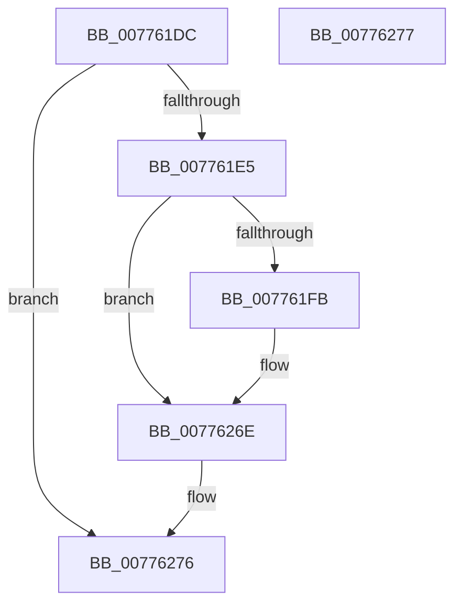

# TtmpCalloutArmWatchdog

- RVA: `0x007761DC`–`0x00776278` (길이 `156` bytes)
- VA: `0x00000001407761DC`
- 실행 섹션: `PAGE`
- PDB 이름 있음: `예`; PDB Function 태그: `아니요`
- unwind 정보 RVA: `0x000CDBC8`
- 디코드: `37`개 명령, `156/156` bytes 표시
- 미해석 바이트: `0` (있으면 어셈블리에 `.byte`로 보존)

> 이 문서는 커널 이미지의 기계어와 PDB 기호를 분석해 생성했습니다. 4번과 5번은 함수 원형과 자료형을 바이너리 사용 방식에서 추정한 C 해석이며 원본 소스 복구 결과는 아닙니다.

## 1. Dependencies

- 직접 호출 지점: **1**; 고유 호출 대상: **1**
- 직접 호출자로 확인된 함수: **1**
- RIP 상대 이미지 참조: **1**

### Outgoing calls
- `0x00776269` → [NtPowerInformation](../95/NtPowerInformation_function_00955D80.md) (function, `0x00955D80`)

### Direct callers
- [TtmpStartCallout](TtmpStartCallout_function_00776AA4.md) at `0x00776BC0`

### Static image references
- `0x00776257` → RVA `0x00776280` (`TtmpCalloutWatchdogCallback`; read)

## 2. Other-region calls and transfers

- 다른 실행 섹션으로 향하는 call: **0**
- 별도 외부 분기/꼬리 이동을 확인하지 못했습니다.

## 3. Assembly (complete function range)

```asm
007761DC  48 85 C9                        test rcx, rcx
007761DF  0F 84 91 00 00 00               je 0x140776276
007761E5  55                              push rbp
007761E6  48 8D 6C 24 A9                  lea rbp, [rsp - 0x57]
007761EB  48 81 EC 90 00 00 00            sub rsp, 0x90
007761F2  48 8B 41 18                     mov rax, qword ptr [rcx + 0x18]
007761F6  48 85 C0                        test rax, rax
007761F9  74 73                           je 0x14077626e
007761FB  48 89 45 FF                     mov qword ptr [rbp - 1], rax
007761FF  45 33 D2                        xor r10d, r10d
00776202  48 63 41 10                     movsxd rax, dword ptr [rcx + 0x10]
00776206  44 21 54 24 20                  and dword ptr [rsp + 0x20], r10d
0077620B  48 89 45 17                     mov qword ptr [rbp + 0x17], rax
0077620F  48 8B 41 08                     mov rax, qword ptr [rcx + 8]
00776213  41 8D 4A 57                     lea ecx, [r10 + 0x57]
00776217  48 89 45 1F                     mov qword ptr [rbp + 0x1f], rax
0077621B  44 89 45 07                     mov dword ptr [rbp + 7], r8d
0077621F  45 8D 42 60                     lea r8d, [r10 + 0x60]
00776223  89 55 0B                        mov dword ptr [rbp + 0xb], edx
00776226  48 8D 55 F7                     lea rdx, [rbp - 9]
0077622A  48 C7 45 F7 15 00 00 00         mov qword ptr [rbp - 9], 0x15
00776232  48 C7 45 0F A0 01 00 00         mov qword ptr [rbp + 0xf], 0x1a0
0077623A  4C 89 55 37                     mov qword ptr [rbp + 0x37], r10
0077623E  4C 89 55 4F                     mov qword ptr [rbp + 0x4f], r10
00776242  65 48 8B 04 25 88 01 00 00      mov rax, qword ptr gs:[0x188]
0077624B  48 89 45 27                     mov qword ptr [rbp + 0x27], rax
0077624F  48 8D 45 F7                     lea rax, [rbp - 9]
00776253  48 89 45 47                     mov qword ptr [rbp + 0x47], rax
00776257  48 8D 05 22 00 00 00            lea rax, [rip + 0x22]
0077625E  4C 89 4D 2F                     mov qword ptr [rbp + 0x2f], r9
00776262  45 33 C9                        xor r9d, r9d
00776265  48 89 45 3F                     mov qword ptr [rbp + 0x3f], rax
00776269  E8 12 FB 1D 00                  call 0x140955d80
0077626E  48 81 C4 90 00 00 00            add rsp, 0x90
00776275  5D                              pop rbp
00776276  C3                              ret
00776277  CC                              int3
```

## 4. C-style interpretation (structured pseudocode)

```c
__int64 __fastcall TtmpCalloutArmWatchdog(__int64 a1, int a2, int a3, __int64 a4)
{
    __int64 result;
    __int64 v_r10;
    __int64 v_rsp;
    unsigned __int64 v_stack_m10;
    unsigned __int64 v_stack_m18;
    unsigned __int64 v_stack_m20;
    unsigned __int64 v_stack_m28;
    unsigned __int64 v_stack_m30;
    unsigned __int64 v_stack_m38;
    unsigned __int64 v_stack_m40;
    unsigned __int64 v_stack_m48;
    unsigned __int64 v_stack_m50;
    unsigned int v_stack_m54;
    unsigned int v_stack_m58;
    unsigned __int64 v_stack_m5F;
    unsigned __int64 v_stack_m60;
    unsigned __int64 v_stack_m68;
    unsigned int v_stack_m78;

    if (a1 == 0) goto loc_00776276;
    v_rsp = (v_rsp) - (144);
    result = *(unsigned __int64 *)(a1 + 24);
    if (*(unsigned __int64 *)(a1 + 24) != 0) {
        v_stack_m60 = *(unsigned __int64 *)(a1 + 24);
        v_r10 = 0;
        result = (int)(*(unsigned int *)(a1 + 16));
        v_stack_m48 = result;
        result = *(unsigned __int64 *)(a1 + 8);
        a1 = v_r10 + 87;
        v_stack_m40 = result;
        v_stack_m58 = a3;
        a3 = v_r10 + 96;
        v_stack_m54 = a2;
        a2 = v_stack_m68;
        v_stack_m68 = 21;
        v_stack_m50 = 416;
        v_stack_m28 = 0;
        v_stack_m10 = 0;
        result = *(unsigned __int64 *)(gs_base + (0 + 392));
        v_stack_m38 = result;
        result = v_stack_m68;
        v_stack_m18 = result;
        result = v_rip + 34;
        v_stack_m30 = a4;
        a4 = 0;
        v_stack_m20 = result;
        result = NtPowerInformation(a1, a2, a3, a4);
    }
    v_rsp = (v_rsp) + (144);
loc_00776276:
    return result;
}
```

## 5. (Beta) C Style

```c
int64_t TtmpCalloutArmWatchdog(int64_t Arg1, int32_t Arg2, int32_t Arg3, int64_t Arg4)
{
    int64_t result;
    int64_t local_r10;
    int64_t local_rsp;
    uint64_t v_stack_m10;
    uint64_t v_stack_m18;
    uint64_t v_stack_m20;
    uint64_t v_stack_m28;
    uint64_t v_stack_m30;
    uint64_t v_stack_m38;
    uint64_t v_stack_m40;
    uint64_t v_stack_m48;
    uint64_t v_stack_m50;
    uint32_t v_stack_m54;
    uint32_t v_stack_m58;
    uint64_t v_stack_m5F;
    uint64_t v_stack_m60;
    uint64_t v_stack_m68;
    uint32_t v_stack_m78;

    if (Arg1 == 0) goto loc_00776276;
    local_rsp = (local_rsp) - (144);
    result = *(uint64_t *)(Arg1 + 0x18);
    if (*(uint64_t *)(Arg1 + 0x18) != 0) {
        v_stack_m60 = *(uint64_t *)(Arg1 + 0x18);
        local_r10 = 0;
        result = (int32_t)(*(uint32_t *)(Arg1 + 0x10));
        v_stack_m48 = result;
        result = *(uint64_t *)(Arg1 + 0x8);
        Arg1 = local_r10 + 87;
        v_stack_m40 = result;
        v_stack_m58 = Arg3;
        Arg3 = local_r10 + 96;
        v_stack_m54 = Arg2;
        Arg2 = v_stack_m68;
        v_stack_m68 = 21;
        v_stack_m50 = 416;
        v_stack_m28 = 0;
        v_stack_m10 = 0;
        result = *(uint64_t *)(gs_base + (0 + 0x188));
        v_stack_m38 = result;
        result = v_stack_m68;
        v_stack_m18 = result;
        result = v_rip + 34;
        v_stack_m30 = Arg4;
        Arg4 = 0;
        v_stack_m20 = result;
        result = NtPowerInformation(Arg1, Arg2, Arg3, Arg4);
    }
    local_rsp = (local_rsp) + (144);
loc_00776276:
    return result;
}
```

## 6. Execution-region graph

[열기: 2D/3D 그래프와 함수 탐색 컨트롤 패널](../../../control-panel.html?section=page&rva=0x007761DC&view=graph)

- 2D 그래프는 위에서 아래로 흐르고, 3D 그래프는 빈 공간을 드래그해 회전합니다. Shift+드래그는 이동, 휠은 확대·축소, 함수 노드 선택은 대상 보고서 이동입니다.

### Static fallback


