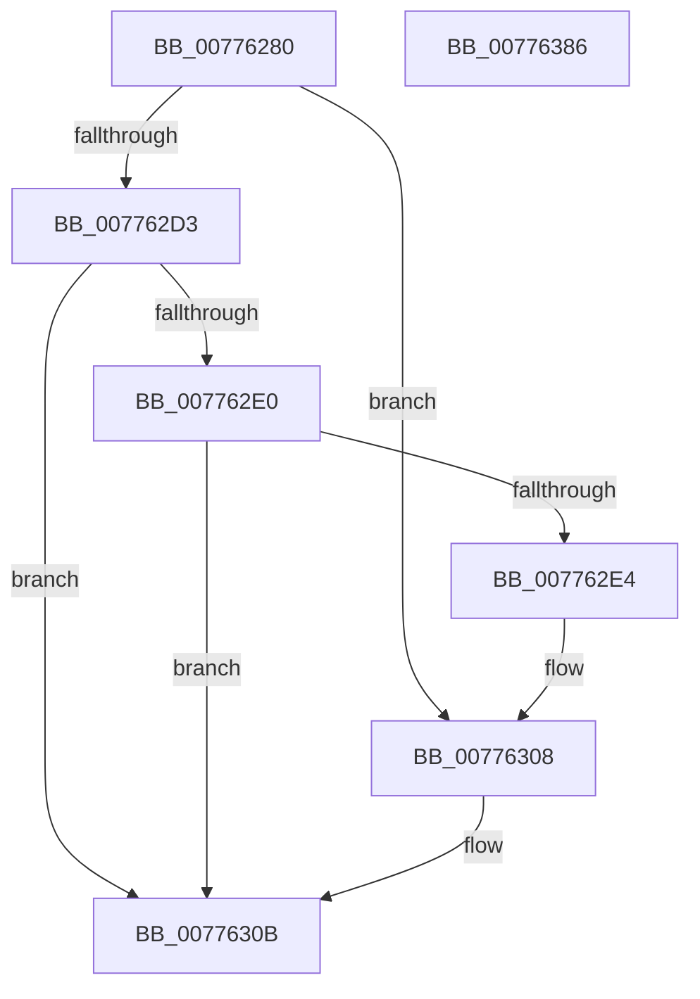

# TtmpCalloutWatchdogCallback

- RVA: `0x00776280`–`0x00776387` (길이 `263` bytes)
- VA: `0x0000000140776280`
- 실행 섹션: `PAGE`
- PDB 이름 있음: `예`; PDB Function 태그: `아니요`
- unwind 정보 RVA: `0x000BF908`
- 디코드: `64`개 명령, `263/263` bytes 표시
- 미해석 바이트: `0` (있으면 어셈블리에 `.byte`로 보존)

> 이 문서는 커널 이미지의 기계어와 PDB 기호를 분석해 생성했습니다. 4번과 5번은 함수 원형과 자료형을 바이너리 사용 방식에서 추정한 C 해석이며 원본 소스 복구 결과는 아닙니다.

## 1. Dependencies

- 직접 호출 지점: **4**; 고유 호출 대상: **4**
- 직접 호출자로 확인된 함수: **0**
- RIP 상대 이미지 참조: **3**

### Outgoing calls
- `0x007762CA` → [NtPowerInformation](../95/NtPowerInformation_function_00955D80.md) (function, `0x00955D80`)
- `0x00776302` → [KeBugCheckEx](../../text/4F/KeBugCheckEx_function_004FD660.md) (function, `0x004FD660`)
- `0x0077632E` → [TtmiLogCalloutWatchdogCrashSkipped](TtmiLogCalloutWatchdogCrashSkipped_function_00779250.md) (function, `0x00779250`)
- `0x00776364` → [DbgkWerCaptureLiveKernelDump](../AC/DbgkWerCaptureLiveKernelDump_function_00AC1E90.md) (function, `0x00AC1E90`)

### Direct callers
- 이 함수 시작 RVA로 연결되는 직접 call은 확인되지 않았습니다. 간접 호출은 완전히 역산할 수 없습니다.

### Static image references
- `0x007762D3` → RVA `0x00E67A88` (`.data`; read)
- `0x00776338` → RVA `0x00A97CF0` (`ArbPreprocessEntry`; read)
- `0x00776344` → RVA `0x00B03FC0` (` ?? ::NNGAKEGL::`string'`; read)

## 2. Other-region calls and transfers

- 다른 실행 섹션으로 향하는 call: **1**
  - `0x00776302` → [KeBugCheckEx](../../text/4F/KeBugCheckEx_function_004FD660.md) (`PAGE` → `.text`)
- 별도 외부 분기/꼬리 이동을 확인하지 못했습니다.

## 3. Assembly (complete function range)

```asm
00776280  48 8B C4                        mov rax, rsp
00776283  48 89 58 08                     mov qword ptr [rax + 8], rbx
00776287  48 89 68 10                     mov qword ptr [rax + 0x10], rbp
0077628B  48 89 70 18                     mov qword ptr [rax + 0x18], rsi
0077628F  48 89 78 20                     mov qword ptr [rax + 0x20], rdi
00776293  41 56                           push r14
00776295  48 83 EC 60                     sub rsp, 0x60
00776299  83 60 E8 00                     and dword ptr [rax - 0x18], 0
0077629D  49 8B E8                        mov rbp, r8
007762A0  83 60 F4 00                     and dword ptr [rax - 0xc], 0
007762A4  41 B8 08 00 00 00               mov r8d, 8
007762AA  49 8B F1                        mov rsi, r9
007762AD  C7 40 F0 25 00 00 00            mov dword ptr [rax - 0x10], 0x25
007762B4  44 8B F2                        mov r14d, edx
007762B7  C7 40 B8 04 00 00 00            mov dword ptr [rax - 0x48], 4
007762BE  4C 8D 48 E8                     lea r9, [rax - 0x18]
007762C2  41 8D 48 4F                     lea ecx, [r8 + 0x4f]
007762C6  48 8D 50 F0                     lea rdx, [rax - 0x10]
007762CA  E8 B1 FA 1D 00                  call 0x140955d80
007762CF  85 C0                           test eax, eax
007762D1  78 35                           js 0x140776308
007762D3  80 3D AE 17 6F 00 00            cmp byte ptr [rip + 0x6f17ae], 0
007762DA  8B 4C 24 50                     mov ecx, dword ptr [rsp + 0x50]
007762DE  74 2B                           je 0x14077630b
007762E0  85 C9                           test ecx, ecx
007762E2  75 27                           jne 0x14077630b
007762E4  48 8B 84 24 98 00 00 00         mov rax, qword ptr [rsp + 0x98]
007762EC  4C 8B C6                        mov r8, rsi
007762EF  4C 8B 8C 24 90 00 00 00         mov r9, qword ptr [rsp + 0x90]
007762F7  48 8B D5                        mov rdx, rbp
007762FA  41 8B CE                        mov ecx, r14d
007762FD  48 89 44 24 20                  mov qword ptr [rsp + 0x20], rax
00776302  E8 59 73 D8 FF                  call 0x1404fd660
00776307  CC                              int3
00776308  83 C9 FF                        or ecx, 0xffffffff
0077630B  48 8B BC 24 98 00 00 00         mov rdi, qword ptr [rsp + 0x98]
00776313  4C 8B CE                        mov r9, rsi
00776316  48 8B 9C 24 90 00 00 00         mov rbx, qword ptr [rsp + 0x90]
0077631E  4C 8B C5                        mov r8, rbp
00776321  48 89 7C 24 28                  mov qword ptr [rsp + 0x28], rdi
00776326  41 8B D6                        mov edx, r14d
00776329  48 89 5C 24 20                  mov qword ptr [rsp + 0x20], rbx
0077632E  E8 1D 2F 00 00                  call 0x140779250
00776333  83 64 24 40 00                  and dword ptr [rsp + 0x40], 0
00776338  48 8D 05 B1 19 32 00            lea rax, [rip + 0x3219b1]
0077633F  48 89 44 24 38                  mov qword ptr [rsp + 0x38], rax
00776344  48 8D 0D 75 DC 38 00            lea rcx, [rip + 0x38dc75]
0077634B  48 83 64 24 30 00               and qword ptr [rsp + 0x30], 0
00776351  4C 8B CE                        mov r9, rsi
00776354  48 89 7C 24 28                  mov qword ptr [rsp + 0x28], rdi
00776359  4C 8B C5                        mov r8, rbp
0077635C  41 8B D6                        mov edx, r14d
0077635F  48 89 5C 24 20                  mov qword ptr [rsp + 0x20], rbx
00776364  E8 27 BB 34 00                  call 0x140ac1e90
00776369  4C 8D 5C 24 60                  lea r11, [rsp + 0x60]
0077636E  33 C0                           xor eax, eax
00776370  49 8B 5B 10                     mov rbx, qword ptr [r11 + 0x10]
00776374  49 8B 6B 18                     mov rbp, qword ptr [r11 + 0x18]
00776378  49 8B 73 20                     mov rsi, qword ptr [r11 + 0x20]
0077637C  49 8B 7B 28                     mov rdi, qword ptr [r11 + 0x28]
00776380  49 8B E3                        mov rsp, r11
00776383  41 5E                           pop r14
00776385  C3                              ret
00776386  CC                              int3
```

## 4. C-style interpretation (structured pseudocode)

```c
__int64 __fastcall TtmpCalloutWatchdogCallback(__int64 a1, int a2, __int64 a3, __int64 a4, __int64 a5, __int64 a6)
{
    __int64 result;
    __int64 v_rsp;
    unsigned int v_stack_m18;
    unsigned int v_stack_m28;
    unsigned __int64 v_stack_m30;
    unsigned __int64 v_stack_m38;
    unsigned __int64 v_stack_m40;
    unsigned __int64 v_stack_m48;
    unsigned __int64 v_stack_m8;

    *(unsigned __int64 *)(v_rsp + 8) = v_rbx;
    *(unsigned __int64 *)(v_rsp + 16) = v_rbp;
    *(unsigned __int64 *)(v_rsp + 24) = v_rsi;
    *(unsigned __int64 *)(v_rsp + 32) = v_rdi;
    v_rsp = (v_rsp) - (96);
    *(unsigned int *)(v_rsp - 16) = 37;
    *(unsigned int *)(v_rsp - 72) = 4;
    result = NtPowerInformation(8 + 79, v_rsp - 16, 8, v_rsp - 24);
    if (sign_flag) goto loc_00776308;
    if ((*(unsigned __int8 *)(v_rip + 7280558)) == 0) goto loc_0077630B;
    if ((unsigned int)((unsigned int)(v_stack_m18)) != 0) goto loc_0077630B;
    v_stack_m48 = a6;
    result = KeBugCheckEx((unsigned int)((unsigned int)((unsigned int)(a2))), a3, a4, a5);
loc_00776308:
    a1 = (unsigned int)(((unsigned int)((unsigned int)((unsigned int)(a2)))) | (0xFFFFFFFFULL));
loc_0077630B:
    v_stack_m40 = a6;
    v_stack_m48 = a5;
    result = TtmiLogCalloutWatchdogCrashSkipped(a1, (unsigned int)((unsigned int)((unsigned int)(a2))), a3, a4);
    v_stack_m30 = v_rip + 3283377;
    v_stack_m40 = a6;
    v_stack_m48 = a5;
    result = DbgkWerCaptureLiveKernelDump(v_rip + 3726453, (unsigned int)((unsigned int)((unsigned int)(a2))), a3, a4);
    result = 0;
    return result;
}
```

## 5. (Beta) C Style

```c
int64_t TtmpCalloutWatchdogCallback(int64_t Arg1, int32_t Arg2, int64_t Arg3, int64_t Arg4, int64_t Arg5, int64_t Arg6)
{
    int64_t result;
    int64_t local_rsp;
    uint32_t v_stack_m18;
    uint32_t v_stack_m28;
    uint64_t v_stack_m30;
    uint64_t v_stack_m38;
    uint64_t v_stack_m40;
    uint64_t v_stack_m48;
    uint64_t v_stack_m8;

    *(uint64_t *)(local_rsp + 0x8) = local_rbx;
    *(uint64_t *)(local_rsp + 0x10) = local_rbp;
    *(uint64_t *)(local_rsp + 0x18) = local_rsi;
    *(uint64_t *)(local_rsp + 0x20) = local_rdi;
    local_rsp = (local_rsp) - (96);
    *(uint32_t *)(local_rsp - 0x10) = 37;
    *(uint32_t *)(local_rsp - 0x48) = 4;
    result = NtPowerInformation(8 + 79, local_rsp - 16, 8, local_rsp - 24);
    if (sign_flag) goto loc_00776308;
    if ((*(uint8_t *)(v_rip + 0x6F17AE)) == 0) goto loc_0077630B;
    if ((uint32_t)((uint32_t)(v_stack_m18)) != 0) goto loc_0077630B;
    v_stack_m48 = Arg6;
    result = KeBugCheckEx((uint32_t)((uint32_t)((uint32_t)(Arg2))), Arg3, Arg4, Arg5);
loc_00776308:
    Arg1 = (uint32_t)(((uint32_t)((uint32_t)((uint32_t)(Arg2)))) | (0xFFFFFFFFULL));
loc_0077630B:
    v_stack_m40 = Arg6;
    v_stack_m48 = Arg5;
    result = TtmiLogCalloutWatchdogCrashSkipped(Arg1, (uint32_t)((uint32_t)((uint32_t)(Arg2))), Arg3, Arg4);
    v_stack_m30 = v_rip + 3283377;
    v_stack_m40 = Arg6;
    v_stack_m48 = Arg5;
    result = DbgkWerCaptureLiveKernelDump(v_rip + 3726453, (uint32_t)((uint32_t)((uint32_t)(Arg2))), Arg3, Arg4);
    result = 0;
    return result;
}
```

## 6. Execution-region graph

[열기: 2D/3D 그래프와 함수 탐색 컨트롤 패널](../../../control-panel.html?section=page&rva=0x00776280&view=graph)

- 2D 그래프는 위에서 아래로 흐르고, 3D 그래프는 빈 공간을 드래그해 회전합니다. Shift+드래그는 이동, 휠은 확대·축소, 함수 노드 선택은 대상 보고서 이동입니다.

### Static fallback


