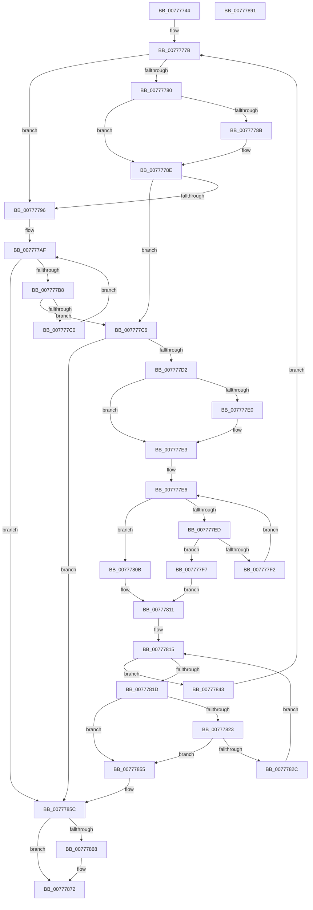

# TtmpCleanupPowerRequestsTrackingFromCurrentSession

- RVA: `0x00777744`–`0x00777892` (길이 `334` bytes)
- VA: `0x0000000140777744`
- 실행 섹션: `PAGE`
- PDB 이름 있음: `예`; PDB Function 태그: `아니요`
- unwind 정보 RVA: `0x0005FEF8`
- 디코드: `97`개 명령, `334/334` bytes 표시
- 미해석 바이트: `0` (있으면 어셈블리에 `.byte`로 보존)

> 이 문서는 커널 이미지의 기계어와 PDB 기호를 분석해 생성했습니다. 4번과 5번은 함수 원형과 자료형을 바이너리 사용 방식에서 추정한 C 해석이며 원본 소스 복구 결과는 아닙니다.

## 1. Dependencies

- 직접 호출 지점: **3**; 고유 호출 대상: **1**
- 직접 호출자로 확인된 함수: **1**
- RIP 상대 이미지 참조: **0**

### Outgoing calls
- `0x0077783C` → [ExFreePoolWithTag](../../poolcode/B8/ExFreePoolWithTag_function_00B82870.md) (function, `0x00B82870`)
- `0x0077784B` → [ExFreePoolWithTag](../../poolcode/B8/ExFreePoolWithTag_function_00B82870.md) (function, `0x00B82870`)
- `0x0077786D` → [ExFreePoolWithTag](../../poolcode/B8/ExFreePoolWithTag_function_00B82870.md) (function, `0x00B82870`)

### Direct callers
- [TtmCleanupCurrentSession](../AC/TtmCleanupCurrentSession_function_00AC54DC.md) at `0x00AC5530`

### Static image references
- 디코드된 RIP-relative 메모리 참조가 없습니다.

## 2. Other-region calls and transfers

- 다른 실행 섹션으로 향하는 call: **3**
  - `0x0077783C` → [ExFreePoolWithTag](../../poolcode/B8/ExFreePoolWithTag_function_00B82870.md) (`PAGE` → `POOLCODE`)
  - `0x0077784B` → [ExFreePoolWithTag](../../poolcode/B8/ExFreePoolWithTag_function_00B82870.md) (`PAGE` → `POOLCODE`)
  - `0x0077786D` → [ExFreePoolWithTag](../../poolcode/B8/ExFreePoolWithTag_function_00B82870.md) (`PAGE` → `POOLCODE`)
- 별도 외부 분기/꼬리 이동을 확인하지 못했습니다.

## 3. Assembly (complete function range)

```asm
00777744  48 8B C4                        mov rax, rsp
00777747  48 89 58 08                     mov qword ptr [rax + 8], rbx
0077774B  48 89 68 10                     mov qword ptr [rax + 0x10], rbp
0077774F  48 89 70 18                     mov qword ptr [rax + 0x18], rsi
00777753  48 89 78 20                     mov qword ptr [rax + 0x20], rdi
00777757  41 54                           push r12
00777759  41 56                           push r14
0077775B  41 57                           push r15
0077775D  48 83 EC 20                     sub rsp, 0x20
00777761  48 8B B9 18 01 00 00            mov rdi, qword ptr [rcx + 0x118]
00777768  48 8B E9                        mov rbp, rcx
0077776B  48 8B DF                        mov rbx, rdi
0077776E  45 33 FF                        xor r15d, r15d
00777771  49 BC 02 00 00 00 00 00 00 80   movabs r12, 0x8000000000000002
0077777B  48 85 DB                        test rbx, rbx
0077777E  74 16                           je 0x140777796
00777780  48 8B 03                        mov rax, qword ptr [rbx]
00777783  49 23 C4                        and rax, r12
00777786  49 3B C4                        cmp rax, r12
00777789  75 03                           jne 0x14077778e
0077778B  49 8B 07                        mov rax, qword ptr [r15]
0077778E  48 8B 1B                        mov rbx, qword ptr [rbx]
00777791  F6 C3 01                        test bl, 1
00777794  74 30                           je 0x1407777c6
00777796  8B 8D 14 01 00 00               mov ecx, dword ptr [rbp + 0x114]
0077779C  48 83 C7 08                     add rdi, 8
007777A0  48 8B 85 18 01 00 00            mov rax, qword ptr [rbp + 0x118]
007777A7  48 C1 E9 05                     shr rcx, 5
007777AB  48 8D 14 C8                     lea rdx, [rax + rcx*8]
007777AF  48 3B FA                        cmp rdi, rdx
007777B2  0F 83 A4 00 00 00               jae 0x14077785c
007777B8  48 8B 1F                        mov rbx, qword ptr [rdi]
007777BB  F6 C3 01                        test bl, 1
007777BE  74 06                           je 0x1407777c6
007777C0  48 83 C7 08                     add rdi, 8
007777C4  EB E9                           jmp 0x1407777af
007777C6  48 8B C3                        mov rax, rbx
007777C9  48 85 C0                        test rax, rax
007777CC  0F 84 8A 00 00 00               je 0x14077785c
007777D2  48 8B 03                        mov rax, qword ptr [rbx]
007777D5  4C 8B F3                        mov r14, rbx
007777D8  49 23 C4                        and rax, r12
007777DB  49 3B C4                        cmp rax, r12
007777DE  75 03                           jne 0x1407777e3
007777E0  49 8B 07                        mov rax, qword ptr [r15]
007777E3  48 8B CF                        mov rcx, rdi
007777E6  48 8B 01                        mov rax, qword ptr [rcx]
007777E9  A8 01                           test al, 1
007777EB  75 1E                           jne 0x14077780b
007777ED  48 3B C3                        cmp rax, rbx
007777F0  74 05                           je 0x1407777f7
007777F2  48 8B C8                        mov rcx, rax
007777F5  EB EF                           jmp 0x1407777e6
007777F7  48 8B 03                        mov rax, qword ptr [rbx]
007777FA  48 89 01                        mov qword ptr [rcx], rax
007777FD  FF 8D 10 01 00 00               dec dword ptr [rbp + 0x110]
00777803  4C 09 23                        or qword ptr [rbx], r12
00777806  48 8B D9                        mov rbx, rcx
00777809  EB 06                           jmp 0x140777811
0077780B  49 8B 07                        mov rax, qword ptr [r15]
0077780E  4D 8B F7                        mov r14, r15
00777811  49 8D 76 30                     lea rsi, [r14 + 0x30]
00777815  48 8B 0E                        mov rcx, qword ptr [rsi]
00777818  48 3B CE                        cmp rcx, rsi
0077781B  74 26                           je 0x140777843
0077781D  48 39 71 08                     cmp qword ptr [rcx + 8], rsi
00777821  75 32                           jne 0x140777855
00777823  48 8B 01                        mov rax, qword ptr [rcx]
00777826  48 39 48 08                     cmp qword ptr [rax + 8], rcx
0077782A  75 29                           jne 0x140777855
0077782C  48 89 06                        mov qword ptr [rsi], rax
0077782F  48 83 C1 F8                     add rcx, -8
00777833  BA 54 74 50 52                  mov edx, 0x52507454
00777838  48 89 70 08                     mov qword ptr [rax + 8], rsi
0077783C  E8 2F B0 40 00                  call 0x140b82870
00777841  EB D2                           jmp 0x140777815
00777843  BA 54 74 50 52                  mov edx, 0x52507454
00777848  49 8B CE                        mov rcx, r14
0077784B  E8 20 B0 40 00                  call 0x140b82870
00777850  E9 26 FF FF FF                  jmp 0x14077777b
00777855  B9 03 00 00 00                  mov ecx, 3
0077785A  CD 29                           int 0x29
0077785C  48 8B 8D 18 01 00 00            mov rcx, qword ptr [rbp + 0x118]
00777863  48 85 C9                        test rcx, rcx
00777866  74 0A                           je 0x140777872
00777868  BA 54 74 50 52                  mov edx, 0x52507454
0077786D  E8 FE AF 40 00                  call 0x140b82870
00777872  48 8B 5C 24 40                  mov rbx, qword ptr [rsp + 0x40]
00777877  48 8B 6C 24 48                  mov rbp, qword ptr [rsp + 0x48]
0077787C  48 8B 74 24 50                  mov rsi, qword ptr [rsp + 0x50]
00777881  48 8B 7C 24 58                  mov rdi, qword ptr [rsp + 0x58]
00777886  48 83 C4 20                     add rsp, 0x20
0077788A  41 5F                           pop r15
0077788C  41 5E                           pop r14
0077788E  41 5C                           pop r12
00777890  C3                              ret
00777891  CC                              int3
```

## 4. C-style interpretation (structured pseudocode)

```c
__int64 __fastcall TtmpCleanupPowerRequestsTrackingFromCurrentSession(__int64 a1)
{
    __int64 result;
    __int64 v_r15;
    __int64 v_rdi;
    __int64 v_rsp;
    unsigned __int64 v_stack_p10;
    unsigned __int64 v_stack_p18;
    unsigned __int64 v_stack_p20;
    unsigned __int64 v_stack_p8;

    *(unsigned __int64 *)(v_rsp + 8) = v_rbx;
    *(unsigned __int64 *)(v_rsp + 16) = v_rbp;
    *(unsigned __int64 *)(v_rsp + 24) = v_rsi;
    *(unsigned __int64 *)(v_rsp + 32) = v_rdi;
    v_rsp = (v_rsp) - (32);
    v_r15 = 0;
loc_0077777B:
    if (*(unsigned __int64 *)(a1 + 280) == 0) goto loc_00777796;
    result = (*(unsigned __int64 *)(*(unsigned __int64 *)(a1 + 280))) & (v_r12);
    if (result == v_r12) {
        result = *(unsigned __int64 *)(v_r15);
    }
    if ((((unsigned __int8)(*(unsigned __int64 *)(*(unsigned __int64 *)(a1 + 280)))) & (1)) == 0) goto loc_007777C6;
loc_00777796:
    v_rdi = (*(unsigned __int64 *)(a1 + 280)) + (8);
    a1 = ((unsigned int)(*(unsigned int *)(a1 + 276))) >> (5);
loc_007777AF:
    if (v_rdi >= (*(unsigned __int64 *)(a1 + 280) + a1 * 8)) goto loc_0077785C;
    if ((((unsigned __int8)(*(unsigned __int64 *)(v_rdi))) & (1)) == 0) goto loc_007777C6;
    v_rdi = (v_rdi) + (8);
    goto loc_007777AF;
loc_007777C6:
    if (*(unsigned __int64 *)(v_rdi) == 0) goto loc_0077785C;
    result = (*(unsigned __int64 *)(*(unsigned __int64 *)(v_rdi))) & (v_r12);
    if (result == v_r12) {
        result = *(unsigned __int64 *)(v_r15);
    }
loc_007777E6:
    if ((((unsigned __int8)(*(unsigned __int64 *)(v_rdi))) & (1)) != 0) goto loc_0077780B;
    if ((*(unsigned __int64 *)(v_rdi)) == (*(unsigned __int64 *)(v_rdi))) goto loc_007777F7;
    goto loc_007777E6;
loc_007777F7:
    *(unsigned __int64 *)(*(unsigned __int64 *)(v_rdi)) = *(unsigned __int64 *)(*(unsigned __int64 *)(v_rdi));
    goto loc_00777811;
loc_0077780B:
loc_00777811:
loc_00777815:
    if ((*(unsigned __int64 *)(0 + 48)) == (0 + 48)) goto loc_00777843;
    if ((*(unsigned __int64 *)(*(unsigned __int64 *)(0 + 48) + 8)) != (0 + 48)) goto loc_00777855;
    if ((*(unsigned __int64 *)(*(unsigned __int64 *)(*(unsigned __int64 *)(0 + 48)) + 8)) != (*(unsigned __int64 *)(0 + 48))) goto loc_00777855;
    *(unsigned __int64 *)(0 + 48) = *(unsigned __int64 *)(*(unsigned __int64 *)(0 + 48));
    a1 = (*(unsigned __int64 *)(0 + 48)) + (-8);
    *(unsigned __int64 *)(*(unsigned __int64 *)(*(unsigned __int64 *)(0 + 48)) + 8) = 0 + 48;
    result = ExFreePoolWithTag(a1, (unsigned int)(0x52507454ULL), a3, a4);
    goto loc_00777815;
loc_00777843:
    result = ExFreePoolWithTag(0, (unsigned int)(0x52507454ULL), a3, a4);
    goto loc_0077777B;
loc_00777855:
loc_0077785C:
    if (*(unsigned __int64 *)(a1 + 280) != 0) {
        a2 = 0x52507454ULL;
        result = ExFreePoolWithTag(*(unsigned __int64 *)(a1 + 280), a2, a3, a4);
    }
    v_rsp = (v_rsp) + (32);
    return result;
}
```

## 5. (Beta) C Style

```c
int64_t TtmpCleanupPowerRequestsTrackingFromCurrentSession(void *Arg1)
{
    uint8_t *arg1 = (uint8_t *)Arg1;

    int64_t result;
    int64_t local_r15;
    int64_t local_rdi;
    int64_t local_rsp;
    uint64_t v_stack_p10;
    uint64_t v_stack_p18;
    uint64_t v_stack_p20;
    uint64_t v_stack_p8;

    *(uint64_t *)(local_rsp + 0x8) = local_rbx;
    *(uint64_t *)(local_rsp + 0x10) = local_rbp;
    *(uint64_t *)(local_rsp + 0x18) = local_rsi;
    *(uint64_t *)(local_rsp + 0x20) = local_rdi;
    local_rsp = (local_rsp) - (32);
    local_r15 = 0;
loc_0077777B:
    if (*(uint64_t *)(arg1 + 0x118) == 0) goto loc_00777796;
    result = (*(uint64_t *)(*(uint64_t *)(arg1 + 0x118))) & (local_r12);
    if (result == local_r12) {
        result = *(uint64_t *)(local_r15);
    }
    if ((((uint8_t)(*(uint64_t *)(*(uint64_t *)(arg1 + 0x118)))) & (1)) == 0) goto loc_007777C6;
loc_00777796:
    local_rdi = (*(uint64_t *)(arg1 + 0x118)) + (8);
    Arg1 = ((uint32_t)(*(uint32_t *)(arg1 + 0x114))) >> (5);
loc_007777AF:
    if (local_rdi >= (*(uint64_t *)(arg1 + 0x118) + Arg1 * 8)) goto loc_0077785C;
    if ((((uint8_t)(*(uint64_t *)(local_rdi))) & (1)) == 0) goto loc_007777C6;
    local_rdi = (local_rdi) + (8);
    goto loc_007777AF;
loc_007777C6:
    if (*(uint64_t *)(local_rdi) == 0) goto loc_0077785C;
    result = (*(uint64_t *)(*(uint64_t *)(local_rdi))) & (local_r12);
    if (result == local_r12) {
        result = *(uint64_t *)(local_r15);
    }
loc_007777E6:
    if ((((uint8_t)(*(uint64_t *)(local_rdi))) & (1)) != 0) goto loc_0077780B;
    if ((*(uint64_t *)(local_rdi)) == (*(uint64_t *)(local_rdi))) goto loc_007777F7;
    goto loc_007777E6;
loc_007777F7:
    *(uint64_t *)(*(uint64_t *)(local_rdi)) = *(uint64_t *)(*(uint64_t *)(local_rdi));
    goto loc_00777811;
loc_0077780B:
loc_00777811:
loc_00777815:
    if ((*(uint64_t *)(0 + 0x30)) == (0 + 48)) goto loc_00777843;
    if ((*(uint64_t *)(*(uint64_t *)(0 + 0x30) + 0x8)) != (0 + 48)) goto loc_00777855;
    if ((*(uint64_t *)(*(uint64_t *)(*(uint64_t *)(0 + 0x30)) + 0x8)) != (*(uint64_t *)(0 + 0x30))) goto loc_00777855;
    *(uint64_t *)(0 + 0x30) = *(uint64_t *)(*(uint64_t *)(0 + 0x30));
    Arg1 = (*(uint64_t *)(0 + 0x30)) + (-8);
    *(uint64_t *)(*(uint64_t *)(*(uint64_t *)(0 + 0x30)) + 0x8) = 0 + 48;
    result = ExFreePoolWithTag(Arg1, (uint32_t)(0x52507454ULL), a3, a4);
    goto loc_00777815;
loc_00777843:
    result = ExFreePoolWithTag(0, (uint32_t)(0x52507454ULL), a3, a4);
    goto loc_0077777B;
loc_00777855:
loc_0077785C:
    if (*(uint64_t *)(arg1 + 0x118) != 0) {
        a2 = 0x52507454ULL;
        result = ExFreePoolWithTag(*(uint64_t *)(arg1 + 0x118), a2, a3, a4);
    }
    local_rsp = (local_rsp) + (32);
    return result;
}
```

### 관측된 메모리 오프셋

구조체 형식이 확인되지 않은 접근은 인자 기준의 오프셋으로만 기록했습니다.

| 기준 인자 | 오프셋 표현 | 폭 (bit) | 접근 |
|---|---:|---:|---|
| `Arg1` | `+ 0x110` | `32` | `R/W` |
| `Arg1` | `+ 0x114` | `32` | `R` |
| `Arg1` | `+ 0x118` | `64` | `R` |

## 6. Execution-region graph

[열기: 2D/3D 그래프와 함수 탐색 컨트롤 패널](../../../control-panel.html?section=page&rva=0x00777744&view=graph)

- 2D 그래프는 위에서 아래로 흐르고, 3D 그래프는 빈 공간을 드래그해 회전합니다. Shift+드래그는 이동, 휠은 확대·축소, 함수 노드 선택은 대상 보고서 이동입니다.

### Static fallback


