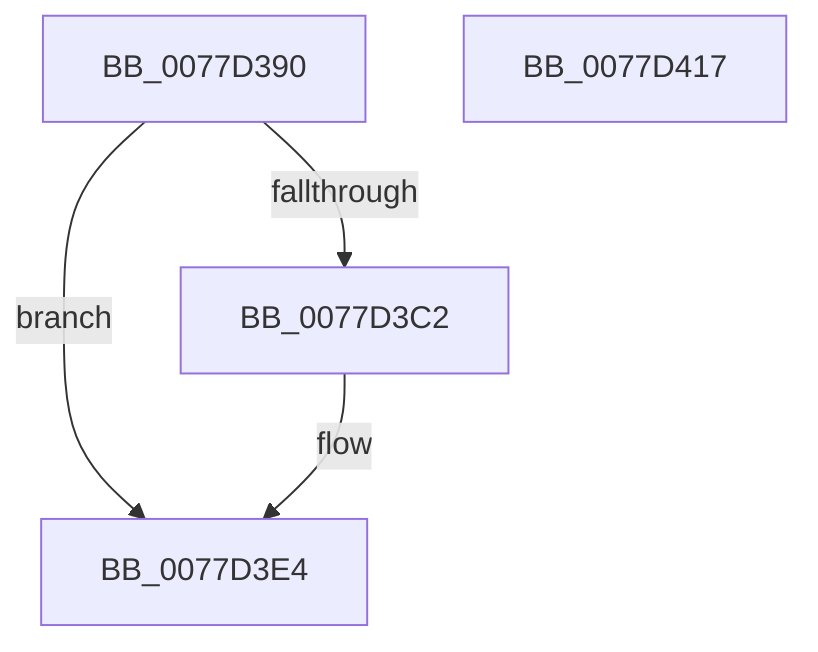

# TtmpCloseTerminalHandle

- RVA: `0x0077D390`–`0x0077D418` (길이 `136` bytes)
- VA: `0x000000014077D390`
- 실행 섹션: `PAGE`
- PDB 이름 있음: `예`; PDB Function 태그: `아니요`
- unwind 정보 RVA: `0x0005E6B4`
- 디코드: `37`개 명령, `136/136` bytes 표시
- 미해석 바이트: `0` (있으면 어셈블리에 `.byte`로 보존)

> 이 문서는 커널 이미지의 기계어와 PDB 기호를 분석해 생성했습니다. 4번과 5번은 함수 원형과 자료형을 바이너리 사용 방식에서 추정한 C 해석이며 원본 소스 복구 결과는 아닙니다.

## 1. Dependencies

- 직접 호출 지점: **6**; 고유 호출 대상: **6**
- 직접 호출자로 확인된 함수: **0**
- RIP 상대 이미지 참조: **1**

### Outgoing calls
- `0x0077D3C2` → [TtmpAcquireSessionLock](../70/TtmpAcquireSessionLock_function_00700408.md) (function, `0x00700408`)
- `0x0077D3CE` → [TtmpSetTerminalPendingCleanup](TtmpSetTerminalPendingCleanup_function_0077D5C4.md) (function, `0x0077D5C4`)
- `0x0077D3DA` → [ExReleaseResourceLite](../../text/25/ExReleaseResourceLite_function_0025FA10.md) (function, `0x0025FA10`)
- `0x0077D3DF` → [KeLeaveCriticalRegion](../../text/25/KeLeaveCriticalRegion_function_0025D8B0.md) (function, `0x0025D8B0`)
- `0x0077D3E7` → [PsGetProcessId](../../text/43/PsGetProcessId_function_0043D910.md) (function, `0x0043D910`)
- `0x0077D3F7` → [TtmiLogTerminalHandleClosed](TtmiLogTerminalHandleClosed_function_0077BE70.md) (function, `0x0077BE70`)

### Direct callers
- 이 함수 시작 RVA로 연결되는 직접 call은 확인되지 않았습니다. 간접 호출은 완전히 역산할 수 없습니다.

### Static image references
- `0x0077D3D3` → RVA `0x00F06940` (`.data`; read)

## 2. Other-region calls and transfers

- 다른 실행 섹션으로 향하는 call: **3**
  - `0x0077D3DA` → [ExReleaseResourceLite](../../text/25/ExReleaseResourceLite_function_0025FA10.md) (`PAGE` → `.text`)
  - `0x0077D3DF` → [KeLeaveCriticalRegion](../../text/25/KeLeaveCriticalRegion_function_0025D8B0.md) (`PAGE` → `.text`)
  - `0x0077D3E7` → [PsGetProcessId](../../text/43/PsGetProcessId_function_0043D910.md) (`PAGE` → `.text`)
- 별도 외부 분기/꼬리 이동을 확인하지 못했습니다.

## 3. Assembly (complete function range)

```asm
0077D390  48 8B C4                        mov rax, rsp
0077D393  48 89 58 08                     mov qword ptr [rax + 8], rbx
0077D397  48 89 68 10                     mov qword ptr [rax + 0x10], rbp
0077D39B  48 89 70 18                     mov qword ptr [rax + 0x18], rsi
0077D39F  48 89 78 20                     mov qword ptr [rax + 0x20], rdi
0077D3A3  41 56                           push r14
0077D3A5  48 83 EC 20                     sub rsp, 0x20
0077D3A9  48 8B 42 10                     mov rax, qword ptr [rdx + 0x10]
0077D3AD  49 8B F9                        mov rdi, r9
0077D3B0  44 8B 72 1C                     mov r14d, dword ptr [rdx + 0x1c]
0077D3B4  48 8B DA                        mov rbx, rdx
0077D3B7  48 8B F1                        mov rsi, rcx
0077D3BA  8B 28                           mov ebp, dword ptr [rax]
0077D3BC  49 83 F9 01                     cmp r9, 1
0077D3C0  75 22                           jne 0x14077d3e4
0077D3C2  E8 41 30 F8 FF                  call 0x140700408
0077D3C7  48 8B 4B 10                     mov rcx, qword ptr [rbx + 0x10]
0077D3CB  48 8B D3                        mov rdx, rbx
0077D3CE  E8 F1 01 00 00                  call 0x14077d5c4
0077D3D3  48 8D 0D 66 95 78 00            lea rcx, [rip + 0x789566]
0077D3DA  E8 31 26 AE FF                  call 0x14025fa10
0077D3DF  E8 CC 04 AE FF                  call 0x14025d8b0
0077D3E4  48 8B CE                        mov rcx, rsi
0077D3E7  E8 24 05 CC FF                  call 0x14043d910
0077D3EC  4C 8B C0                        mov r8, rax
0077D3EF  4C 8B CF                        mov r9, rdi
0077D3F2  41 8B D6                        mov edx, r14d
0077D3F5  8B CD                           mov ecx, ebp
0077D3F7  E8 74 EA FF FF                  call 0x14077be70
0077D3FC  48 8B 5C 24 30                  mov rbx, qword ptr [rsp + 0x30]
0077D401  48 8B 6C 24 38                  mov rbp, qword ptr [rsp + 0x38]
0077D406  48 8B 74 24 40                  mov rsi, qword ptr [rsp + 0x40]
0077D40B  48 8B 7C 24 48                  mov rdi, qword ptr [rsp + 0x48]
0077D410  48 83 C4 20                     add rsp, 0x20
0077D414  41 5E                           pop r14
0077D416  C3                              ret
0077D417  CC                              int3
```

## 4. C-style interpretation (structured pseudocode)

```c
__int64 __fastcall TtmpCloseTerminalHandle(__int64 a1, __int64 a2, __int64 a3, __int64 a4)
{
    __int64 result;
    __int64 v_rsp;
    unsigned __int64 v_stack_p10;
    unsigned __int64 v_stack_p18;
    unsigned __int64 v_stack_p20;
    unsigned __int64 v_stack_p8;

    *(unsigned __int64 *)(v_rsp + 8) = v_rbx;
    *(unsigned __int64 *)(v_rsp + 16) = v_rbp;
    *(unsigned __int64 *)(v_rsp + 24) = v_rsi;
    *(unsigned __int64 *)(v_rsp + 32) = v_rdi;
    v_rsp = (v_rsp) - (32);
    result = *(unsigned __int64 *)(a2 + 16);
    if (a4 == 1) {
        result = TtmpAcquireSessionLock(a1, a2, a3, a4);
        a1 = *(unsigned __int64 *)(a2 + 16);
        a2 = a2;
        result = TtmpSetTerminalPendingCleanup(a1, a2, a3, a4);
        a1 = v_rip + 7902566;
        result = ExReleaseResourceLite(a1, a2, a3, a4);
        result = KeLeaveCriticalRegion(a1, a2, a3, a4);
    }
    result = PsGetProcessId(a1, a2, a3, a4);
    result = TtmiLogTerminalHandleClosed((unsigned int)((unsigned int)((unsigned int)(*(unsigned int *)(*(unsigned __int64 *)(a2 + 16))))), (unsigned int)((unsigned int)((unsigned int)(*(unsigned int *)(a2 + 28)))), result, a4);
    v_rsp = (v_rsp) + (32);
    return result;
}
```

## 5. (Beta) C Style

```c
int64_t TtmpCloseTerminalHandle(int64_t Arg1, void *Arg2, int64_t Arg3, int64_t Arg4)
{
    uint8_t *arg2 = (uint8_t *)Arg2;

    int64_t result;
    int64_t local_rsp;
    uint64_t v_stack_p10;
    uint64_t v_stack_p18;
    uint64_t v_stack_p20;
    uint64_t v_stack_p8;

    *(uint64_t *)(local_rsp + 0x8) = local_rbx;
    *(uint64_t *)(local_rsp + 0x10) = local_rbp;
    *(uint64_t *)(local_rsp + 0x18) = local_rsi;
    *(uint64_t *)(local_rsp + 0x20) = local_rdi;
    local_rsp = (local_rsp) - (32);
    result = *(uint64_t *)(arg2 + 0x10);
    if (Arg4 == 1) {
        result = TtmpAcquireSessionLock(Arg1, Arg2, Arg3, Arg4);
        Arg1 = *(uint64_t *)(arg2 + 0x10);
        Arg2 = Arg2;
        result = TtmpSetTerminalPendingCleanup(Arg1, Arg2, Arg3, Arg4);
        Arg1 = v_rip + 7902566;
        result = ExReleaseResourceLite(Arg1, Arg2, Arg3, Arg4);
        result = KeLeaveCriticalRegion(Arg1, Arg2, Arg3, Arg4);
    }
    result = PsGetProcessId(Arg1, Arg2, Arg3, Arg4);
    result = TtmiLogTerminalHandleClosed((uint32_t)((uint32_t)((uint32_t)(*(uint32_t *)(*(uint64_t *)(arg2 + 0x10))))), (uint32_t)((uint32_t)((uint32_t)(*(uint32_t *)(arg2 + 0x1C)))), result, Arg4);
    local_rsp = (local_rsp) + (32);
    return result;
}
```

### 관측된 메모리 오프셋

구조체 형식이 확인되지 않은 접근은 인자 기준의 오프셋으로만 기록했습니다.

| 기준 인자 | 오프셋 표현 | 폭 (bit) | 접근 |
|---|---:|---:|---|
| `Arg2` | `+ 0x10` | `64` | `R` |
| `Arg2` | `+ 0x1C` | `32` | `R` |

## 6. Execution-region graph

[열기: 2D/3D 그래프와 함수 탐색 컨트롤 패널](../../../control-panel.html?section=page&rva=0x0077D390&view=graph)

- 2D 그래프는 위에서 아래로 흐르고, 3D 그래프는 빈 공간을 드래그해 회전합니다. Shift+드래그는 이동, 휠은 확대·축소, 함수 노드 선택은 대상 보고서 이동입니다.

### Static fallback


