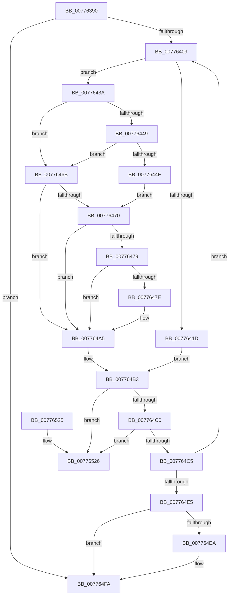

# TtmpCommitTerminalDisplayStateUpdateWorker

- RVA: `0x00776390`–`0x0077652D` (길이 `413` bytes)
- VA: `0x0000000140776390`
- 실행 섹션: `PAGE`
- PDB 이름 있음: `예`; PDB Function 태그: `아니요`
- unwind 정보 RVA: `0x000CDB78`
- 디코드: `112`개 명령, `413/413` bytes 표시
- 미해석 바이트: `0` (있으면 어셈블리에 `.byte`로 보존)

> 이 문서는 커널 이미지의 기계어와 PDB 기호를 분석해 생성했습니다. 4번과 5번은 함수 원형과 자료형을 바이너리 사용 방식에서 추정한 C 해석이며 원본 소스 복구 결과는 아닙니다.

## 1. Dependencies

- 직접 호출 지점: **8**; 고유 호출 대상: **6**
- 직접 호출자로 확인된 함수: **1**
- RIP 상대 이미지 참조: **2**

### Outgoing calls
- `0x007763D5` → [memset](../../text/6C/memset_function_006C6C40.md) (function, `0x006C6C40`)
- `0x00776414` → [TtmpFindDeviceByDeviceId](TtmpFindDeviceByDeviceId_function_00776534.md) (function, `0x00776534`)
- `0x00776433` → [TtmiLogError](../98/TtmiLogError_function_0098B39C.md) (function, `0x0098B39C`)
- `0x00776489` → [TtmpPushTerminalDisplayStateOntoDevice](TtmpPushTerminalDisplayStateOntoDevice_function_00776838.md) (function, `0x00776838`)
- `0x007764AE` → [TtmpPushTerminalDisplayStateOntoDevice](TtmpPushTerminalDisplayStateOntoDevice_function_00776838.md) (function, `0x00776838`)
- `0x007764D4` → [ExFreePoolWithTag](../../poolcode/B8/ExFreePoolWithTag_function_00B82870.md) (function, `0x00B82870`)
- `0x007764F5` → [TtmpPushTerminalDisplayStateOntoDevice](TtmpPushTerminalDisplayStateOntoDevice_function_00776838.md) (function, `0x00776838`)
- `0x00776504` → [_security_check_cookie](../../text/6A/_security_check_cookie_function_006AC640.md) (function, `0x006AC640`)

### Direct callers
- [TtmiSessionDeviceListWorker](TtmiSessionDeviceListWorker_function_00775CA0.md) at `0x00775E2D`
- [TtmiSessionDeviceListWorker](TtmiSessionDeviceListWorker_function_00775CA0.md) at `0x00775E3A`
- [TtmiSessionDeviceListWorker](TtmiSessionDeviceListWorker_function_00775CA0.md) at `0x00775E47`
- [TtmiSessionDeviceListWorker](TtmiSessionDeviceListWorker_function_00775CA0.md) at `0x00775E54`

### Static image references
- `0x007763B1` → RVA `0x00E0A740` (`.data`; read)
- `0x00776421` → RVA `0x00B04090` (` ?? ::NNGAKEGL::`string'`; read)

## 2. Other-region calls and transfers

- 다른 실행 섹션으로 향하는 call: **3**
  - `0x007763D5` → [memset](../../text/6C/memset_function_006C6C40.md) (`PAGE` → `.text`)
  - `0x007764D4` → [ExFreePoolWithTag](../../poolcode/B8/ExFreePoolWithTag_function_00B82870.md) (`PAGE` → `POOLCODE`)
  - `0x00776504` → [_security_check_cookie](../../text/6A/_security_check_cookie_function_006AC640.md) (`PAGE` → `.text`)
- 별도 외부 분기/꼬리 이동을 확인하지 못했습니다.

## 3. Assembly (complete function range)

```asm
00776390  48 89 5C 24 18                  mov qword ptr [rsp + 0x18], rbx
00776395  48 89 74 24 20                  mov qword ptr [rsp + 0x20], rsi
0077639A  55                              push rbp
0077639B  57                              push rdi
0077639C  41 54                           push r12
0077639E  41 56                           push r14
007763A0  41 57                           push r15
007763A2  48 8D AC 24 50 FE FF FF         lea rbp, [rsp - 0x1b0]
007763AA  48 81 EC B0 02 00 00            sub rsp, 0x2b0
007763B1  48 8B 05 88 43 69 00            mov rax, qword ptr [rip + 0x694388]
007763B8  48 33 C4                        xor rax, rsp
007763BB  48 89 85 A0 01 00 00            mov qword ptr [rbp + 0x1a0], rax
007763C2  4C 63 E2                        movsxd r12, edx
007763C5  48 8B F1                        mov rsi, rcx
007763C8  33 D2                           xor edx, edx
007763CA  48 8D 4C 24 30                  lea rcx, [rsp + 0x30]
007763CF  41 B8 68 02 00 00               mov r8d, 0x268
007763D5  E8 66 08 F5 FF                  call 0x1406c6c40
007763DA  48 83 64 24 20 00               and qword ptr [rsp + 0x20], 0
007763E0  4D 8D 7C 24 08                  lea r15, [r12 + 8]
007763E5  49 C1 E7 04                     shl r15, 4
007763E9  B8 FF FF FF FF                  mov eax, 0xffffffff
007763EE  4C 03 FE                        add r15, rsi
007763F1  89 44 24 50                     mov dword ptr [rsp + 0x50], eax
007763F5  45 32 F6                        xor r14b, r14b
007763F8  48 89 44 24 48                  mov qword ptr [rsp + 0x48], rax
007763FD  49 8B 3F                        mov rdi, qword ptr [r15]
00776400  49 3B FF                        cmp rdi, r15
00776403  0F 84 F1 00 00 00               je 0x1407764fa
00776409  8B 57 20                        mov edx, dword ptr [rdi + 0x20]
0077640C  4C 8D 44 24 20                  lea r8, [rsp + 0x20]
00776411  48 8B CE                        mov rcx, rsi
00776414  E8 1B 01 00 00                  call 0x140776534
00776419  84 C0                           test al, al
0077641B  75 1D                           jne 0x14077643a
0077641D  41 83 C9 FF                     or r9d, 0xffffffff
00776421  48 8D 0D 68 DC 38 00            lea rcx, [rip + 0x38dc68]
00776428  BA AA 0B 00 00                  mov edx, 0xbaa
0077642D  41 B8 25 02 00 C0               mov r8d, 0xc0000225
00776433  E8 64 4F 21 00                  call 0x14098b39c
00776438  EB 79                           jmp 0x1407764b3
0077643A  48 8B 44 24 68                  mov rax, qword ptr [rsp + 0x68]
0077643F  48 8B 5C 24 20                  mov rbx, qword ptr [rsp + 0x20]
00776444  48 85 C0                        test rax, rax
00776447  75 22                           jne 0x14077646b
00776449  48 39 43 38                     cmp qword ptr [rbx + 0x38], rax
0077644D  74 1C                           je 0x14077646b
0077644F  8B 43 10                        mov eax, dword ptr [rbx + 0x10]
00776452  41 B6 01                        mov r14b, 1
00776455  89 44 24 40                     mov dword ptr [rsp + 0x40], eax
00776459  8B 43 48                        mov eax, dword ptr [rbx + 0x48]
0077645C  89 44 24 78                     mov dword ptr [rsp + 0x78], eax
00776460  48 8B 43 38                     mov rax, qword ptr [rbx + 0x38]
00776464  48 89 44 24 68                  mov qword ptr [rsp + 0x68], rax
00776469  EB 05                           jmp 0x140776470
0077646B  45 84 F6                        test r14b, r14b
0077646E  74 35                           je 0x1407764a5
00776470  48 8B 4B 38                     mov rcx, qword ptr [rbx + 0x38]
00776474  48 85 C9                        test rcx, rcx
00776477  74 2C                           je 0x1407764a5
00776479  48 3B C8                        cmp rcx, rax
0077647C  74 27                           je 0x1407764a5
0077647E  45 8B C4                        mov r8d, r12d
00776481  48 8D 54 24 30                  lea rdx, [rsp + 0x30]
00776486  48 8B CE                        mov rcx, rsi
00776489  E8 AA 03 00 00                  call 0x140776838
0077648E  8B 43 10                        mov eax, dword ptr [rbx + 0x10]
00776491  89 44 24 40                     mov dword ptr [rsp + 0x40], eax
00776495  8B 43 48                        mov eax, dword ptr [rbx + 0x48]
00776498  89 44 24 78                     mov dword ptr [rsp + 0x78], eax
0077649C  48 8B 43 38                     mov rax, qword ptr [rbx + 0x38]
007764A0  48 89 44 24 68                  mov qword ptr [rsp + 0x68], rax
007764A5  45 8B C4                        mov r8d, r12d
007764A8  48 8B D3                        mov rdx, rbx
007764AB  48 8B CE                        mov rcx, rsi
007764AE  E8 85 03 00 00                  call 0x140776838
007764B3  48 8B 07                        mov rax, qword ptr [rdi]
007764B6  48 8B 5F 08                     mov rbx, qword ptr [rdi + 8]
007764BA  48 39 78 08                     cmp qword ptr [rax + 8], rdi
007764BE  75 66                           jne 0x140776526
007764C0  48 39 3B                        cmp qword ptr [rbx], rdi
007764C3  75 61                           jne 0x140776526
007764C5  48 89 03                        mov qword ptr [rbx], rax
007764C8  BA 54 74 6D 44                  mov edx, 0x446d7454
007764CD  48 8B CF                        mov rcx, rdi
007764D0  48 89 58 08                     mov qword ptr [rax + 8], rbx
007764D4  E8 97 C3 40 00                  call 0x140b82870
007764D9  48 8B 3B                        mov rdi, qword ptr [rbx]
007764DC  49 3B FF                        cmp rdi, r15
007764DF  0F 85 24 FF FF FF               jne 0x140776409
007764E5  45 84 F6                        test r14b, r14b
007764E8  74 10                           je 0x1407764fa
007764EA  45 8B C4                        mov r8d, r12d
007764ED  48 8D 54 24 30                  lea rdx, [rsp + 0x30]
007764F2  48 8B CE                        mov rcx, rsi
007764F5  E8 3E 03 00 00                  call 0x140776838
007764FA  48 8B 8D A0 01 00 00            mov rcx, qword ptr [rbp + 0x1a0]
00776501  48 33 CC                        xor rcx, rsp
00776504  E8 37 61 F3 FF                  call 0x1406ac640
00776509  4C 8D 9C 24 B0 02 00 00         lea r11, [rsp + 0x2b0]
00776511  49 8B 5B 40                     mov rbx, qword ptr [r11 + 0x40]
00776515  49 8B 73 48                     mov rsi, qword ptr [r11 + 0x48]
00776519  49 8B E3                        mov rsp, r11
0077651C  41 5F                           pop r15
0077651E  41 5E                           pop r14
00776520  41 5C                           pop r12
00776522  5F                              pop rdi
00776523  5D                              pop rbp
00776524  C3                              ret
00776525  CC                              int3
00776526  B9 03 00 00 00                  mov ecx, 3
0077652B  CD 29                           int 0x29
```

## 4. C-style interpretation (structured pseudocode)

```c
__int64 __fastcall TtmpCommitTerminalDisplayStateUpdateWorker(__int64 a1, int a2, __int64 a3, int a4)
{
    __int64 result;
    __int64 v_r14;
    __int64 v_r15;
    __int64 v_rsp;
    unsigned __int64 v_stack_m1D8;
    unsigned int v_stack_m260;
    unsigned __int64 v_stack_m270;
    unsigned __int64 v_stack_m28;
    unsigned int v_stack_m288;
    unsigned __int64 v_stack_m290;
    unsigned int v_stack_m298;
    unsigned __int64 v_stack_m2A8;
    unsigned __int64 v_stack_m2B8;
    unsigned __int64 v_stack_m38;
    unsigned __int64 v_stack_p18;
    unsigned __int64 v_stack_p20;

    v_stack_p18 = v_rbx;
    v_stack_p20 = v_rsi;
    v_rsp = (v_rsp) - (688);
    result = (*(unsigned __int64 *)(v_rip + 6898568)) ^ (v_rsp);
    v_stack_m38 = result;
    a2 = 0;
    result = memset(v_stack_m2A8, a2, 616, a4);
    v_r15 = ((int)(a2) + 8) << (4);
    v_r15 = (v_r15) + (a1);
    v_stack_m288 = (unsigned int)((unsigned int)(0xFFFFFFFFULL));
    v_r14 = 0;
    v_stack_m290 = (unsigned int)(0xFFFFFFFFULL);
    if ((*(unsigned __int64 *)(v_r15)) == v_r15) goto loc_007764FA;
loc_00776409:
    result = TtmpFindDeviceByDeviceId(a1, (unsigned int)(*(unsigned int *)(*(unsigned __int64 *)(v_r15) + 32)), v_stack_m2B8, a4);
    if ((unsigned __int8)(result) != 0) goto loc_0077643A;
    a4 = (unsigned int)((a4) | (0xFFFFFFFFULL));
    result = TtmiLogError(v_rip + 3726440, (unsigned int)(0xBAAULL), (unsigned int)(0xC0000225ULL), a4);
    goto loc_007764B3;
loc_0077643A:
    if (v_stack_m270 != 0) goto loc_0077646B;
    if ((*(unsigned __int64 *)(v_stack_m2B8 + 56)) == v_stack_m270) goto loc_0077646B;
    v_stack_m298 = (unsigned int)((unsigned int)(*(unsigned int *)(v_stack_m2B8 + 16)));
    v_stack_m260 = (unsigned int)((unsigned int)(*(unsigned int *)(v_stack_m2B8 + 72)));
    v_stack_m270 = *(unsigned __int64 *)(v_stack_m2B8 + 56);
    goto loc_00776470;
loc_0077646B:
    if (1 == 0) goto loc_007764A5;
loc_00776470:
    if (*(unsigned __int64 *)(v_stack_m2B8 + 56) == 0) goto loc_007764A5;
    result = *(unsigned __int64 *)(v_stack_m2B8 + 56);
    if ((*(unsigned __int64 *)(v_stack_m2B8 + 56)) != (*(unsigned __int64 *)(v_stack_m2B8 + 56))) {
        a3 = (unsigned int)((int)(a2));
        a2 = v_stack_m2A8;
        a1 = a1;
        result = TtmpPushTerminalDisplayStateOntoDevice(a1, a2, a3, a4);
        result = *(unsigned int *)(v_stack_m2B8 + 16);
        v_stack_m298 = (unsigned int)(result);
        result = *(unsigned int *)(v_stack_m2B8 + 72);
        v_stack_m260 = (unsigned int)(result);
        result = *(unsigned __int64 *)(v_stack_m2B8 + 56);
        v_stack_m270 = result;
    }
    result = TtmpPushTerminalDisplayStateOntoDevice(a1, v_stack_m2B8, (unsigned int)((unsigned int)((int)(a2))), a4);
loc_007764B3:
    if ((*(unsigned __int64 *)(*(unsigned __int64 *)(*(unsigned __int64 *)(v_r15)) + 8)) != (*(unsigned __int64 *)(v_r15))) goto loc_00776526;
    if ((*(unsigned __int64 *)(*(unsigned __int64 *)(*(unsigned __int64 *)(v_r15) + 8))) != (*(unsigned __int64 *)(v_r15))) goto loc_00776526;
    *(unsigned __int64 *)(*(unsigned __int64 *)(*(unsigned __int64 *)(v_r15) + 8)) = *(unsigned __int64 *)(*(unsigned __int64 *)(v_r15));
    *(unsigned __int64 *)(*(unsigned __int64 *)(*(unsigned __int64 *)(v_r15)) + 8) = *(unsigned __int64 *)(*(unsigned __int64 *)(v_r15) + 8);
    result = ExFreePoolWithTag(*(unsigned __int64 *)(v_r15), (unsigned int)(0x446D7454ULL), (unsigned int)((unsigned int)((int)(a2))), a4);
    if ((*(unsigned __int64 *)(*(unsigned __int64 *)(*(unsigned __int64 *)(v_r15) + 8))) != v_r15) goto loc_00776409;
    if (1 != 0) {
        a3 = (unsigned int)((int)(a2));
        a2 = v_stack_m2A8;
        a1 = a1;
        result = TtmpPushTerminalDisplayStateOntoDevice(a1, a2, a3, a4);
    }
    a1 = (v_stack_m38) ^ (v_rsp);
    result = _security_check_cookie(a1, a2, a3, a4);
    return result;
loc_00776526:
    return result;
}
```

## 5. (Beta) C Style

```c
int64_t TtmpCommitTerminalDisplayStateUpdateWorker(int64_t Arg1, void *Arg2, int64_t Arg3, int32_t Arg4)
{
    uint8_t *arg2 = (uint8_t *)Arg2;

    int64_t result;
    int64_t local_r14;
    int64_t local_r15;
    int64_t local_rsp;
    uint64_t v_stack_m1D8;
    uint32_t v_stack_m260;
    uint64_t v_stack_m270;
    uint64_t v_stack_m28;
    uint32_t v_stack_m288;
    uint64_t v_stack_m290;
    uint32_t v_stack_m298;
    uint64_t v_stack_m2A8;
    uint64_t v_stack_m2B8;
    uint64_t v_stack_m38;
    uint64_t v_stack_p18;
    uint64_t v_stack_p20;

    v_stack_p18 = local_rbx;
    v_stack_p20 = local_rsi;
    local_rsp = (local_rsp) - (688);
    result = (*(uint64_t *)(v_rip + 0x694388)) ^ (local_rsp);
    v_stack_m38 = result;
    Arg2 = 0;
    result = memset(v_stack_m2A8, Arg2, 616, Arg4);
    local_r15 = ((int32_t)(Arg2) + 8) << (4);
    local_r15 = (local_r15) + (Arg1);
    v_stack_m288 = (uint32_t)((uint32_t)(0xFFFFFFFFULL));
    local_r14 = 0;
    v_stack_m290 = (uint32_t)(0xFFFFFFFFULL);
    if ((*(uint64_t *)(local_r15)) == local_r15) goto loc_007764FA;
loc_00776409:
    result = TtmpFindDeviceByDeviceId(Arg1, (uint32_t)(*(uint32_t *)(*(uint64_t *)(local_r15) + 0x20)), v_stack_m2B8, Arg4);
    if ((uint8_t)(result) != 0) goto loc_0077643A;
    Arg4 = (uint32_t)((Arg4) | (0xFFFFFFFFULL));
    result = TtmiLogError(v_rip + 3726440, (uint32_t)(0xBAAULL), (uint32_t)(0xC0000225ULL), Arg4);
    goto loc_007764B3;
loc_0077643A:
    if (v_stack_m270 != 0) goto loc_0077646B;
    if ((*(uint64_t *)(v_stack_m2B8 + 0x38)) == v_stack_m270) goto loc_0077646B;
    v_stack_m298 = (uint32_t)((uint32_t)(*(uint32_t *)(v_stack_m2B8 + 0x10)));
    v_stack_m260 = (uint32_t)((uint32_t)(*(uint32_t *)(v_stack_m2B8 + 0x48)));
    v_stack_m270 = *(uint64_t *)(v_stack_m2B8 + 0x38);
    goto loc_00776470;
loc_0077646B:
    if (1 == 0) goto loc_007764A5;
loc_00776470:
    if (*(uint64_t *)(v_stack_m2B8 + 0x38) == 0) goto loc_007764A5;
    result = *(uint64_t *)(v_stack_m2B8 + 0x38);
    if ((*(uint64_t *)(v_stack_m2B8 + 0x38)) != (*(uint64_t *)(v_stack_m2B8 + 0x38))) {
        Arg3 = (uint32_t)((int32_t)(Arg2));
        Arg2 = v_stack_m2A8;
        Arg1 = Arg1;
        result = TtmpPushTerminalDisplayStateOntoDevice(Arg1, Arg2, Arg3, Arg4);
        result = *(uint32_t *)(v_stack_m2B8 + 0x10);
        v_stack_m298 = (uint32_t)(result);
        result = *(uint32_t *)(v_stack_m2B8 + 0x48);
        v_stack_m260 = (uint32_t)(result);
        result = *(uint64_t *)(v_stack_m2B8 + 0x38);
        v_stack_m270 = result;
    }
    result = TtmpPushTerminalDisplayStateOntoDevice(Arg1, v_stack_m2B8, (uint32_t)((uint32_t)((int32_t)(Arg2))), Arg4);
loc_007764B3:
    if ((*(uint64_t *)(*(uint64_t *)(*(uint64_t *)(local_r15)) + 0x8)) != (*(uint64_t *)(local_r15))) goto loc_00776526;
    if ((*(uint64_t *)(*(uint64_t *)(*(uint64_t *)(local_r15) + 0x8))) != (*(uint64_t *)(local_r15))) goto loc_00776526;
    *(uint64_t *)(*(uint64_t *)(*(uint64_t *)(local_r15) + 0x8)) = *(uint64_t *)(*(uint64_t *)(local_r15));
    *(uint64_t *)(*(uint64_t *)(*(uint64_t *)(local_r15)) + 0x8) = *(uint64_t *)(*(uint64_t *)(local_r15) + 0x8);
    result = ExFreePoolWithTag(*(uint64_t *)(local_r15), (uint32_t)(0x446D7454ULL), (uint32_t)((uint32_t)((int32_t)(Arg2))), Arg4);
    if ((*(uint64_t *)(*(uint64_t *)(*(uint64_t *)(local_r15) + 0x8))) != local_r15) goto loc_00776409;
    if (1 != 0) {
        Arg3 = (uint32_t)((int32_t)(Arg2));
        Arg2 = v_stack_m2A8;
        Arg1 = Arg1;
        result = TtmpPushTerminalDisplayStateOntoDevice(Arg1, Arg2, Arg3, Arg4);
    }
    Arg1 = (v_stack_m38) ^ (local_rsp);
    result = _security_check_cookie(Arg1, Arg2, Arg3, Arg4);
    return result;
loc_00776526:
    return result;
}
```

### 관측된 메모리 오프셋

구조체 형식이 확인되지 않은 접근은 인자 기준의 오프셋으로만 기록했습니다.

| 기준 인자 | 오프셋 표현 | 폭 (bit) | 접근 |
|---|---:|---:|---|
| `Arg2` | `+ 0x8` | `64` | `R` |

## 6. Execution-region graph

[열기: 2D/3D 그래프와 함수 탐색 컨트롤 패널](../../../control-panel.html?section=page&rva=0x00776390&view=graph)

- 2D 그래프는 위에서 아래로 흐르고, 3D 그래프는 빈 공간을 드래그해 회전합니다. Shift+드래그는 이동, 휠은 확대·축소, 함수 노드 선택은 대상 보고서 이동입니다.

### Static fallback


