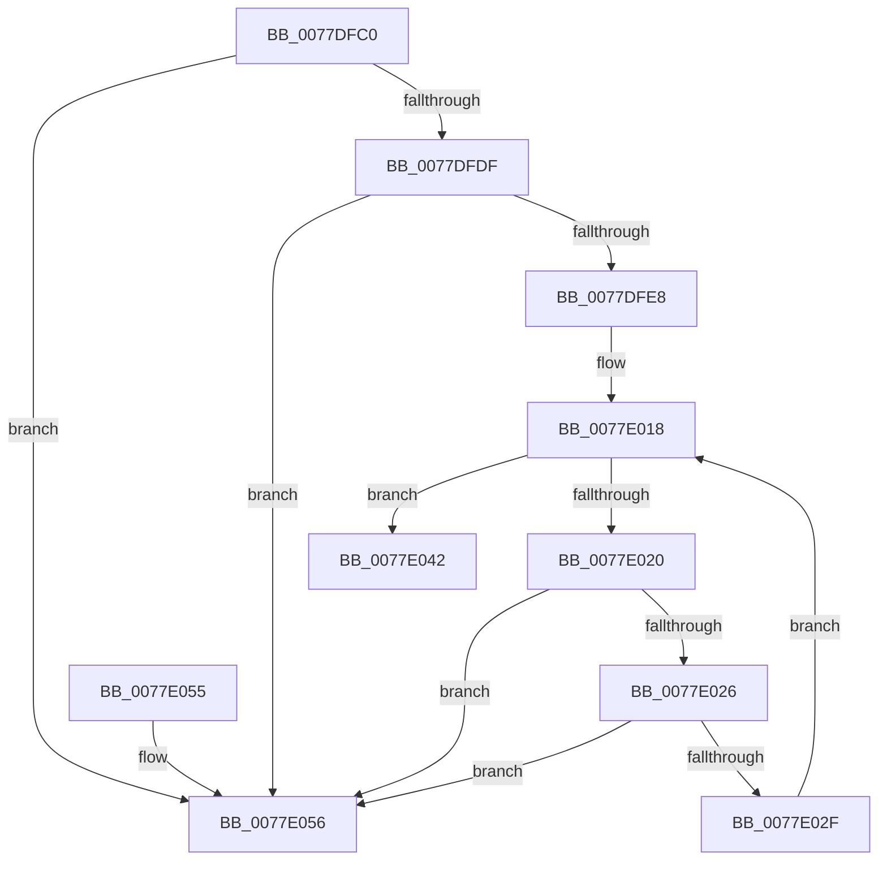

# TtmpDeleteQueue

- RVA: `0x0077DFC0`–`0x0077E05D` (길이 `157` bytes)
- VA: `0x000000014077DFC0`
- 실행 섹션: `PAGE`
- PDB 이름 있음: `예`; PDB Function 태그: `아니요`
- unwind 정보 RVA: `0x0006CF28`
- 디코드: `44`개 명령, `157/157` bytes 표시
- 미해석 바이트: `0` (있으면 어셈블리에 `.byte`로 보존)

> 이 문서는 커널 이미지의 기계어와 PDB 기호를 분석해 생성했습니다. 4번과 5번은 함수 원형과 자료형을 바이너리 사용 방식에서 추정한 C 해석이며 원본 소스 복구 결과는 아닙니다.

## 1. Dependencies

- 직접 호출 지점: **7**; 고유 호출 대상: **7**
- 직접 호출자로 확인된 함수: **0**
- RIP 상대 이미지 참조: **1**

### Outgoing calls
- `0x0077DFCD` → [TtmpAcquireSessionLock](../70/TtmpAcquireSessionLock_function_00700408.md) (function, `0x00700408`)
- `0x0077DFF6` → [ExReleaseResourceLite](../../text/25/ExReleaseResourceLite_function_0025FA10.md) (function, `0x0025FA10`)
- `0x0077DFFB` → [KeLeaveCriticalRegion](../../text/25/KeLeaveCriticalRegion_function_0025D8B0.md) (function, `0x0025D8B0`)
- `0x0077E003` → [TtmpDereferenceSessionMaybeLast](TtmpDereferenceSessionMaybeLast_function_00777898.md) (function, `0x00777898`)
- `0x0077E00C` → [ExDeleteResourceLite](../../text/38/ExDeleteResourceLite_function_0038BA60.md) (function, `0x0038BA60`)
- `0x0077E03B` → [ExFreePoolWithTag](../../poolcode/B8/ExFreePoolWithTag_function_00B82870.md) (function, `0x00B82870`)
- `0x0077E045` → [TtmiLogQueueDestroyed](TtmiLogQueueDestroyed_function_0077AAD8.md) (function, `0x0077AAD8`)

### Direct callers
- 이 함수 시작 RVA로 연결되는 직접 call은 확인되지 않았습니다. 간접 호출은 완전히 역산할 수 없습니다.

### Static image references
- `0x0077DFEB` → RVA `0x00F06940` (`.data`; read)

## 2. Other-region calls and transfers

- 다른 실행 섹션으로 향하는 call: **4**
  - `0x0077DFF6` → [ExReleaseResourceLite](../../text/25/ExReleaseResourceLite_function_0025FA10.md) (`PAGE` → `.text`)
  - `0x0077DFFB` → [KeLeaveCriticalRegion](../../text/25/KeLeaveCriticalRegion_function_0025D8B0.md) (`PAGE` → `.text`)
  - `0x0077E00C` → [ExDeleteResourceLite](../../text/38/ExDeleteResourceLite_function_0038BA60.md) (`PAGE` → `.text`)
  - `0x0077E03B` → [ExFreePoolWithTag](../../poolcode/B8/ExFreePoolWithTag_function_00B82870.md) (`PAGE` → `POOLCODE`)
- 별도 외부 분기/꼬리 이동을 확인하지 못했습니다.

## 3. Assembly (complete function range)

```asm
0077DFC0  48 89 5C 24 08                  mov qword ptr [rsp + 8], rbx
0077DFC5  57                              push rdi
0077DFC6  48 83 EC 20                     sub rsp, 0x20
0077DFCA  48 8B D9                        mov rbx, rcx
0077DFCD  E8 36 24 F8 FF                  call 0x140700408
0077DFD2  48 8B 13                        mov rdx, qword ptr [rbx]
0077DFD5  48 8B 7B 10                     mov rdi, qword ptr [rbx + 0x10]
0077DFD9  48 39 5A 08                     cmp qword ptr [rdx + 8], rbx
0077DFDD  75 77                           jne 0x14077e056
0077DFDF  48 8B 43 08                     mov rax, qword ptr [rbx + 8]
0077DFE3  48 39 18                        cmp qword ptr [rax], rbx
0077DFE6  75 6E                           jne 0x14077e056
0077DFE8  48 89 10                        mov qword ptr [rax], rdx
0077DFEB  48 8D 0D 4E 89 78 00            lea rcx, [rip + 0x78894e]
0077DFF2  48 89 42 08                     mov qword ptr [rdx + 8], rax
0077DFF6  E8 15 1A AE FF                  call 0x14025fa10
0077DFFB  E8 B0 F8 AD FF                  call 0x14025d8b0
0077E000  48 8B CF                        mov rcx, rdi
0077E003  E8 90 98 FF FF                  call 0x140777898
0077E008  48 8D 4B 18                     lea rcx, [rbx + 0x18]
0077E00C  E8 4F DA C0 FF                  call 0x14038ba60
0077E011  48 8D BB 98 00 00 00            lea rdi, [rbx + 0x98]
0077E018  48 8B 0F                        mov rcx, qword ptr [rdi]
0077E01B  48 3B CF                        cmp rcx, rdi
0077E01E  74 22                           je 0x14077e042
0077E020  48 39 79 08                     cmp qword ptr [rcx + 8], rdi
0077E024  75 30                           jne 0x14077e056
0077E026  48 8B 01                        mov rax, qword ptr [rcx]
0077E029  48 39 48 08                     cmp qword ptr [rax + 8], rcx
0077E02D  75 27                           jne 0x14077e056
0077E02F  48 89 07                        mov qword ptr [rdi], rax
0077E032  BA 54 74 6D 71                  mov edx, 0x716d7454
0077E037  48 89 78 08                     mov qword ptr [rax + 8], rdi
0077E03B  E8 30 48 40 00                  call 0x140b82870
0077E040  EB D6                           jmp 0x14077e018
0077E042  48 8B CB                        mov rcx, rbx
0077E045  E8 8E CA FF FF                  call 0x14077aad8
0077E04A  48 8B 5C 24 30                  mov rbx, qword ptr [rsp + 0x30]
0077E04F  48 83 C4 20                     add rsp, 0x20
0077E053  5F                              pop rdi
0077E054  C3                              ret
0077E055  CC                              int3
0077E056  B9 03 00 00 00                  mov ecx, 3
0077E05B  CD 29                           int 0x29
```

## 4. C-style interpretation (structured pseudocode)

```c
__int64 __fastcall TtmpDeleteQueue(__int64 a1)
{
    __int64 result;
    __int64 v_rsp;
    unsigned __int64 v_stack_p8;

    v_stack_p8 = v_rbx;
    v_rsp = (v_rsp) - (32);
    result = TtmpAcquireSessionLock(a1, a2, a3, a4);
    if ((*(unsigned __int64 *)(*(unsigned __int64 *)(a1) + 8)) != a1) goto loc_0077E056;
    if ((*(unsigned __int64 *)(*(unsigned __int64 *)(a1 + 8))) != a1) goto loc_0077E056;
    *(unsigned __int64 *)(*(unsigned __int64 *)(a1 + 8)) = *(unsigned __int64 *)(a1);
    *(unsigned __int64 *)(*(unsigned __int64 *)(a1) + 8) = *(unsigned __int64 *)(a1 + 8);
    result = ExReleaseResourceLite(v_rip + 7899470, *(unsigned __int64 *)(a1), a3, a4);
    result = KeLeaveCriticalRegion(v_rip + 7899470, *(unsigned __int64 *)(a1), a3, a4);
    result = TtmpDereferenceSessionMaybeLast(*(unsigned __int64 *)(a1 + 16), *(unsigned __int64 *)(a1), a3, a4);
    result = ExDeleteResourceLite(a1 + 24, *(unsigned __int64 *)(a1), a3, a4);
loc_0077E018:
    if ((*(unsigned __int64 *)(a1 + 152)) == (a1 + 152)) goto loc_0077E042;
    if ((*(unsigned __int64 *)(*(unsigned __int64 *)(a1 + 152) + 8)) != (a1 + 152)) goto loc_0077E056;
    if ((*(unsigned __int64 *)(*(unsigned __int64 *)(*(unsigned __int64 *)(a1 + 152)) + 8)) != (*(unsigned __int64 *)(a1 + 152))) goto loc_0077E056;
    *(unsigned __int64 *)(a1 + 152) = *(unsigned __int64 *)(*(unsigned __int64 *)(a1 + 152));
    *(unsigned __int64 *)(*(unsigned __int64 *)(*(unsigned __int64 *)(a1 + 152)) + 8) = a1 + 152;
    result = ExFreePoolWithTag(*(unsigned __int64 *)(a1 + 152), (unsigned int)(0x716D7454ULL), a3, a4);
    goto loc_0077E018;
loc_0077E042:
    result = TtmiLogQueueDestroyed(a1, (unsigned int)(0x716D7454ULL), a3, a4);
    v_rsp = (v_rsp) + (32);
    return result;
loc_0077E056:
    return result;
}
```

## 5. (Beta) C Style

```c
int64_t TtmpDeleteQueue(void *Arg1)
{
    uint8_t *arg1 = (uint8_t *)Arg1;

    int64_t result;
    int64_t local_rsp;
    uint64_t v_stack_p8;

    v_stack_p8 = local_rbx;
    local_rsp = (local_rsp) - (32);
    result = TtmpAcquireSessionLock(Arg1, a2, a3, a4);
    if ((*(uint64_t *)(*(uint64_t *)(arg1) + 0x8)) != Arg1) goto loc_0077E056;
    if ((*(uint64_t *)(*(uint64_t *)(arg1 + 0x8))) != Arg1) goto loc_0077E056;
    *(uint64_t *)(*(uint64_t *)(arg1 + 0x8)) = *(uint64_t *)(arg1);
    *(uint64_t *)(*(uint64_t *)(arg1) + 0x8) = *(uint64_t *)(arg1 + 0x8);
    result = ExReleaseResourceLite(v_rip + 7899470, *(uint64_t *)(arg1), a3, a4);
    result = KeLeaveCriticalRegion(v_rip + 7899470, *(uint64_t *)(arg1), a3, a4);
    result = TtmpDereferenceSessionMaybeLast(*(uint64_t *)(arg1 + 0x10), *(uint64_t *)(arg1), a3, a4);
    result = ExDeleteResourceLite(Arg1 + 24, *(uint64_t *)(arg1), a3, a4);
loc_0077E018:
    if ((*(uint64_t *)(arg1 + 0x98)) == (Arg1 + 152)) goto loc_0077E042;
    if ((*(uint64_t *)(*(uint64_t *)(arg1 + 0x98) + 0x8)) != (Arg1 + 152)) goto loc_0077E056;
    if ((*(uint64_t *)(*(uint64_t *)(*(uint64_t *)(arg1 + 0x98)) + 0x8)) != (*(uint64_t *)(arg1 + 0x98))) goto loc_0077E056;
    *(uint64_t *)(arg1 + 0x98) = *(uint64_t *)(*(uint64_t *)(arg1 + 0x98));
    *(void **)(*(uint64_t *)(*(uint64_t *)(arg1 + 0x98)) + 0x8) = Arg1 + 152;
    result = ExFreePoolWithTag(*(uint64_t *)(arg1 + 0x98), (uint32_t)(0x716D7454ULL), a3, a4);
    goto loc_0077E018;
loc_0077E042:
    result = TtmiLogQueueDestroyed(Arg1, (uint32_t)(0x716D7454ULL), a3, a4);
    local_rsp = (local_rsp) + (32);
    return result;
loc_0077E056:
    return result;
}
```

### 관측된 메모리 오프셋

구조체 형식이 확인되지 않은 접근은 인자 기준의 오프셋으로만 기록했습니다.

| 기준 인자 | 오프셋 표현 | 폭 (bit) | 접근 |
|---|---:|---:|---|
| `Arg1` | `+ 0x0` | `64` | `R` |
| `Arg1` | `+ 0x0` | `64` | `W` |
| `Arg1` | `+ 0x8` | `64` | `R` |
| `Arg1` | `+ 0x10` | `64` | `R` |
| `Arg1` | `+ 0x18` | `64` | `R` |
| `Arg1` | `+ 0x98` | `64` | `R` |

## 6. Execution-region graph

[열기: 2D/3D 그래프와 함수 탐색 컨트롤 패널](../../../control-panel.html?section=page&rva=0x0077DFC0&view=graph)

- 2D 그래프는 위에서 아래로 흐르고, 3D 그래프는 빈 공간을 드래그해 회전합니다. Shift+드래그는 이동, 휠은 확대·축소, 함수 노드 선택은 대상 보고서 이동입니다.

### Static fallback


