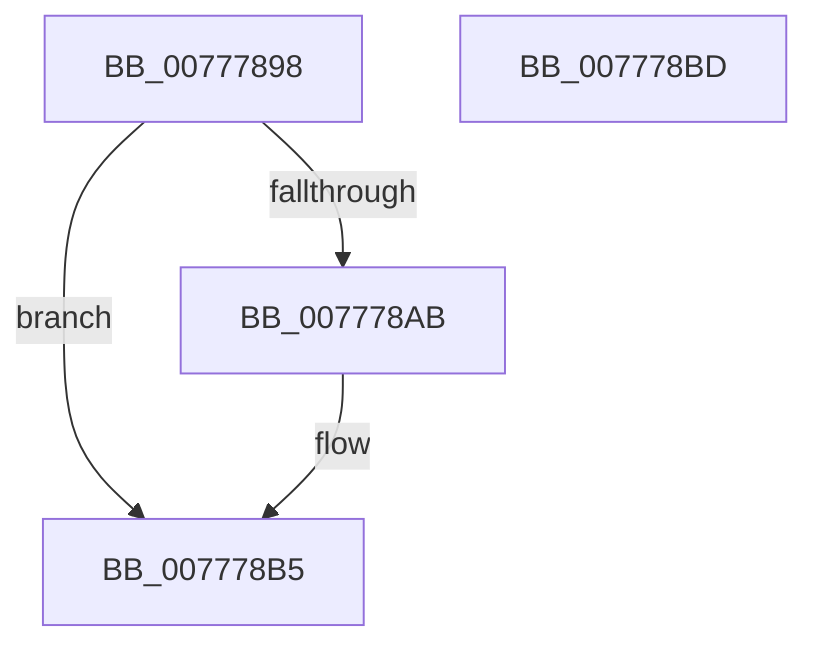

# TtmpDereferenceSessionMaybeLast

- RVA: `0x00777898`–`0x007778BE` (길이 `38` bytes)
- VA: `0x0000000140777898`
- 실행 섹션: `PAGE`
- PDB 이름 있음: `예`; PDB Function 태그: `아니요`
- unwind 정보 RVA: `0x0005CF00`
- 디코드: `13`개 명령, `38/38` bytes 표시
- 미해석 바이트: `0` (있으면 어셈블리에 `.byte`로 보존)

> 이 문서는 커널 이미지의 기계어와 PDB 기호를 분석해 생성했습니다. 4번과 5번은 함수 원형과 자료형을 바이너리 사용 방식에서 추정한 C 해석이며 원본 소스 복구 결과는 아닙니다.

## 1. Dependencies

- 직접 호출 지점: **1**; 고유 호출 대상: **1**
- 직접 호출자로 확인된 함수: **4**
- RIP 상대 이미지 참조: **0**

### Outgoing calls
- `0x007778B0` → [ExFreePoolWithTag](../../poolcode/B8/ExFreePoolWithTag_function_00B82870.md) (function, `0x00B82870`)

### Direct callers
- [TtmpSessionWorker](TtmpSessionWorker_function_00777F60.md) at `0x007780D5`
- [TtmiSessionTerminalListWorker](TtmiSessionTerminalListWorker_function_0077CE14.md) at `0x0077CF16`
- [TtmpDeleteQueue](TtmpDeleteQueue_function_0077DFC0.md) at `0x0077E003`
- [TtmCleanupCurrentSession](../AC/TtmCleanupCurrentSession_function_00AC54DC.md) at `0x00AC555A`
- [TtmCleanupCurrentSession](../AC/TtmCleanupCurrentSession_function_00AC54DC.md) at `0x00AC5594`
- [TtmCleanupCurrentSession](../AC/TtmCleanupCurrentSession_function_00AC54DC.md) at `0x00AC55B5`

### Static image references
- 디코드된 RIP-relative 메모리 참조가 없습니다.

## 2. Other-region calls and transfers

- 다른 실행 섹션으로 향하는 call: **1**
  - `0x007778B0` → [ExFreePoolWithTag](../../poolcode/B8/ExFreePoolWithTag_function_00B82870.md) (`PAGE` → `POOLCODE`)
- 별도 외부 분기/꼬리 이동을 확인하지 못했습니다.

## 3. Assembly (complete function range)

```asm
00777898  40 53                           push rbx
0077789A  48 83 EC 20                     sub rsp, 0x20
0077789E  83 CB FF                        or ebx, 0xffffffff
007778A1  F0 0F C1 59 08                  lock xadd dword ptr [rcx + 8], ebx
007778A6  83 EB 01                        sub ebx, 1
007778A9  75 0A                           jne 0x1407778b5
007778AB  BA 54 74 6D 53                  mov edx, 0x536d7454
007778B0  E8 BB AF 40 00                  call 0x140b82870
007778B5  8B C3                           mov eax, ebx
007778B7  48 83 C4 20                     add rsp, 0x20
007778BB  5B                              pop rbx
007778BC  C3                              ret
007778BD  CC                              int3
```

## 4. C-style interpretation (structured pseudocode)

```c
__int64 __fastcall TtmpDereferenceSessionMaybeLast(__int64 a1)
{
    __int64 result;
    __int64 v_rbx;
    __int64 v_rsp;

    v_rsp = (v_rsp) - (32);
    v_rbx = (unsigned int)((v_rbx) | (0xFFFFFFFFULL));
    v_rbx = (unsigned int)((v_rbx) - (1));
    if (!(condition_is_not_equal)) {
        a2 = 0x536D7454ULL;
        result = ExFreePoolWithTag(a1, a2, a3, a4);
    }
    v_rsp = (v_rsp) + (32);
    return (unsigned int)((unsigned int)(v_rbx));
}
```

## 5. (Beta) C Style

```c
int64_t TtmpDereferenceSessionMaybeLast(void *Arg1)
{
    uint8_t *arg1 = (uint8_t *)Arg1;

    int64_t result;
    int64_t local_rbx;
    int64_t local_rsp;

    local_rsp = (local_rsp) - (32);
    local_rbx = (uint32_t)((local_rbx) | (0xFFFFFFFFULL));
    local_rbx = (uint32_t)((local_rbx) - (1));
    if (!(condition_is_not_equal)) {
        a2 = 0x536D7454ULL;
        result = ExFreePoolWithTag(Arg1, a2, a3, a4);
    }
    local_rsp = (local_rsp) + (32);
    return (uint32_t)((uint32_t)(local_rbx));
}
```

### 관측된 메모리 오프셋

구조체 형식이 확인되지 않은 접근은 인자 기준의 오프셋으로만 기록했습니다.

| 기준 인자 | 오프셋 표현 | 폭 (bit) | 접근 |
|---|---:|---:|---|
| `Arg1` | `+ 0x8` | `32` | `R/W` |

## 6. Execution-region graph

[열기: 2D/3D 그래프와 함수 탐색 컨트롤 패널](../../../control-panel.html?section=page&rva=0x00777898&view=graph)

- 2D 그래프는 위에서 아래로 흐르고, 3D 그래프는 빈 공간을 드래그해 회전합니다. Shift+드래그는 이동, 휠은 확대·축소, 함수 노드 선택은 대상 보고서 이동입니다.

### Static fallback


