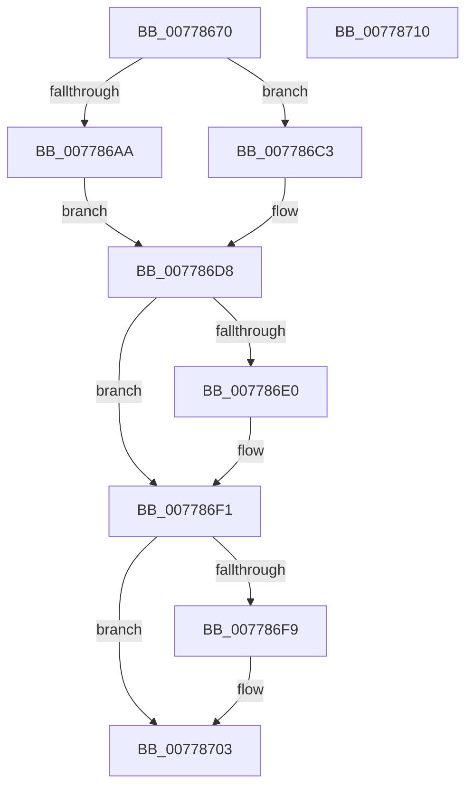

# TtmpDispatchAssignDevice

- RVA: `0x00778670`–`0x00778711` (길이 `161` bytes)
- VA: `0x0000000140778670`
- 실행 섹션: `PAGE`
- PDB 이름 있음: `예`; PDB Function 태그: `아니요`
- unwind 정보 RVA: `0x000CDC84`
- 디코드: `43`개 명령, `161/161` bytes 표시
- 미해석 바이트: `0` (있으면 어셈블리에 `.byte`로 보존)

> 이 문서는 커널 이미지의 기계어와 PDB 기호를 분석해 생성했습니다. 4번과 5번은 함수 원형과 자료형을 바이너리 사용 방식에서 추정한 C 해석이며 원본 소스 복구 결과는 아닙니다.

## 1. Dependencies

- 직접 호출 지점: **6**; 고유 호출 대상: **6**
- 직접 호출자로 확인된 함수: **1**
- RIP 상대 이미지 참조: **2**

### Outgoing calls
- `0x0077869F` → [TtmpAcquireSessionFromTerminalHandle](TtmpAcquireSessionFromTerminalHandle_function_00778544.md) (function, `0x00778544`)
- `0x007786BC` → [TtmiLogError](../98/TtmiLogError_function_0098B39C.md) (function, `0x0098B39C`)
- `0x007786D1` → [TtmiAssignDevice](TtmiAssignDevice_function_00775A3C.md) (function, `0x00775A3C`)
- `0x007786E7` → [ExReleaseResourceLite](../../text/25/ExReleaseResourceLite_function_0025FA10.md) (function, `0x0025FA10`)
- `0x007786EC` → [KeLeaveCriticalRegion](../../text/25/KeLeaveCriticalRegion_function_0025D8B0.md) (function, `0x0025D8B0`)
- `0x007786FE` → [ObfDereferenceObject](../../text/2F/ObfDereferenceObject_function_002F9350.md) (function, `0x002F9350`)

### Direct callers
- [TtmDispatchApi](../98/TtmDispatchApi_function_0098AD08.md) at `0x0098AF35`

### Static image references
- `0x007786AD` → RVA `0x00B045D0` (` ?? ::NNGAKEGL::`string'`; read)
- `0x007786E0` → RVA `0x00F06940` (`.data`; read)

## 2. Other-region calls and transfers

- 다른 실행 섹션으로 향하는 call: **3**
  - `0x007786E7` → [ExReleaseResourceLite](../../text/25/ExReleaseResourceLite_function_0025FA10.md) (`PAGE` → `.text`)
  - `0x007786EC` → [KeLeaveCriticalRegion](../../text/25/KeLeaveCriticalRegion_function_0025D8B0.md) (`PAGE` → `.text`)
  - `0x007786FE` → [ObfDereferenceObject](../../text/2F/ObfDereferenceObject_function_002F9350.md) (`PAGE` → `.text`)
- 별도 외부 분기/꼬리 이동을 확인하지 못했습니다.

## 3. Assembly (complete function range)

```asm
00778670  4C 8B DC                        mov r11, rsp
00778673  49 89 5B 18                     mov qword ptr [r11 + 0x18], rbx
00778677  55                              push rbp
00778678  48 83 EC 30                     sub rsp, 0x30
0077867C  49 83 63 10 00                  and qword ptr [r11 + 0x10], 0
00778681  49 8D 43 08                     lea rax, [r11 + 8]
00778685  49 83 63 08 00                  and qword ptr [r11 + 8], 0
0077868A  4D 8D 4B 10                     lea r9, [r11 + 0x10]
0077868E  41 B0 01                        mov r8b, 1
00778691  49 89 43 E8                     mov qword ptr [r11 - 0x18], rax
00778695  48 8B E9                        mov rbp, rcx
00778698  41 8A D0                        mov dl, r8b
0077869B  48 8B 49 08                     mov rcx, qword ptr [rcx + 8]
0077869F  E8 A0 FE FF FF                  call 0x140778544
007786A4  8B D8                           mov ebx, eax
007786A6  85 C0                           test eax, eax
007786A8  79 19                           jns 0x1407786c3
007786AA  44 8B C8                        mov r9d, eax
007786AD  48 8D 0D 1C BF 38 00            lea rcx, [rip + 0x38bf1c]
007786B4  44 8B C0                        mov r8d, eax
007786B7  BA 0B 03 00 00                  mov edx, 0x30b
007786BC  E8 DB 2C 21 00                  call 0x14098b39c
007786C1  EB 15                           jmp 0x1407786d8
007786C3  44 8B 45 10                     mov r8d, dword ptr [rbp + 0x10]
007786C7  48 8B 54 24 40                  mov rdx, qword ptr [rsp + 0x40]
007786CC  48 8B 4C 24 48                  mov rcx, qword ptr [rsp + 0x48]
007786D1  E8 66 D3 FF FF                  call 0x140775a3c
007786D6  8B D8                           mov ebx, eax
007786D8  48 83 7C 24 48 00               cmp qword ptr [rsp + 0x48], 0
007786DE  74 11                           je 0x1407786f1
007786E0  48 8D 0D 59 E2 78 00            lea rcx, [rip + 0x78e259]
007786E7  E8 24 73 AE FF                  call 0x14025fa10
007786EC  E8 BF 51 AE FF                  call 0x14025d8b0
007786F1  48 83 7C 24 40 00               cmp qword ptr [rsp + 0x40], 0
007786F7  74 0A                           je 0x140778703
007786F9  48 8B 4C 24 40                  mov rcx, qword ptr [rsp + 0x40]
007786FE  E8 4D 0C B8 FF                  call 0x1402f9350
00778703  8B C3                           mov eax, ebx
00778705  48 8B 5C 24 50                  mov rbx, qword ptr [rsp + 0x50]
0077870A  48 83 C4 30                     add rsp, 0x30
0077870E  5D                              pop rbp
0077870F  C3                              ret
00778710  CC                              int3
```

## 4. C-style interpretation (structured pseudocode)

```c
__int64 __fastcall TtmpDispatchAssignDevice(__int64 a1)
{
    __int64 result;
    __int64 v_rsp;
    unsigned __int64 v_stack_p10;
    unsigned __int64 v_stack_p18;
    unsigned __int64 v_stack_p8;

    *(unsigned __int64 *)(v_rsp + 24) = v_rbx;
    v_rsp = (v_rsp) - (48);
    *(unsigned __int64 *)(v_rsp - 24) = v_rsp + 8;
    result = TtmpAcquireSessionFromTerminalHandle(*(unsigned __int64 *)(a1 + 8), 1, 1, v_rsp + 16);
    if (!sign_flag) goto loc_007786C3;
    result = TtmiLogError(v_rip + 3718940, 779, (unsigned int)((unsigned int)(result)), (unsigned int)((unsigned int)(result)));
    goto loc_007786D8;
loc_007786C3:
    result = TtmiAssignDevice(v_stack_p10, v_stack_p8, (unsigned int)(*(unsigned int *)(a1 + 16)), (unsigned int)((unsigned int)(result)));
loc_007786D8:
    if (v_stack_p10 != 0) {
        a1 = v_rip + 7922265;
        result = ExReleaseResourceLite(a1, v_stack_p8, (unsigned int)(*(unsigned int *)(a1 + 16)), (unsigned int)((unsigned int)(result)));
        result = KeLeaveCriticalRegion(a1, v_stack_p8, (unsigned int)(*(unsigned int *)(a1 + 16)), (unsigned int)((unsigned int)(result)));
    }
    if (v_stack_p8 != 0) {
        a1 = v_stack_p8;
        result = ObfDereferenceObject(a1, v_stack_p8, (unsigned int)(*(unsigned int *)(a1 + 16)), (unsigned int)((unsigned int)(result)));
    }
    v_rsp = (v_rsp) + (48);
    return (unsigned int)((unsigned int)((unsigned int)((unsigned int)(result))));
}
```

## 5. (Beta) C Style

```c
int64_t TtmpDispatchAssignDevice(void *Arg1)
{
    uint8_t *arg1 = (uint8_t *)Arg1;

    int64_t result;
    int64_t local_rsp;
    uint64_t v_stack_p10;
    uint64_t v_stack_p18;
    uint64_t v_stack_p8;

    *(uint64_t *)(local_rsp + 0x18) = local_rbx;
    local_rsp = (local_rsp) - (48);
    *(uint64_t *)(local_rsp - 0x18) = local_rsp + 8;
    result = TtmpAcquireSessionFromTerminalHandle(*(uint64_t *)(arg1 + 0x8), 1, 1, local_rsp + 16);
    if (!sign_flag) goto loc_007786C3;
    result = TtmiLogError(v_rip + 3718940, 779, (uint32_t)((uint32_t)(result)), (uint32_t)((uint32_t)(result)));
    goto loc_007786D8;
loc_007786C3:
    result = TtmiAssignDevice(v_stack_p10, v_stack_p8, (uint32_t)(*(uint32_t *)(arg1 + 0x10)), (uint32_t)((uint32_t)(result)));
loc_007786D8:
    if (v_stack_p10 != 0) {
        Arg1 = v_rip + 7922265;
        result = ExReleaseResourceLite(Arg1, v_stack_p8, (uint32_t)(*(uint32_t *)(arg1 + 0x10)), (uint32_t)((uint32_t)(result)));
        result = KeLeaveCriticalRegion(Arg1, v_stack_p8, (uint32_t)(*(uint32_t *)(arg1 + 0x10)), (uint32_t)((uint32_t)(result)));
    }
    if (v_stack_p8 != 0) {
        Arg1 = v_stack_p8;
        result = ObfDereferenceObject(Arg1, v_stack_p8, (uint32_t)(*(uint32_t *)(arg1 + 0x10)), (uint32_t)((uint32_t)(result)));
    }
    local_rsp = (local_rsp) + (48);
    return (uint32_t)((uint32_t)((uint32_t)((uint32_t)(result))));
}
```

### 관측된 메모리 오프셋

구조체 형식이 확인되지 않은 접근은 인자 기준의 오프셋으로만 기록했습니다.

| 기준 인자 | 오프셋 표현 | 폭 (bit) | 접근 |
|---|---:|---:|---|
| `Arg1` | `+ 0x8` | `64` | `R` |
| `Arg1` | `+ 0x10` | `32` | `R` |

## 6. Execution-region graph

[열기: 2D/3D 그래프와 함수 탐색 컨트롤 패널](../../../control-panel.html?section=page&rva=0x00778670&view=graph)

- 2D 그래프는 위에서 아래로 흐르고, 3D 그래프는 빈 공간을 드래그해 회전합니다. Shift+드래그는 이동, 휠은 확대·축소, 함수 노드 선택은 대상 보고서 이동입니다.

### Static fallback


