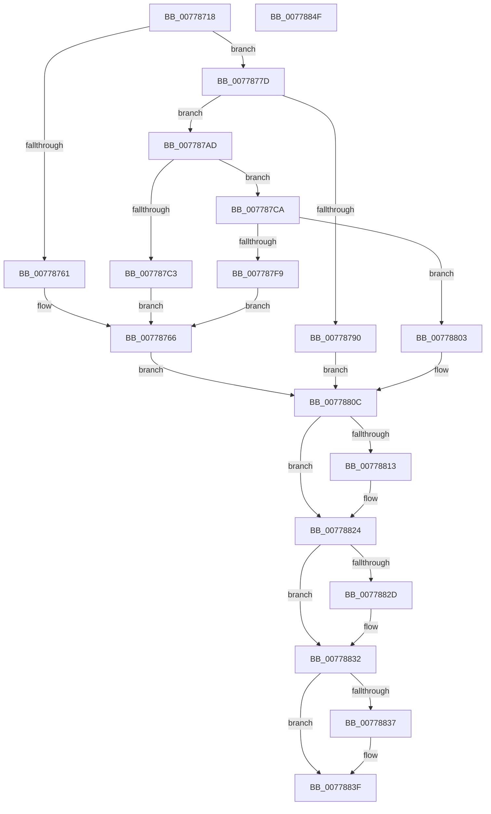

# TtmpDispatchCreateEventQueue

- RVA: `0x00778718`–`0x00778850` (길이 `312` bytes)
- VA: `0x0000000140778718`
- 실행 섹션: `PAGE`
- PDB 이름 있음: `예`; PDB Function 태그: `아니요`
- unwind 정보 RVA: `0x000CDCC8`
- 디코드: `89`개 명령, `312/312` bytes 표시
- 미해석 바이트: `0` (있으면 어셈블리에 `.byte`로 보존)

> 이 문서는 커널 이미지의 기계어와 PDB 기호를 분석해 생성했습니다. 4번과 5번은 함수 원형과 자료형을 바이너리 사용 방식에서 추정한 C 해석이며 원본 소스 복구 결과는 아닙니다.

## 1. Dependencies

- 직접 호출 지점: **10**; 고유 호출 대상: **8**
- 직접 호출자로 확인된 함수: **1**
- RIP 상대 이미지 참조: **2**

### Outgoing calls
- `0x00778756` → [TtmpAcquireSessionFromTerminalHandle](TtmpAcquireSessionFromTerminalHandle_function_00778544.md) (function, `0x00778544`)
- `0x00778773` → [TtmiLogError](../98/TtmiLogError_function_0098B39C.md) (function, `0x0098B39C`)
- `0x00778785` → [TtmiCreateEventQueue](TtmiCreateEventQueue_function_0077DA14.md) (function, `0x0077DA14`)
- `0x007787A2` → [TtmiLogError](../98/TtmiLogError_function_0098B39C.md) (function, `0x0098B39C`)
- `0x007787B8` → [TtmiWriteEnumerationEventsToQueue](TtmiWriteEnumerationEventsToQueue_function_00777510.md) (function, `0x00777510`)
- `0x007787EC` → [ObInsertObjectEx](../8B/ObInsertObjectEx_function_008B97A0.md) (function, `0x008B97A0`)
- `0x0077881A` → [ExReleaseResourceLite](../../text/25/ExReleaseResourceLite_function_0025FA10.md) (function, `0x0025FA10`)
- `0x0077881F` → [KeLeaveCriticalRegion](../../text/25/KeLeaveCriticalRegion_function_0025D8B0.md) (function, `0x0025D8B0`)
- `0x0077882D` → [ObfDereferenceObject](../../text/2F/ObfDereferenceObject_function_002F9350.md) (function, `0x002F9350`)
- `0x0077883A` → [ObfDereferenceObject](../../text/2F/ObfDereferenceObject_function_002F9350.md) (function, `0x002F9350`)

### Direct callers
- [TtmDispatchApi](../98/TtmDispatchApi_function_0098AD08.md) at `0x0098AE8F`

### Static image references
- `0x00778769` → RVA `0x00B04580` (` ?? ::NNGAKEGL::`string'`; read)
- `0x00778813` → RVA `0x00F06940` (`.data`; read)

## 2. Other-region calls and transfers

- 다른 실행 섹션으로 향하는 call: **4**
  - `0x0077881A` → [ExReleaseResourceLite](../../text/25/ExReleaseResourceLite_function_0025FA10.md) (`PAGE` → `.text`)
  - `0x0077881F` → [KeLeaveCriticalRegion](../../text/25/KeLeaveCriticalRegion_function_0025D8B0.md) (`PAGE` → `.text`)
  - `0x0077882D` → [ObfDereferenceObject](../../text/2F/ObfDereferenceObject_function_002F9350.md) (`PAGE` → `.text`)
  - `0x0077883A` → [ObfDereferenceObject](../../text/2F/ObfDereferenceObject_function_002F9350.md) (`PAGE` → `.text`)
- 별도 외부 분기/꼬리 이동을 확인하지 못했습니다.

## 3. Assembly (complete function range)

```asm
00778718  48 89 5C 24 10                  mov qword ptr [rsp + 0x10], rbx
0077871D  55                              push rbp
0077871E  57                              push rdi
0077871F  41 56                           push r14
00778721  48 8B EC                        mov rbp, rsp
00778724  48 83 EC 50                     sub rsp, 0x50
00778728  48 8B 49 08                     mov rcx, qword ptr [rcx + 8]
0077872C  48 8D 45 F0                     lea rax, [rbp - 0x10]
00778730  48 83 65 20 00                  and qword ptr [rbp + 0x20], 0
00778735  4C 8D 4D 20                     lea r9, [rbp + 0x20]
00778739  48 83 65 38 00                  and qword ptr [rbp + 0x38], 0
0077873E  4C 8B F2                        mov r14, rdx
00778741  48 83 65 F0 00                  and qword ptr [rbp - 0x10], 0
00778746  33 FF                           xor edi, edi
00778748  B2 01                           mov dl, 1
0077874A  48 89 7D 30                     mov qword ptr [rbp + 0x30], rdi
0077874E  45 33 C0                        xor r8d, r8d
00778751  48 89 44 24 20                  mov qword ptr [rsp + 0x20], rax
00778756  E8 E9 FD FF FF                  call 0x140778544
0077875B  8B D8                           mov ebx, eax
0077875D  85 C0                           test eax, eax
0077875F  79 1C                           jns 0x14077877d
00778761  BA 32 01 00 00                  mov edx, 0x132
00778766  44 8B C8                        mov r9d, eax
00778769  48 8D 0D 10 BE 38 00            lea rcx, [rip + 0x38be10]
00778770  44 8B C0                        mov r8d, eax
00778773  E8 24 2C 21 00                  call 0x14098b39c
00778778  E9 8F 00 00 00                  jmp 0x14077880c
0077877D  48 8B 4D 20                     mov rcx, qword ptr [rbp + 0x20]
00778781  48 8D 55 30                     lea rdx, [rbp + 0x30]
00778785  E8 8A 52 00 00                  call 0x14077da14
0077878A  8B D8                           mov ebx, eax
0077878C  85 C0                           test eax, eax
0077878E  79 1D                           jns 0x1407787ad
00778790  44 8B C8                        mov r9d, eax
00778793  48 8D 0D E6 BD 38 00            lea rcx, [rip + 0x38bde6]
0077879A  44 8B C0                        mov r8d, eax
0077879D  BA 38 01 00 00                  mov edx, 0x138
007787A2  E8 F5 2B 21 00                  call 0x14098b39c
007787A7  48 8B 7D 30                     mov rdi, qword ptr [rbp + 0x30]
007787AB  EB 5F                           jmp 0x14077880c
007787AD  48 8B 7D 30                     mov rdi, qword ptr [rbp + 0x30]
007787B1  48 8B 4D 20                     mov rcx, qword ptr [rbp + 0x20]
007787B5  48 8B D7                        mov rdx, rdi
007787B8  E8 53 ED FF FF                  call 0x140777510
007787BD  8B D8                           mov ebx, eax
007787BF  85 C0                           test eax, eax
007787C1  79 07                           jns 0x1407787ca
007787C3  BA 42 01 00 00                  mov edx, 0x142
007787C8  EB 9C                           jmp 0x140778766
007787CA  48 8D 45 38                     lea rax, [rbp + 0x38]
007787CE  45 33 C9                        xor r9d, r9d
007787D1  48 89 44 24 30                  mov qword ptr [rsp + 0x30], rax
007787D6  33 D2                           xor edx, edx
007787D8  48 83 64 24 28 00               and qword ptr [rsp + 0x28], 0
007787DE  41 B8 00 00 1F 00               mov r8d, 0x1f0000
007787E4  83 64 24 20 00                  and dword ptr [rsp + 0x20], 0
007787E9  48 8B CF                        mov rcx, rdi
007787EC  E8 AF 0F 14 00                  call 0x1408b97a0
007787F1  33 FF                           xor edi, edi
007787F3  8B D8                           mov ebx, eax
007787F5  85 C0                           test eax, eax
007787F7  79 0A                           jns 0x140778803
007787F9  BA 54 01 00 00                  mov edx, 0x154
007787FE  E9 63 FF FF FF                  jmp 0x140778766
00778803  48 8B 45 38                     mov rax, qword ptr [rbp + 0x38]
00778807  33 DB                           xor ebx, ebx
00778809  49 89 06                        mov qword ptr [r14], rax
0077880C  48 83 7D 20 00                  cmp qword ptr [rbp + 0x20], 0
00778811  74 11                           je 0x140778824
00778813  48 8D 0D 26 E1 78 00            lea rcx, [rip + 0x78e126]
0077881A  E8 F1 71 AE FF                  call 0x14025fa10
0077881F  E8 8C 50 AE FF                  call 0x14025d8b0
00778824  48 8B 4D F0                     mov rcx, qword ptr [rbp - 0x10]
00778828  48 85 C9                        test rcx, rcx
0077882B  74 05                           je 0x140778832
0077882D  E8 1E 0B B8 FF                  call 0x1402f9350
00778832  48 85 FF                        test rdi, rdi
00778835  74 08                           je 0x14077883f
00778837  48 8B CF                        mov rcx, rdi
0077883A  E8 11 0B B8 FF                  call 0x1402f9350
0077883F  8B C3                           mov eax, ebx
00778841  48 8B 5C 24 78                  mov rbx, qword ptr [rsp + 0x78]
00778846  48 83 C4 50                     add rsp, 0x50
0077884A  41 5E                           pop r14
0077884C  5F                              pop rdi
0077884D  5D                              pop rbp
0077884E  C3                              ret
0077884F  CC                              int3
```

## 4. C-style interpretation (structured pseudocode)

```c
__int64 __fastcall TtmpDispatchCreateEventQueue(__int64 a1, __int64 a2, int a3)
{
    __int64 result;
    __int64 v_rbx;
    __int64 v_rdi;
    __int64 v_rsp;
    unsigned __int64 v_stack_m28;
    unsigned __int64 v_stack_m38;
    unsigned __int64 v_stack_m40;
    unsigned __int64 v_stack_m48;
    unsigned __int64 v_stack_p10;
    unsigned __int64 v_stack_p18;
    unsigned __int64 v_stack_p20;
    unsigned __int64 v_stack_p8;

    v_stack_p10 = v_rbx;
    v_rsp = (v_rsp) - (80);
    v_rdi = 0;
    v_stack_p18 = 0;
    a3 = 0;
    v_stack_m48 = v_stack_m28;
    result = TtmpAcquireSessionFromTerminalHandle(*(unsigned __int64 *)(a1 + 8), 1, a3, v_stack_p8);
    if (!sign_flag) goto loc_0077877D;
loc_00778766:
    result = TtmiLogError(v_rip + 3718672, 306, (unsigned int)((unsigned int)(result)), (unsigned int)((unsigned int)(result)));
    goto loc_0077880C;
loc_0077877D:
    result = TtmiCreateEventQueue(v_stack_p8, v_stack_p18, (unsigned int)((unsigned int)(result)), (unsigned int)((unsigned int)(result)));
    if (!sign_flag) goto loc_007787AD;
    result = TtmiLogError(v_rip + 3718630, 312, (unsigned int)((unsigned int)(result)), (unsigned int)((unsigned int)(result)));
    goto loc_0077880C;
loc_007787AD:
    result = TtmiWriteEnumerationEventsToQueue(v_stack_p8, v_stack_p18, (unsigned int)((unsigned int)(result)), (unsigned int)((unsigned int)(result)));
    if (!sign_flag) goto loc_007787CA;
    goto loc_00778766;
loc_007787CA:
    a4 = 0;
    v_stack_m38 = v_stack_p20;
    a2 = 0;
    result = ObInsertObjectEx(v_stack_p18, a2, (unsigned int)(0x1F0000ULL), a4);
    v_rdi = 0;
    if (!sign_flag) goto loc_00778803;
    goto loc_00778766;
loc_00778803:
    v_rbx = 0;
    *(unsigned __int64 *)(a2) = v_stack_p20;
loc_0077880C:
    result = v_stack_p20;
    if (v_stack_p8 != 0) {
        a1 = v_rip + 7921958;
        result = ExReleaseResourceLite(a1, 340, (unsigned int)(0x1F0000ULL), a4);
        result = KeLeaveCriticalRegion(a1, 340, (unsigned int)(0x1F0000ULL), a4);
    }
    if (v_stack_m28 != 0) {
        result = ObfDereferenceObject(v_stack_m28, 340, (unsigned int)(0x1F0000ULL), a4);
    }
    if (0 != 0) {
        a1 = 0;
        result = ObfDereferenceObject(a1, 340, (unsigned int)(0x1F0000ULL), a4);
    }
    v_rsp = (v_rsp) + (80);
    return 0;
}
```

## 5. (Beta) C Style

```c
int64_t TtmpDispatchCreateEventQueue(void *Arg1, void *Arg2, int32_t Arg3)
{
    uint8_t *arg1 = (uint8_t *)Arg1;
    uint8_t *arg2 = (uint8_t *)Arg2;

    int64_t result;
    int64_t local_rbx;
    int64_t local_rdi;
    int64_t local_rsp;
    uint64_t v_stack_m28;
    uint64_t v_stack_m38;
    uint64_t v_stack_m40;
    uint64_t v_stack_m48;
    uint64_t v_stack_p10;
    uint64_t v_stack_p18;
    uint64_t v_stack_p20;
    uint64_t v_stack_p8;

    v_stack_p10 = local_rbx;
    local_rsp = (local_rsp) - (80);
    local_rdi = 0;
    v_stack_p18 = 0;
    Arg3 = 0;
    v_stack_m48 = v_stack_m28;
    result = TtmpAcquireSessionFromTerminalHandle(*(uint64_t *)(arg1 + 0x8), 1, Arg3, v_stack_p8);
    if (!sign_flag) goto loc_0077877D;
loc_00778766:
    result = TtmiLogError(v_rip + 3718672, 306, (uint32_t)((uint32_t)(result)), (uint32_t)((uint32_t)(result)));
    goto loc_0077880C;
loc_0077877D:
    result = TtmiCreateEventQueue(v_stack_p8, v_stack_p18, (uint32_t)((uint32_t)(result)), (uint32_t)((uint32_t)(result)));
    if (!sign_flag) goto loc_007787AD;
    result = TtmiLogError(v_rip + 3718630, 312, (uint32_t)((uint32_t)(result)), (uint32_t)((uint32_t)(result)));
    goto loc_0077880C;
loc_007787AD:
    result = TtmiWriteEnumerationEventsToQueue(v_stack_p8, v_stack_p18, (uint32_t)((uint32_t)(result)), (uint32_t)((uint32_t)(result)));
    if (!sign_flag) goto loc_007787CA;
    goto loc_00778766;
loc_007787CA:
    a4 = 0;
    v_stack_m38 = v_stack_p20;
    Arg2 = 0;
    result = ObInsertObjectEx(v_stack_p18, Arg2, (uint32_t)(0x1F0000ULL), a4);
    local_rdi = 0;
    if (!sign_flag) goto loc_00778803;
    goto loc_00778766;
loc_00778803:
    local_rbx = 0;
    *(uint64_t *)(arg2) = v_stack_p20;
loc_0077880C:
    result = v_stack_p20;
    if (v_stack_p8 != 0) {
        Arg1 = v_rip + 7921958;
        result = ExReleaseResourceLite(Arg1, 340, (uint32_t)(0x1F0000ULL), a4);
        result = KeLeaveCriticalRegion(Arg1, 340, (uint32_t)(0x1F0000ULL), a4);
    }
    if (v_stack_m28 != 0) {
        result = ObfDereferenceObject(v_stack_m28, 340, (uint32_t)(0x1F0000ULL), a4);
    }
    if (0 != 0) {
        Arg1 = 0;
        result = ObfDereferenceObject(Arg1, 340, (uint32_t)(0x1F0000ULL), a4);
    }
    local_rsp = (local_rsp) + (80);
    return 0;
}
```

### 관측된 메모리 오프셋

구조체 형식이 확인되지 않은 접근은 인자 기준의 오프셋으로만 기록했습니다.

| 기준 인자 | 오프셋 표현 | 폭 (bit) | 접근 |
|---|---:|---:|---|
| `Arg1` | `+ 0x8` | `64` | `R` |
| `Arg2` | `+ 0x0` | `64` | `W` |

## 6. Execution-region graph

[열기: 2D/3D 그래프와 함수 탐색 컨트롤 패널](../../../control-panel.html?section=page&rva=0x00778718&view=graph)

- 2D 그래프는 위에서 아래로 흐르고, 3D 그래프는 빈 공간을 드래그해 회전합니다. Shift+드래그는 이동, 휠은 확대·축소, 함수 노드 선택은 대상 보고서 이동입니다.

### Static fallback


